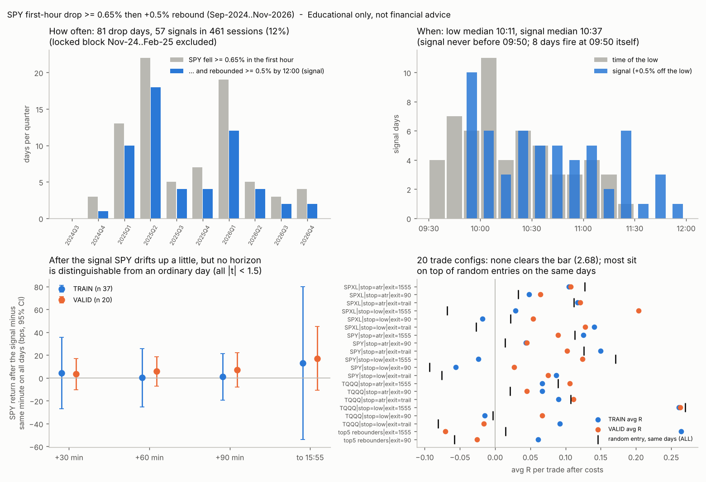

# Drop-and-rebound study (owner idea 2026-11-16)

*Educational only — not financial advice. Research only: no config, setup or live change.*

Owner: "do a scan of the S&P dropping 0.65% or more within the first hour of open, and if after that drop it then rises
back up (after the bottom) 0.5% or so or more, let's create a setup off of that."

Data: SPY / QQQ / SPXL / TQQQ 1-minute RTH bars, 461 full sessions 2024-09-16 .. 2026-11-13 (cache to 11-04, later
sessions fetched read-only); 1,220 lab-universe stocks for the stock variant (cache sessions only). Locked block
2024-11-01..2025-02-28 never read. TRAIN = 242 sessions to 2025-12-31, VALID = 219 sessions of 2026.
No decision before 09:50 (owner 2026-11-14). Costs in everywhere a trade is scored (1c + 1 bp per side, +2c on a stop
fill, as in research/morning_low_1116).

## Plain-English summary

**How often.** SPY falls 0.65% or more from its running high inside the first hour on 81 of 461 days (18%), and on 57
of those (12% of all days, 70% of drop days) it then closes 0.5% or more above the low by 12:00 — about 2 signals a
month on average, but very bunched: 15 of the 57 are April 2025 (tariff month) and 2025 Q1-Q2 + 2026 Q1 hold 40. TRAIN
15% of days, VALID 9%. Measured from the 09:30 open instead of the running high: 42 drop days, 31 signals (7%).
**Timing.** Median low 10:11 (one in three lows after 10:30, i.e. the drop keeps going after the first hour), median
signal 10:37; 8 days had rebounded before 09:50 and fire at 09:50.

**What SPY/QQQ do after the signal.** A little up, but nothing you can tell apart from an ordinary day at the same
minute: SPY +4 bps at +30 min, +3 at +90, +15 to 15:55 above the same-minute average (all |t| < 1.5, TRAIN and VALID
both slightly positive). QQQ the same, slightly larger (+23 bps to 15:55, t 0.9).

**The setup.** 20 pre-declared trade configs (SPXL / TQQQ / SPY x stop under the low or 1x daily ATR x exit 15:55 /
90 min / 1R trail, + long the 5 strongest-rebounding liquid stocks at the signal, 15:55 or 90 min). Best results:
SPXL with an ATR stop and trail +0.12 R (TRAIN +0.12, VALID +0.12), TQQQ stop-under-the-low to 15:55 +0.26 R
(+0.26 / +0.26, w/o best day +0.11), TQQQ ATR stop 90 min +0.06 R (t 1.51, the highest t). Many configs are positive
in both halves after costs — but **none clears the bar (2.68 at N = 36) and the best t is 1.51**, and the decisive
check fails: **random entries between 09:50 and 12:00 on the same days earn about the same** (TQQQ to 15:55: signal
+0.26 R vs random +0.27 R; SPXL ATR to 15:55 +0.11 vs +0.13). The rebound trigger itself adds nothing measurable;
what little there is comes from "being long on a big-drop morning" (also not significant). The stock variant is
+0.26 R in TRAIN and -0.07 R in VALID — fails.

**Verdict: no Testing candidate, no DECISION.** Nothing passes the pre-stated rule (positive in TRAIN and VALID after
costs, w/o best day > 0, and clears the bar or is clearly best). Honest optimistic note: the family is not negative —
long leveraged index after a big first-hour drop is mildly positive in both halves with an ATR-sized stop, and it is
not just April 2025 (ex-April 2025 the SPXL ATR configs are +0.09..+0.14 R). It overlaps the existing
`index_dip_bounce` family (dip >= 0.75% from the open by 09:45, trigger 09:50-10:05) rather than adding a new edge.

**The two recent days.** 11-16 fired at 10:56 (low $743.31 on the 10:26 bar, first-hour drop 0.87% from the 09:31
high). 11-13 was a near miss: the 1.6% drop qualified, but the best close after the 10:21 low by 12:00 was +0.48%
(+0.52% on bar highs), short of +0.5% on closes.

## Definitions (pre-declared before any result was seen)

- Drop (primary, "from_runhigh"): some bar starting 09:30-10:29 has a low >= 0.65% below the highest high since 09:30
  (inclusive). Comparison ("from_open"): low >= 0.65% below the 09:30 open.
- Bottom: the lowest low from the bar of that running high up to the decision bar (it may be after 10:30).
- Signal: first bar close from 09:50 to 12:00 that is >= 0.5% above the bottom (bar closes only). Entry at that close.
- Forward returns: SPY / QQQ from the signal close to +30 / +60 / +90 min and 15:55; null = the same minute on all
  461 days (excess and t against it).
- Trades (primary definition only): instruments SPXL, TQQQ, SPY (reference); stops "low" = the traded instrument's own
  low since 09:30 minus 5 bp, "atr" = entry - 1 x daily ATR(14) (14 prior sessions within 30 calendar days, so 10 days
  after the locked block / at the start have no ATR); exits 15:55, +90 min, "trail" = 1R chandelier off the highest high
  since entry (updated after each bar), backstop 15:55. Stock variant: names with >= $30M traded 09:30..signal, top 5 by
  close / own low since 09:30, stop 5 bp under the own low, equal-weight R per day.
- Random-entry controls: same day, same instrument / stop / exit rule, 20 random decision bars 09:50-12:00 (stocks: 5
  random liquid names at the signal minute, 20 draws).

## Results tables

Frequency (`summary.json`, per-day `scan_days.csv`, signals `signal_days.csv`):

| definition | split | sessions | drop days | signals | signals / day | signals / drop | fire at 09:50 | low after 10:30 | median low | median signal |
|---|---|---|---|---|---|---|---|---|---|---|
| from running high | TRAIN | 242 | 50 | 37 | 15.3% | 74% | 7 | 12 | 10:01 | 10:28 |
| | VALID | 219 | 31 | 20 | 9.1% | 65% | 1 | 7 | 10:16 | 10:53 |
| | ALL | 461 | 81 | 57 | 12.4% | 70% | 8 | 19 | 10:11 | 10:37 |
| from 09:30 open | ALL | 461 | 42 | 31 | 6.7% | 74% | 4 | 12 | 10:22 | 10:53 |

Forward index returns after the signal (primary definition; excess over the same minute on all days, bps; `fwd_cells.csv`):

| | +30 | +60 | +90 | to 15:55 |
|---|---|---|---|---|
| SPY ALL (n 57) | +4.1 (t 0.38) | +2.0 (0.26) | +2.8 (0.38) | +14.9 (0.66) |
| SPY TRAIN / VALID | +4.3 / +3.3 | +0.1 / +5.7 | +1.0 / +7.1 | +13.0 / +17.1 |
| QQQ ALL | +5.6 (0.44) | +5.3 (0.58) | +6.1 (0.69) | +23.2 (0.89) |
| QQQ TRAIN / VALID | +5.7 / +4.5 | +3.5 / +8.9 | +4.1 / +11.5 | +20.5 / +26.8 |

From the open: SPY to 15:55 -16 bps (TRAIN -35, VALID +12) — the two definitions disagree late in the day.

Trade grid, avg R after costs (`trade_grid.csv`, `trade_grid_stocks.csv`, per trade `trades_etf.csv` / `trades_stocks.csv`):

| config | n | TRAIN | VALID | ALL | t | w/o best day | best-day share | worst | random same days | median risk |
|---|---|---|---|---|---|---|---|---|---|---|
| SPXL atr 15:55 | 47 | +0.105 | +0.107 | +0.106 | 1.13 | +0.058 | 46% | -1.01 | +0.127 | 4.3% |
| SPXL atr 90 | 47 | +0.048 | +0.064 | +0.055 | 1.18 | +0.042 | 26% | -1.01 | +0.033 | 4.3% |
| SPXL atr trail | 47 | +0.117 | +0.121 | +0.119 | 1.28 | +0.072 | 41% | -0.96 | +0.112 | 4.3% |
| SPXL low 15:55 | 57 | +0.029 | +0.204 | +0.091 | 0.53 | +0.025 | 73% (1 day) | -1.03 | -0.068 | 1.6% |
| SPXL low 90 | 57 | -0.018 | +0.054 | +0.008 | 0.07 | -0.022 | — | -1.03 | +0.022 | 1.6% |
| SPXL low trail | 57 | +0.141 | +0.128 | +0.136 | 0.92 | +0.053 | 62% (1 day) | -1.03 | -0.027 | 1.6% |
| TQQQ atr 15:55 | 47 | +0.067 | +0.106 | +0.083 | 0.92 | +0.036 | 58% (1 day) | -1.03 | +0.089 | 6.3% |
| TQQQ atr 90 | 47 | +0.067 | +0.045 | +0.058 | 1.51 | +0.045 | 24% | -0.74 | +0.021 | 6.3% |
| TQQQ atr trail | 47 | +0.090 | +0.111 | +0.099 | 1.12 | +0.052 | 49% | -0.96 | +0.107 | 6.3% |
| TQQQ low 15:55 | 57 | +0.261 | +0.263 | +0.262 | 1.20 | +0.114 | 57% (1 day) | -1.10 | +0.270 | 2.2% |
| TQQQ low 90 | 57 | -0.015 | +0.067 | +0.014 | 0.14 | -0.016 | — | -1.09 | -0.003 | 2.2% |
| TQQQ low trail | 57 | +0.092 | -0.016 | +0.054 | 0.39 | -0.030 | — | -1.05 | -0.081 | 2.2% |
| SPY atr 15:55 / 90 / trail (ref) | 47 | +0.13 / +0.04 / +0.15 | +0.09 / +0.05 / +0.10 | +0.11 / +0.05 / +0.13 | ≤ 1.26 | | | | +0.11 / +0.01 / +0.13 | 1.4% |
| SPY low 15:55 / 90 / trail (ref) | 57 | -0.02 / -0.06 / +0.09 | +0.12 / +0.03 / +0.08 | +0.03 / -0.03 / +0.08 | ≤ 0.59 | | | | +0.17 / -0.09 / -0.08 | 0.6% |
| top-5 rebounding stocks 15:55 | 56 | +0.264 | -0.071 | +0.150 | 1.46 | +0.075 | 51% (1 day) | -1.02 | +0.015 | |
| top-5 rebounding stocks 90 | 56 | +0.061 | -0.026 | +0.031 | 0.67 | +0.009 | 72% (1 day) | -0.59 | -0.058 | |

April 2025 holds 15 of the 57 signals. Without it: SPXL atr 15:55 / 90 / trail +0.135 / +0.090 / +0.131 R, TQQQ low
15:55 +0.180 R, SPXL low trail +0.105 R — the sign survives, the strength does not change the verdict.
Worst single day ≈ -1.0 to -1.1 R in every config (a clean stop); the ATR stop is wide (4-6% of the 3x ETF price), so
its R values are small and stops are rare (0-17%).

## Try count and bar

Forward cells: 2 definitions x 2 symbols x 4 horizons = 16. Trades: 3 instruments x 2 stops x 3 exits = 18, + 2 stock
variants = 20. N = 36, bar = max(1.5, sqrt(2 ln 36)) = **2.68**. Best t = 1.51 (TQQQ atr 90 min). Nothing clears it.
Random controls and the from-open trades were not scored for the bar (controls are not configs; from-open was scan-only).

## Rule-change context

An index timing study on raw bars; no `research/ledger.jsonl` change (sizing, stops, filters, moves) alters these numbers.
The 09:50 earliest decision is the owner's 2026-11-14 rule. The existing `index_dip_bounce` setups (dip from the open by
09:45, trigger 09:50-10:05) are the nearest live family; this study did not change them.

## Next step (optimistic, honest)

The trigger timing is the part that does not hold up; the day type (big first-hour drop) is mildly positive for a
long leveraged-index hold with an ATR-sized stop in both halves. If the owner wants to pursue it, the natural test is a
day-type filter on the existing index-dip family (enter at a fixed time on drop days, ATR stop) logged in
`research/backlog.jsonl` and scored forward — not a new rebound setup.

Reproduce: `MCF_ROOT=/home/user/MCF python research/drop_rebound_1116/study.py <recent_bars.parquet>`, then
`stocks.py`, then `plot.py` (recent bars = read-only `mcf.replay.store._fetch_bars` for SPY/QQQ/SPXL/TQQQ after the
cache end).
