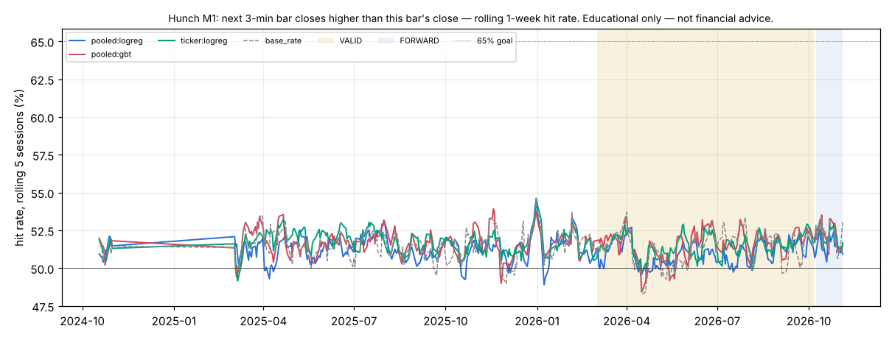

# Hunch M1 — next 3-min bar closes higher than this bar's close

*Educational only — not financial advice. Research tool only: Hunch places no orders and changes nothing in config/ or the trading path.*

## Verdict (failures first)

- **Consistent 65%+: NO** (pooled models); per ticker: **none of the 22 tickers**. Definition: rolling 20-session hit rate ≥ 65% in ≥ 90% of VALID windows. Highest VALID 20-session window of any main pooled learner: 52.3%.
- **Hunch (best combined learner) on VALID: `pooled:gbt` 51.56%** (±0.15% day-clustered SE, n = 406,295 guesses, 153 sessions) vs **best baseline `base_rate` 51.37%**: +0.19 pp, day-clustered z = 1.54 (McNemar z = 2.73). Bar: z ≥ 3.14 (N = 138 tests).
- Main learners beating the best baseline at the bar on VALID: **none**. Per-ticker (pooled or own model vs that ticker's best baseline): **none**.
- Base rate ('yes' share): TRAIN 48.49%, VALID 48.63%. 2.9% of guess slots have the next close exactly equal to this close (a tie counts as 'not higher'), which is why the base-rate baseline ('no') sits above 50% on M1.
- Tests counted per metric: 4 main learners + 2 × 22 per-ticker comparisons + 21 single-indicator diagnostics = 69; × 2 metrics (M1, M3) = 138. One configuration per learner, hyper-parameters fixed in advance (mcf/hunch/learners.py); nothing tuned on VALID. The top-8 model's features were picked on TRAIN: ret1, qqq_ret1, pressure, tod, sector_ret1, spy_ret1, ret5, rsi14.

## Data and protocol

- Data: SIP 1-min bars from the 2-year cache (data/cache_hist/1Min), RTH only, built into 3-min bars. Universe (22): SPY, QQQ, IWM + the most-traded live symbols in the journals (Primary + Testing 1 + Testing 2 on 2026-11-04) with history in the cache: SOXS, CRWV, MRNA, SOXL, MSTU, MSTX, MUU, CLSK, CORZ, HUT, CIFR, UVXY, IREN, RBRK, CRDO, NBIS, RIOT, USAR, INTW. Later listings join when they list: CRWV (from 2025-03-28), MUU (from 2024-10-10), NBIS (from 2024-10-21), INTW (from 2025-03-03). Context: SPY, QQQ, sector ETFs SMH (semis) and IBIT (crypto names). Survivorship: today's most-traded names applied to the past.
- Periods: TRAIN 2024-09-16..2026-02-28 (locked block 2024-11-01..2025-02-28 never read — filtered inside the parquet read), VALID 2026-03-01..2026-10-07, FORWARD after that (reported separately). Sessions scored: TRAIN 263, VALID 153, FORWARD 20; the first 20 sessions are warm-up (guessed, not scored); the first session after the locked gap is an indicator warm-up (not guessed).
- Guesses: every 3-min bar closing 09:51..15:51 ET (121 a session per ticker); each uses data up to that bar's close only and is scored on the next bar. Walk-forward, online: the logistic learners update after every scored guess; the boosted trees refit every 20 sessions on the previous 120 sessions only.
- Learners: **pooled:logreg** = Hunch, all features, shared weights across tickers (+ ticker intercept); **pooled:gbt** = light boosted trees, all features, pooled; **pooled:top8** = pooled logreg on the TRAIN top-8 features; **ticker:logreg** = one Hunch instance per ticker (own weights, own data). Single-indicator learners are a diagnostic only.
- Run time 224 s. No rule / config change in research/ledger.jsonl bears on this study: it reads raw market bars, not setup results.

## Hunch: combined learners vs baselines

Day-clustered SE in brackets; z vs the best baseline (VALID: `base_rate`; TRAIN: `base_rate`), day-clustered. ✔ = z ≥ 3.14.

| learner | TRAIN hit | VALID hit | FORWARD hit | VALID − best base (pp) | z vs best | McNemar z | z vs coin | 20-sess ≥65% share | best 20-sess |
|---|---|---|---|---|---|---|---|---|---|
| `pooled:gbt` | 51.64% | 51.56% (0.15%) | 52.16% | +0.19 | 1.54 | 2.73 | 10.62 | 0% | 52.3% |
| `ticker:logreg` | 51.72% | 51.47% (0.12%) | 52.00% | +0.10 | 0.60 | 1.08 | 12.52 | 0% | 52.2% |
| `pooled:top8` | 51.45% (in-sample feature pick) | 51.17% (0.14%) | 51.86% | -0.20 | -1.06 | -2.10 | 8.23 | 0% | 52.0% |
| `pooled:logreg` | 51.29% | 50.98% (0.14%) | 51.47% | -0.39 | -2.07 | -3.96 | 6.89 | 0% | 51.8% |
| baseline `coin` | 50.00% | 50.00% | 50.00% | | | | | | |
| baseline `same_last` | 49.18% | 48.94% | 49.93% | | | | | | |
| baseline `base_rate` | 51.51% | 51.37% | 52.28% | | | | | | |
| baseline `always_yes` | 48.49% | 48.63% | 47.72% | | | | | | |
| baseline `mom20` | 50.17% | 49.77% | 50.62% | | | | | | |

## The 20+ Hunch instances: per ticker (VALID, TRAIN in brackets)

Each ticker's own best VALID baseline; z (day-clustered) of the pooled model and of that ticker's own model against it. ✔ = z ≥ 3.14. 65% = share of VALID 20-session windows ≥ 65%.

| ticker | guesses | pooled:logreg | ticker:logreg | best baseline | z pooled | z own | 65% pooled | 65% own |
|---|---|---|---|---|---|---|---|---|
| MSTU | 18,513 | 52.34% (51.1%) | 53.71% (51.5%) | `base_rate` 53.68% | -3.86 | 0.08 | 0% | 0% |
| UVXY | 18,513 | 52.14% (51.6%) | 52.60% (52.4%) | `base_rate` 53.21% | -2.49 | -1.87 | 0% | 0% |
| CORZ | 18,513 | 51.94% (52.4%) | 52.11% (52.3%) | `base_rate` 53.12% | -3.15 | -3.04 | 0% | 0% |
| SOXS | 18,513 | 51.69% (52.8%) | 51.95% (54.4%) | `base_rate` 52.79% | -2.74 | -2.54 | 0% | 0% |
| IWM | 18,513 | 51.54% (50.3%) | 50.40% (50.9%) | `base_rate` 50.74% | 1.64 | -0.80 | 0% | 0% |
| CLSK | 18,513 | 51.45% (51.3%) | 52.35% (51.5%) | `base_rate` 52.70% | -3.14 | -0.99 | 0% | 0% |
| USAR | 18,513 | 51.43% (52.5%) | 52.17% (53.2%) | `base_rate` 51.81% | -0.86 | 0.85 | 0% | 0% |
| MSTX | 18,511 | 51.20% (50.8%) | 51.90% (51.3%) | `base_rate` 52.17% | -2.22 | -0.67 | 0% | 0% |
| INTW | 17,536 | 51.05% (52.6%) | 52.69% (54.0%) | `base_rate` 51.41% | -0.74 | 2.73 | 0% | 0% |
| RBRK | 18,513 | 51.02% (51.0%) | 51.37% (51.1%) | `base_rate` 50.29% | 1.43 | 2.38 | 0% | 0% |
| CIFR | 18,513 | 51.01% (52.8%) | 50.73% (52.8%) | `base_rate` 52.03% | -2.41 | -3.66 | 0% | 0% |
| SPY | 18,513 | 51.00% (50.0%) | 50.91% (50.9%) | `base_rate` 50.09% | 1.80 | 1.39 | 0% | 0% |
| QQQ | 18,513 | 50.83% (50.5%) | 51.19% (50.7%) | `always_yes` 50.56% | 0.54 | 1.30 | 0% | 0% |
| RIOT | 18,513 | 50.75% (50.7%) | 51.66% (50.9%) | `base_rate` 52.40% | -4.10 | -2.23 | 0% | 0% |
| CRWV | 18,513 | 50.55% (50.4%) | 50.54% (51.4%) | `base_rate` 50.97% | -1.00 | -0.99 | 0% | 0% |
| IREN | 18,513 | 50.54% (50.6%) | 50.83% (50.9%) | `base_rate` 51.30% | -1.49 | -1.02 | 0% | 0% |
| MRNA | 18,513 | 50.31% (51.5%) | 50.76% (51.4%) | `base_rate` 51.04% | -1.46 | -0.57 | 0% | 0% |
| SOXL | 18,513 | 50.25% (50.4%) | 50.80% (50.6%) | `always_yes` 50.78% | -1.15 | 0.06 | 0% | 0% |
| CRDO | 18,513 | 50.20% (50.9%) | 51.06% (50.4%) | `base_rate` 50.09% | 0.22 | 1.82 | 0% | 0% |
| NBIS | 18,513 | 50.19% (50.8%) | 50.49% (50.7%) | `mom20` 50.52% | -0.56 | -0.04 | 0% | 0% |
| HUT | 18,513 | 50.18% (51.0%) | 50.94% (50.9%) | `base_rate` 50.59% | -0.87 | 0.76 | 0% | 0% |
| MUU | 18,501 | 49.93% (53.2%) | 51.29% (54.8%) | `base_rate` 50.69% | -1.55 | 1.23 | 0% | 0% |

## Indicator trust table (primary: permutation importance of the combined model)

The end-of-TRAIN pooled logreg and pooled GBT, frozen, scored on every VALID guess (frozen hit: logreg 50.75%, GBT 51.66%, n = 406,295); each indicator shuffled across the VALID guesses in turn (3 repeats; ± = sd over repeats). Higher log-loss increase = the model leans on it out of sample. Ranked by the mean of the two models' ranks. A negative value means shuffling the indicator *helped* on VALID: the model's use of it learned on TRAIN does not carry over. Mean weight = the pooled logreg's average standardized weight over VALID (sign = push toward 'yes').

| rank | indicator | logreg log-loss ↑ ×1000 | logreg hit drop (pp) | GBT log-loss ↑ ×1000 | GBT hit drop (pp) | mean weight | TRAIN rank |
|---|---|---|---|---|---|---|---|
| 1 | ret1 | +0.623 ± 0.029 | -0.08 | +0.192 ± 0.008 | +0.16 | -0.0217 | 1 |
| 2 | qqq_ret1 | +0.163 ± 0.007 | -0.00 | +0.090 ± 0.017 | -0.05 | +0.0040 | 2 |
| 3 | pressure | -0.017 ± 0.001 | +0.02 | +0.605 ± 0.051 | +0.48 | -0.0274 | 3 |
| 4 | sector_ret1 | -0.165 ± 0.016 | -0.02 | +0.062 ± 0.014 | -0.03 | +0.0145 | 5 |
| 5 | orl | +1.044 ± 0.012 | +0.06 | +0.000 ± 0.000 | +0.00 | +0.0296 | 13 |
| 6 | gap | +0.403 ± 0.017 | +0.06 | +0.002 ± 0.002 | +0.01 | +0.0171 | 9 |
| 7 | atr_pct | +0.096 ± 0.004 | +0.02 | +0.016 ± 0.005 | +0.00 | +0.0452 | 14 |
| 8 | vol20 | -0.076 ± 0.068 | +0.07 | +0.023 ± 0.008 | -0.01 | +0.0254 | 11 |
| 9 | tod | -0.479 ± 0.045 | -0.06 | +0.058 ± 0.008 | -0.03 | +0.0221 | 4 |
| 10 | ret3 | -0.676 ± 0.003 | +0.02 | +0.047 ± 0.005 | +0.04 | +0.0170 | 12 |
| 11 | ret5 | +1.992 ± 0.004 | +0.00 | -0.011 ± 0.003 | -0.00 | +0.0140 | 7 |
| 12 | spy_ret1 | +0.527 ± 0.020 | +0.04 | -0.004 ± 0.007 | -0.04 | -0.0141 | 6 |
| 13 | pdh | -0.822 ± 0.021 | -0.02 | +0.052 ± 0.015 | +0.07 | -0.0003 | 10 |
| 14 | spy_fo | -1.540 ± 0.038 | +0.01 | +0.017 ± 0.002 | -0.01 | -0.0626 | 17 |
| 15 | fo | -0.803 ± 0.005 | -0.02 | +0.000 ± 0.002 | -0.02 | -0.0066 | 19 |
| 16 | orh | -0.727 ± 0.006 | -0.00 | -0.002 ± 0.001 | +0.00 | +0.0287 | 18 |
| 17 | pdl | -1.550 ± 0.003 | -0.05 | +0.012 ± 0.010 | +0.00 | +0.0066 | 15 |
| 18 | rsi14 | -0.475 ± 0.003 | +0.01 | -0.013 ± 0.007 | -0.02 | +0.0063 | 8 |
| 19 | qqq_fo | -1.267 ± 0.010 | +0.01 | +0.000 ± 0.000 | +0.00 | -0.0629 | 21 |
| 20 | rsi5 | -0.740 ± 0.047 | +0.42 | -0.011 ± 0.001 | -0.01 | -0.1050 | 20 |
| 21 | vwap_atr | -4.903 ± 0.073 | -0.10 | -0.006 ± 0.010 | -0.03 | -0.0977 | 16 |

**Diagnostic: single-indicator learners** (each indicator alone, binned; VALID hit [95% CI], vs best baseline). Not the approach — a cross-check of the table above.

| indicator | VALID hit [95% CI] | TRAIN hit | vs best base (pp) | z |
|---|---|---|---|---|
| pressure | 51.66% [51.39%, 51.94%] | 51.66% | +0.29 | 2.92 |
| ret1 | 51.62% [51.33%, 51.90%] | 51.53% | +0.25 | 2.06 |
| ret3 | 51.42% [51.11%, 51.72%] | 51.45% | +0.05 | 0.67 |
| ret5 | 51.40% [51.09%, 51.71%] | 51.43% | +0.03 | 0.45 |
| atr_pct | 51.39% [51.10%, 51.69%] | 51.48% | +0.03 | 0.51 |
| rsi5 | 51.38% [51.07%, 51.70%] | 51.47% | +0.01 | 0.15 |
| pdh | 51.38% [51.07%, 51.69%] | 51.46% | +0.01 | 0.11 |
| fo | 51.36% [51.03%, 51.70%] | 51.45% | -0.01 | -1.16 |
| vwap_atr | 51.35% [51.02%, 51.69%] | 51.47% | -0.02 | -0.70 |
| orl | 51.35% [51.02%, 51.68%] | 51.48% | -0.02 | -0.83 |
| orh | 51.34% [51.00%, 51.68%] | 51.48% | -0.03 | -3.05 |
| vol20 | 51.33% [51.01%, 51.66%] | 51.50% | -0.04 | -1.33 |
| sector_ret1 | 51.33% [51.00%, 51.67%] | 51.48% | -0.04 | -1.15 |
| gap | 51.31% [50.99%, 51.64%] | 51.45% | -0.06 | -1.70 |
| rsi14 | 51.30% [50.98%, 51.63%] | 51.48% | -0.07 | -1.36 |
| spy_ret1 | 51.29% [50.94%, 51.63%] | 51.21% | -0.08 | -0.86 |
| spy_fo | 51.27% [50.92%, 51.62%] | 51.35% | -0.10 | -1.50 |
| pdl | 51.26% [50.91%, 51.60%] | 51.47% | -0.11 | -3.17 |
| tod | 51.24% [50.91%, 51.56%] | 51.33% | -0.13 | -1.36 |
| qqq_fo | 51.18% [50.85%, 51.51%] | 51.42% | -0.19 | -2.21 |
| qqq_ret1 | 51.18% [50.84%, 51.51%] | 51.23% | -0.19 | -2.03 |

## VALID by time of day

| bar close | `pooled:gbt` | `ticker:logreg` | `pooled:top8` | `pooled:logreg` | `base_rate` |
|---|---|---|---|---|---|
| 09:51-10:30 | 50.39% | 50.68% | 49.87% | 50.05% | 50.66% |
| 10:33-12:00 | 50.79% | 50.85% | 50.72% | 50.66% | 50.95% |
| 12:03-14:00 | 51.84% | 51.82% | 51.46% | 51.34% | 51.20% |
| 14:03-15:00 | 52.93% | 52.05% | 52.70% | 51.69% | 52.65% |
| 15:03-15:51 | 51.60% | 51.74% | 50.57% | 50.63% | 51.60% |

## VALID by SPY day type

SPY session open-to-close terciles, cut points from TRAIN (-0.23% / +0.33%). Known only after the close: a report split, never a feature.

| day type | guesses | `pooled:gbt` | `ticker:logreg` | `pooled:top8` | `pooled:logreg` | `base_rate` |
|---|---|---|---|---|---|---|
| up | 114,158 | 50.68% | 50.93% | 50.76% | 50.32% | 49.73% |
| flat | 169,946 | 51.51% | 51.62% | 51.23% | 51.26% | 51.41% |
| down | 122,191 | 52.44% | 51.76% | 51.48% | 51.20% | 52.84% |

## Stability

Rolling 5-session hit rate of the combined learners and the best baseline (`base_rate`, dashed); VALID and FORWARD shaded.

*Educational only — not financial advice.*
