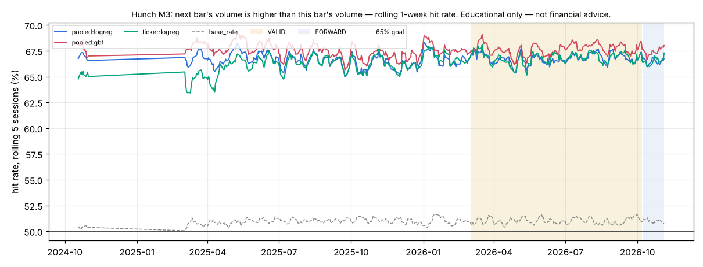

# Hunch M3 — next bar's volume is higher than this bar's volume

*Educational only — not financial advice. Research tool only: Hunch places no orders and changes nothing in config/ or the trading path.*

## Verdict (failures first)

- **Consistent 65%+: YES — pooled:logreg, pooled:gbt, pooled:top8, ticker:logreg** (pooled models); per ticker: CIFR (pooled:logreg), CIFR (ticker:logreg), CLSK (pooled:logreg), CLSK (ticker:logreg), CORZ (pooled:logreg), CORZ (ticker:logreg), CRDO (pooled:logreg), CRDO (ticker:logreg), CRWV (pooled:logreg), HUT (pooled:logreg), HUT (ticker:logreg), INTW (pooled:logreg), INTW (ticker:logreg), IREN (ticker:logreg), IWM (pooled:logreg), IWM (ticker:logreg), MRNA (pooled:logreg), MRNA (ticker:logreg), MSTU (pooled:logreg), MSTU (ticker:logreg), QQQ (pooled:logreg), QQQ (ticker:logreg), RBRK (pooled:logreg), RBRK (ticker:logreg), RIOT (pooled:logreg), RIOT (ticker:logreg), SPY (pooled:logreg), SPY (ticker:logreg), USAR (pooled:logreg), USAR (ticker:logreg), UVXY (pooled:logreg), UVXY (ticker:logreg). Definition: rolling 20-session hit rate ≥ 65% in ≥ 90% of VALID windows. Highest VALID 20-session window of any main pooled learner: 68.1%.
- **Hunch (best combined learner) on VALID: `pooled:gbt` 67.66%** (±0.08% day-clustered SE, n = 406,295 guesses, 153 sessions) vs **best baseline `base_rate` 51.01%**: +16.65 pp, day-clustered z = 163.39 (McNemar z = 149.62). Bar: z ≥ 3.14 (N = 138 tests).
- Main learners beating the best baseline at the bar on VALID: `pooled:logreg`, `pooled:gbt`, `pooled:top8`, `ticker:logreg`. Per-ticker (pooled or own model vs that ticker's best baseline): CIFR (pooled:logreg), CIFR (ticker:logreg), CLSK (pooled:logreg), CLSK (ticker:logreg), CORZ (pooled:logreg), CORZ (ticker:logreg), CRDO (pooled:logreg), CRDO (ticker:logreg), CRWV (pooled:logreg), CRWV (ticker:logreg), HUT (pooled:logreg), HUT (ticker:logreg), INTW (pooled:logreg), INTW (ticker:logreg), IREN (pooled:logreg), IREN (ticker:logreg), IWM (pooled:logreg), IWM (ticker:logreg), MRNA (pooled:logreg), MRNA (ticker:logreg), MSTU (pooled:logreg), MSTU (ticker:logreg), MSTX (pooled:logreg), MSTX (ticker:logreg), MUU (pooled:logreg), MUU (ticker:logreg), NBIS (pooled:logreg), NBIS (ticker:logreg), QQQ (pooled:logreg), QQQ (ticker:logreg), RBRK (pooled:logreg), RBRK (ticker:logreg), RIOT (pooled:logreg), RIOT (ticker:logreg), SOXL (pooled:logreg), SOXL (ticker:logreg), SOXS (pooled:logreg), SOXS (ticker:logreg), SPY (pooled:logreg), SPY (ticker:logreg), USAR (pooled:logreg), USAR (ticker:logreg), UVXY (pooled:logreg), UVXY (ticker:logreg).
- Base rate ('yes' share): TRAIN 49.04%, VALID 48.99%. 2.9% of guess slots have the next close exactly equal to this close (a tie counts as 'not higher'), which is why the base-rate baseline ('no') sits above 50% on M1.
- Tests counted per metric: 4 main learners + 2 × 22 per-ticker comparisons + 21 single-indicator diagnostics = 69; × 2 metrics (M1, M3) = 138. One configuration per learner, hyper-parameters fixed in advance (mcf/hunch/learners.py); nothing tuned on VALID. The top-8 model's features were picked on TRAIN: vol20, tod, atr_pct, rsi5, pressure, orl, ret3, orh.

## Data and protocol

- Data: SIP 1-min bars from the 2-year cache (data/cache_hist/1Min), RTH only, built into 3-min bars. Universe (22): SPY, QQQ, IWM + the most-traded live symbols in the journals (Primary + Testing 1 + Testing 2 on 2026-11-04) with history in the cache: SOXS, CRWV, MRNA, SOXL, MSTU, MSTX, MUU, CLSK, CORZ, HUT, CIFR, UVXY, IREN, RBRK, CRDO, NBIS, RIOT, USAR, INTW. Later listings join when they list: CRWV (from 2025-03-28), MUU (from 2024-10-10), NBIS (from 2024-10-21), INTW (from 2025-03-03). Context: SPY, QQQ, sector ETFs SMH (semis) and IBIT (crypto names). Survivorship: today's most-traded names applied to the past.
- Periods: TRAIN 2024-09-16..2026-02-28 (locked block 2024-11-01..2025-02-28 never read — filtered inside the parquet read), VALID 2026-03-01..2026-10-07, FORWARD after that (reported separately). Sessions scored: TRAIN 263, VALID 153, FORWARD 20; the first 20 sessions are warm-up (guessed, not scored); the first session after the locked gap is an indicator warm-up (not guessed).
- Guesses: every 3-min bar closing 09:51..15:51 ET (121 a session per ticker); each uses data up to that bar's close only and is scored on the next bar. Walk-forward, online: the logistic learners update after every scored guess; the boosted trees refit every 20 sessions on the previous 120 sessions only.
- Learners: **pooled:logreg** = Hunch, all features, shared weights across tickers (+ ticker intercept); **pooled:gbt** = light boosted trees, all features, pooled; **pooled:top8** = pooled logreg on the TRAIN top-8 features; **ticker:logreg** = one Hunch instance per ticker (own weights, own data). Single-indicator learners are a diagnostic only.
- Run time 223 s. No rule / config change in research/ledger.jsonl bears on this study: it reads raw market bars, not setup results.

## Hunch: combined learners vs baselines

Day-clustered SE in brackets; z vs the best baseline (VALID: `base_rate`; TRAIN: `base_rate`), day-clustered. ✔ = z ≥ 3.14.

| learner | TRAIN hit | VALID hit | FORWARD hit | VALID − best base (pp) | z vs best | McNemar z | z vs coin | 20-sess ≥65% share | best 20-sess |
|---|---|---|---|---|---|---|---|---|---|
| `pooled:gbt` | 67.53% | 67.66% (0.08%) | 67.47% | +16.65 | 163.39 ✔ | 149.62 | 209.57 | 100% | 68.1% |
| `pooled:top8` | 66.67% (in-sample feature pick) | 66.82% (0.08%) | 66.64% | +15.81 | 159.43 ✔ | 134.58 | 206.74 | 100% | 67.2% |
| `ticker:logreg` | 66.15% | 66.80% (0.09%) | 66.55% | +15.79 | 150.29 ✔ | 134.07 | 181.76 | 100% | 67.2% |
| `pooled:logreg` | 66.59% | 66.78% (0.09%) | 66.49% | +15.77 | 149.78 ✔ | 134.45 | 189.76 | 100% | 67.2% |
| baseline `coin` | 50.00% | 50.00% | 50.00% | | | | | | |
| baseline `same_last` | 36.96% | 37.16% | 37.04% | | | | | | |
| baseline `base_rate` | 50.96% | 51.01% | 50.98% | | | | | | |
| baseline `always_yes` | 49.04% | 48.99% | 49.02% | | | | | | |
| baseline `mom20` | 46.75% | 46.96% | 46.81% | | | | | | |

## The 20+ Hunch instances: per ticker (VALID, TRAIN in brackets)

Each ticker's own best VALID baseline; z (day-clustered) of the pooled model and of that ticker's own model against it. ✔ = z ≥ 3.14. 65% = share of VALID 20-session windows ≥ 65%.

| ticker | guesses | pooled:logreg | ticker:logreg | best baseline | z pooled | z own | 65% pooled | 65% own |
|---|---|---|---|---|---|---|---|---|
| MSTU | 18,513 | 68.22% (66.2%) | 68.68% (66.0%) | `base_rate` 51.19% | 43.76 ✔ | 43.77 ✔ | 100% | 100% |
| IWM | 18,513 | 68.09% (67.2%) | 68.23% (66.9%) | `base_rate` 50.82% | 40.39 ✔ | 42.27 ✔ | 100% | 100% |
| INTW | 17,536 | 68.04% (68.0%) | 67.85% (66.3%) | `base_rate` 50.85% | 44.49 ✔ | 42.24 ✔ | 100% | 100% |
| HUT | 18,513 | 67.86% (66.9%) | 67.52% (66.3%) | `base_rate` 50.11% | 45.45 ✔ | 47.35 ✔ | 100% | 100% |
| RBRK | 18,513 | 67.70% (67.4%) | 68.22% (67.3%) | `always_yes` 50.05% | 52.19 ✔ | 53.44 ✔ | 100% | 100% |
| UVXY | 18,513 | 67.50% (66.7%) | 67.24% (66.4%) | `base_rate` 50.73% | 41.56 ✔ | 40.14 ✔ | 100% | 100% |
| CLSK | 18,513 | 67.31% (66.5%) | 66.85% (66.3%) | `base_rate` 51.09% | 41.58 ✔ | 39.52 ✔ | 100% | 100% |
| CORZ | 18,513 | 67.27% (67.0%) | 67.08% (66.4%) | `base_rate` 50.27% | 42.17 ✔ | 41.51 ✔ | 100% | 100% |
| QQQ | 18,513 | 67.24% (66.1%) | 66.88% (65.6%) | `base_rate` 50.79% | 36.69 ✔ | 38.09 ✔ | 100% | 100% |
| USAR | 18,513 | 67.06% (67.4%) | 66.96% (65.7%) | `base_rate` 50.63% | 40.58 ✔ | 42.85 ✔ | 93% | 96% |
| CIFR | 18,513 | 67.02% (67.1%) | 66.52% (67.2%) | `base_rate` 51.17% | 39.79 ✔ | 38.14 ✔ | 100% | 93% |
| MRNA | 18,513 | 66.87% (66.2%) | 67.03% (66.1%) | `base_rate` 50.68% | 41.82 ✔ | 39.05 ✔ | 100% | 100% |
| CRDO | 18,513 | 66.79% (66.9%) | 66.72% (66.7%) | `base_rate` 50.16% | 44.77 ✔ | 44.23 ✔ | 100% | 100% |
| RIOT | 18,513 | 66.60% (65.8%) | 66.60% (66.0%) | `base_rate` 50.87% | 36.79 ✔ | 39.37 ✔ | 100% | 100% |
| CRWV | 18,513 | 66.45% (65.3%) | 66.19% (64.6%) | `base_rate` 51.23% | 34.27 ✔ | 33.03 ✔ | 90% | 74% |
| MSTX | 18,511 | 66.45% (66.8%) | 66.86% (66.8%) | `base_rate` 51.47% | 37.67 ✔ | 38.10 ✔ | 87% | 90% |
| SPY | 18,513 | 66.12% (65.2%) | 66.75% (65.1%) | `base_rate` 50.02% | 42.23 ✔ | 44.21 ✔ | 100% | 96% |
| MUU | 18,501 | 65.96% (67.9%) | 65.91% (65.8%) | `base_rate` 52.41% | 33.22 ✔ | 33.40 ✔ | 88% | 90% |
| IREN | 18,513 | 65.73% (66.4%) | 66.09% (65.8%) | `base_rate` 51.48% | 37.65 ✔ | 40.76 ✔ | 84% | 92% |
| NBIS | 18,513 | 65.56% (66.2%) | 65.87% (65.1%) | `base_rate` 51.34% | 35.08 ✔ | 35.77 ✔ | 76% | 82% |
| SOXS | 18,513 | 65.03% (67.3%) | 65.34% (67.7%) | `base_rate` 52.27% | 30.96 ✔ | 33.06 ✔ | 54% | 63% |
| SOXL | 18,513 | 64.30% (65.2%) | 64.29% (64.9%) | `base_rate` 52.74% | 28.77 ✔ | 28.04 ✔ | 19% | 28% |

## Indicator trust table (primary: permutation importance of the combined model)

The end-of-TRAIN pooled logreg and pooled GBT, frozen, scored on every VALID guess (frozen hit: logreg 66.32%, GBT 67.71%, n = 406,295); each indicator shuffled across the VALID guesses in turn (3 repeats; ± = sd over repeats). Higher log-loss increase = the model leans on it out of sample. Ranked by the mean of the two models' ranks. A negative value means shuffling the indicator *helped* on VALID: the model's use of it learned on TRAIN does not carry over. Mean weight = the pooled logreg's average standardized weight over VALID (sign = push toward 'yes').

| rank | indicator | logreg log-loss ↑ ×1000 | logreg hit drop (pp) | GBT log-loss ↑ ×1000 | GBT hit drop (pp) | mean weight | TRAIN rank |
|---|---|---|---|---|---|---|---|
| 1 | vol20 | +205.945 ± 0.426 | +15.46 | +181.828 ± 0.406 | +17.23 | -1.5483 | 1 |
| 2 | tod | +21.551 ± 0.037 | +2.02 | +21.222 ± 0.042 | +2.56 | +0.3669 | 2 |
| 3 | atr_pct | +1.452 ± 0.058 | +0.31 | +0.825 ± 0.037 | +0.12 | -0.1031 | 3 |
| 4 | rsi5 | +0.147 ± 0.015 | +0.04 | +4.922 ± 0.028 | +0.64 | -0.0385 | 4 |
| 5 | pressure | +0.163 ± 0.031 | +0.05 | +0.565 ± 0.015 | +0.05 | +0.0119 | 5 |
| 6 | orl | +4.494 ± 0.043 | +0.59 | +0.000 ± 0.000 | +0.00 | +0.1044 | 6 |
| 7 | ret3 | -0.000 ± 0.001 | +0.01 | +0.062 ± 0.003 | +0.00 | +0.0290 | 7 |
| 8 | rsi14 | -0.041 ± 0.003 | +0.00 | +0.710 ± 0.001 | +0.06 | +0.0025 | 9 |
| 9 | orh | +0.971 ± 0.074 | +0.09 | +0.000 ± 0.000 | +0.00 | -0.1129 | 8 |
| 10 | ret5 | +0.418 ± 0.014 | +0.09 | +0.000 ± 0.000 | +0.00 | +0.0087 | 10 |
| 11 | pdl | +0.117 ± 0.004 | +0.03 | +0.000 ± 0.000 | +0.00 | +0.0090 | 11 |
| 12 | gap | +0.052 ± 0.003 | +0.03 | +0.000 ± 0.000 | +0.00 | -0.0015 | 12 |
| 13 | spy_ret1 | -0.126 ± 0.001 | -0.01 | +0.015 ± 0.003 | +0.00 | -0.0101 | 13 |
| 14 | ret1 | +0.013 ± 0.003 | +0.02 | +0.000 ± 0.000 | +0.00 | +0.0434 | 14 |
| 15 | qqq_fo | -0.009 ± 0.001 | +0.00 | +0.000 ± 0.000 | +0.00 | +0.0168 | 15 |
| 16 | vwap_atr | -0.057 ± 0.002 | +0.01 | +0.000 ± 0.000 | +0.00 | +0.0087 | 17 |
| 17 | spy_fo | -0.084 ± 0.012 | -0.01 | +0.000 ± 0.000 | +0.00 | -0.0297 | 16 |
| 18 | fo | -0.210 ± 0.007 | -0.01 | +0.000 ± 0.000 | +0.00 | +0.0020 | 20 |
| 19 | sector_ret1 | -0.247 ± 0.023 | +0.00 | +0.000 ± 0.000 | +0.00 | -0.0008 | 18 |
| 20 | qqq_ret1 | -0.294 ± 0.002 | -0.04 | +0.000 ± 0.000 | +0.00 | -0.0395 | 19 |
| 21 | pdh | -0.416 ± 0.052 | -0.01 | +0.000 ± 0.000 | +0.00 | -0.0134 | 21 |

**Diagnostic: single-indicator learners** (each indicator alone, binned; VALID hit [95% CI], vs best baseline). Not the approach — a cross-check of the table above.

| indicator | VALID hit [95% CI] | TRAIN hit | vs best base (pp) | z |
|---|---|---|---|---|
| vol20 | 65.43% [65.26%, 65.60%] | 65.72% | +14.42 | 138.71 |
| pressure | 58.12% [57.96%, 58.29%] | 58.55% | +7.11 | 66.99 |
| ret1 | 52.91% [52.72%, 53.11%] | 52.83% | +1.90 | 16.97 |
| ret3 | 52.36% [52.21%, 52.51%] | 51.99% | +1.35 | 14.43 |
| tod | 52.33% [52.21%, 52.46%] | 51.99% | +1.32 | 20.40 |
| atr_pct | 52.02% [51.90%, 52.14%] | 51.57% | +1.01 | 14.53 |
| ret5 | 51.72% [51.56%, 51.88%] | 51.47% | +0.70 | 7.91 |
| qqq_ret1 | 51.68% [51.44%, 51.92%] | 51.17% | +0.67 | 5.25 |
| sector_ret1 | 51.58% [51.38%, 51.78%] | 51.26% | +0.57 | 5.14 |
| spy_ret1 | 51.51% [51.26%, 51.76%] | 51.16% | +0.50 | 3.89 |
| orh | 51.46% [51.34%, 51.58%] | 51.30% | +0.45 | 7.62 |
| fo | 51.37% [51.26%, 51.49%] | 51.24% | +0.36 | 6.33 |
| pdl | 51.36% [51.24%, 51.47%] | 51.27% | +0.34 | 7.17 |
| pdh | 51.33% [51.20%, 51.47%] | 51.15% | +0.32 | 4.91 |
| orl | 51.32% [51.18%, 51.46%] | 51.20% | +0.31 | 4.15 |
| vwap_atr | 51.17% [51.05%, 51.29%] | 51.07% | +0.16 | 2.44 |
| gap | 51.01% [50.92%, 51.11%] | 50.90% | +0.00 | — |
| qqq_fo | 50.98% [50.88%, 51.08%] | 50.87% | -0.03 | -2.53 |
| spy_fo | 50.96% [50.85%, 51.07%] | 50.91% | -0.05 | -2.26 |
| rsi14 | 50.95% [50.81%, 51.08%] | 50.83% | -0.06 | -1.06 |
| rsi5 | 50.92% [50.78%, 51.06%] | 50.85% | -0.09 | -1.36 |

## VALID by time of day

| bar close | `pooled:gbt` | `pooled:top8` | `ticker:logreg` | `pooled:logreg` | `base_rate` |
|---|---|---|---|---|---|
| 09:51-10:30 | 65.07% | 64.08% | 65.20% | 63.92% | 53.61% |
| 10:33-12:00 | 67.92% | 67.17% | 66.89% | 67.07% | 52.52% |
| 12:03-14:00 | 68.46% | 67.63% | 67.35% | 67.64% | 51.45% |
| 14:03-15:00 | 68.41% | 67.64% | 67.38% | 67.60% | 50.34% |
| 15:03-15:51 | 66.55% | 65.59% | 65.99% | 65.62% | 45.97% |

## VALID by SPY day type

SPY session open-to-close terciles, cut points from TRAIN (-0.23% / +0.33%). Known only after the close: a report split, never a feature.

| day type | guesses | `pooled:gbt` | `pooled:top8` | `ticker:logreg` | `pooled:logreg` | `base_rate` |
|---|---|---|---|---|---|---|
| up | 114,158 | 67.72% | 67.03% | 67.01% | 67.02% | 50.88% |
| flat | 169,946 | 67.74% | 66.75% | 66.81% | 66.68% | 51.04% |
| down | 122,191 | 67.48% | 66.72% | 66.59% | 66.68% | 51.09% |

## Stability

Rolling 5-session hit rate of the combined learners and the best baseline (`base_rate`, dashed); VALID and FORWARD shaded.

*Educational only — not financial advice.*
