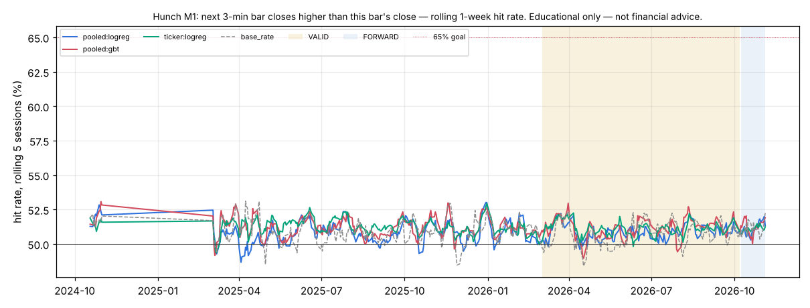

# Hunch M1 — next 3-min bar closes higher than this bar's close

*Educational only — not financial advice. Research tool only: Hunch places no orders and changes nothing in config/ or the trading path.*

## Verdict (failures first)

- **Consistent 65%+: NO** (pooled models); per ticker: **none of the 100 tickers**. Definition: rolling 20-session hit rate ≥ 65% in ≥ 90% of VALID windows. Highest VALID 20-session window of any main pooled learner: 51.8%.
- **Hunch (best combined learner) on VALID: `pooled:gbt` 51.14%** (±0.11% day-clustered SE, n = 1,850,301 guesses, 153 sessions) vs **best baseline `base_rate` 50.72%**: +0.42 pp, day-clustered z = 3.39 (McNemar z = 10.48). Bar: z ≥ 3.47 (N = 408 tests).
- Main learners beating the best baseline at the bar on VALID: **none**. Per-ticker (pooled or own model vs that ticker's best baseline): TMO (ticker:logreg).
- Base rate ('yes' share): TRAIN 49.06%, VALID 49.28%. 2.2% of guess slots have the next close exactly equal to this close (a tie counts as 'not higher'), which is why the base-rate baseline ('no') sits above 50% on M1.
- Tests counted per metric: 4 main learners + 2 × 100 per-ticker comparisons + 0 single-indicator diagnostics = 204; × 2 metrics (M1, M3) = 408. One configuration per learner, hyper-parameters fixed in advance (mcf/hunch/learners.py); nothing tuned on VALID. The top-8 model's features were picked on TRAIN: qqq_ret1, rsi14, pressure, sector_ret1, ret5, spy_ret1, rsi5, pdh.

## Data and protocol

- Data: SIP 1-min bars from the 2-year cache (data/cache_hist/1Min), RTH only, built into 3-min bars. Universe (100, list in research/hunch/universe100.txt): SPY, QQQ, IWM + the most liquid names in the cache by 20-day dollar ADV (to 2026-11-04), live-traded names first. 5 of them list after the start and join when they list. Context: SPY, QQQ, SMH, IBIT. Survivorship: today's liquid names applied to the past.
- Periods: TRAIN 2024-09-16..2026-02-28 (locked block 2024-11-01..2025-02-28 never read — filtered inside the parquet read), VALID 2026-03-01..2026-10-07, FORWARD after that (reported separately). Sessions scored: TRAIN 263, VALID 153, FORWARD 20; the first 20 sessions are warm-up (guessed, not scored); the first session after the locked gap is an indicator warm-up (not guessed).
- Guesses: every 3-min bar closing 09:51..15:51 ET (121 a session per ticker); each uses data up to that bar's close only and is scored on the next bar. Walk-forward, online: the logistic learners update after every scored guess; the boosted trees refit every 20 sessions on the previous 120 sessions only.
- Learners: **pooled:logreg** = Hunch, all features, shared weights across tickers (+ ticker intercept); **pooled:gbt** = light boosted trees, all features, pooled; **pooled:top8** = pooled logreg on the TRAIN top-8 features; **ticker:logreg** = one Hunch instance per ticker (own weights, own data). Single-indicator learners are a diagnostic only.
- Run time 345 s. No rule / config change in research/ledger.jsonl bears on this study: it reads raw market bars, not setup results.

## Hunch: combined learners vs baselines

Day-clustered SE in brackets; z vs the best baseline (VALID: `base_rate`; TRAIN: `base_rate`), day-clustered. ✔ = z ≥ 3.47.

| learner | TRAIN hit | VALID hit | FORWARD hit | VALID − best base (pp) | z vs best | McNemar z | z vs coin | 20-sess ≥65% share | best 20-sess |
|---|---|---|---|---|---|---|---|---|---|
| `pooled:gbt` | 51.21% | 51.14% (0.11%) | 51.35% | +0.42 | 3.39 | 10.48 | 10.24 | 0% | 51.8% |
| `ticker:logreg` | 51.26% | 51.12% (0.08%) | 51.13% | +0.40 | 2.91 | 8.28 | 14.61 | 0% | 51.8% |
| `pooled:top8` | 50.88% (in-sample feature pick) | 51.04% (0.11%) | 51.22% | +0.32 | 2.07 | 6.79 | 9.28 | 0% | 51.8% |
| `pooled:logreg` | 50.82% | 50.87% (0.11%) | 51.11% | +0.15 | 0.95 | 3.04 | 7.73 | 0% | 51.6% |
| baseline `coin` | 50.00% | 50.00% | 50.00% | | | | | | |
| baseline `same_last` | 49.29% | 49.02% | 49.59% | | | | | | |
| baseline `base_rate` | 50.94% | 50.72% | 51.26% | | | | | | |
| baseline `always_yes` | 49.06% | 49.28% | 48.74% | | | | | | |
| baseline `mom20` | 49.99% | 49.68% | 50.15% | | | | | | |

## The 20+ Hunch instances: per ticker (VALID, TRAIN in brackets)

Each ticker's own best VALID baseline; z (day-clustered) of the pooled model and of that ticker's own model against it. ✔ = z ≥ 3.47. 65% = share of VALID 20-session windows ≥ 65%.

| ticker | guesses | pooled:logreg | ticker:logreg | best baseline | z pooled | z own | 65% pooled | 65% own |
|---|---|---|---|---|---|---|---|---|
| TLT | 18,513 | 53.31% (51.1%) | 53.50% (51.9%) | `base_rate` 54.28% | -2.67 | -2.29 | 0% | 0% |
| EWZ | 18,513 | 52.92% (52.6%) | 53.62% (53.6%) | `base_rate` 54.19% | -4.29 | -2.26 | 0% | 0% |
| XLP | 18,513 | 52.35% (51.3%) | 51.41% (51.7%) | `base_rate` 52.40% | -0.11 | -2.72 | 0% | 0% |
| XLF | 18,513 | 52.29% (51.8%) | 53.42% (52.4%) | `base_rate` 53.54% | -3.65 | -0.43 | 0% | 0% |
| MSTU | 18,513 | 52.21% (50.8%) | 53.71% (51.5%) | `base_rate` 53.68% | -3.51 | 0.08 | 0% | 0% |
| UVXY | 18,513 | 52.13% (51.6%) | 52.60% (52.4%) | `base_rate` 53.21% | -2.80 | -1.87 | 0% | 0% |
| CORZ | 18,513 | 51.96% (51.8%) | 52.11% (52.3%) | `base_rate` 53.12% | -2.86 | -3.04 | 0% | 0% |
| BAC | 18,513 | 51.74% (51.2%) | 52.20% (51.9%) | `base_rate` 52.57% | -2.07 | -1.03 | 0% | 0% |
| SOXS | 18,513 | 51.74% (52.6%) | 51.95% (54.4%) | `base_rate` 52.79% | -2.92 | -2.54 | 0% | 0% |
| INTW | 17,536 | 51.70% (52.3%) | 52.69% (54.0%) | `base_rate` 51.41% | 0.70 | 2.73 | 0% | 0% |
| TMO | 18,513 | 51.69% (51.4%) | 52.23% (52.0%) | `always_yes` 50.04% | 3.10 | 4.10 ✔ | 0% | 0% |
| MDT | 18,513 | 51.68% (50.3%) | 52.03% (51.0%) | `base_rate` 52.71% | -2.25 | -1.68 | 0% | 0% |
| CLSK | 18,513 | 51.60% (51.1%) | 52.35% (51.5%) | `base_rate` 52.70% | -2.45 | -0.99 | 0% | 0% |
| EFA | 18,513 | 51.54% (50.3%) | 51.72% (50.9%) | `base_rate` 52.44% | -2.18 | -1.95 | 0% | 0% |
| XLE | 18,513 | 51.54% (53.3%) | 51.77% (54.7%) | `base_rate` 50.94% | 1.54 | 1.71 | 0% | 0% |
| LLY | 18,513 | 51.49% (50.8%) | 51.51% (51.7%) | `base_rate` 50.10% | 2.73 | 2.98 | 0% | 0% |
| IWM | 18,513 | 51.35% (50.2%) | 50.40% (50.9%) | `base_rate` 50.74% | 1.32 | -0.80 | 0% | 0% |
| EEM | 18,513 | 51.35% (53.5%) | 51.23% (54.5%) | `base_rate` 52.14% | -2.18 | -2.35 | 0% | 0% |
| SNOW | 18,513 | 51.33% (51.0%) | 51.32% (51.0%) | `base_rate` 50.71% | 1.24 | 1.39 | 0% | 0% |
| XLV | 18,513 | 51.29% (50.1%) | 50.83% (50.7%) | `base_rate` 51.52% | -0.59 | -1.96 | 0% | 0% |
| IBIT | 18,513 | 51.19% (50.2%) | 51.97% (50.6%) | `base_rate` 51.73% | -1.22 | 0.52 | 0% | 0% |
| WMT | 18,513 | 51.15% (50.1%) | 50.29% (50.6%) | `base_rate` 50.76% | 0.83 | -1.00 | 0% | 0% |
| UNH | 18,513 | 51.14% (50.6%) | 50.67% (51.0%) | `base_rate` 50.39% | 1.38 | 0.52 | 0% | 0% |
| XLI | 18,513 | 51.14% (50.2%) | 50.82% (50.3%) | `base_rate` 51.03% | 0.23 | -0.44 | 0% | 0% |
| ACN | 18,513 | 51.13% (50.9%) | 51.78% (51.5%) | `base_rate` 50.19% | 1.70 | 3.01 | 0% | 0% |
| MSTX | 18,511 | 51.12% (50.5%) | 51.90% (51.3%) | `base_rate` 52.17% | -2.60 | -0.67 | 0% | 0% |
| JPM | 18,513 | 51.11% (50.3%) | 50.86% (50.6%) | `base_rate` 50.50% | 1.36 | 0.81 | 0% | 0% |
| RBRK | 18,513 | 51.10% (50.9%) | 51.37% (51.1%) | `base_rate` 50.29% | 1.67 | 2.38 | 0% | 0% |
| XOM | 18,513 | 51.10% (49.9%) | 50.69% (50.9%) | `always_yes` 50.40% | 1.43 | 0.59 | 0% | 0% |
| CIFR | 18,513 | 51.10% (52.5%) | 50.73% (52.8%) | `base_rate` 52.03% | -2.23 | -3.66 | 0% | 0% |
| CRWD | 18,513 | 51.09% (51.5%) | 50.94% (52.0%) | `always_yes` 50.16% | 1.66 | 1.56 | 0% | 0% |
| USAR | 18,513 | 51.09% (52.5%) | 52.17% (53.2%) | `base_rate` 51.81% | -1.70 | 0.85 | 0% | 0% |
| QQQ | 18,513 | 51.08% (50.4%) | 51.19% (50.7%) | `always_yes` 50.56% | 0.99 | 1.30 | 0% | 0% |
| GE | 18,513 | 51.07% (50.7%) | 50.99% (50.7%) | `base_rate` 50.07% | 2.03 | 1.67 | 0% | 0% |
| PANW | 18,513 | 51.06% (51.1%) | 51.30% (50.8%) | `always_yes` 50.57% | 0.91 | 1.45 | 0% | 0% |
| SPY | 18,513 | 51.03% (49.9%) | 50.91% (50.9%) | `base_rate` 50.09% | 1.73 | 1.39 | 0% | 0% |
| CVX | 18,513 | 51.01% (50.4%) | 50.74% (50.6%) | `mom20` 50.34% | 1.12 | 0.77 | 0% | 0% |
| GLD | 18,513 | 50.97% (50.4%) | 51.20% (51.3%) | `base_rate` 50.76% | 0.43 | 0.90 | 0% | 0% |
| COST | 18,513 | 50.93% (51.0%) | 51.46% (52.3%) | `always_yes` 50.03% | 1.69 | 2.35 | 0% | 0% |
| GS | 18,513 | 50.89% (50.8%) | 51.03% (51.7%) | `always_yes` 50.09% | 1.65 | 1.73 | 0% | 0% |
| XLK | 18,513 | 50.89% (50.7%) | 50.95% (51.3%) | `always_yes` 50.03% | 1.60 | 1.82 | 0% | 0% |
| STX | 18,513 | 50.88% (50.9%) | 51.29% (51.5%) | `always_yes` 50.31% | 1.04 | 1.86 | 0% | 0% |
| DELL | 18,513 | 50.87% (51.2%) | 50.52% (50.3%) | `always_yes` 50.01% | 1.63 | 0.96 | 0% | 0% |
| SQQQ | 18,513 | 50.84% (51.9%) | 51.72% (53.1%) | `base_rate` 51.51% | -1.56 | 0.48 | 0% | 0% |
| JNJ | 18,513 | 50.83% (50.4%) | 50.84% (50.7%) | `base_rate` 50.81% | 0.04 | 0.06 | 0% | 0% |
| INTC | 18,513 | 50.81% (51.2%) | 50.17% (51.3%) | `base_rate` 50.37% | 0.93 | -0.40 | 0% | 0% |
| ASML | 18,513 | 50.78% (51.2%) | 50.96% (52.4%) | `always_yes` 50.31% | 0.99 | 1.33 | 0% | 0% |
| GEV | 18,513 | 50.78% (51.0%) | 51.05% (51.4%) | `always_yes` 50.09% | 1.38 | 2.03 | 0% | 0% |
| CAT | 18,513 | 50.77% (50.5%) | 50.96% (51.4%) | `always_yes` 50.36% | 0.80 | 1.10 | 0% | 0% |
| NFLX | 18,513 | 50.76% (51.2%) | 51.27% (51.9%) | `base_rate` 51.37% | -1.31 | -0.23 | 0% | 0% |
| TQQQ | 18,513 | 50.76% (51.3%) | 51.27% (51.7%) | `always_yes` 50.35% | 0.73 | 1.98 | 0% | 0% |
| V | 18,513 | 50.75% (50.1%) | 50.46% (50.6%) | `always_yes` 50.15% | 1.18 | 0.64 | 0% | 0% |
| AVGO | 18,513 | 50.74% (50.5%) | 51.29% (50.8%) | `always_yes` 50.03% | 1.47 | 2.74 | 0% | 0% |
| CRWV | 18,513 | 50.70% (50.2%) | 50.54% (51.4%) | `base_rate` 50.97% | -0.59 | -0.99 | 0% | 0% |
| DIA | 18,513 | 50.70% (50.1%) | 51.26% (50.3%) | `base_rate` 50.85% | -0.30 | 0.93 | 0% | 0% |
| TXN | 18,513 | 50.68% (51.0%) | 50.86% (51.0%) | `base_rate` 50.06% | 1.45 | 1.73 | 0% | 0% |
| AMZN | 18,513 | 50.68% (50.2%) | 50.88% (49.8%) | `base_rate` 50.58% | 0.20 | 0.68 | 0% | 0% |
| VRT | 18,513 | 50.68% (50.8%) | 51.19% (50.1%) | `always_yes` 50.44% | 0.46 | 1.48 | 0% | 0% |
| MUU | 18,501 | 50.67% (52.6%) | 51.29% (54.8%) | `base_rate` 50.69% | -0.05 | 1.23 | 0% | 0% |
| LRCX | 18,513 | 50.67% (50.4%) | 50.28% (50.9%) | `always_yes` 50.34% | 0.64 | -0.11 | 0% | 0% |
| NVDA | 18,513 | 50.67% (50.0%) | 51.29% (50.4%) | `base_rate` 50.15% | 0.99 | 2.28 | 0% | 0% |
| GDX | 18,513 | 50.65% (50.2%) | 50.55% (50.8%) | `base_rate` 51.72% | -2.19 | -2.82 | 0% | 0% |
| RIOT | 18,513 | 50.63% (51.0%) | 51.66% (50.9%) | `base_rate` 52.40% | -4.04 | -2.23 | 0% | 0% |
| AMAT | 18,513 | 50.63% (50.5%) | 50.41% (50.8%) | `always_yes` 50.11% | 1.08 | 0.64 | 0% | 0% |
| CRM | 18,513 | 50.61% (50.9%) | 50.15% (51.0%) | `base_rate` 50.56% | 0.09 | -0.81 | 0% | 0% |
| KLAC | 18,505 | 50.57% (51.8%) | 51.34% (53.0%) | `always_yes` 50.13% | 0.89 | 2.31 | 0% | 0% |
| ORCL | 18,513 | 50.56% (50.4%) | 50.66% (50.5%) | `base_rate` 50.82% | -0.50 | -0.32 | 0% | 0% |
| AAPL | 18,513 | 50.53% (50.3%) | 50.51% (50.3%) | `base_rate` 50.02% | 1.00 | 0.96 | 0% | 0% |
| QCOM | 18,513 | 50.52% (50.4%) | 50.44% (49.8%) | `base_rate` 50.61% | -0.20 | -0.40 | 0% | 0% |
| SMH | 18,513 | 50.50% (50.2%) | 50.94% (50.6%) | `always_yes` 50.97% | -0.99 | -0.06 | 0% | 0% |
| BA | 18,513 | 50.49% (50.8%) | 50.74% (50.8%) | `base_rate` 50.78% | -0.57 | -0.08 | 0% | 0% |
| COHR | 18,513 | 50.49% (50.4%) | 50.49% (50.2%) | `base_rate` 50.35% | 0.29 | 0.28 | 0% | 0% |
| CRDO | 18,513 | 50.47% (50.8%) | 51.06% (50.4%) | `base_rate` 50.09% | 0.74 | 1.82 | 0% | 0% |
| MA | 18,513 | 50.47% (51.3%) | 51.40% (51.6%) | `mom20` 50.23% | 0.47 | 2.25 | 0% | 0% |
| LITE | 18,513 | 50.47% (50.5%) | 50.39% (51.0%) | `always_yes` 50.04% | 0.99 | 0.69 | 0% | 0% |
| IREN | 18,513 | 50.45% (50.6%) | 50.83% (50.9%) | `base_rate` 51.30% | -1.61 | -1.02 | 0% | 0% |
| META | 18,513 | 50.40% (50.4%) | 50.45% (50.5%) | `base_rate` 50.36% | 0.08 | 0.16 | 0% | 0% |
| NOW | 18,513 | 50.38% (51.8%) | 50.51% (52.8%) | `base_rate` 50.26% | 0.24 | 0.47 | 0% | 0% |
| TSLA | 18,513 | 50.38% (49.5%) | 50.59% (50.3%) | `base_rate` 50.67% | -0.72 | -0.20 | 0% | 0% |
| HUT | 18,513 | 50.36% (51.1%) | 50.94% (50.9%) | `base_rate` 50.59% | -0.55 | 0.76 | 0% | 0% |
| SHOP | 18,513 | 50.32% (50.6%) | 49.67% (50.8%) | `base_rate` 50.17% | 0.26 | -0.99 | 0% | 0% |
| PLTR | 18,513 | 50.29% (50.0%) | 50.86% (50.2%) | `always_yes` 50.04% | 0.46 | 1.64 | 0% | 0% |
| SOXX | 18,513 | 50.29% (50.2%) | 51.08% (50.4%) | `always_yes` 50.80% | -1.09 | 0.60 | 0% | 0% |
| MRVL | 18,513 | 50.28% (50.2%) | 50.49% (50.3%) | `base_rate` 50.29% | -0.02 | 0.38 | 0% | 0% |
| GOOGL | 18,513 | 50.28% (50.2%) | 50.33% (50.5%) | `base_rate` 50.06% | 0.48 | 0.51 | 0% | 0% |
| SNDK | 18,513 | 50.24% (51.2%) | 51.21% (51.9%) | `always_yes` 50.12% | 0.27 | 2.21 | 0% | 0% |
| MRNA | 18,513 | 50.20% (51.2%) | 50.76% (51.4%) | `base_rate` 51.04% | -1.74 | -0.57 | 0% | 0% |
| NBIS | 18,513 | 50.19% (50.2%) | 50.49% (50.7%) | `mom20` 50.52% | -0.56 | -0.04 | 0% | 0% |
| SOXL | 18,513 | 50.19% (50.6%) | 50.80% (50.6%) | `always_yes` 50.78% | -1.23 | 0.06 | 0% | 0% |
| XBI | 18,513 | 50.19% (51.1%) | 50.83% (50.8%) | `base_rate` 50.53% | -0.71 | 0.59 | 0% | 0% |
| MU | 18,513 | 50.18% (50.0%) | 50.65% (50.0%) | `always_yes` 50.41% | -0.50 | 0.50 | 0% | 0% |
| EWY | 18,513 | 50.16% (51.1%) | 51.21% (51.9%) | `base_rate` 50.37% | -0.47 | 1.70 | 0% | 0% |
| HOOD | 18,513 | 50.15% (49.6%) | 50.21% (50.2%) | `base_rate` 50.90% | -1.36 | -1.37 | 0% | 0% |
| BE | 18,513 | 50.15% (50.8%) | 51.05% (51.4%) | `base_rate` 50.66% | -1.09 | 0.82 | 0% | 0% |
| GOOG | 18,513 | 50.13% (50.2%) | 50.57% (50.5%) | `mom20` 50.01% | 0.23 | 1.06 | 0% | 0% |
| AMD | 18,513 | 50.05% (50.3%) | 50.79% (50.7%) | `always_yes` 50.52% | -1.01 | 0.59 | 0% | 0% |
| MSTR | 18,513 | 50.01% (49.9%) | 50.33% (50.8%) | `base_rate` 50.79% | -1.61 | -0.99 | 0% | 0% |
| WDC | 18,513 | 49.94% (50.6%) | 50.18% (50.4%) | `base_rate` 50.18% | -0.47 | 0.01 | 0% | 0% |
| MSFT | 18,513 | 49.74% (50.4%) | 50.43% (50.1%) | `base_rate` 50.17% | -0.81 | 0.49 | 0% | 0% |
| TSM | 18,513 | 49.62% (50.3%) | 50.16% (50.1%) | `always_yes` 50.16% | -1.08 | -0.01 | 0% | 0% |

## Indicator trust table (primary: permutation importance of the combined model)

The end-of-TRAIN pooled logreg and pooled GBT, frozen, scored on every VALID guess (frozen hit: logreg 50.44%, GBT 51.27%, n = 500,000); each indicator shuffled across the VALID guesses in turn (3 repeats; ± = sd over repeats). Higher log-loss increase = the model leans on it out of sample. Ranked by the mean of the two models' ranks. A negative value means shuffling the indicator *helped* on VALID: the model's use of it learned on TRAIN does not carry over. Mean weight = the pooled logreg's average standardized weight over VALID (sign = push toward 'yes').

| rank | indicator | logreg log-loss ↑ ×1000 | logreg hit drop (pp) | GBT log-loss ↑ ×1000 | GBT hit drop (pp) | mean weight | TRAIN rank |
|---|---|---|---|---|---|---|---|
| 1 | pressure | +0.035 ± 0.002 | +0.03 | +0.554 ± 0.022 | +0.73 | -0.0335 | 3 |
| 2 | rsi5 | +1.401 ± 0.056 | +0.45 | +0.004 ± 0.001 | -0.00 | -0.0641 | 7 |
| 3 | gap | +0.174 ± 0.022 | +0.02 | +0.017 ± 0.007 | +0.01 | +0.0092 | 9 |
| 4 | orh | +0.429 ± 0.011 | +0.01 | +0.003 ± 0.002 | +0.00 | +0.0189 | 16 |
| 5 | qqq_ret1 | +0.005 ± 0.002 | -0.02 | +0.028 ± 0.010 | -0.01 | -0.0179 | 1 |
| 6 | pdh | -0.085 ± 0.000 | -0.05 | +0.072 ± 0.006 | +0.09 | +0.0072 | 8 |
| 7 | qqq_fo | -0.012 ± 0.000 | -0.01 | +0.018 ± 0.005 | +0.02 | -0.0286 | 10 |
| 8 | rsi14 | +0.644 ± 0.013 | -0.01 | -0.004 ± 0.002 | -0.01 | +0.0096 | 2 |
| 9 | ret3 | -0.167 ± 0.009 | +0.03 | +0.038 ± 0.005 | +0.09 | +0.0080 | 17 |
| 10 | atr_pct | -0.239 ± 0.012 | -0.04 | +0.049 ± 0.005 | +0.04 | +0.0153 | 12 |
| 11 | ret1 | +0.167 ± 0.013 | -0.16 | +0.000 ± 0.000 | +0.00 | -0.0121 | 15 |
| 12 | ret5 | +0.555 ± 0.006 | -0.10 | -0.005 ± 0.002 | -0.02 | +0.0013 | 5 |
| 13 | fo | +0.047 ± 0.002 | -0.00 | +0.000 ± 0.000 | +0.00 | -0.0088 | 19 |
| 14 | orl | +0.086 ± 0.003 | -0.02 | -0.001 ± 0.001 | +0.01 | +0.0117 | 11 |
| 15 | tod | -0.328 ± 0.018 | -0.07 | +0.029 ± 0.005 | +0.01 | +0.0047 | 14 |
| 16 | vol20 | -0.098 ± 0.014 | -0.05 | +0.015 ± 0.003 | -0.02 | +0.0091 | 13 |
| 17 | pdl | -0.053 ± 0.005 | -0.04 | +0.001 ± 0.002 | -0.00 | -0.0014 | 18 |
| 18 | spy_fo | -0.299 ± 0.008 | -0.05 | +0.016 ± 0.005 | +0.01 | -0.0814 | 20 |
| 19 | sector_ret1 | +0.000 ± 0.000 | -0.00 | -0.004 ± 0.006 | -0.04 | +0.0088 | 4 |
| 20 | spy_ret1 | +0.022 ± 0.004 | -0.02 | -0.023 ± 0.007 | -0.06 | -0.0117 | 6 |
| 21 | vwap_atr | -0.554 ± 0.033 | -0.03 | +0.001 ± 0.002 | +0.01 | -0.0485 | 21 |

## VALID by time of day

| bar close | `pooled:gbt` | `ticker:logreg` | `pooled:top8` | `pooled:logreg` | `base_rate` |
|---|---|---|---|---|---|
| 09:51-10:30 | 50.29% | 50.28% | 50.01% | 50.03% | 50.08% |
| 10:33-12:00 | 50.64% | 50.75% | 50.77% | 50.42% | 50.40% |
| 12:03-14:00 | 51.38% | 51.42% | 51.20% | 51.21% | 50.65% |
| 14:03-15:00 | 51.93% | 51.49% | 51.81% | 51.47% | 51.56% |
| 15:03-15:51 | 51.21% | 51.33% | 51.10% | 50.83% | 51.00% |

## VALID by SPY day type

SPY session open-to-close terciles, cut points from TRAIN (-0.23% / +0.33%). Known only after the close: a report split, never a feature.

| day type | guesses | `pooled:gbt` | `ticker:logreg` | `pooled:top8` | `pooled:logreg` | `base_rate` |
|---|---|---|---|---|---|---|
| up | 519,984 | 50.69% | 50.86% | 50.88% | 50.45% | 49.27% |
| flat | 773,978 | 51.08% | 51.18% | 51.00% | 51.14% | 50.64% |
| down | 556,339 | 51.63% | 51.28% | 51.26% | 50.88% | 52.19% |

## Stability

Rolling 5-session hit rate of the combined learners and the best baseline (`base_rate`, dashed); VALID and FORWARD shaded.

*Educational only — not financial advice.*
