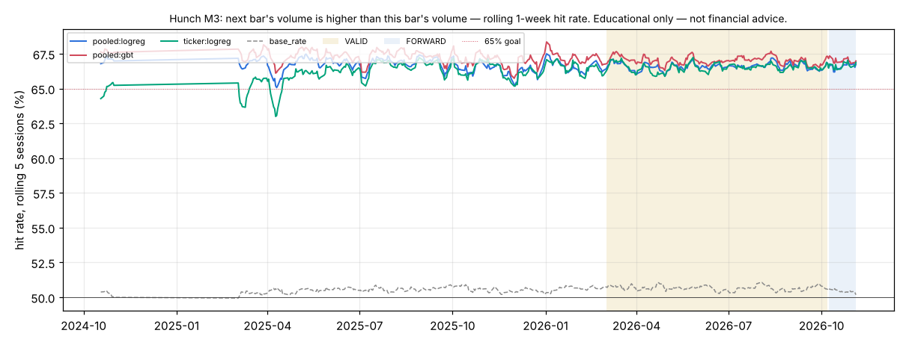

# Hunch M3 — next bar's volume is higher than this bar's volume

*Educational only — not financial advice. Research tool only: Hunch places no orders and changes nothing in config/ or the trading path.*

## Verdict (failures first)

- **Consistent 65%+: YES — pooled:logreg, pooled:gbt, pooled:top8, ticker:logreg** (pooled models); per ticker: ACN (pooled:logreg), ACN (ticker:logreg), AMAT (pooled:logreg), AMAT (ticker:logreg), ASML (ticker:logreg), AVGO (pooled:logreg), BA (pooled:logreg), BA (ticker:logreg), BAC (pooled:logreg), BAC (ticker:logreg), BE (pooled:logreg), BE (ticker:logreg), CAT (pooled:logreg), CAT (ticker:logreg), CIFR (pooled:logreg), CIFR (ticker:logreg), CLSK (pooled:logreg), CLSK (ticker:logreg), COHR (pooled:logreg), COHR (ticker:logreg), CORZ (pooled:logreg), CORZ (ticker:logreg), COST (pooled:logreg), COST (ticker:logreg), CRDO (pooled:logreg), CRDO (ticker:logreg), CRM (pooled:logreg), CRM (ticker:logreg), CRWD (pooled:logreg), CRWD (ticker:logreg), CRWV (pooled:logreg), CVX (pooled:logreg), CVX (ticker:logreg), DELL (pooled:logreg), DELL (ticker:logreg), EEM (pooled:logreg), EEM (ticker:logreg), EWZ (pooled:logreg), EWZ (ticker:logreg), GE (pooled:logreg), GE (ticker:logreg), GEV (pooled:logreg), GEV (ticker:logreg), GOOG (pooled:logreg), GS (pooled:logreg), GS (ticker:logreg), HUT (pooled:logreg), HUT (ticker:logreg), IBIT (pooled:logreg), IBIT (ticker:logreg), INTW (pooled:logreg), INTW (ticker:logreg), IREN (ticker:logreg), IWM (pooled:logreg), IWM (ticker:logreg), JNJ (pooled:logreg), JNJ (ticker:logreg), JPM (pooled:logreg), JPM (ticker:logreg), KLAC (pooled:logreg), KLAC (ticker:logreg), LLY (pooled:logreg), LLY (ticker:logreg), LRCX (pooled:logreg), LRCX (ticker:logreg), MA (pooled:logreg), MA (ticker:logreg), MDT (pooled:logreg), MDT (ticker:logreg), MRNA (pooled:logreg), MRNA (ticker:logreg), MSTU (pooled:logreg), MSTU (ticker:logreg), NFLX (pooled:logreg), NVDA (pooled:logreg), PANW (pooled:logreg), PANW (ticker:logreg), QCOM (pooled:logreg), QQQ (pooled:logreg), QQQ (ticker:logreg), RBRK (pooled:logreg), RBRK (ticker:logreg), RIOT (pooled:logreg), RIOT (ticker:logreg), SHOP (pooled:logreg), SHOP (ticker:logreg), SNOW (pooled:logreg), SNOW (ticker:logreg), SPY (pooled:logreg), SPY (ticker:logreg), SQQQ (ticker:logreg), STX (pooled:logreg), STX (ticker:logreg), TLT (pooled:logreg), TLT (ticker:logreg), TMO (pooled:logreg), TMO (ticker:logreg), TQQQ (pooled:logreg), TQQQ (ticker:logreg), TSLA (ticker:logreg), TXN (pooled:logreg), TXN (ticker:logreg), UNH (pooled:logreg), UNH (ticker:logreg), USAR (pooled:logreg), USAR (ticker:logreg), UVXY (pooled:logreg), UVXY (ticker:logreg), V (pooled:logreg), V (ticker:logreg), VRT (pooled:logreg), VRT (ticker:logreg), WMT (pooled:logreg), WMT (ticker:logreg), XBI (pooled:logreg), XBI (ticker:logreg), XLE (pooled:logreg), XLE (ticker:logreg), XLF (ticker:logreg), XLI (pooled:logreg), XLI (ticker:logreg), XOM (pooled:logreg), XOM (ticker:logreg). Definition: rolling 20-session hit rate ≥ 65% in ≥ 90% of VALID windows. Highest VALID 20-session window of any main pooled learner: 67.3%.
- **Hunch (best combined learner) on VALID: `pooled:gbt` 67.03%** (±0.05% day-clustered SE, n = 1,850,301 guesses, 153 sessions) vs **best baseline `base_rate` 50.66%**: +16.37 pp, day-clustered z = 283.44 (McNemar z = 311.57). Bar: z ≥ 3.47 (N = 408 tests).
- Main learners beating the best baseline at the bar on VALID: `pooled:logreg`, `pooled:gbt`, `pooled:top8`, `ticker:logreg`. Per-ticker (pooled or own model vs that ticker's best baseline): AAPL (pooled:logreg), AAPL (ticker:logreg), ACN (pooled:logreg), ACN (ticker:logreg), AMAT (pooled:logreg), AMAT (ticker:logreg), AMD (pooled:logreg), AMD (ticker:logreg), AMZN (pooled:logreg), AMZN (ticker:logreg), ASML (pooled:logreg), ASML (ticker:logreg), AVGO (pooled:logreg), AVGO (ticker:logreg), BA (pooled:logreg), BA (ticker:logreg), BAC (pooled:logreg), BAC (ticker:logreg), BE (pooled:logreg), BE (ticker:logreg), CAT (pooled:logreg), CAT (ticker:logreg), CIFR (pooled:logreg), CIFR (ticker:logreg), CLSK (pooled:logreg), CLSK (ticker:logreg), COHR (pooled:logreg), COHR (ticker:logreg), CORZ (pooled:logreg), CORZ (ticker:logreg), COST (pooled:logreg), COST (ticker:logreg), CRDO (pooled:logreg), CRDO (ticker:logreg), CRM (pooled:logreg), CRM (ticker:logreg), CRWD (pooled:logreg), CRWD (ticker:logreg), CRWV (pooled:logreg), CRWV (ticker:logreg), CVX (pooled:logreg), CVX (ticker:logreg), DELL (pooled:logreg), DELL (ticker:logreg), DIA (pooled:logreg), DIA (ticker:logreg), EEM (pooled:logreg), EEM (ticker:logreg), EFA (pooled:logreg), EFA (ticker:logreg), EWY (pooled:logreg), EWY (ticker:logreg), EWZ (pooled:logreg), EWZ (ticker:logreg), GDX (pooled:logreg), GDX (ticker:logreg), GE (pooled:logreg), GE (ticker:logreg), GEV (pooled:logreg), GEV (ticker:logreg), GLD (pooled:logreg), GLD (ticker:logreg), GOOG (pooled:logreg), GOOG (ticker:logreg), GOOGL (pooled:logreg), GOOGL (ticker:logreg), GS (pooled:logreg), GS (ticker:logreg), HOOD (pooled:logreg), HOOD (ticker:logreg), HUT (pooled:logreg), HUT (ticker:logreg), IBIT (pooled:logreg), IBIT (ticker:logreg), INTC (pooled:logreg), INTC (ticker:logreg), INTW (pooled:logreg), INTW (ticker:logreg), IREN (pooled:logreg), IREN (ticker:logreg), IWM (pooled:logreg), IWM (ticker:logreg), JNJ (pooled:logreg), JNJ (ticker:logreg), JPM (pooled:logreg), JPM (ticker:logreg), KLAC (pooled:logreg), KLAC (ticker:logreg), LITE (pooled:logreg), LITE (ticker:logreg), LLY (pooled:logreg), LLY (ticker:logreg), LRCX (pooled:logreg), LRCX (ticker:logreg), MA (pooled:logreg), MA (ticker:logreg), MDT (pooled:logreg), MDT (ticker:logreg), META (pooled:logreg), META (ticker:logreg), MRNA (pooled:logreg), MRNA (ticker:logreg), MRVL (pooled:logreg), MRVL (ticker:logreg), MSFT (pooled:logreg), MSFT (ticker:logreg), MSTR (pooled:logreg), MSTR (ticker:logreg), MSTU (pooled:logreg), MSTU (ticker:logreg), MSTX (pooled:logreg), MSTX (ticker:logreg), MU (pooled:logreg), MU (ticker:logreg), MUU (pooled:logreg), MUU (ticker:logreg), NBIS (pooled:logreg), NBIS (ticker:logreg), NFLX (pooled:logreg), NFLX (ticker:logreg), NOW (pooled:logreg), NOW (ticker:logreg), NVDA (pooled:logreg), NVDA (ticker:logreg), ORCL (pooled:logreg), ORCL (ticker:logreg), PANW (pooled:logreg), PANW (ticker:logreg), PLTR (pooled:logreg), PLTR (ticker:logreg), QCOM (pooled:logreg), QCOM (ticker:logreg), QQQ (pooled:logreg), QQQ (ticker:logreg), RBRK (pooled:logreg), RBRK (ticker:logreg), RIOT (pooled:logreg), RIOT (ticker:logreg), SHOP (pooled:logreg), SHOP (ticker:logreg), SMH (pooled:logreg), SMH (ticker:logreg), SNDK (pooled:logreg), SNDK (ticker:logreg), SNOW (pooled:logreg), SNOW (ticker:logreg), SOXL (pooled:logreg), SOXL (ticker:logreg), SOXS (pooled:logreg), SOXS (ticker:logreg), SOXX (pooled:logreg), SOXX (ticker:logreg), SPY (pooled:logreg), SPY (ticker:logreg), SQQQ (pooled:logreg), SQQQ (ticker:logreg), STX (pooled:logreg), STX (ticker:logreg), TLT (pooled:logreg), TLT (ticker:logreg), TMO (pooled:logreg), TMO (ticker:logreg), TQQQ (pooled:logreg), TQQQ (ticker:logreg), TSLA (pooled:logreg), TSLA (ticker:logreg), TSM (pooled:logreg), TSM (ticker:logreg), TXN (pooled:logreg), TXN (ticker:logreg), UNH (pooled:logreg), UNH (ticker:logreg), USAR (pooled:logreg), USAR (ticker:logreg), UVXY (pooled:logreg), UVXY (ticker:logreg), V (pooled:logreg), V (ticker:logreg), VRT (pooled:logreg), VRT (ticker:logreg), WDC (pooled:logreg), WDC (ticker:logreg), WMT (pooled:logreg), WMT (ticker:logreg), XBI (pooled:logreg), XBI (ticker:logreg), XLE (pooled:logreg), XLE (ticker:logreg), XLF (pooled:logreg), XLF (ticker:logreg), XLI (pooled:logreg), XLI (ticker:logreg), XLK (pooled:logreg), XLK (ticker:logreg), XLP (pooled:logreg), XLP (ticker:logreg), XLV (pooled:logreg), XLV (ticker:logreg), XOM (pooled:logreg), XOM (ticker:logreg).
- Base rate ('yes' share): TRAIN 49.48%, VALID 49.34%. 2.2% of guess slots have the next close exactly equal to this close (a tie counts as 'not higher'), which is why the base-rate baseline ('no') sits above 50% on M1.
- Tests counted per metric: 4 main learners + 2 × 100 per-ticker comparisons + 0 single-indicator diagnostics = 204; × 2 metrics (M1, M3) = 408. One configuration per learner, hyper-parameters fixed in advance (mcf/hunch/learners.py); nothing tuned on VALID. The top-8 model's features were picked on TRAIN: vol20, tod, rsi14, atr_pct, spy_ret1, orh, pressure, orl.

## Data and protocol

- Data: SIP 1-min bars from the 2-year cache (data/cache_hist/1Min), RTH only, built into 3-min bars. Universe (100, list in research/hunch/universe100.txt): SPY, QQQ, IWM + the most liquid names in the cache by 20-day dollar ADV (to 2026-11-04), live-traded names first. 5 of them list after the start and join when they list. Context: SPY, QQQ, SMH, IBIT. Survivorship: today's liquid names applied to the past.
- Periods: TRAIN 2024-09-16..2026-02-28 (locked block 2024-11-01..2025-02-28 never read — filtered inside the parquet read), VALID 2026-03-01..2026-10-07, FORWARD after that (reported separately). Sessions scored: TRAIN 263, VALID 153, FORWARD 20; the first 20 sessions are warm-up (guessed, not scored); the first session after the locked gap is an indicator warm-up (not guessed).
- Guesses: every 3-min bar closing 09:51..15:51 ET (121 a session per ticker); each uses data up to that bar's close only and is scored on the next bar. Walk-forward, online: the logistic learners update after every scored guess; the boosted trees refit every 20 sessions on the previous 120 sessions only.
- Learners: **pooled:logreg** = Hunch, all features, shared weights across tickers (+ ticker intercept); **pooled:gbt** = light boosted trees, all features, pooled; **pooled:top8** = pooled logreg on the TRAIN top-8 features; **ticker:logreg** = one Hunch instance per ticker (own weights, own data). Single-indicator learners are a diagnostic only.
- Run time 358 s. No rule / config change in research/ledger.jsonl bears on this study: it reads raw market bars, not setup results.

## Hunch: combined learners vs baselines

Day-clustered SE in brackets; z vs the best baseline (VALID: `base_rate`; TRAIN: `base_rate`), day-clustered. ✔ = z ≥ 3.47.

| learner | TRAIN hit | VALID hit | FORWARD hit | VALID − best base (pp) | z vs best | McNemar z | z vs coin | 20-sess ≥65% share | best 20-sess |
|---|---|---|---|---|---|---|---|---|---|
| `pooled:gbt` | 67.26% | 67.03% (0.05%) | 66.93% | +16.37 | 283.44 ✔ | 311.57 | 350.69 | 100% | 67.3% |
| `pooled:top8` | 66.70% (in-sample feature pick) | 66.63% (0.05%) | 66.64% | +15.97 | 275.12 ✔ | 289.57 | 356.46 | 100% | 66.9% |
| `pooled:logreg` | 66.67% | 66.61% (0.05%) | 66.57% | +15.94 | 286.54 ✔ | 289.63 | 361.40 | 100% | 66.8% |
| `ticker:logreg` | 66.12% | 66.53% (0.05%) | 66.61% | +15.87 | 276.20 ✔ | 287.06 | 341.87 | 100% | 66.7% |
| baseline `coin` | 50.00% | 50.00% | 50.00% | | | | | | |
| baseline `same_last` | 36.83% | 37.14% | 37.11% | | | | | | |
| baseline `base_rate` | 50.52% | 50.66% | 50.42% | | | | | | |
| baseline `always_yes` | 49.48% | 49.34% | 49.58% | | | | | | |
| baseline `mom20` | 46.71% | 46.81% | 46.67% | | | | | | |

## The 20+ Hunch instances: per ticker (VALID, TRAIN in brackets)

Each ticker's own best VALID baseline; z (day-clustered) of the pooled model and of that ticker's own model against it. ✔ = z ≥ 3.47. 65% = share of VALID 20-session windows ≥ 65%.

| ticker | guesses | pooled:logreg | ticker:logreg | best baseline | z pooled | z own | 65% pooled | 65% own |
|---|---|---|---|---|---|---|---|---|
| TMO | 18,513 | 69.00% (68.5%) | 69.02% (68.1%) | `always_yes` 50.46% | 48.64 ✔ | 47.85 ✔ | 100% | 100% |
| LLY | 18,513 | 68.41% (68.3%) | 68.70% (67.6%) | `base_rate` 50.20% | 42.35 ✔ | 44.16 ✔ | 100% | 100% |
| CAT | 18,513 | 68.21% (68.4%) | 67.90% (68.1%) | `always_yes` 50.51% | 47.87 ✔ | 45.42 ✔ | 100% | 100% |
| RBRK | 18,513 | 68.14% (68.1%) | 68.22% (67.3%) | `always_yes` 50.05% | 52.68 ✔ | 53.44 ✔ | 100% | 100% |
| IWM | 18,513 | 68.10% (67.8%) | 68.23% (66.9%) | `base_rate` 50.82% | 40.32 ✔ | 42.27 ✔ | 100% | 100% |
| ACN | 18,513 | 68.06% (68.9%) | 68.23% (68.6%) | `always_yes` 50.56% | 50.38 ✔ | 48.36 ✔ | 100% | 100% |
| MSTU | 18,513 | 67.96% (66.0%) | 68.68% (66.0%) | `base_rate` 51.19% | 42.21 ✔ | 43.77 ✔ | 100% | 100% |
| COST | 18,513 | 67.94% (69.0%) | 67.94% (68.9%) | `always_yes` 50.36% | 51.95 ✔ | 50.74 ✔ | 100% | 100% |
| HUT | 18,513 | 67.87% (66.9%) | 67.52% (66.3%) | `base_rate` 50.11% | 45.30 ✔ | 47.35 ✔ | 100% | 100% |
| INTW | 17,536 | 67.76% (67.7%) | 67.85% (66.3%) | `base_rate` 50.85% | 43.83 ✔ | 42.24 ✔ | 100% | 100% |
| MA | 18,513 | 67.71% (68.3%) | 67.76% (68.1%) | `always_yes` 50.28% | 47.03 ✔ | 45.44 ✔ | 100% | 100% |
| JPM | 18,513 | 67.67% (67.1%) | 67.51% (66.6%) | `always_yes` 50.33% | 44.04 ✔ | 47.87 ✔ | 100% | 100% |
| KLAC | 18,505 | 67.67% (69.5%) | 67.15% (68.8%) | `base_rate` 50.04% | 42.58 ✔ | 39.60 ✔ | 100% | 92% |
| EEM | 18,513 | 67.64% (68.0%) | 67.28% (67.1%) | `base_rate` 50.74% | 40.49 ✔ | 40.33 ✔ | 100% | 100% |
| V | 18,513 | 67.57% (67.9%) | 67.81% (67.5%) | `always_yes` 50.45% | 40.56 ✔ | 42.99 ✔ | 100% | 100% |
| UVXY | 18,513 | 67.55% (66.5%) | 67.24% (66.4%) | `base_rate` 50.73% | 41.88 ✔ | 40.14 ✔ | 100% | 100% |
| CORZ | 18,513 | 67.54% (67.4%) | 67.08% (66.4%) | `base_rate` 50.27% | 42.84 ✔ | 41.51 ✔ | 100% | 100% |
| GEV | 18,513 | 67.54% (67.9%) | 67.30% (67.3%) | `always_yes` 50.18% | 43.38 ✔ | 43.96 ✔ | 100% | 100% |
| TLT | 18,513 | 67.54% (68.5%) | 67.53% (68.0%) | `base_rate` 50.60% | 42.26 ✔ | 42.25 ✔ | 100% | 100% |
| GS | 18,513 | 67.53% (68.2%) | 67.30% (67.3%) | `base_rate` 50.02% | 42.68 ✔ | 40.40 ✔ | 100% | 100% |
| VRT | 18,513 | 67.50% (66.7%) | 67.17% (66.1%) | `always_yes` 50.33% | 52.06 ✔ | 48.93 ✔ | 100% | 100% |
| SNOW | 18,513 | 67.48% (67.1%) | 67.54% (66.1%) | `base_rate` 50.23% | 39.90 ✔ | 39.36 ✔ | 100% | 100% |
| PANW | 18,513 | 67.46% (67.3%) | 67.68% (66.8%) | `always_yes` 50.21% | 46.75 ✔ | 48.10 ✔ | 100% | 100% |
| BA | 18,513 | 67.43% (66.9%) | 66.84% (66.1%) | `always_yes` 50.01% | 47.88 ✔ | 45.59 ✔ | 100% | 94% |
| LRCX | 18,513 | 67.40% (66.1%) | 67.01% (65.6%) | `always_yes` 50.42% | 47.71 ✔ | 48.86 ✔ | 100% | 100% |
| TXN | 18,513 | 67.36% (66.3%) | 67.39% (65.8%) | `always_yes` 50.58% | 46.74 ✔ | 47.51 ✔ | 99% | 98% |
| CRWD | 18,513 | 67.36% (66.9%) | 67.53% (66.5%) | `base_rate` 50.61% | 42.14 ✔ | 41.46 ✔ | 100% | 100% |
| CRM | 18,513 | 67.32% (67.5%) | 67.34% (66.9%) | `always_yes` 50.12% | 46.47 ✔ | 44.40 ✔ | 99% | 100% |
| UNH | 18,513 | 67.26% (66.3%) | 67.61% (66.3%) | `always_yes` 50.41% | 50.14 ✔ | 52.52 ✔ | 99% | 100% |
| USAR | 18,513 | 67.26% (67.7%) | 66.96% (65.7%) | `base_rate` 50.63% | 41.57 ✔ | 42.85 ✔ | 93% | 96% |
| CRDO | 18,513 | 67.24% (67.3%) | 66.72% (66.7%) | `base_rate` 50.16% | 44.71 ✔ | 44.23 ✔ | 100% | 100% |
| QQQ | 18,513 | 67.24% (66.4%) | 66.88% (65.6%) | `base_rate` 50.79% | 37.91 ✔ | 38.09 ✔ | 100% | 100% |
| BAC | 18,513 | 67.21% (67.6%) | 67.41% (67.2%) | `base_rate` 50.18% | 39.21 ✔ | 41.30 ✔ | 100% | 100% |
| WMT | 18,513 | 67.14% (65.9%) | 67.05% (65.5%) | `base_rate` 50.02% | 40.29 ✔ | 39.39 ✔ | 100% | 100% |
| MRNA | 18,513 | 67.14% (67.0%) | 67.03% (66.1%) | `base_rate` 50.68% | 41.84 ✔ | 39.05 ✔ | 100% | 100% |
| CLSK | 18,513 | 67.12% (66.5%) | 66.85% (66.3%) | `base_rate` 51.09% | 40.71 ✔ | 39.52 ✔ | 100% | 100% |
| AMAT | 18,513 | 67.10% (67.1%) | 66.78% (66.5%) | `always_yes` 50.16% | 53.09 ✔ | 51.31 ✔ | 100% | 99% |
| CIFR | 18,513 | 67.07% (66.9%) | 66.52% (67.2%) | `base_rate` 51.17% | 41.00 ✔ | 38.14 ✔ | 100% | 93% |
| SHOP | 18,513 | 67.03% (66.9%) | 66.95% (66.0%) | `always_yes` 50.05% | 44.96 ✔ | 46.34 ✔ | 93% | 96% |
| CVX | 18,513 | 67.01% (66.5%) | 66.99% (66.1%) | `base_rate` 50.01% | 40.69 ✔ | 43.80 ✔ | 100% | 97% |
| MDT | 18,513 | 67.01% (66.7%) | 67.38% (66.4%) | `always_yes` 50.31% | 43.90 ✔ | 45.47 ✔ | 99% | 96% |
| EWZ | 18,513 | 66.96% (67.8%) | 66.56% (67.3%) | `base_rate` 50.76% | 40.99 ✔ | 39.05 ✔ | 100% | 96% |
| GE | 18,513 | 66.93% (67.3%) | 66.81% (66.7%) | `always_yes` 50.30% | 44.69 ✔ | 45.81 ✔ | 100% | 96% |
| JNJ | 18,513 | 66.93% (66.6%) | 68.02% (66.2%) | `always_yes` 50.81% | 41.81 ✔ | 46.32 ✔ | 99% | 100% |
| XOM | 18,513 | 66.93% (66.0%) | 67.46% (65.7%) | `always_yes` 50.06% | 42.67 ✔ | 43.71 ✔ | 100% | 100% |
| IBIT | 18,513 | 66.86% (65.5%) | 66.72% (65.1%) | `base_rate` 51.66% | 33.27 ✔ | 34.62 ✔ | 97% | 97% |
| SPY | 18,513 | 66.86% (65.9%) | 66.75% (65.1%) | `base_rate` 50.02% | 43.47 ✔ | 44.21 ✔ | 100% | 96% |
| STX | 18,513 | 66.83% (67.4%) | 66.70% (66.5%) | `base_rate` 50.27% | 40.22 ✔ | 40.58 ✔ | 93% | 91% |
| XLI | 18,513 | 66.70% (67.2%) | 66.65% (66.5%) | `base_rate` 50.48% | 42.29 ✔ | 42.13 ✔ | 96% | 99% |
| QCOM | 18,513 | 66.68% (66.9%) | 66.74% (66.3%) | `always_yes` 50.01% | 47.40 ✔ | 45.64 ✔ | 91% | 84% |
| XBI | 18,513 | 66.67% (66.7%) | 66.48% (66.0%) | `base_rate` 50.82% | 39.09 ✔ | 38.86 ✔ | 100% | 100% |
| DELL | 18,513 | 66.59% (67.1%) | 66.66% (66.3%) | `base_rate` 50.20% | 39.59 ✔ | 41.19 ✔ | 93% | 94% |
| NFLX | 18,513 | 66.59% (66.6%) | 66.30% (66.0%) | `base_rate` 50.52% | 40.08 ✔ | 38.31 ✔ | 92% | 84% |
| TQQQ | 18,513 | 66.48% (66.3%) | 66.66% (66.3%) | `base_rate` 52.37% | 33.74 ✔ | 32.62 ✔ | 95% | 99% |
| BE | 18,513 | 66.47% (66.2%) | 66.12% (65.4%) | `base_rate` 51.68% | 36.78 ✔ | 36.21 ✔ | 94% | 98% |
| COHR | 18,513 | 66.46% (67.4%) | 66.12% (66.4%) | `base_rate` 50.31% | 41.08 ✔ | 41.27 ✔ | 100% | 97% |
| RIOT | 18,513 | 66.45% (65.8%) | 66.60% (66.0%) | `base_rate` 50.87% | 35.54 ✔ | 39.37 ✔ | 99% | 100% |
| CRWV | 18,513 | 66.36% (65.2%) | 66.19% (64.6%) | `base_rate` 51.23% | 35.27 ✔ | 33.03 ✔ | 94% | 74% |
| AVGO | 18,513 | 66.33% (65.6%) | 65.51% (65.2%) | `base_rate` 50.54% | 37.47 ✔ | 34.00 ✔ | 93% | 67% |
| XLP | 18,513 | 66.30% (67.0%) | 66.00% (66.9%) | `base_rate` 50.53% | 36.13 ✔ | 37.49 ✔ | 87% | 84% |
| ASML | 18,513 | 66.20% (67.7%) | 66.14% (66.8%) | `base_rate` 50.22% | 41.26 ✔ | 39.13 ✔ | 85% | 90% |
| XLE | 18,513 | 66.18% (65.8%) | 65.99% (65.2%) | `base_rate` 51.16% | 35.67 ✔ | 38.24 ✔ | 99% | 98% |
| MSTX | 18,511 | 66.16% (66.3%) | 66.86% (66.8%) | `base_rate` 51.47% | 37.31 ✔ | 38.10 ✔ | 84% | 90% |
| AMD | 18,513 | 66.16% (65.1%) | 65.74% (64.5%) | `base_rate` 51.80% | 34.67 ✔ | 34.73 ✔ | 89% | 84% |
| MRVL | 18,513 | 66.07% (65.9%) | 65.76% (65.2%) | `base_rate` 51.44% | 34.04 ✔ | 35.43 ✔ | 89% | 77% |
| MSTR | 18,513 | 66.03% (65.3%) | 65.54% (64.9%) | `base_rate` 51.47% | 36.95 ✔ | 38.24 ✔ | 87% | 70% |
| ORCL | 18,513 | 66.01% (66.3%) | 66.02% (65.8%) | `base_rate` 50.89% | 36.60 ✔ | 36.73 ✔ | 75% | 75% |
| LITE | 18,513 | 66.01% (67.7%) | 65.63% (66.8%) | `base_rate` 50.94% | 40.72 ✔ | 40.58 ✔ | 82% | 80% |
| IREN | 18,513 | 65.98% (66.2%) | 66.09% (65.8%) | `base_rate` 51.48% | 36.64 ✔ | 40.76 ✔ | 81% | 92% |
| SQQQ | 18,513 | 65.96% (66.1%) | 66.43% (66.2%) | `base_rate` 52.24% | 29.44 ✔ | 31.53 ✔ | 75% | 93% |
| NVDA | 18,513 | 65.92% (65.1%) | 65.71% (64.8%) | `base_rate` 51.79% | 35.43 ✔ | 33.63 ✔ | 97% | 88% |
| XLF | 18,513 | 65.91% (66.9%) | 66.52% (66.2%) | `base_rate` 50.49% | 39.71 ✔ | 40.61 ✔ | 90% | 99% |
| XLV | 18,513 | 65.89% (66.5%) | 65.93% (65.8%) | `base_rate` 51.05% | 37.83 ✔ | 39.11 ✔ | 81% | 83% |
| TSM | 18,513 | 65.87% (65.8%) | 65.56% (65.2%) | `base_rate` 50.60% | 36.43 ✔ | 36.14 ✔ | 87% | 76% |
| GLD | 18,513 | 65.86% (65.8%) | 65.91% (65.4%) | `base_rate` 50.46% | 38.63 ✔ | 38.01 ✔ | 82% | 85% |
| GOOG | 18,513 | 65.85% (64.7%) | 65.51% (64.0%) | `base_rate` 50.43% | 36.25 ✔ | 35.39 ✔ | 95% | 81% |
| MSFT | 18,513 | 65.77% (65.5%) | 65.51% (65.0%) | `base_rate` 50.79% | 34.74 ✔ | 32.59 ✔ | 74% | 76% |
| DIA | 18,513 | 65.76% (67.2%) | 65.53% (66.1%) | `base_rate` 50.70% | 34.47 ✔ | 35.64 ✔ | 81% | 72% |
| PLTR | 18,513 | 65.73% (64.6%) | 65.79% (64.7%) | `base_rate` 51.34% | 34.90 ✔ | 34.04 ✔ | 78% | 80% |
| NBIS | 18,513 | 65.72% (66.4%) | 65.87% (65.1%) | `base_rate` 51.34% | 36.00 ✔ | 35.77 ✔ | 81% | 82% |
| WDC | 18,513 | 65.66% (66.2%) | 65.37% (65.1%) | `base_rate` 50.80% | 34.77 ✔ | 32.98 ✔ | 67% | 67% |
| NOW | 18,513 | 65.61% (68.8%) | 65.59% (68.4%) | `base_rate` 50.56% | 35.66 ✔ | 35.16 ✔ | 69% | 65% |
| GOOGL | 18,513 | 65.60% (65.2%) | 64.99% (64.3%) | `base_rate` 50.52% | 32.54 ✔ | 31.87 ✔ | 78% | 49% |
| AMZN | 18,513 | 65.60% (65.2%) | 65.29% (64.7%) | `base_rate` 50.76% | 34.77 ✔ | 35.87 ✔ | 75% | 69% |
| MUU | 18,501 | 65.60% (67.5%) | 65.91% (65.8%) | `base_rate` 52.41% | 30.91 ✔ | 33.40 ✔ | 74% | 90% |
| META | 18,513 | 65.57% (65.5%) | 65.61% (65.4%) | `base_rate` 50.85% | 34.29 ✔ | 37.19 ✔ | 76% | 81% |
| AAPL | 18,513 | 65.50% (65.2%) | 65.22% (64.6%) | `base_rate` 51.12% | 34.69 ✔ | 37.93 ✔ | 66% | 54% |
| XLK | 18,513 | 65.50% (66.3%) | 65.05% (65.1%) | `base_rate` 50.39% | 40.24 ✔ | 37.10 ✔ | 70% | 44% |
| TSLA | 18,513 | 65.48% (64.2%) | 66.07% (64.8%) | `base_rate` 53.03% | 32.30 ✔ | 36.12 ✔ | 70% | 94% |
| EFA | 18,513 | 65.47% (66.1%) | 65.65% (65.3%) | `base_rate` 51.07% | 35.40 ✔ | 36.74 ✔ | 76% | 75% |
| INTC | 18,513 | 65.45% (65.8%) | 65.46% (65.3%) | `base_rate` 52.00% | 40.33 ✔ | 39.91 ✔ | 75% | 68% |
| GDX | 18,513 | 65.44% (65.9%) | 65.38% (65.8%) | `base_rate` 50.49% | 34.73 ✔ | 35.07 ✔ | 78% | 78% |
| HOOD | 18,513 | 65.42% (65.4%) | 65.14% (64.8%) | `base_rate` 51.59% | 33.45 ✔ | 32.04 ✔ | 66% | 56% |
| EWY | 18,513 | 65.25% (66.8%) | 64.95% (66.0%) | `base_rate` 50.60% | 34.98 ✔ | 35.20 ✔ | 60% | 51% |
| MU | 18,513 | 65.20% (64.9%) | 65.01% (64.7%) | `base_rate` 52.47% | 33.23 ✔ | 33.89 ✔ | 64% | 58% |
| SMH | 18,513 | 65.04% (65.6%) | 64.89% (65.1%) | `base_rate` 50.29% | 36.13 ✔ | 34.81 ✔ | 46% | 30% |
| SOXS | 18,513 | 64.95% (67.0%) | 65.34% (67.7%) | `base_rate` 52.27% | 30.52 ✔ | 33.06 ✔ | 49% | 63% |
| SNDK | 18,513 | 64.61% (67.5%) | 65.04% (66.4%) | `base_rate` 52.75% | 30.40 ✔ | 31.67 ✔ | 28% | 50% |
| SOXX | 18,513 | 64.47% (64.9%) | 64.29% (63.9%) | `base_rate` 50.92% | 32.45 ✔ | 32.75 ✔ | 33% | 17% |
| SOXL | 18,513 | 64.37% (65.3%) | 64.29% (64.9%) | `base_rate` 52.74% | 27.64 ✔ | 28.04 ✔ | 20% | 28% |

## Indicator trust table (primary: permutation importance of the combined model)

The end-of-TRAIN pooled logreg and pooled GBT, frozen, scored on every VALID guess (frozen hit: logreg 66.41%, GBT 67.11%, n = 500,000); each indicator shuffled across the VALID guesses in turn (3 repeats; ± = sd over repeats). Higher log-loss increase = the model leans on it out of sample. Ranked by the mean of the two models' ranks. A negative value means shuffling the indicator *helped* on VALID: the model's use of it learned on TRAIN does not carry over. Mean weight = the pooled logreg's average standardized weight over VALID (sign = push toward 'yes').

| rank | indicator | logreg log-loss ↑ ×1000 | logreg hit drop (pp) | GBT log-loss ↑ ×1000 | GBT hit drop (pp) | mean weight | TRAIN rank |
|---|---|---|---|---|---|---|---|
| 1 | vol20 | +218.741 ± 0.670 | +15.33 | +173.144 ± 0.433 | +16.27 | -1.5851 | 1 |
| 2 | tod | +41.068 ± 0.142 | +3.48 | +34.048 ± 0.103 | +3.97 | +0.4515 | 2 |
| 3 | rsi14 | +0.311 ± 0.012 | +0.05 | +0.275 ± 0.005 | +0.02 | -0.0154 | 3 |
| 4 | atr_pct | +0.253 ± 0.071 | +0.10 | +0.275 ± 0.015 | +0.01 | -0.0638 | 4 |
| 5 | pressure | -0.061 ± 0.020 | -0.01 | +0.664 ± 0.023 | +0.06 | +0.0121 | 7 |
| 6 | spy_ret1 | +0.236 ± 0.005 | +0.03 | +0.012 ± 0.002 | +0.00 | +0.0026 | 5 |
| 7 | orh | +2.167 ± 0.020 | +0.30 | +0.000 ± 0.000 | +0.00 | -0.0893 | 6 |
| 8 | orl | +1.033 ± 0.048 | +0.14 | +0.000 ± 0.000 | +0.00 | +0.0953 | 8 |
| 9 | pdh | +0.416 ± 0.004 | +0.08 | +0.000 ± 0.000 | +0.00 | -0.0188 | 9 |
| 10 | ret1 | -0.110 ± 0.012 | -0.01 | +0.020 ± 0.002 | +0.00 | +0.0226 | 10 |
| 11 | ret3 | -0.143 ± 0.003 | -0.01 | +0.024 ± 0.002 | -0.00 | +0.0099 | 13 |
| 12 | rsi5 | -0.308 ± 0.012 | -0.04 | +2.830 ± 0.050 | +0.32 | -0.0023 | 11 |
| 13 | spy_fo | +0.144 ± 0.005 | +0.02 | +0.000 ± 0.000 | +0.00 | -0.0121 | 12 |
| 14 | gap | -0.010 ± 0.003 | +0.00 | +0.000 ± 0.000 | +0.00 | +0.0002 | 14 |
| 15 | fo | -0.070 ± 0.001 | -0.01 | +0.000 ± 0.000 | +0.00 | +0.0002 | 17 |
| 16 | sector_ret1 | -0.072 ± 0.004 | +0.00 | +0.000 ± 0.000 | +0.00 | +0.0026 | 15 |
| 17 | pdl | -0.085 ± 0.021 | -0.01 | +0.000 ± 0.000 | +0.00 | +0.0077 | 18 |
| 18 | qqq_ret1 | -0.094 ± 0.009 | +0.00 | +0.000 ± 0.000 | +0.00 | -0.0251 | 16 |
| 19 | qqq_fo | -0.149 ± 0.005 | +0.00 | +0.000 ± 0.000 | +0.00 | +0.0028 | 19 |
| 20 | ret5 | -0.185 ± 0.014 | -0.02 | +0.000 ± 0.000 | +0.00 | -0.0032 | 20 |
| 21 | vwap_atr | -0.205 ± 0.013 | -0.02 | +0.000 ± 0.000 | +0.00 | +0.0058 | 21 |

## VALID by time of day

| bar close | `pooled:gbt` | `pooled:top8` | `pooled:logreg` | `ticker:logreg` | `base_rate` |
|---|---|---|---|---|---|
| 09:51-10:30 | 64.28% | 63.77% | 63.64% | 64.49% | 53.73% |
| 10:33-12:00 | 67.42% | 66.98% | 66.93% | 66.79% | 52.31% |
| 12:03-14:00 | 67.86% | 67.50% | 67.53% | 67.22% | 51.19% |
| 14:03-15:00 | 68.19% | 67.87% | 67.84% | 67.45% | 50.23% |
| 15:03-15:51 | 65.30% | 64.86% | 64.87% | 65.08% | 44.48% |

## VALID by SPY day type

SPY session open-to-close terciles, cut points from TRAIN (-0.23% / +0.33%). Known only after the close: a report split, never a feature.

| day type | guesses | `pooled:gbt` | `pooled:top8` | `pooled:logreg` | `ticker:logreg` | `base_rate` |
|---|---|---|---|---|---|---|
| up | 519,984 | 67.11% | 66.72% | 66.69% | 66.61% | 50.69% |
| flat | 773,978 | 67.05% | 66.67% | 66.64% | 66.56% | 50.65% |
| down | 556,339 | 66.92% | 66.48% | 66.48% | 66.43% | 50.65% |

## Stability

Rolling 5-session hit rate of the combined learners and the best baseline (`base_rate`, dashed); VALID and FORWARD shaded.

*Educational only — not financial advice.*
