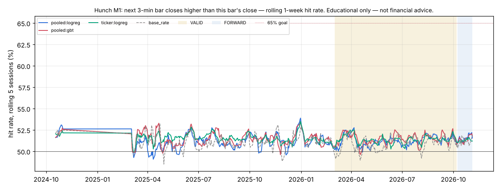

# Hunch M1 — next 3-min bar closes higher than this bar's close

*Educational only — not financial advice. Research tool only: Hunch places no orders and changes nothing in config/ or the trading path.*

## Verdict (failures first)

- **Consistent 65%+: NO** (pooled models); per ticker: **none of the 200 tickers**. Definition: rolling 20-session hit rate ≥ 65% in ≥ 90% of VALID windows. Highest VALID 20-session window of any main pooled learner: 52.2%.
- **Hunch (best combined learner) on VALID: `pooled:gbt` 51.44%** (±0.09% day-clustered SE, n = 3,700,179 guesses, 153 sessions) vs **best baseline `base_rate` 50.93%**: +0.51 pp, day-clustered z = 4.34 (McNemar z = 17.97). Bar: z ≥ 3.66 (N = 808 tests).
- Main learners beating the best baseline at the bar on VALID: `pooled:gbt`, `ticker:logreg`. Per-ticker (pooled or own model vs that ticker's best baseline): BLK (ticker:logreg), FIX (ticker:logreg), MPWR (ticker:logreg), PSQ (ticker:logreg), QQQM (ticker:logreg), SNPS (ticker:logreg), SPGI (ticker:logreg), TMO (ticker:logreg).
- Base rate ('yes' share): TRAIN 48.87%, VALID 49.07%. 2.6% of guess slots have the next close exactly equal to this close (a tie counts as 'not higher'), which is why the base-rate baseline ('no') sits above 50% on M1.
- Tests counted per metric: 4 main learners + 2 × 200 per-ticker comparisons + 0 single-indicator diagnostics = 404; × 2 metrics (M1, M3) = 808. One configuration per learner, hyper-parameters fixed in advance (mcf/hunch/learners.py); nothing tuned on VALID. The top-8 model's features were picked on TRAIN: qqq_fo, spy_fo, rsi14, spy_ret1, pressure, sector_ret1, qqq_ret1, rsi5.

## Data and protocol

- Data: SIP 1-min bars from the 2-year cache (data/cache_hist/1Min), RTH only, built into 3-min bars. Universe (200, list in research/hunch/universe200.txt): SPY, QQQ, IWM + the most liquid names in the cache by 20-day dollar ADV (to 2026-11-04), live-traded names first. 5 of them list after the start and join when they list. Context: SPY, QQQ, SMH, IBIT. Survivorship: today's liquid names applied to the past.
- Periods: TRAIN 2024-09-16..2026-02-28 (locked block 2024-11-01..2025-02-28 never read — filtered inside the parquet read), VALID 2026-03-01..2026-10-07, FORWARD after that (reported separately). Sessions scored: TRAIN 263, VALID 153, FORWARD 20; the first 20 sessions are warm-up (guessed, not scored); the first session after the locked gap is an indicator warm-up (not guessed).
- Guesses: every 3-min bar closing 09:51..15:51 ET (121 a session per ticker); each uses data up to that bar's close only and is scored on the next bar. Walk-forward, online: the logistic learners update after every scored guess; the boosted trees refit every 20 sessions on the previous 120 sessions only.
- Learners: **pooled:logreg** = Hunch, all features, shared weights across tickers (+ ticker intercept); **pooled:gbt** = light boosted trees, all features, pooled; **pooled:top8** = pooled logreg on the TRAIN top-8 features; **ticker:logreg** = one Hunch instance per ticker (own weights, own data). Single-indicator learners are a diagnostic only.
- Run time 408 s. No rule / config change in research/ledger.jsonl bears on this study: it reads raw market bars, not setup results.

## Hunch: combined learners vs baselines

Day-clustered SE in brackets; z vs the best baseline (VALID: `base_rate`; TRAIN: `base_rate`), day-clustered. ✔ = z ≥ 3.66.

| learner | TRAIN hit | VALID hit | FORWARD hit | VALID − best base (pp) | z vs best | McNemar z | z vs coin | 20-sess ≥65% share | best 20-sess |
|---|---|---|---|---|---|---|---|---|---|
| `pooled:gbt` | 51.47% | 51.44% (0.09%) | 51.51% | +0.51 | 4.34 ✔ | 17.97 | 15.54 | 0% | 52.2% |
| `ticker:logreg` | 51.54% | 51.36% (0.06%) | 51.26% | +0.43 | 3.71 ✔ | 12.92 | 21.47 | 0% | 52.0% |
| `pooled:top8` | 51.16% (in-sample feature pick) | 51.28% (0.10%) | 51.52% | +0.35 | 2.67 | 11.01 | 13.03 | 0% | 52.0% |
| `pooled:logreg` | 51.13% | 51.23% (0.10%) | 51.59% | +0.30 | 2.22 | 9.11 | 12.40 | 0% | 52.0% |
| baseline `coin` | 50.00% | 50.00% | 50.00% | | | | | | |
| baseline `same_last` | 49.26% | 48.97% | 49.20% | | | | | | |
| baseline `base_rate` | 51.13% | 50.93% | 51.28% | | | | | | |
| baseline `always_yes` | 48.87% | 49.07% | 48.72% | | | | | | |
| baseline `mom20` | 49.99% | 49.71% | 50.02% | | | | | | |

## The 20+ Hunch instances: per ticker (VALID, TRAIN in brackets)

Each ticker's own best VALID baseline; z (day-clustered) of the pooled model and of that ticker's own model against it. ✔ = z ≥ 3.66. 65% = share of VALID 20-session windows ≥ 65%.

| ticker | guesses | pooled:logreg | ticker:logreg | best baseline | z pooled | z own | 65% pooled | 65% own |
|---|---|---|---|---|---|---|---|---|
| RWM | 17,636 | 55.74% (52.9%) | 57.39% (54.9%) | `base_rate` 56.52% | -2.17 | 2.80 | 0% | 0% |
| NOK | 18,513 | 55.27% (65.7%) | 54.45% (66.5%) | `base_rate` 55.28% | -0.15 | -3.24 | 0% | 0% |
| AAL | 18,513 | 55.03% (52.8%) | 54.99% (54.0%) | `base_rate` 55.59% | -1.76 | -2.49 | 0% | 0% |
| NU | 18,513 | 54.96% (53.9%) | 55.44% (55.0%) | `base_rate` 55.86% | -3.36 | -1.78 | 0% | 0% |
| PSQ | 18,423 | 54.65% (53.8%) | 56.58% (55.7%) | `base_rate` 55.32% | -2.38 | 3.71 ✔ | 0% | 0% |
| T | 18,513 | 54.57% (53.3%) | 54.26% (54.7%) | `base_rate` 55.07% | -1.79 | -3.13 | 0% | 0% |
| PFE | 18,513 | 54.13% (52.8%) | 54.11% (53.6%) | `base_rate` 54.86% | -2.41 | -3.06 | 0% | 0% |
| BITO | 18,505 | 53.99% (51.1%) | 54.70% (52.1%) | `base_rate` 54.12% | -0.34 | 1.64 | 0% | 0% |
| TLT | 18,513 | 53.25% (51.2%) | 53.50% (51.9%) | `base_rate` 54.28% | -2.72 | -2.29 | 0% | 0% |
| XLU | 18,513 | 53.10% (54.6%) | 53.88% (56.0%) | `base_rate` 54.06% | -3.36 | -0.57 | 0% | 0% |
| XLF | 18,513 | 52.89% (51.8%) | 53.42% (52.4%) | `base_rate` 53.54% | -1.92 | -0.43 | 0% | 0% |
| EWZ | 18,513 | 52.74% (52.8%) | 53.62% (53.6%) | `base_rate` 54.19% | -4.67 | -2.26 | 0% | 0% |
| VZ | 18,513 | 52.58% (52.3%) | 52.67% (52.5%) | `base_rate` 53.06% | -1.43 | -1.08 | 0% | 0% |
| CMG | 18,513 | 52.56% (51.6%) | 53.10% (51.9%) | `base_rate` 53.98% | -4.09 | -3.15 | 0% | 0% |
| XLP | 18,513 | 52.49% (51.4%) | 51.41% (51.7%) | `base_rate` 52.40% | 0.21 | -2.72 | 0% | 0% |
| UVXY | 18,513 | 52.42% (51.6%) | 52.60% (52.4%) | `base_rate` 53.21% | -1.98 | -1.87 | 0% | 0% |
| MDT | 18,513 | 52.08% (50.3%) | 52.03% (51.0%) | `base_rate` 52.71% | -1.48 | -1.68 | 0% | 0% |
| BSX | 18,513 | 52.02% (50.6%) | 52.04% (51.2%) | `base_rate` 52.88% | -2.06 | -2.85 | 0% | 0% |
| SNPS | 18,511 | 52.01% (50.8%) | 52.04% (52.1%) | `always_yes` 50.20% | 3.64 | 3.69 ✔ | 0% | 0% |
| SOFI | 18,513 | 51.96% (51.0%) | 52.53% (51.3%) | `base_rate` 53.28% | -3.02 | -2.34 | 0% | 0% |
| BAC | 18,513 | 51.95% (51.2%) | 52.20% (51.9%) | `base_rate` 52.57% | -1.53 | -1.03 | 0% | 0% |
| PWR | 18,505 | 51.86% (51.9%) | 52.22% (52.4%) | `always_yes` 50.75% | 2.07 | 2.89 | 0% | 0% |
| MSTU | 18,513 | 51.80% (50.7%) | 53.71% (51.5%) | `base_rate` 53.68% | -4.00 | 0.08 | 0% | 0% |
| CORZ | 18,513 | 51.76% (51.8%) | 52.11% (52.3%) | `base_rate` 53.12% | -3.42 | -3.04 | 0% | 0% |
| TMO | 18,513 | 51.75% (51.3%) | 52.23% (52.0%) | `always_yes` 50.04% | 3.16 | 4.10 ✔ | 0% | 0% |
| PEP | 18,513 | 51.73% (51.0%) | 51.23% (51.0%) | `base_rate` 51.37% | 0.80 | -0.29 | 0% | 0% |
| SYK | 18,513 | 51.66% (51.4%) | 51.39% (51.7%) | `base_rate` 50.39% | 2.59 | 1.92 | 0% | 0% |
| COP | 18,513 | 51.65% (50.4%) | 51.54% (51.0%) | `base_rate` 50.42% | 2.54 | 2.02 | 0% | 0% |
| EFA | 18,513 | 51.63% (50.5%) | 51.72% (50.9%) | `base_rate` 52.44% | -1.98 | -1.95 | 0% | 0% |
| SPGI | 18,513 | 51.63% (52.1%) | 52.54% (53.2%) | `base_rate` 50.55% | 2.43 | 4.06 ✔ | 0% | 0% |
| FIX | 18,332 | 51.63% (52.8%) | 53.03% (54.4%) | `always_yes` 50.01% | 3.20 | 5.75 ✔ | 0% | 0% |
| ABT | 18,513 | 51.61% (51.0%) | 51.52% (51.0%) | `base_rate` 52.04% | -1.04 | -1.27 | 0% | 0% |
| RTX | 18,513 | 51.61% (51.1%) | 50.62% (51.4%) | `base_rate` 50.73% | 1.72 | -0.22 | 0% | 0% |
| XLY | 18,513 | 51.61% (50.7%) | 51.75% (51.1%) | `base_rate` 52.36% | -1.83 | -1.75 | 0% | 0% |
| INTW | 17,536 | 51.61% (52.3%) | 52.69% (54.0%) | `base_rate` 51.41% | 0.44 | 2.73 | 0% | 0% |
| VEA | 18,513 | 51.61% (51.0%) | 51.64% (51.5%) | `base_rate` 52.61% | -2.55 | -2.49 | 0% | 0% |
| LLY | 18,513 | 51.60% (50.8%) | 51.51% (51.7%) | `base_rate` 50.10% | 3.08 | 2.98 | 0% | 0% |
| IBIT | 18,513 | 51.59% (50.3%) | 51.97% (50.6%) | `base_rate` 51.73% | -0.35 | 0.52 | 0% | 0% |
| AXP | 18,513 | 51.58% (50.7%) | 51.03% (51.3%) | `base_rate` 50.18% | 2.56 | 1.67 | 0% | 0% |
| ACN | 18,513 | 51.57% (51.0%) | 51.78% (51.5%) | `base_rate` 50.19% | 2.66 | 3.01 | 0% | 0% |
| NKE | 18,513 | 51.56% (51.0%) | 51.74% (51.0%) | `base_rate` 52.60% | -2.61 | -2.40 | 0% | 0% |
| KO | 18,513 | 51.55% (50.7%) | 51.61% (51.2%) | `base_rate` 52.09% | -1.48 | -1.27 | 0% | 0% |
| DHR | 18,511 | 51.54% (51.0%) | 50.97% (51.8%) | `always_yes` 50.16% | 2.59 | 1.55 | 0% | 0% |
| BLK | 18,400 | 51.53% (53.0%) | 52.43% (55.1%) | `base_rate` 50.46% | 2.21 | 3.75 ✔ | 0% | 0% |
| LIN | 18,513 | 51.52% (51.4%) | 49.96% (51.3%) | `base_rate` 50.47% | 2.11 | -1.06 | 0% | 0% |
| JPM | 18,513 | 51.52% (50.4%) | 50.86% (50.6%) | `base_rate` 50.50% | 2.19 | 0.81 | 0% | 0% |
| VLO | 18,513 | 51.50% (50.7%) | 50.99% (50.9%) | `always_yes` 51.51% | -0.01 | -1.32 | 0% | 0% |
| LMT | 18,513 | 51.50% (51.9%) | 52.36% (53.0%) | `base_rate` 50.68% | 1.56 | 3.49 | 0% | 0% |
| VRTX | 18,513 | 51.50% (51.4%) | 51.61% (51.9%) | `base_rate` 50.46% | 2.25 | 2.38 | 0% | 0% |
| EEM | 18,513 | 51.48% (53.5%) | 51.23% (54.5%) | `base_rate` 52.14% | -1.88 | -2.35 | 0% | 0% |
| NEE | 18,513 | 51.47% (51.0%) | 51.47% (50.8%) | `base_rate` 51.79% | -0.77 | -0.75 | 0% | 0% |
| CLSK | 18,513 | 51.46% (51.1%) | 52.35% (51.5%) | `base_rate` 52.70% | -2.71 | -0.99 | 0% | 0% |
| RBRK | 18,513 | 51.44% (51.4%) | 51.37% (51.1%) | `base_rate` 50.29% | 2.42 | 2.38 | 0% | 0% |
| IWF | 18,513 | 51.43% (52.1%) | 51.66% (54.0%) | `base_rate` 51.47% | -0.09 | 0.47 | 0% | 0% |
| SOXS | 18,513 | 51.42% (52.2%) | 51.95% (54.4%) | `base_rate` 52.79% | -3.32 | -2.54 | 0% | 0% |
| TMUS | 18,513 | 51.42% (50.7%) | 51.64% (50.5%) | `base_rate` 51.08% | 0.73 | 1.22 | 0% | 0% |
| XLE | 18,513 | 51.42% (53.1%) | 51.77% (54.7%) | `base_rate` 50.94% | 1.32 | 1.71 | 0% | 0% |
| XLI | 18,513 | 51.40% (50.2%) | 50.82% (50.3%) | `base_rate` 51.03% | 0.84 | -0.44 | 0% | 0% |
| SBUX | 18,513 | 51.40% (50.5%) | 51.17% (50.9%) | `base_rate` 51.96% | -1.26 | -2.21 | 0% | 0% |
| CVS | 18,513 | 51.39% (51.2%) | 51.52% (51.2%) | `base_rate` 51.50% | -0.28 | 0.04 | 0% | 0% |
| MELI | 18,513 | 51.37% (53.2%) | 51.35% (54.4%) | `base_rate` 50.11% | 2.73 | 2.62 | 0% | 0% |
| ASTS | 18,513 | 51.37% (50.3%) | 51.20% (50.5%) | `base_rate` 51.00% | 0.69 | 0.44 | 0% | 0% |
| USAR | 18,513 | 51.34% (52.5%) | 52.17% (53.2%) | `base_rate` 51.81% | -1.13 | 0.85 | 0% | 0% |
| BABA | 18,513 | 51.33% (50.5%) | 50.73% (50.4%) | `base_rate` 51.36% | -0.05 | -1.50 | 0% | 0% |
| GS | 18,513 | 51.33% (50.8%) | 51.03% (51.7%) | `always_yes` 50.09% | 2.58 | 1.73 | 0% | 0% |
| HPE | 18,513 | 51.33% (53.1%) | 50.65% (54.1%) | `base_rate` 50.92% | 1.05 | -0.58 | 0% | 0% |
| ISRG | 18,513 | 51.33% (51.6%) | 50.72% (51.8%) | `base_rate` 50.66% | 1.36 | 0.11 | 0% | 0% |
| WMT | 18,513 | 51.32% (50.1%) | 50.29% (50.6%) | `base_rate` 50.76% | 1.22 | -1.00 | 0% | 0% |
| ETN | 18,513 | 51.32% (51.1%) | 51.42% (51.2%) | `always_yes` 50.70% | 1.15 | 1.49 | 0% | 0% |
| INTU | 18,513 | 51.31% (51.1%) | 50.55% (51.3%) | `always_yes` 50.05% | 2.44 | 1.03 | 0% | 0% |
| COF | 18,513 | 51.30% (51.0%) | 51.21% (51.2%) | `base_rate` 51.08% | 0.46 | 0.33 | 0% | 0% |
| NET | 18,513 | 51.30% (51.4%) | 51.72% (51.4%) | `always_yes` 50.01% | 2.46 | 3.23 | 0% | 0% |
| PG | 18,513 | 51.29% (50.9%) | 50.56% (50.9%) | `base_rate` 50.93% | 0.84 | -0.83 | 0% | 0% |
| APP | 18,513 | 51.28% (50.6%) | 51.70% (50.4%) | `always_yes` 50.09% | 2.14 | 3.02 | 0% | 0% |
| SLV | 18,513 | 51.28% (50.5%) | 51.61% (51.9%) | `base_rate` 51.41% | -0.28 | 0.46 | 0% | 0% |
| WFC | 18,513 | 51.28% (50.5%) | 51.03% (51.0%) | `base_rate` 51.67% | -0.89 | -1.66 | 0% | 0% |
| CDNS | 18,513 | 51.26% (51.4%) | 51.32% (51.5%) | `always_yes` 50.12% | 2.17 | 2.38 | 0% | 0% |
| CRWD | 18,513 | 51.26% (51.7%) | 50.94% (52.0%) | `always_yes` 50.16% | 1.99 | 1.56 | 0% | 0% |
| IEMG | 18,513 | 51.26% (52.1%) | 50.90% (52.0%) | `base_rate` 51.00% | 0.65 | -0.21 | 0% | 0% |
| SPOT | 18,513 | 51.26% (51.2%) | 51.05% (52.0%) | `base_rate` 50.21% | 2.14 | 1.82 | 0% | 0% |
| SPY | 18,513 | 51.24% (50.0%) | 50.91% (50.9%) | `base_rate` 50.09% | 2.31 | 1.39 | 0% | 0% |
| QQQM | 18,513 | 51.23% (50.1%) | 52.20% (51.0%) | `base_rate` 50.06% | 2.51 | 3.76 ✔ | 0% | 0% |
| XLV | 18,513 | 51.23% (50.5%) | 50.83% (50.7%) | `base_rate` 51.52% | -0.75 | -1.96 | 0% | 0% |
| DASH | 18,513 | 51.23% (50.8%) | 50.90% (51.0%) | `base_rate` 50.48% | 1.47 | 0.88 | 0% | 0% |
| IWM | 18,513 | 51.23% (50.4%) | 50.40% (50.9%) | `base_rate` 50.74% | 1.06 | -0.80 | 0% | 0% |
| APH | 18,513 | 51.22% (51.5%) | 51.21% (52.8%) | `base_rate` 51.55% | -0.84 | -0.77 | 0% | 0% |
| KRE | 18,513 | 51.22% (50.8%) | 51.33% (51.3%) | `base_rate` 51.92% | -1.67 | -1.55 | 0% | 0% |
| AMGN | 18,513 | 51.21% (51.2%) | 51.12% (51.8%) | `always_yes` 50.07% | 1.79 | 1.95 | 0% | 0% |
| HD | 18,513 | 51.19% (50.4%) | 50.88% (51.0%) | `base_rate` 51.06% | 0.26 | -0.39 | 0% | 0% |
| COST | 18,513 | 51.18% (51.2%) | 51.46% (52.3%) | `always_yes` 50.03% | 2.02 | 2.35 | 0% | 0% |
| ADBE | 18,513 | 51.16% (51.3%) | 51.09% (51.2%) | `mom20` 50.48% | 1.20 | 1.16 | 0% | 0% |
| GEV | 18,513 | 51.16% (51.1%) | 51.05% (51.4%) | `always_yes` 50.09% | 2.04 | 2.03 | 0% | 0% |
| DIS | 18,513 | 51.15% (50.9%) | 51.66% (50.8%) | `base_rate` 52.29% | -2.58 | -1.75 | 0% | 0% |
| IEFA | 18,513 | 51.15% (50.5%) | 51.63% (50.8%) | `base_rate` 52.22% | -2.39 | -1.54 | 0% | 0% |
| C | 18,513 | 51.15% (50.3%) | 50.25% (50.2%) | `base_rate` 50.96% | 0.46 | -1.61 | 0% | 0% |
| CIFR | 18,513 | 51.14% (52.6%) | 50.73% (52.8%) | `base_rate` 52.03% | -2.33 | -3.66 | 0% | 0% |
| RDDT | 18,513 | 51.14% (50.7%) | 50.86% (51.0%) | `base_rate` 50.73% | 0.86 | 0.27 | 0% | 0% |
| BKNG | 18,513 | 51.13% (53.2%) | 50.81% (54.5%) | `base_rate` 51.01% | 0.30 | -0.44 | 0% | 0% |
| MS | 18,513 | 51.13% (50.1%) | 50.58% (50.2%) | `base_rate` 50.54% | 1.39 | 0.09 | 0% | 0% |
| JNJ | 18,513 | 51.11% (50.5%) | 50.84% (50.7%) | `base_rate` 50.81% | 0.59 | 0.06 | 0% | 0% |
| XOM | 18,513 | 51.10% (50.0%) | 50.69% (50.9%) | `always_yes` 50.40% | 1.29 | 0.59 | 0% | 0% |
| TER | 18,509 | 51.09% (51.1%) | 51.54% (51.6%) | `always_yes` 50.49% | 1.20 | 2.18 | 0% | 0% |
| GE | 18,513 | 51.08% (51.0%) | 50.99% (50.7%) | `base_rate` 50.07% | 2.08 | 1.67 | 0% | 0% |
| PM | 18,513 | 51.08% (50.2%) | 51.26% (50.7%) | `base_rate` 50.73% | 0.71 | 1.06 | 0% | 0% |
| DDOG | 18,513 | 51.08% (51.2%) | 50.47% (50.9%) | `always_yes` 50.36% | 1.31 | 0.21 | 0% | 0% |
| SNOW | 18,513 | 51.07% (51.3%) | 51.32% (51.0%) | `base_rate` 50.71% | 0.74 | 1.39 | 0% | 0% |
| MPC | 18,503 | 51.07% (51.6%) | 51.48% (51.7%) | `always_yes` 51.00% | 0.13 | 1.12 | 0% | 0% |
| SQQQ | 18,513 | 51.05% (51.7%) | 51.72% (53.1%) | `base_rate` 51.51% | -1.15 | 0.48 | 0% | 0% |
| GDX | 18,513 | 51.01% (50.3%) | 50.55% (50.8%) | `base_rate` 51.72% | -1.59 | -2.82 | 0% | 0% |
| AAOI | 18,513 | 51.00% (51.3%) | 50.92% (51.7%) | `base_rate` 50.72% | 0.51 | 0.40 | 0% | 0% |
| GLD | 18,513 | 51.00% (50.2%) | 51.20% (51.3%) | `base_rate` 50.76% | 0.51 | 0.90 | 0% | 0% |
| MCD | 18,513 | 51.00% (51.0%) | 50.85% (50.4%) | `base_rate` 51.08% | -0.19 | -0.47 | 0% | 0% |
| HWM | 18,491 | 50.99% (51.1%) | 51.77% (51.3%) | `base_rate` 50.02% | 1.98 | 3.27 | 0% | 0% |
| NFLX | 18,513 | 50.98% (51.2%) | 51.27% (51.9%) | `base_rate` 51.37% | -0.87 | -0.23 | 0% | 0% |
| QCOM | 18,513 | 50.97% (50.5%) | 50.44% (49.8%) | `base_rate` 50.61% | 0.84 | -0.40 | 0% | 0% |
| MSTX | 18,511 | 50.97% (50.7%) | 51.90% (51.3%) | `base_rate` 52.17% | -2.51 | -0.67 | 0% | 0% |
| UNH | 18,513 | 50.93% (50.7%) | 50.67% (51.0%) | `base_rate` 50.39% | 1.02 | 0.52 | 0% | 0% |
| PANW | 18,513 | 50.93% (51.3%) | 51.30% (50.8%) | `always_yes` 50.57% | 0.63 | 1.45 | 0% | 0% |
| XLC | 18,513 | 50.92% (50.8%) | 51.14% (50.7%) | `base_rate` 52.00% | -2.67 | -2.25 | 0% | 0% |
| INTC | 18,513 | 50.91% (51.1%) | 50.17% (51.3%) | `base_rate` 50.37% | 1.16 | -0.40 | 0% | 0% |
| STX | 18,513 | 50.91% (50.8%) | 51.29% (51.5%) | `always_yes` 50.31% | 1.16 | 1.86 | 0% | 0% |
| MPWR | 18,433 | 50.91% (52.4%) | 52.73% (54.0%) | `always_yes` 50.43% | 0.94 | 4.99 ✔ | 0% | 0% |
| OKTA | 18,513 | 50.90% (52.0%) | 51.28% (51.8%) | `base_rate` 50.29% | 1.34 | 1.97 | 0% | 0% |
| NXPI | 18,507 | 50.89% (50.8%) | 51.08% (51.0%) | `base_rate` 50.05% | 1.69 | 2.19 | 0% | 0% |
| LRCX | 18,513 | 50.88% (50.5%) | 50.28% (50.9%) | `always_yes` 50.34% | 1.07 | -0.11 | 0% | 0% |
| SNDK | 18,513 | 50.87% (51.0%) | 51.21% (51.9%) | `always_yes` 50.12% | 1.66 | 2.21 | 0% | 0% |
| ASML | 18,513 | 50.86% (51.1%) | 50.96% (52.4%) | `always_yes` 50.31% | 1.17 | 1.33 | 0% | 0% |
| CIEN | 18,502 | 50.86% (50.8%) | 50.71% (51.3%) | `always_yes` 50.09% | 1.53 | 1.16 | 0% | 0% |
| CLS | 18,507 | 50.86% (50.4%) | 51.83% (51.1%) | `always_yes` 50.70% | 0.29 | 2.22 | 0% | 0% |
| V | 18,513 | 50.85% (50.4%) | 50.46% (50.6%) | `always_yes` 50.15% | 1.32 | 0.64 | 0% | 0% |
| CVX | 18,513 | 50.84% (50.3%) | 50.74% (50.6%) | `mom20` 50.34% | 0.83 | 0.77 | 0% | 0% |
| ORCL | 18,513 | 50.82% (50.4%) | 50.66% (50.5%) | `base_rate` 50.82% | 0.00 | -0.32 | 0% | 0% |
| QQQ | 18,513 | 50.82% (50.3%) | 51.19% (50.7%) | `always_yes` 50.56% | 0.48 | 1.30 | 0% | 0% |
| VST | 18,513 | 50.81% (50.7%) | 51.41% (50.2%) | `base_rate` 51.07% | -0.54 | 0.79 | 0% | 0% |
| DELL | 18,513 | 50.79% (51.2%) | 50.52% (50.3%) | `always_yes` 50.01% | 1.40 | 0.96 | 0% | 0% |
| IGV | 18,513 | 50.79% (51.1%) | 50.45% (50.5%) | `base_rate` 50.16% | 1.52 | 0.59 | 0% | 0% |
| SMCI | 18,513 | 50.79% (50.4%) | 51.40% (50.6%) | `base_rate` 51.54% | -1.41 | -0.31 | 0% | 0% |
| ANET | 18,513 | 50.79% (50.7%) | 50.60% (50.7%) | `always_yes` 50.18% | 0.96 | 0.68 | 0% | 0% |
| SCHW | 18,513 | 50.78% (50.5%) | 50.82% (50.5%) | `base_rate` 51.35% | -1.24 | -1.31 | 0% | 0% |
| TXN | 18,513 | 50.78% (50.9%) | 50.86% (51.0%) | `base_rate` 50.06% | 1.62 | 1.73 | 0% | 0% |
| AMZN | 18,513 | 50.77% (50.1%) | 50.88% (49.8%) | `base_rate` 50.58% | 0.41 | 0.68 | 0% | 0% |
| CRDO | 18,513 | 50.77% (51.0%) | 51.06% (50.4%) | `base_rate` 50.09% | 1.30 | 1.82 | 0% | 0% |
| VRT | 18,513 | 50.75% (50.8%) | 51.19% (50.1%) | `always_yes` 50.44% | 0.59 | 1.48 | 0% | 0% |
| GILD | 18,513 | 50.74% (50.6%) | 50.40% (50.7%) | `base_rate` 50.54% | 0.47 | -0.32 | 0% | 0% |
| IBM | 18,513 | 50.74% (50.3%) | 50.85% (50.7%) | `always_yes` 50.16% | 1.08 | 1.33 | 0% | 0% |
| SMH | 18,513 | 50.74% (50.1%) | 50.94% (50.6%) | `always_yes` 50.97% | -0.45 | -0.06 | 0% | 0% |
| KLAC | 18,505 | 50.72% (52.2%) | 51.34% (53.0%) | `always_yes` 50.13% | 1.19 | 2.31 | 0% | 0% |
| FTNT | 18,513 | 50.72% (51.5%) | 50.95% (50.4%) | `always_yes` 50.01% | 1.26 | 1.64 | 0% | 0% |
| XLK | 18,513 | 50.71% (50.8%) | 50.95% (51.3%) | `always_yes` 50.03% | 1.25 | 1.82 | 0% | 0% |
| TQQQ | 18,513 | 50.70% (51.2%) | 51.27% (51.7%) | `always_yes` 50.35% | 0.61 | 1.98 | 0% | 0% |
| AAPL | 18,513 | 50.69% (50.4%) | 50.51% (50.3%) | `base_rate` 50.02% | 1.35 | 0.96 | 0% | 0% |
| RIOT | 18,513 | 50.69% (51.0%) | 51.66% (50.9%) | `base_rate` 52.40% | -3.83 | -2.23 | 0% | 0% |
| IREN | 18,513 | 50.68% (50.9%) | 50.83% (50.9%) | `base_rate` 51.30% | -1.17 | -1.02 | 0% | 0% |
| NOW | 18,513 | 50.67% (52.1%) | 50.51% (52.8%) | `base_rate` 50.26% | 0.85 | 0.47 | 0% | 0% |
| ADI | 18,513 | 50.67% (51.0%) | 51.02% (51.3%) | `base_rate` 50.07% | 1.33 | 1.89 | 0% | 0% |
| SOXX | 18,513 | 50.67% (50.1%) | 51.08% (50.4%) | `always_yes` 50.80% | -0.26 | 0.60 | 0% | 0% |
| CAT | 18,513 | 50.66% (50.4%) | 50.96% (51.4%) | `always_yes` 50.36% | 0.56 | 1.10 | 0% | 0% |
| ABBV | 18,513 | 50.63% (50.6%) | 51.16% (51.1%) | `base_rate` 50.13% | 1.04 | 1.99 | 0% | 0% |
| NVDA | 18,513 | 50.63% (50.0%) | 51.29% (50.4%) | `base_rate` 50.15% | 0.94 | 2.28 | 0% | 0% |
| CRM | 18,513 | 50.61% (50.9%) | 50.15% (51.0%) | `base_rate` 50.56% | 0.11 | -0.81 | 0% | 0% |
| AVGO | 18,513 | 50.59% (50.5%) | 51.29% (50.8%) | `always_yes` 50.03% | 1.11 | 2.74 | 0% | 0% |
| CSCO | 18,513 | 50.58% (50.7%) | 50.23% (51.0%) | `mom20` 50.33% | 0.45 | -0.19 | 0% | 0% |
| ARM | 18,511 | 50.56% (51.0%) | 51.17% (51.8%) | `base_rate` 50.06% | 0.98 | 2.11 | 0% | 0% |
| RKLB | 18,513 | 50.56% (50.4%) | 50.09% (50.4%) | `always_yes` 50.02% | 1.11 | 0.16 | 0% | 0% |
| CRWV | 18,513 | 50.56% (50.4%) | 50.54% (51.4%) | `base_rate` 50.97% | -0.93 | -0.99 | 0% | 0% |
| GLW | 18,513 | 50.55% (51.1%) | 51.08% (51.5%) | `base_rate` 50.32% | 0.47 | 1.51 | 0% | 0% |
| MA | 18,513 | 50.54% (51.4%) | 51.40% (51.6%) | `mom20` 50.23% | 0.63 | 2.25 | 0% | 0% |
| HUT | 18,513 | 50.54% (51.2%) | 50.94% (50.9%) | `base_rate` 50.59% | -0.12 | 0.76 | 0% | 0% |
| LITE | 18,513 | 50.54% (51.1%) | 50.39% (51.0%) | `always_yes` 50.04% | 1.09 | 0.69 | 0% | 0% |
| DIA | 18,513 | 50.53% (50.5%) | 51.26% (50.3%) | `base_rate` 50.85% | -0.69 | 0.93 | 0% | 0% |
| META | 18,513 | 50.52% (50.5%) | 50.45% (50.5%) | `base_rate` 50.36% | 0.33 | 0.16 | 0% | 0% |
| CEG | 18,513 | 50.51% (51.4%) | 50.48% (51.6%) | `always_yes` 50.02% | 0.93 | 0.94 | 0% | 0% |
| MRK | 18,513 | 50.51% (50.3%) | 50.35% (51.0%) | `base_rate` 51.01% | -1.23 | -1.54 | 0% | 0% |
| BE | 18,513 | 50.49% (50.8%) | 51.05% (51.4%) | `base_rate` 50.66% | -0.37 | 0.82 | 0% | 0% |
| ALAB | 18,513 | 50.48% (50.6%) | 51.02% (51.1%) | `always_yes` 50.07% | 0.86 | 1.76 | 0% | 0% |
| SHOP | 18,513 | 50.43% (50.4%) | 49.67% (50.8%) | `base_rate` 50.17% | 0.49 | -0.99 | 0% | 0% |
| WDC | 18,513 | 50.42% (50.9%) | 50.18% (50.4%) | `base_rate` 50.18% | 0.54 | 0.01 | 0% | 0% |
| MU | 18,513 | 50.42% (50.0%) | 50.65% (50.0%) | `always_yes` 50.41% | 0.01 | 0.50 | 0% | 0% |
| COHR | 18,513 | 50.41% (50.6%) | 50.49% (50.2%) | `base_rate` 50.35% | 0.12 | 0.28 | 0% | 0% |
| BA | 18,513 | 50.39% (51.1%) | 50.74% (50.8%) | `base_rate` 50.78% | -0.85 | -0.08 | 0% | 0% |
| XBI | 18,513 | 50.38% (51.0%) | 50.83% (50.8%) | `base_rate` 50.53% | -0.34 | 0.59 | 0% | 0% |
| MUU | 18,501 | 50.35% (52.7%) | 51.29% (54.8%) | `base_rate` 50.69% | -0.67 | 1.23 | 0% | 0% |
| COIN | 18,513 | 50.35% (50.5%) | 50.25% (50.7%) | `base_rate` 50.43% | -0.14 | -0.36 | 0% | 0% |
| PLTR | 18,513 | 50.34% (50.2%) | 50.86% (50.2%) | `always_yes` 50.04% | 0.56 | 1.64 | 0% | 0% |
| HOOD | 18,513 | 50.32% (49.7%) | 50.21% (50.2%) | `base_rate` 50.90% | -1.10 | -1.37 | 0% | 0% |
| UBER | 18,513 | 50.31% (50.1%) | 50.60% (50.2%) | `base_rate` 51.52% | -2.83 | -1.93 | 0% | 0% |
| SOXL | 18,513 | 50.26% (50.5%) | 50.80% (50.6%) | `always_yes` 50.78% | -1.16 | 0.06 | 0% | 0% |
| AMAT | 18,513 | 50.25% (50.6%) | 50.41% (50.8%) | `always_yes` 50.11% | 0.28 | 0.64 | 0% | 0% |
| USO | 18,513 | 50.23% (51.2%) | 50.60% (51.8%) | `always_yes` 50.73% | -0.98 | -0.31 | 0% | 0% |
| MRNA | 18,513 | 50.22% (51.7%) | 50.76% (51.4%) | `base_rate` 51.04% | -1.70 | -0.57 | 0% | 0% |
| TSM | 18,513 | 50.20% (50.3%) | 50.16% (50.1%) | `always_yes` 50.16% | 0.06 | -0.01 | 0% | 0% |
| TSLA | 18,513 | 50.18% (49.6%) | 50.59% (50.3%) | `base_rate` 50.67% | -1.16 | -0.20 | 0% | 0% |
| NBIS | 18,513 | 50.16% (50.6%) | 50.49% (50.7%) | `mom20` 50.52% | -0.61 | -0.04 | 0% | 0% |
| EWY | 18,513 | 50.12% (51.3%) | 51.21% (51.9%) | `base_rate` 50.37% | -0.64 | 1.70 | 0% | 0% |
| MRVL | 18,513 | 50.11% (50.7%) | 50.49% (50.3%) | `base_rate` 50.29% | -0.43 | 0.38 | 0% | 0% |
| AMD | 18,513 | 50.02% (50.3%) | 50.79% (50.7%) | `always_yes` 50.52% | -1.03 | 0.59 | 0% | 0% |
| MSFT | 18,513 | 49.91% (50.5%) | 50.43% (50.1%) | `base_rate` 50.17% | -0.52 | 0.49 | 0% | 0% |
| GOOGL | 18,513 | 49.90% (50.1%) | 50.33% (50.5%) | `base_rate` 50.06% | -0.37 | 0.51 | 0% | 0% |
| MSTR | 18,513 | 49.86% (50.2%) | 50.33% (50.8%) | `base_rate` 50.79% | -1.84 | -0.99 | 0% | 0% |
| GOOG | 18,513 | 49.75% (50.0%) | 50.57% (50.5%) | `mom20` 50.01% | -0.52 | 1.06 | 0% | 0% |

## Indicator trust table (primary: permutation importance of the combined model)

The end-of-TRAIN pooled logreg and pooled GBT, frozen, scored on every VALID guess (frozen hit: logreg 50.59%, GBT 51.34%, n = 500,000); each indicator shuffled across the VALID guesses in turn (3 repeats; ± = sd over repeats). Higher log-loss increase = the model leans on it out of sample. Ranked by the mean of the two models' ranks. A negative value means shuffling the indicator *helped* on VALID: the model's use of it learned on TRAIN does not carry over. Mean weight = the pooled logreg's average standardized weight over VALID (sign = push toward 'yes').

| rank | indicator | logreg log-loss ↑ ×1000 | logreg hit drop (pp) | GBT log-loss ↑ ×1000 | GBT hit drop (pp) | mean weight | TRAIN rank |
|---|---|---|---|---|---|---|---|
| 1 | pressure | +0.094 ± 0.010 | +0.14 | +0.741 ± 0.032 | +0.85 | -0.0386 | 5 |
| 2 | ret5 | +0.273 ± 0.005 | -0.01 | +0.012 ± 0.001 | +0.02 | +0.0012 | 9 |
| 3 | ret1 | +0.066 ± 0.016 | -0.10 | +0.046 ± 0.005 | +0.07 | -0.0173 | 10 |
| 4 | spy_fo | +0.477 ± 0.060 | +0.08 | +0.001 ± 0.000 | +0.01 | -0.0981 | 2 |
| 5 | rsi5 | +0.729 ± 0.078 | +0.50 | -0.005 ± 0.000 | +0.00 | -0.0493 | 8 |
| 6 | qqq_ret1 | +0.009 ± 0.001 | +0.02 | +0.037 ± 0.013 | -0.00 | -0.0245 | 7 |
| 7 | orh | +0.168 ± 0.001 | +0.01 | +0.000 ± 0.000 | +0.00 | +0.0099 | 13 |
| 8 | qqq_fo | +0.578 ± 0.032 | +0.01 | -0.015 ± 0.006 | -0.04 | +0.0060 | 1 |
| 9 | fo | +0.121 ± 0.003 | -0.01 | +0.000 ± 0.000 | +0.00 | -0.0052 | 15 |
| 10 | atr_pct | -0.241 ± 0.025 | -0.07 | +0.039 ± 0.011 | +0.03 | +0.0183 | 14 |
| 11 | rsi14 | +0.366 ± 0.012 | +0.01 | -0.016 ± 0.003 | -0.00 | +0.0052 | 3 |
| 12 | orl | +0.097 ± 0.001 | -0.00 | -0.002 ± 0.001 | -0.01 | +0.0073 | 19 |
| 13 | gap | +0.077 ± 0.012 | +0.02 | +0.000 ± 0.000 | +0.00 | +0.0067 | 20 |
| 14 | pdh | -0.076 ± 0.002 | -0.01 | +0.018 ± 0.002 | +0.02 | +0.0069 | 12 |
| 15 | ret3 | -0.159 ± 0.008 | +0.02 | +0.029 ± 0.001 | +0.05 | +0.0043 | 21 |
| 16 | vol20 | -0.034 ± 0.004 | +0.00 | +0.010 ± 0.002 | -0.01 | +0.0096 | 17 |
| 17 | tod | -0.250 ± 0.011 | -0.01 | +0.035 ± 0.012 | +0.01 | -0.0002 | 11 |
| 18 | pdl | -0.007 ± 0.000 | +0.00 | +0.003 ± 0.001 | +0.03 | -0.0002 | 16 |
| 19 | spy_ret1 | +0.037 ± 0.004 | -0.05 | -0.015 ± 0.005 | +0.02 | -0.0001 | 4 |
| 20 | vwap_atr | -0.354 ± 0.021 | -0.02 | +0.004 ± 0.006 | -0.01 | -0.0299 | 18 |
| 21 | sector_ret1 | +0.016 ± 0.002 | -0.02 | -0.031 ± 0.004 | -0.02 | +0.0098 | 6 |

## VALID by time of day

| bar close | `pooled:gbt` | `ticker:logreg` | `pooled:top8` | `pooled:logreg` | `base_rate` |
|---|---|---|---|---|---|
| 09:51-10:30 | 50.48% | 50.47% | 50.47% | 50.40% | 50.13% |
| 10:33-12:00 | 50.97% | 50.94% | 50.78% | 50.79% | 50.59% |
| 12:03-14:00 | 51.77% | 51.74% | 51.60% | 51.53% | 50.98% |
| 14:03-15:00 | 52.08% | 51.80% | 52.04% | 51.90% | 51.59% |
| 15:03-15:51 | 51.50% | 51.41% | 51.18% | 51.17% | 51.26% |

## VALID by SPY day type

SPY session open-to-close terciles, cut points from TRAIN (-0.23% / +0.33%). Known only after the close: a report split, never a feature.

| day type | guesses | `pooled:gbt` | `ticker:logreg` | `pooled:top8` | `pooled:logreg` | `base_rate` |
|---|---|---|---|---|---|---|
| up | 1,039,851 | 51.04% | 51.12% | 51.03% | 50.85% | 49.60% |
| flat | 1,547,754 | 51.42% | 51.37% | 51.35% | 51.43% | 50.86% |
| down | 1,112,574 | 51.83% | 51.56% | 51.41% | 51.28% | 52.25% |

## Stability

Rolling 5-session hit rate of the combined learners and the best baseline (`base_rate`, dashed); VALID and FORWARD shaded.

*Educational only — not financial advice.*
