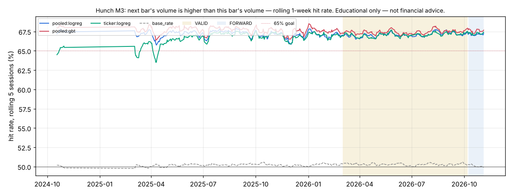

# Hunch M3 — next bar's volume is higher than this bar's volume

*Educational only — not financial advice. Research tool only: Hunch places no orders and changes nothing in config/ or the trading path.*

## Verdict (failures first)

- **Consistent 65%+: YES — pooled:logreg, pooled:gbt, pooled:top8, ticker:logreg** (pooled models); per ticker: ABBV (pooled:logreg), ABBV (ticker:logreg), ABT (pooled:logreg), ABT (ticker:logreg), ACN (pooled:logreg), ACN (ticker:logreg), ADBE (pooled:logreg), ADBE (ticker:logreg), ADI (pooled:logreg), ADI (ticker:logreg), ALAB (pooled:logreg), ALAB (ticker:logreg), AMAT (pooled:logreg), AMAT (ticker:logreg), AMGN (pooled:logreg), AMGN (ticker:logreg), ANET (pooled:logreg), ANET (ticker:logreg), APH (pooled:logreg), APH (ticker:logreg), APP (ticker:logreg), ARM (pooled:logreg), ARM (ticker:logreg), ASML (pooled:logreg), ASML (ticker:logreg), AXP (pooled:logreg), AXP (ticker:logreg), BA (pooled:logreg), BA (ticker:logreg), BABA (pooled:logreg), BABA (ticker:logreg), BAC (pooled:logreg), BAC (ticker:logreg), BE (ticker:logreg), BITO (pooled:logreg), BITO (ticker:logreg), BKNG (pooled:logreg), BLK (pooled:logreg), BLK (ticker:logreg), BSX (pooled:logreg), BSX (ticker:logreg), C (pooled:logreg), C (ticker:logreg), CAT (pooled:logreg), CAT (ticker:logreg), CDNS (pooled:logreg), CDNS (ticker:logreg), CEG (pooled:logreg), CEG (ticker:logreg), CIEN (pooled:logreg), CIEN (ticker:logreg), CIFR (pooled:logreg), CIFR (ticker:logreg), CLS (pooled:logreg), CLS (ticker:logreg), CLSK (pooled:logreg), CLSK (ticker:logreg), CMG (pooled:logreg), CMG (ticker:logreg), COF (pooled:logreg), COF (ticker:logreg), COHR (pooled:logreg), COHR (ticker:logreg), COP (pooled:logreg), CORZ (pooled:logreg), CORZ (ticker:logreg), COST (pooled:logreg), COST (ticker:logreg), CRDO (pooled:logreg), CRDO (ticker:logreg), CRM (pooled:logreg), CRM (ticker:logreg), CRWD (pooled:logreg), CRWD (ticker:logreg), CRWV (pooled:logreg), CSCO (pooled:logreg), CSCO (ticker:logreg), CVS (pooled:logreg), CVS (ticker:logreg), CVX (pooled:logreg), CVX (ticker:logreg), DASH (pooled:logreg), DASH (ticker:logreg), DDOG (pooled:logreg), DDOG (ticker:logreg), DELL (pooled:logreg), DELL (ticker:logreg), DHR (pooled:logreg), DHR (ticker:logreg), DIS (pooled:logreg), DIS (ticker:logreg), EEM (pooled:logreg), EEM (ticker:logreg), ETN (pooled:logreg), ETN (ticker:logreg), EWZ (pooled:logreg), EWZ (ticker:logreg), FIX (pooled:logreg), FIX (ticker:logreg), FTNT (pooled:logreg), FTNT (ticker:logreg), GE (pooled:logreg), GE (ticker:logreg), GEV (pooled:logreg), GEV (ticker:logreg), GILD (pooled:logreg), GILD (ticker:logreg), GLW (pooled:logreg), GLW (ticker:logreg), GS (pooled:logreg), GS (ticker:logreg), HD (pooled:logreg), HD (ticker:logreg), HPE (pooled:logreg), HPE (ticker:logreg), HUT (pooled:logreg), HUT (ticker:logreg), HWM (pooled:logreg), HWM (ticker:logreg), IBIT (pooled:logreg), IBIT (ticker:logreg), IBM (pooled:logreg), IBM (ticker:logreg), IEFA (pooled:logreg), IEFA (ticker:logreg), IEMG (pooled:logreg), IEMG (ticker:logreg), INTU (pooled:logreg), INTU (ticker:logreg), INTW (pooled:logreg), INTW (ticker:logreg), IREN (ticker:logreg), ISRG (pooled:logreg), ISRG (ticker:logreg), IWF (pooled:logreg), IWF (ticker:logreg), IWM (pooled:logreg), IWM (ticker:logreg), JNJ (pooled:logreg), JNJ (ticker:logreg), JPM (pooled:logreg), JPM (ticker:logreg), KLAC (pooled:logreg), KLAC (ticker:logreg), KO (ticker:logreg), LIN (pooled:logreg), LIN (ticker:logreg), LLY (pooled:logreg), LLY (ticker:logreg), LMT (pooled:logreg), LMT (ticker:logreg), LRCX (pooled:logreg), LRCX (ticker:logreg), MA (pooled:logreg), MA (ticker:logreg), MCD (pooled:logreg), MCD (ticker:logreg), MDT (pooled:logreg), MDT (ticker:logreg), MELI (pooled:logreg), MELI (ticker:logreg), MPC (pooled:logreg), MPC (ticker:logreg), MPWR (pooled:logreg), MPWR (ticker:logreg), MRK (pooled:logreg), MRK (ticker:logreg), MRNA (pooled:logreg), MRNA (ticker:logreg), MS (pooled:logreg), MS (ticker:logreg), MSTR (pooled:logreg), MSTU (pooled:logreg), MSTU (ticker:logreg), NEE (pooled:logreg), NEE (ticker:logreg), NET (pooled:logreg), NET (ticker:logreg), NFLX (pooled:logreg), NKE (pooled:logreg), NKE (ticker:logreg), NOK (pooled:logreg), NOK (ticker:logreg), NU (ticker:logreg), NVDA (pooled:logreg), NXPI (pooled:logreg), NXPI (ticker:logreg), OKTA (pooled:logreg), OKTA (ticker:logreg), PANW (pooled:logreg), PANW (ticker:logreg), PEP (pooled:logreg), PEP (ticker:logreg), PFE (pooled:logreg), PFE (ticker:logreg), PG (pooled:logreg), PG (ticker:logreg), PM (pooled:logreg), PM (ticker:logreg), PSQ (pooled:logreg), PSQ (ticker:logreg), PWR (pooled:logreg), PWR (ticker:logreg), QQQ (pooled:logreg), QQQ (ticker:logreg), QQQM (pooled:logreg), QQQM (ticker:logreg), RBRK (pooled:logreg), RBRK (ticker:logreg), RDDT (pooled:logreg), RDDT (ticker:logreg), RIOT (pooled:logreg), RIOT (ticker:logreg), RTX (pooled:logreg), RTX (ticker:logreg), RWM (pooled:logreg), RWM (ticker:logreg), SBUX (pooled:logreg), SBUX (ticker:logreg), SCHW (pooled:logreg), SCHW (ticker:logreg), SHOP (pooled:logreg), SHOP (ticker:logreg), SLV (pooled:logreg), SLV (ticker:logreg), SMCI (pooled:logreg), SMCI (ticker:logreg), SNOW (pooled:logreg), SNOW (ticker:logreg), SNPS (pooled:logreg), SNPS (ticker:logreg), SPGI (pooled:logreg), SPGI (ticker:logreg), SPOT (pooled:logreg), SPOT (ticker:logreg), SPY (pooled:logreg), SPY (ticker:logreg), SQQQ (ticker:logreg), STX (ticker:logreg), SYK (pooled:logreg), SYK (ticker:logreg), T (pooled:logreg), T (ticker:logreg), TER (pooled:logreg), TER (ticker:logreg), TLT (pooled:logreg), TLT (ticker:logreg), TMO (pooled:logreg), TMO (ticker:logreg), TMUS (pooled:logreg), TMUS (ticker:logreg), TQQQ (pooled:logreg), TQQQ (ticker:logreg), TSLA (ticker:logreg), TXN (pooled:logreg), TXN (ticker:logreg), UBER (pooled:logreg), UBER (ticker:logreg), UNH (pooled:logreg), UNH (ticker:logreg), USAR (pooled:logreg), USAR (ticker:logreg), UVXY (pooled:logreg), UVXY (ticker:logreg), V (pooled:logreg), V (ticker:logreg), VEA (pooled:logreg), VEA (ticker:logreg), VLO (pooled:logreg), VLO (ticker:logreg), VRT (pooled:logreg), VRT (ticker:logreg), VRTX (pooled:logreg), VRTX (ticker:logreg), VST (pooled:logreg), VST (ticker:logreg), VZ (pooled:logreg), VZ (ticker:logreg), WFC (pooled:logreg), WFC (ticker:logreg), WMT (pooled:logreg), WMT (ticker:logreg), XBI (pooled:logreg), XBI (ticker:logreg), XLE (pooled:logreg), XLE (ticker:logreg), XLF (ticker:logreg), XLI (pooled:logreg), XLI (ticker:logreg), XLU (pooled:logreg), XLU (ticker:logreg), XOM (pooled:logreg), XOM (ticker:logreg). Definition: rolling 20-session hit rate ≥ 65% in ≥ 90% of VALID windows. Highest VALID 20-session window of any main pooled learner: 67.7%.
- **Hunch (best combined learner) on VALID: `pooled:gbt` 67.45%** (±0.04% day-clustered SE, n = 3,700,179 guesses, 153 sessions) vs **best baseline `base_rate` 50.30%**: +17.16 pp, day-clustered z = 380.73 (McNemar z = 454.71). Bar: z ≥ 3.66 (N = 808 tests).
- Main learners beating the best baseline at the bar on VALID: `pooled:logreg`, `pooled:gbt`, `pooled:top8`, `ticker:logreg`. Per-ticker (pooled or own model vs that ticker's best baseline): AAL (pooled:logreg), AAL (ticker:logreg), AAOI (pooled:logreg), AAOI (ticker:logreg), AAPL (pooled:logreg), AAPL (ticker:logreg), ABBV (pooled:logreg), ABBV (ticker:logreg), ABT (pooled:logreg), ABT (ticker:logreg), ACN (pooled:logreg), ACN (ticker:logreg), ADBE (pooled:logreg), ADBE (ticker:logreg), ADI (pooled:logreg), ADI (ticker:logreg), ALAB (pooled:logreg), ALAB (ticker:logreg), AMAT (pooled:logreg), AMAT (ticker:logreg), AMD (pooled:logreg), AMD (ticker:logreg), AMGN (pooled:logreg), AMGN (ticker:logreg), AMZN (pooled:logreg), AMZN (ticker:logreg), ANET (pooled:logreg), ANET (ticker:logreg), APH (pooled:logreg), APH (ticker:logreg), APP (pooled:logreg), APP (ticker:logreg), ARM (pooled:logreg), ARM (ticker:logreg), ASML (pooled:logreg), ASML (ticker:logreg), ASTS (pooled:logreg), ASTS (ticker:logreg), AVGO (pooled:logreg), AVGO (ticker:logreg), AXP (pooled:logreg), AXP (ticker:logreg), BA (pooled:logreg), BA (ticker:logreg), BABA (pooled:logreg), BABA (ticker:logreg), BAC (pooled:logreg), BAC (ticker:logreg), BE (pooled:logreg), BE (ticker:logreg), BITO (pooled:logreg), BITO (ticker:logreg), BKNG (pooled:logreg), BKNG (ticker:logreg), BLK (pooled:logreg), BLK (ticker:logreg), BSX (pooled:logreg), BSX (ticker:logreg), C (pooled:logreg), C (ticker:logreg), CAT (pooled:logreg), CAT (ticker:logreg), CDNS (pooled:logreg), CDNS (ticker:logreg), CEG (pooled:logreg), CEG (ticker:logreg), CIEN (pooled:logreg), CIEN (ticker:logreg), CIFR (pooled:logreg), CIFR (ticker:logreg), CLS (pooled:logreg), CLS (ticker:logreg), CLSK (pooled:logreg), CLSK (ticker:logreg), CMG (pooled:logreg), CMG (ticker:logreg), COF (pooled:logreg), COF (ticker:logreg), COHR (pooled:logreg), COHR (ticker:logreg), COIN (pooled:logreg), COIN (ticker:logreg), COP (pooled:logreg), COP (ticker:logreg), CORZ (pooled:logreg), CORZ (ticker:logreg), COST (pooled:logreg), COST (ticker:logreg), CRDO (pooled:logreg), CRDO (ticker:logreg), CRM (pooled:logreg), CRM (ticker:logreg), CRWD (pooled:logreg), CRWD (ticker:logreg), CRWV (pooled:logreg), CRWV (ticker:logreg), CSCO (pooled:logreg), CSCO (ticker:logreg), CVS (pooled:logreg), CVS (ticker:logreg), CVX (pooled:logreg), CVX (ticker:logreg), DASH (pooled:logreg), DASH (ticker:logreg), DDOG (pooled:logreg), DDOG (ticker:logreg), DELL (pooled:logreg), DELL (ticker:logreg), DHR (pooled:logreg), DHR (ticker:logreg), DIA (pooled:logreg), DIA (ticker:logreg), DIS (pooled:logreg), DIS (ticker:logreg), EEM (pooled:logreg), EEM (ticker:logreg), EFA (pooled:logreg), EFA (ticker:logreg), ETN (pooled:logreg), ETN (ticker:logreg), EWY (pooled:logreg), EWY (ticker:logreg), EWZ (pooled:logreg), EWZ (ticker:logreg), FIX (pooled:logreg), FIX (ticker:logreg), FTNT (pooled:logreg), FTNT (ticker:logreg), GDX (pooled:logreg), GDX (ticker:logreg), GE (pooled:logreg), GE (ticker:logreg), GEV (pooled:logreg), GEV (ticker:logreg), GILD (pooled:logreg), GILD (ticker:logreg), GLD (pooled:logreg), GLD (ticker:logreg), GLW (pooled:logreg), GLW (ticker:logreg), GOOG (pooled:logreg), GOOG (ticker:logreg), GOOGL (pooled:logreg), GOOGL (ticker:logreg), GS (pooled:logreg), GS (ticker:logreg), HD (pooled:logreg), HD (ticker:logreg), HOOD (pooled:logreg), HOOD (ticker:logreg), HPE (pooled:logreg), HPE (ticker:logreg), HUT (pooled:logreg), HUT (ticker:logreg), HWM (pooled:logreg), HWM (ticker:logreg), IBIT (pooled:logreg), IBIT (ticker:logreg), IBM (pooled:logreg), IBM (ticker:logreg), IEFA (pooled:logreg), IEFA (ticker:logreg), IEMG (pooled:logreg), IEMG (ticker:logreg), IGV (pooled:logreg), IGV (ticker:logreg), INTC (pooled:logreg), INTC (ticker:logreg), INTU (pooled:logreg), INTU (ticker:logreg), INTW (pooled:logreg), INTW (ticker:logreg), IREN (pooled:logreg), IREN (ticker:logreg), ISRG (pooled:logreg), ISRG (ticker:logreg), IWF (pooled:logreg), IWF (ticker:logreg), IWM (pooled:logreg), IWM (ticker:logreg), JNJ (pooled:logreg), JNJ (ticker:logreg), JPM (pooled:logreg), JPM (ticker:logreg), KLAC (pooled:logreg), KLAC (ticker:logreg), KO (pooled:logreg), KO (ticker:logreg), KRE (pooled:logreg), KRE (ticker:logreg), LIN (pooled:logreg), LIN (ticker:logreg), LITE (pooled:logreg), LITE (ticker:logreg), LLY (pooled:logreg), LLY (ticker:logreg), LMT (pooled:logreg), LMT (ticker:logreg), LRCX (pooled:logreg), LRCX (ticker:logreg), MA (pooled:logreg), MA (ticker:logreg), MCD (pooled:logreg), MCD (ticker:logreg), MDT (pooled:logreg), MDT (ticker:logreg), MELI (pooled:logreg), MELI (ticker:logreg), META (pooled:logreg), META (ticker:logreg), MPC (pooled:logreg), MPC (ticker:logreg), MPWR (pooled:logreg), MPWR (ticker:logreg), MRK (pooled:logreg), MRK (ticker:logreg), MRNA (pooled:logreg), MRNA (ticker:logreg), MRVL (pooled:logreg), MRVL (ticker:logreg), MS (pooled:logreg), MS (ticker:logreg), MSFT (pooled:logreg), MSFT (ticker:logreg), MSTR (pooled:logreg), MSTR (ticker:logreg), MSTU (pooled:logreg), MSTU (ticker:logreg), MSTX (pooled:logreg), MSTX (ticker:logreg), MU (pooled:logreg), MU (ticker:logreg), MUU (pooled:logreg), MUU (ticker:logreg), NBIS (pooled:logreg), NBIS (ticker:logreg), NEE (pooled:logreg), NEE (ticker:logreg), NET (pooled:logreg), NET (ticker:logreg), NFLX (pooled:logreg), NFLX (ticker:logreg), NKE (pooled:logreg), NKE (ticker:logreg), NOK (pooled:logreg), NOK (ticker:logreg), NOW (pooled:logreg), NOW (ticker:logreg), NU (pooled:logreg), NU (ticker:logreg), NVDA (pooled:logreg), NVDA (ticker:logreg), NXPI (pooled:logreg), NXPI (ticker:logreg), OKTA (pooled:logreg), OKTA (ticker:logreg), ORCL (pooled:logreg), ORCL (ticker:logreg), PANW (pooled:logreg), PANW (ticker:logreg), PEP (pooled:logreg), PEP (ticker:logreg), PFE (pooled:logreg), PFE (ticker:logreg), PG (pooled:logreg), PG (ticker:logreg), PLTR (pooled:logreg), PLTR (ticker:logreg), PM (pooled:logreg), PM (ticker:logreg), PSQ (pooled:logreg), PSQ (ticker:logreg), PWR (pooled:logreg), PWR (ticker:logreg), QCOM (pooled:logreg), QCOM (ticker:logreg), QQQ (pooled:logreg), QQQ (ticker:logreg), QQQM (pooled:logreg), QQQM (ticker:logreg), RBRK (pooled:logreg), RBRK (ticker:logreg), RDDT (pooled:logreg), RDDT (ticker:logreg), RIOT (pooled:logreg), RIOT (ticker:logreg), RKLB (pooled:logreg), RKLB (ticker:logreg), RTX (pooled:logreg), RTX (ticker:logreg), RWM (pooled:logreg), RWM (ticker:logreg), SBUX (pooled:logreg), SBUX (ticker:logreg), SCHW (pooled:logreg), SCHW (ticker:logreg), SHOP (pooled:logreg), SHOP (ticker:logreg), SLV (pooled:logreg), SLV (ticker:logreg), SMCI (pooled:logreg), SMCI (ticker:logreg), SMH (pooled:logreg), SMH (ticker:logreg), SNDK (pooled:logreg), SNDK (ticker:logreg), SNOW (pooled:logreg), SNOW (ticker:logreg), SNPS (pooled:logreg), SNPS (ticker:logreg), SOFI (pooled:logreg), SOFI (ticker:logreg), SOXL (pooled:logreg), SOXL (ticker:logreg), SOXS (pooled:logreg), SOXS (ticker:logreg), SOXX (pooled:logreg), SOXX (ticker:logreg), SPGI (pooled:logreg), SPGI (ticker:logreg), SPOT (pooled:logreg), SPOT (ticker:logreg), SPY (pooled:logreg), SPY (ticker:logreg), SQQQ (pooled:logreg), SQQQ (ticker:logreg), STX (pooled:logreg), STX (ticker:logreg), SYK (pooled:logreg), SYK (ticker:logreg), T (pooled:logreg), T (ticker:logreg), TER (pooled:logreg), TER (ticker:logreg), TLT (pooled:logreg), TLT (ticker:logreg), TMO (pooled:logreg), TMO (ticker:logreg), TMUS (pooled:logreg), TMUS (ticker:logreg), TQQQ (pooled:logreg), TQQQ (ticker:logreg), TSLA (pooled:logreg), TSLA (ticker:logreg), TSM (pooled:logreg), TSM (ticker:logreg), TXN (pooled:logreg), TXN (ticker:logreg), UBER (pooled:logreg), UBER (ticker:logreg), UNH (pooled:logreg), UNH (ticker:logreg), USAR (pooled:logreg), USAR (ticker:logreg), USO (pooled:logreg), USO (ticker:logreg), UVXY (pooled:logreg), UVXY (ticker:logreg), V (pooled:logreg), V (ticker:logreg), VEA (pooled:logreg), VEA (ticker:logreg), VLO (pooled:logreg), VLO (ticker:logreg), VRT (pooled:logreg), VRT (ticker:logreg), VRTX (pooled:logreg), VRTX (ticker:logreg), VST (pooled:logreg), VST (ticker:logreg), VZ (pooled:logreg), VZ (ticker:logreg), WDC (pooled:logreg), WDC (ticker:logreg), WFC (pooled:logreg), WFC (ticker:logreg), WMT (pooled:logreg), WMT (ticker:logreg), XBI (pooled:logreg), XBI (ticker:logreg), XLC (pooled:logreg), XLC (ticker:logreg), XLE (pooled:logreg), XLE (ticker:logreg), XLF (pooled:logreg), XLF (ticker:logreg), XLI (pooled:logreg), XLI (ticker:logreg), XLK (pooled:logreg), XLK (ticker:logreg), XLP (pooled:logreg), XLP (ticker:logreg), XLU (pooled:logreg), XLU (ticker:logreg), XLV (pooled:logreg), XLV (ticker:logreg), XLY (pooled:logreg), XLY (ticker:logreg), XOM (pooled:logreg), XOM (ticker:logreg).
- Base rate ('yes' share): TRAIN 49.80%, VALID 49.70%. 2.6% of guess slots have the next close exactly equal to this close (a tie counts as 'not higher'), which is why the base-rate baseline ('no') sits above 50% on M1.
- Tests counted per metric: 4 main learners + 2 × 200 per-ticker comparisons + 0 single-indicator diagnostics = 404; × 2 metrics (M1, M3) = 808. One configuration per learner, hyper-parameters fixed in advance (mcf/hunch/learners.py); nothing tuned on VALID. The top-8 model's features were picked on TRAIN: vol20, tod, atr_pct, rsi14, orh, orl, pdh, ret5.

## Data and protocol

- Data: SIP 1-min bars from the 2-year cache (data/cache_hist/1Min), RTH only, built into 3-min bars. Universe (200, list in research/hunch/universe200.txt): SPY, QQQ, IWM + the most liquid names in the cache by 20-day dollar ADV (to 2026-11-04), live-traded names first. 5 of them list after the start and join when they list. Context: SPY, QQQ, SMH, IBIT. Survivorship: today's liquid names applied to the past.
- Periods: TRAIN 2024-09-16..2026-02-28 (locked block 2024-11-01..2025-02-28 never read — filtered inside the parquet read), VALID 2026-03-01..2026-10-07, FORWARD after that (reported separately). Sessions scored: TRAIN 263, VALID 153, FORWARD 20; the first 20 sessions are warm-up (guessed, not scored); the first session after the locked gap is an indicator warm-up (not guessed).
- Guesses: every 3-min bar closing 09:51..15:51 ET (121 a session per ticker); each uses data up to that bar's close only and is scored on the next bar. Walk-forward, online: the logistic learners update after every scored guess; the boosted trees refit every 20 sessions on the previous 120 sessions only.
- Learners: **pooled:logreg** = Hunch, all features, shared weights across tickers (+ ticker intercept); **pooled:gbt** = light boosted trees, all features, pooled; **pooled:top8** = pooled logreg on the TRAIN top-8 features; **ticker:logreg** = one Hunch instance per ticker (own weights, own data). Single-indicator learners are a diagnostic only.
- Run time 426 s. No rule / config change in research/ledger.jsonl bears on this study: it reads raw market bars, not setup results.

## Hunch: combined learners vs baselines

Day-clustered SE in brackets; z vs the best baseline (VALID: `base_rate`; TRAIN: `base_rate`), day-clustered. ✔ = z ≥ 3.66.

| learner | TRAIN hit | VALID hit | FORWARD hit | VALID − best base (pp) | z vs best | McNemar z | z vs coin | 20-sess ≥65% share | best 20-sess |
|---|---|---|---|---|---|---|---|---|---|
| `pooled:gbt` | 67.67% | 67.45% (0.04%) | 67.52% | +17.16 | 380.73 ✔ | 454.71 | 448.00 | 100% | 67.7% |
| `pooled:top8` | 67.18% (in-sample feature pick) | 67.12% (0.04%) | 67.15% | +16.82 | 348.51 ✔ | 427.50 | 419.32 | 100% | 67.6% |
| `pooled:logreg` | 67.15% | 67.10% (0.04%) | 67.09% | +16.80 | 350.84 ✔ | 427.53 | 416.80 | 100% | 67.5% |
| `ticker:logreg` | 66.59% | 67.08% (0.04%) | 67.20% | +16.79 | 361.14 ✔ | 425.88 | 430.69 | 100% | 67.3% |
| baseline `coin` | 50.00% | 50.00% | 50.00% | | | | | | |
| baseline `same_last` | 36.36% | 36.55% | 36.50% | | | | | | |
| baseline `base_rate` | 50.20% | 50.30% | 50.08% | | | | | | |
| baseline `always_yes` | 49.80% | 49.70% | 49.92% | | | | | | |
| baseline `mom20` | 46.48% | 46.53% | 46.35% | | | | | | |

## The 20+ Hunch instances: per ticker (VALID, TRAIN in brackets)

Each ticker's own best VALID baseline; z (day-clustered) of the pooled model and of that ticker's own model against it. ✔ = z ≥ 3.66. 65% = share of VALID 20-session windows ≥ 65%.

| ticker | guesses | pooled:logreg | ticker:logreg | best baseline | z pooled | z own | 65% pooled | 65% own |
|---|---|---|---|---|---|---|---|---|
| FIX | 18,332 | 70.39% (70.7%) | 70.00% (69.1%) | `base_rate` 50.10% | 52.50 ✔ | 53.10 ✔ | 100% | 100% |
| PWR | 18,505 | 69.85% (69.5%) | 69.39% (69.1%) | `always_yes` 50.67% | 54.05 ✔ | 56.38 ✔ | 100% | 100% |
| HWM | 18,491 | 69.80% (69.0%) | 69.81% (68.2%) | `always_yes` 50.55% | 56.69 ✔ | 57.22 ✔ | 100% | 100% |
| VRTX | 18,513 | 69.66% (69.7%) | 69.73% (69.2%) | `always_yes` 50.45% | 50.50 ✔ | 52.54 ✔ | 100% | 100% |
| RWM | 17,636 | 69.53% (69.5%) | 71.30% (71.2%) | `base_rate` 50.67% | 43.59 ✔ | 44.79 ✔ | 100% | 100% |
| BLK | 18,400 | 69.39% (69.5%) | 69.14% (68.9%) | `always_yes` 50.47% | 54.44 ✔ | 53.96 ✔ | 100% | 100% |
| MPC | 18,503 | 69.38% (68.7%) | 69.37% (68.4%) | `always_yes` 50.45% | 53.96 ✔ | 54.28 ✔ | 100% | 100% |
| ETN | 18,513 | 69.30% (69.1%) | 69.11% (68.6%) | `always_yes` 50.78% | 47.20 ✔ | 52.06 ✔ | 100% | 100% |
| LIN | 18,513 | 69.25% (70.0%) | 69.26% (69.8%) | `always_yes` 50.42% | 51.16 ✔ | 47.62 ✔ | 100% | 100% |
| TMO | 18,513 | 69.18% (68.5%) | 69.02% (68.1%) | `always_yes` 50.46% | 49.66 ✔ | 47.85 ✔ | 100% | 100% |
| MPWR | 18,433 | 69.13% (69.3%) | 69.23% (68.4%) | `always_yes` 50.38% | 49.03 ✔ | 50.62 ✔ | 100% | 100% |
| SYK | 18,513 | 69.04% (69.7%) | 68.96% (68.9%) | `always_yes` 50.60% | 54.89 ✔ | 53.88 ✔ | 100% | 100% |
| VLO | 18,513 | 68.99% (68.1%) | 68.73% (67.7%) | `always_yes` 50.27% | 47.73 ✔ | 47.42 ✔ | 100% | 100% |
| SPGI | 18,513 | 68.95% (69.5%) | 68.84% (69.1%) | `always_yes` 50.08% | 58.51 ✔ | 59.02 ✔ | 100% | 100% |
| LMT | 18,513 | 68.76% (70.0%) | 68.85% (69.1%) | `always_yes` 50.19% | 51.19 ✔ | 54.34 ✔ | 100% | 100% |
| SPOT | 18,513 | 68.73% (68.8%) | 68.56% (67.9%) | `always_yes` 50.79% | 49.00 ✔ | 46.65 ✔ | 100% | 100% |
| MELI | 18,513 | 68.66% (70.1%) | 68.47% (68.8%) | `always_yes` 50.00% | 52.66 ✔ | 50.07 ✔ | 100% | 100% |
| LLY | 18,513 | 68.56% (68.2%) | 68.70% (67.6%) | `base_rate` 50.20% | 41.78 ✔ | 44.16 ✔ | 100% | 100% |
| CDNS | 18,513 | 68.49% (68.9%) | 68.10% (67.9%) | `always_yes` 50.76% | 53.56 ✔ | 52.06 ✔ | 100% | 100% |
| ABBV | 18,513 | 68.47% (67.6%) | 68.20% (66.6%) | `always_yes` 51.02% | 43.53 ✔ | 45.65 ✔ | 100% | 100% |
| CLS | 18,507 | 68.43% (67.4%) | 68.08% (66.8%) | `always_yes` 50.21% | 48.52 ✔ | 52.63 ✔ | 100% | 100% |
| SNPS | 18,511 | 68.43% (69.4%) | 68.46% (68.9%) | `always_yes` 50.30% | 48.02 ✔ | 46.87 ✔ | 100% | 100% |
| DASH | 18,513 | 68.41% (68.3%) | 68.27% (67.3%) | `always_yes` 50.05% | 50.18 ✔ | 49.57 ✔ | 100% | 100% |
| ACN | 18,513 | 68.37% (68.9%) | 68.23% (68.6%) | `always_yes` 50.56% | 52.84 ✔ | 48.36 ✔ | 100% | 100% |
| ISRG | 18,513 | 68.34% (68.9%) | 68.45% (68.2%) | `always_yes` 50.36% | 45.93 ✔ | 49.37 ✔ | 100% | 100% |
| RBRK | 18,513 | 68.32% (68.2%) | 68.22% (67.3%) | `always_yes` 50.05% | 54.29 ✔ | 53.44 ✔ | 100% | 100% |
| TMUS | 18,513 | 68.29% (68.9%) | 68.74% (68.2%) | `always_yes` 50.55% | 45.78 ✔ | 46.17 ✔ | 100% | 100% |
| AXP | 18,513 | 68.28% (68.4%) | 68.24% (67.5%) | `always_yes` 50.20% | 51.74 ✔ | 51.33 ✔ | 100% | 100% |
| INTU | 18,513 | 68.27% (69.3%) | 67.97% (68.7%) | `always_yes` 50.29% | 54.81 ✔ | 52.68 ✔ | 100% | 100% |
| CAT | 18,513 | 68.25% (68.6%) | 67.90% (68.1%) | `always_yes` 50.51% | 47.17 ✔ | 45.42 ✔ | 100% | 100% |
| CIEN | 18,502 | 68.22% (68.2%) | 68.23% (67.1%) | `base_rate` 50.22% | 44.70 ✔ | 49.30 ✔ | 100% | 100% |
| BITO | 18,505 | 68.20% (68.0%) | 71.29% (68.8%) | `base_rate` 50.79% | 46.73 ✔ | 53.96 ✔ | 100% | 100% |
| NET | 18,513 | 68.18% (68.6%) | 67.87% (67.8%) | `always_yes` 50.36% | 47.95 ✔ | 47.83 ✔ | 100% | 100% |
| PFE | 18,513 | 68.15% (68.0%) | 68.16% (67.4%) | `base_rate` 50.38% | 41.34 ✔ | 39.96 ✔ | 100% | 100% |
| RTX | 18,513 | 68.15% (67.6%) | 68.20% (67.1%) | `always_yes` 50.95% | 47.11 ✔ | 50.09 ✔ | 100% | 100% |
| UBER | 18,513 | 68.14% (66.7%) | 67.96% (66.4%) | `base_rate` 50.22% | 46.59 ✔ | 44.36 ✔ | 100% | 100% |
| T | 18,513 | 68.13% (68.7%) | 68.26% (68.2%) | `base_rate` 50.31% | 41.91 ✔ | 41.03 ✔ | 100% | 100% |
| DDOG | 18,513 | 68.13% (67.5%) | 68.14% (66.8%) | `always_yes` 50.55% | 47.02 ✔ | 46.03 ✔ | 100% | 100% |
| APH | 18,513 | 68.07% (66.7%) | 67.63% (65.9%) | `always_yes` 50.53% | 49.64 ✔ | 50.51 ✔ | 100% | 100% |
| HD | 18,513 | 68.05% (67.7%) | 68.30% (67.2%) | `always_yes` 50.74% | 47.22 ✔ | 44.64 ✔ | 100% | 100% |
| COST | 18,513 | 68.02% (69.1%) | 67.94% (68.9%) | `always_yes` 50.36% | 53.47 ✔ | 50.74 ✔ | 100% | 100% |
| V | 18,513 | 68.02% (68.0%) | 67.81% (67.5%) | `always_yes` 50.45% | 41.06 ✔ | 42.99 ✔ | 100% | 100% |
| OKTA | 18,513 | 68.02% (67.9%) | 67.94% (67.5%) | `always_yes` 50.01% | 48.34 ✔ | 50.97 ✔ | 100% | 100% |
| PSQ | 18,423 | 67.94% (68.4%) | 68.68% (68.2%) | `base_rate` 50.99% | 41.37 ✔ | 45.24 ✔ | 100% | 100% |
| HUT | 18,513 | 67.94% (67.0%) | 67.52% (66.3%) | `base_rate` 50.11% | 44.14 ✔ | 47.35 ✔ | 100% | 100% |
| RDDT | 18,513 | 67.93% (66.3%) | 67.70% (66.0%) | `always_yes` 50.19% | 45.82 ✔ | 43.52 ✔ | 100% | 100% |
| DHR | 18,511 | 67.93% (68.6%) | 67.98% (67.9%) | `always_yes` 50.78% | 44.62 ✔ | 46.82 ✔ | 100% | 100% |
| MA | 18,513 | 67.91% (68.4%) | 67.76% (68.1%) | `always_yes` 50.28% | 46.44 ✔ | 45.44 ✔ | 100% | 100% |
| ABT | 18,513 | 67.89% (66.9%) | 67.77% (66.4%) | `always_yes` 50.54% | 48.60 ✔ | 48.30 ✔ | 100% | 100% |
| AMGN | 18,513 | 67.89% (68.1%) | 67.96% (67.7%) | `always_yes` 50.45% | 50.77 ✔ | 48.48 ✔ | 100% | 100% |
| GILD | 18,513 | 67.87% (66.8%) | 67.90% (66.2%) | `always_yes` 50.72% | 47.63 ✔ | 47.95 ✔ | 100% | 100% |
| JPM | 18,513 | 67.84% (67.2%) | 67.51% (66.6%) | `always_yes` 50.33% | 44.01 ✔ | 47.87 ✔ | 100% | 100% |
| IEMG | 18,513 | 67.82% (68.4%) | 68.00% (67.6%) | `base_rate` 50.68% | 38.32 ✔ | 40.45 ✔ | 100% | 100% |
| IWM | 18,513 | 67.82% (67.7%) | 68.23% (66.9%) | `base_rate` 50.82% | 39.77 ✔ | 42.27 ✔ | 100% | 100% |
| VST | 18,513 | 67.81% (67.2%) | 67.79% (66.3%) | `always_yes` 50.02% | 50.08 ✔ | 50.47 ✔ | 100% | 100% |
| QQQM | 18,513 | 67.80% (67.6%) | 68.08% (66.5%) | `base_rate` 50.93% | 35.11 ✔ | 36.07 ✔ | 100% | 100% |
| MSTU | 18,513 | 67.76% (65.9%) | 68.68% (66.0%) | `base_rate` 51.19% | 42.95 ✔ | 43.77 ✔ | 100% | 100% |
| BSX | 18,513 | 67.70% (66.2%) | 67.50% (65.3%) | `always_yes` 50.52% | 44.13 ✔ | 46.00 ✔ | 100% | 100% |
| NXPI | 18,507 | 67.69% (68.6%) | 68.02% (68.2%) | `always_yes` 50.54% | 42.49 ✔ | 43.92 ✔ | 100% | 100% |
| TER | 18,509 | 67.69% (68.2%) | 67.22% (67.3%) | `always_yes` 50.04% | 48.64 ✔ | 44.15 ✔ | 100% | 100% |
| CVS | 18,513 | 67.68% (66.7%) | 67.83% (66.1%) | `always_yes` 50.85% | 41.58 ✔ | 45.07 ✔ | 99% | 100% |
| ANET | 18,513 | 67.68% (67.3%) | 67.14% (66.3%) | `always_yes` 50.41% | 47.12 ✔ | 46.15 ✔ | 100% | 95% |
| INTW | 17,536 | 67.66% (67.5%) | 67.85% (66.3%) | `base_rate` 50.85% | 41.91 ✔ | 42.24 ✔ | 100% | 100% |
| KLAC | 18,505 | 67.66% (69.6%) | 67.15% (68.8%) | `base_rate` 50.04% | 42.34 ✔ | 39.60 ✔ | 100% | 92% |
| GEV | 18,513 | 67.66% (68.0%) | 67.30% (67.3%) | `always_yes` 50.18% | 43.24 ✔ | 43.96 ✔ | 100% | 100% |
| NEE | 18,513 | 67.66% (67.2%) | 67.64% (66.2%) | `always_yes` 51.07% | 42.29 ✔ | 45.41 ✔ | 100% | 100% |
| VRT | 18,513 | 67.66% (66.7%) | 67.17% (66.1%) | `always_yes` 50.33% | 50.53 ✔ | 48.93 ✔ | 100% | 100% |
| PANW | 18,513 | 67.64% (67.3%) | 67.68% (66.8%) | `always_yes` 50.21% | 47.03 ✔ | 48.10 ✔ | 100% | 100% |
| SNOW | 18,513 | 67.64% (67.2%) | 67.54% (66.1%) | `base_rate` 50.23% | 40.39 ✔ | 39.36 ✔ | 100% | 100% |
| TXN | 18,513 | 67.62% (66.4%) | 67.39% (65.8%) | `always_yes` 50.58% | 46.45 ✔ | 47.51 ✔ | 99% | 98% |
| GS | 18,513 | 67.61% (68.2%) | 67.30% (67.3%) | `base_rate` 50.02% | 42.40 ✔ | 40.40 ✔ | 100% | 100% |
| MS | 18,513 | 67.61% (66.8%) | 67.48% (66.0%) | `always_yes` 50.85% | 44.43 ✔ | 48.04 ✔ | 100% | 100% |
| VEA | 18,513 | 67.60% (68.7%) | 67.54% (68.6%) | `base_rate` 50.41% | 38.04 ✔ | 39.73 ✔ | 100% | 100% |
| CEG | 18,513 | 67.59% (68.1%) | 67.41% (67.6%) | `always_yes` 50.42% | 42.87 ✔ | 41.28 ✔ | 100% | 100% |
| CMG | 18,513 | 67.59% (67.1%) | 67.66% (66.2%) | `always_yes` 50.41% | 46.64 ✔ | 45.50 ✔ | 100% | 100% |
| WFC | 18,513 | 67.58% (67.0%) | 67.51% (66.4%) | `always_yes` 50.31% | 44.78 ✔ | 44.80 ✔ | 100% | 100% |
| CRM | 18,513 | 67.57% (67.5%) | 67.34% (66.9%) | `always_yes` 50.12% | 45.91 ✔ | 44.40 ✔ | 100% | 100% |
| ADI | 18,513 | 67.55% (68.2%) | 67.64% (67.5%) | `always_yes` 50.52% | 46.41 ✔ | 44.80 ✔ | 100% | 100% |
| TLT | 18,513 | 67.51% (68.4%) | 67.53% (68.0%) | `base_rate` 50.60% | 42.28 ✔ | 42.25 ✔ | 100% | 100% |
| BA | 18,513 | 67.50% (66.8%) | 66.84% (66.1%) | `always_yes` 50.01% | 47.74 ✔ | 45.59 ✔ | 100% | 94% |
| LRCX | 18,513 | 67.48% (66.3%) | 67.01% (65.6%) | `always_yes` 50.42% | 48.53 ✔ | 48.86 ✔ | 100% | 100% |
| NOK | 18,513 | 67.48% (68.8%) | 67.97% (67.7%) | `base_rate` 50.60% | 39.06 ✔ | 40.48 ✔ | 94% | 95% |
| CORZ | 18,513 | 67.45% (67.4%) | 67.08% (66.4%) | `base_rate` 50.27% | 41.82 ✔ | 41.51 ✔ | 100% | 100% |
| EEM | 18,513 | 67.44% (68.0%) | 67.28% (67.1%) | `base_rate` 50.74% | 40.59 ✔ | 40.33 ✔ | 100% | 100% |
| CRWD | 18,513 | 67.42% (66.9%) | 67.53% (66.5%) | `base_rate` 50.61% | 43.53 ✔ | 41.46 ✔ | 100% | 100% |
| IEFA | 18,513 | 67.39% (68.0%) | 67.33% (67.3%) | `base_rate` 50.80% | 38.52 ✔ | 39.28 ✔ | 100% | 100% |
| ALAB | 18,513 | 67.37% (67.3%) | 67.21% (66.7%) | `base_rate` 50.05% | 40.85 ✔ | 40.14 ✔ | 100% | 100% |
| UVXY | 18,513 | 67.37% (66.6%) | 67.24% (66.4%) | `base_rate` 50.73% | 41.83 ✔ | 40.14 ✔ | 100% | 100% |
| IBM | 18,513 | 67.36% (67.3%) | 67.39% (66.8%) | `always_yes` 50.23% | 45.53 ✔ | 44.13 ✔ | 100% | 100% |
| MDT | 18,513 | 67.34% (66.9%) | 67.38% (66.4%) | `always_yes` 50.31% | 43.77 ✔ | 45.47 ✔ | 99% | 96% |
| BAC | 18,513 | 67.33% (67.5%) | 67.41% (67.2%) | `base_rate` 50.18% | 39.17 ✔ | 41.30 ✔ | 100% | 100% |
| PG | 18,513 | 67.31% (67.3%) | 67.20% (66.4%) | `always_yes` 50.83% | 46.09 ✔ | 45.96 ✔ | 100% | 100% |
| UNH | 18,513 | 67.30% (66.3%) | 67.61% (66.3%) | `always_yes` 50.41% | 50.13 ✔ | 52.52 ✔ | 98% | 100% |
| JNJ | 18,513 | 67.28% (66.6%) | 68.02% (66.2%) | `always_yes` 50.81% | 42.64 ✔ | 46.32 ✔ | 100% | 100% |
| VZ | 18,513 | 67.27% (67.4%) | 67.36% (67.3%) | `base_rate` 50.13% | 39.84 ✔ | 42.39 ✔ | 100% | 99% |
| CRDO | 18,513 | 67.26% (67.3%) | 66.72% (66.7%) | `base_rate` 50.16% | 45.22 ✔ | 44.23 ✔ | 100% | 100% |
| USAR | 18,513 | 67.26% (67.5%) | 66.96% (65.7%) | `base_rate` 50.63% | 43.06 ✔ | 42.85 ✔ | 95% | 96% |
| WMT | 18,513 | 67.24% (66.0%) | 67.05% (65.5%) | `base_rate` 50.02% | 40.21 ✔ | 39.39 ✔ | 100% | 100% |
| PM | 18,513 | 67.23% (67.0%) | 67.31% (66.4%) | `always_yes` 50.72% | 42.35 ✔ | 44.61 ✔ | 99% | 100% |
| BABA | 18,513 | 67.22% (65.6%) | 67.20% (65.3%) | `always_yes` 50.04% | 49.47 ✔ | 44.85 ✔ | 100% | 100% |
| DIS | 18,513 | 67.22% (66.9%) | 67.63% (65.8%) | `always_yes` 50.51% | 49.44 ✔ | 45.68 ✔ | 100% | 100% |
| COF | 18,513 | 67.21% (67.9%) | 67.22% (66.8%) | `always_yes` 50.56% | 45.11 ✔ | 44.94 ✔ | 100% | 99% |
| MRK | 18,513 | 67.20% (66.3%) | 67.21% (65.8%) | `always_yes` 50.51% | 43.84 ✔ | 45.91 ✔ | 96% | 99% |
| SBUX | 18,513 | 67.19% (66.8%) | 67.24% (66.4%) | `always_yes` 50.93% | 43.84 ✔ | 48.18 ✔ | 100% | 100% |
| XLU | 18,513 | 67.18% (67.0%) | 67.42% (66.4%) | `base_rate` 50.38% | 40.59 ✔ | 39.85 ✔ | 93% | 95% |
| MRNA | 18,513 | 67.17% (66.9%) | 67.03% (66.1%) | `base_rate` 50.68% | 39.84 ✔ | 39.05 ✔ | 99% | 100% |
| GE | 18,513 | 67.16% (67.3%) | 66.81% (66.7%) | `always_yes` 50.30% | 43.00 ✔ | 45.81 ✔ | 100% | 96% |
| GLW | 18,513 | 67.16% (66.7%) | 66.65% (65.9%) | `base_rate` 50.18% | 43.91 ✔ | 43.44 ✔ | 100% | 100% |
| AMAT | 18,513 | 67.13% (67.3%) | 66.78% (66.5%) | `always_yes` 50.16% | 52.87 ✔ | 51.31 ✔ | 100% | 99% |
| SHOP | 18,513 | 67.12% (66.8%) | 66.95% (66.0%) | `always_yes` 50.05% | 45.68 ✔ | 46.34 ✔ | 100% | 96% |
| NU | 18,513 | 67.11% (67.3%) | 67.35% (67.0%) | `base_rate` 50.49% | 39.60 ✔ | 40.21 ✔ | 84% | 90% |
| CLSK | 18,513 | 67.10% (66.5%) | 66.85% (66.3%) | `base_rate` 51.09% | 41.22 ✔ | 39.52 ✔ | 100% | 100% |
| IWF | 18,513 | 67.08% (67.5%) | 67.12% (66.4%) | `base_rate` 50.20% | 41.79 ✔ | 41.33 ✔ | 99% | 100% |
| CVX | 18,513 | 67.08% (66.5%) | 66.99% (66.1%) | `base_rate` 50.01% | 41.27 ✔ | 43.80 ✔ | 100% | 97% |
| QQQ | 18,513 | 67.08% (66.3%) | 66.88% (65.6%) | `base_rate` 50.79% | 38.06 ✔ | 38.09 ✔ | 100% | 100% |
| MCD | 18,513 | 67.03% (68.6%) | 67.34% (68.0%) | `always_yes` 50.10% | 45.63 ✔ | 48.63 ✔ | 100% | 99% |
| C | 18,513 | 67.02% (66.8%) | 66.69% (66.0%) | `always_yes` 50.42% | 45.92 ✔ | 45.08 ✔ | 100% | 100% |
| XOM | 18,513 | 66.99% (66.2%) | 67.46% (65.7%) | `always_yes` 50.06% | 42.68 ✔ | 43.71 ✔ | 100% | 100% |
| NKE | 18,513 | 66.97% (67.0%) | 67.15% (65.9%) | `base_rate` 50.55% | 39.20 ✔ | 37.91 ✔ | 93% | 97% |
| CIFR | 18,513 | 66.89% (66.9%) | 66.52% (67.2%) | `base_rate` 51.17% | 40.88 ✔ | 38.14 ✔ | 100% | 93% |
| SCHW | 18,513 | 66.89% (66.5%) | 67.05% (66.1%) | `always_yes` 50.21% | 45.34 ✔ | 50.35 ✔ | 100% | 100% |
| SPY | 18,513 | 66.89% (66.2%) | 66.75% (65.1%) | `base_rate` 50.02% | 43.19 ✔ | 44.21 ✔ | 100% | 96% |
| FTNT | 18,513 | 66.86% (67.1%) | 67.01% (66.6%) | `always_yes` 50.59% | 44.21 ✔ | 43.10 ✔ | 99% | 100% |
| IBIT | 18,513 | 66.84% (65.3%) | 66.72% (65.1%) | `base_rate` 51.66% | 32.67 ✔ | 34.62 ✔ | 97% | 97% |
| KO | 18,513 | 66.82% (66.6%) | 66.69% (66.1%) | `always_yes` 50.26% | 42.50 ✔ | 43.80 ✔ | 90% | 96% |
| QCOM | 18,513 | 66.80% (66.9%) | 66.74% (66.3%) | `always_yes` 50.01% | 49.24 ✔ | 45.64 ✔ | 89% | 84% |
| EWZ | 18,513 | 66.74% (67.7%) | 66.56% (67.3%) | `base_rate` 50.76% | 39.99 ✔ | 39.05 ✔ | 100% | 96% |
| HPE | 18,513 | 66.73% (66.7%) | 66.66% (66.1%) | `base_rate` 50.24% | 37.66 ✔ | 38.14 ✔ | 100% | 99% |
| CSCO | 18,513 | 66.66% (66.7%) | 66.66% (65.9%) | `always_yes` 50.36% | 48.49 ✔ | 48.31 ✔ | 99% | 99% |
| DELL | 18,513 | 66.63% (67.2%) | 66.66% (66.3%) | `base_rate` 50.20% | 39.96 ✔ | 41.19 ✔ | 93% | 94% |
| XBI | 18,513 | 66.63% (66.7%) | 66.48% (66.0%) | `base_rate` 50.82% | 38.98 ✔ | 38.86 ✔ | 100% | 100% |
| STX | 18,513 | 66.62% (67.3%) | 66.70% (66.5%) | `base_rate` 50.27% | 39.01 ✔ | 40.58 ✔ | 79% | 91% |
| ADBE | 18,513 | 66.61% (68.4%) | 66.47% (68.0%) | `base_rate` 50.13% | 43.31 ✔ | 41.28 ✔ | 99% | 95% |
| COP | 18,513 | 66.60% (66.7%) | 66.48% (66.1%) | `always_yes` 50.42% | 43.93 ✔ | 43.49 ✔ | 91% | 87% |
| PEP | 18,513 | 66.59% (66.7%) | 66.72% (66.1%) | `always_yes` 50.27% | 48.78 ✔ | 47.45 ✔ | 94% | 96% |
| NFLX | 18,513 | 66.55% (66.6%) | 66.30% (66.0%) | `base_rate` 50.52% | 40.62 ✔ | 38.31 ✔ | 92% | 84% |
| RIOT | 18,513 | 66.55% (65.7%) | 66.60% (66.0%) | `base_rate` 50.87% | 36.43 ✔ | 39.37 ✔ | 96% | 100% |
| XLI | 18,513 | 66.53% (67.1%) | 66.65% (66.5%) | `base_rate` 50.48% | 40.64 ✔ | 42.13 ✔ | 94% | 99% |
| SLV | 18,513 | 66.49% (66.4%) | 66.48% (66.2%) | `base_rate` 51.27% | 39.11 ✔ | 38.96 ✔ | 100% | 99% |
| APP | 18,513 | 66.38% (66.8%) | 66.18% (66.0%) | `always_yes` 50.06% | 46.35 ✔ | 47.83 ✔ | 83% | 100% |
| COHR | 18,513 | 66.33% (67.5%) | 66.12% (66.4%) | `base_rate` 50.31% | 40.71 ✔ | 41.27 ✔ | 100% | 97% |
| CRWV | 18,513 | 66.32% (65.3%) | 66.19% (64.6%) | `base_rate` 51.23% | 35.13 ✔ | 33.03 ✔ | 96% | 74% |
| BE | 18,513 | 66.30% (66.2%) | 66.12% (65.4%) | `base_rate` 51.68% | 37.55 ✔ | 36.21 ✔ | 90% | 98% |
| BKNG | 18,513 | 66.28% (69.5%) | 65.56% (67.1%) | `always_yes` 50.06% | 48.13 ✔ | 46.20 ✔ | 94% | 62% |
| ARM | 18,511 | 66.27% (66.3%) | 66.17% (65.9%) | `base_rate` 50.07% | 39.49 ✔ | 38.10 ✔ | 92% | 95% |
| ASML | 18,513 | 66.21% (67.7%) | 66.14% (66.8%) | `base_rate` 50.22% | 41.28 ✔ | 39.13 ✔ | 92% | 90% |
| COIN | 18,513 | 66.21% (65.6%) | 66.12% (64.9%) | `base_rate` 50.48% | 41.28 ✔ | 39.50 ✔ | 77% | 72% |
| MSTX | 18,511 | 66.15% (66.1%) | 66.86% (66.8%) | `base_rate` 51.47% | 38.05 ✔ | 38.10 ✔ | 81% | 90% |
| XLP | 18,513 | 66.12% (66.8%) | 66.00% (66.9%) | `base_rate` 50.53% | 34.61 ✔ | 37.49 ✔ | 85% | 84% |
| MRVL | 18,513 | 66.10% (66.0%) | 65.76% (65.2%) | `base_rate` 51.44% | 35.47 ✔ | 35.43 ✔ | 89% | 77% |
| XLC | 18,513 | 66.06% (66.6%) | 66.06% (66.1%) | `base_rate` 50.44% | 31.66 ✔ | 34.84 ✔ | 87% | 82% |
| AVGO | 18,513 | 66.05% (65.6%) | 65.51% (65.2%) | `base_rate` 50.54% | 36.80 ✔ | 34.00 ✔ | 88% | 67% |
| XLE | 18,513 | 66.03% (65.8%) | 65.99% (65.2%) | `base_rate` 51.16% | 35.04 ✔ | 38.24 ✔ | 98% | 98% |
| LITE | 18,513 | 66.02% (67.8%) | 65.63% (66.8%) | `base_rate` 50.94% | 40.79 ✔ | 40.58 ✔ | 81% | 80% |
| MSTR | 18,513 | 66.01% (65.4%) | 65.54% (64.9%) | `base_rate` 51.47% | 38.05 ✔ | 38.24 ✔ | 91% | 70% |
| TQQQ | 18,513 | 66.00% (66.0%) | 66.66% (66.3%) | `base_rate` 52.37% | 33.71 ✔ | 32.62 ✔ | 94% | 99% |
| MSFT | 18,513 | 65.92% (65.5%) | 65.51% (65.0%) | `base_rate` 50.79% | 34.19 ✔ | 32.59 ✔ | 74% | 76% |
| GOOG | 18,513 | 65.91% (64.5%) | 65.51% (64.0%) | `base_rate` 50.43% | 36.68 ✔ | 35.39 ✔ | 90% | 81% |
| SMCI | 18,513 | 65.90% (65.8%) | 66.33% (65.4%) | `base_rate` 51.91% | 32.81 ✔ | 34.47 ✔ | 91% | 98% |
| ASTS | 18,513 | 65.88% (66.9%) | 65.67% (66.5%) | `base_rate` 50.80% | 39.88 ✔ | 37.00 ✔ | 81% | 80% |
| NVDA | 18,513 | 65.88% (65.0%) | 65.71% (64.8%) | `base_rate` 51.79% | 34.57 ✔ | 33.63 ✔ | 95% | 88% |
| TSM | 18,513 | 65.88% (65.8%) | 65.56% (65.2%) | `base_rate` 50.60% | 36.20 ✔ | 36.14 ✔ | 81% | 76% |
| AMD | 18,513 | 65.86% (65.0%) | 65.74% (64.5%) | `base_rate` 51.80% | 35.87 ✔ | 34.73 ✔ | 81% | 84% |
| SOFI | 18,513 | 65.86% (65.5%) | 66.08% (65.3%) | `base_rate` 51.13% | 34.92 ✔ | 33.74 ✔ | 66% | 84% |
| IREN | 18,513 | 65.85% (66.1%) | 66.09% (65.8%) | `base_rate` 51.48% | 35.89 ✔ | 40.76 ✔ | 77% | 92% |
| ORCL | 18,513 | 65.85% (66.2%) | 66.02% (65.8%) | `base_rate` 50.89% | 35.82 ✔ | 36.73 ✔ | 75% | 75% |
| XLF | 18,513 | 65.79% (66.9%) | 66.52% (66.2%) | `base_rate` 50.49% | 36.79 ✔ | 40.61 ✔ | 87% | 99% |
| AAPL | 18,513 | 65.75% (65.1%) | 65.22% (64.6%) | `base_rate` 51.12% | 34.44 ✔ | 37.93 ✔ | 73% | 54% |
| XLV | 18,513 | 65.75% (66.5%) | 65.93% (65.8%) | `base_rate` 51.05% | 35.94 ✔ | 39.11 ✔ | 72% | 83% |
| PLTR | 18,513 | 65.73% (64.4%) | 65.79% (64.7%) | `base_rate` 51.34% | 33.66 ✔ | 34.04 ✔ | 73% | 80% |
| AAL | 18,513 | 65.71% (66.8%) | 66.49% (67.3%) | `always_yes` 50.25% | 36.01 ✔ | 42.20 ✔ | 69% | 77% |
| GLD | 18,513 | 65.71% (65.7%) | 65.91% (65.4%) | `base_rate` 50.46% | 37.80 ✔ | 38.01 ✔ | 74% | 85% |
| SQQQ | 18,513 | 65.70% (66.0%) | 66.43% (66.2%) | `base_rate` 52.24% | 30.24 ✔ | 31.53 ✔ | 72% | 93% |
| NBIS | 18,513 | 65.66% (66.2%) | 65.87% (65.1%) | `base_rate` 51.34% | 35.18 ✔ | 35.77 ✔ | 78% | 82% |
| NOW | 18,513 | 65.62% (68.8%) | 65.59% (68.4%) | `base_rate` 50.56% | 35.50 ✔ | 35.16 ✔ | 69% | 65% |
| META | 18,513 | 65.58% (65.5%) | 65.61% (65.4%) | `base_rate` 50.85% | 34.61 ✔ | 37.19 ✔ | 75% | 81% |
| WDC | 18,513 | 65.56% (66.2%) | 65.37% (65.1%) | `base_rate` 50.80% | 34.64 ✔ | 32.98 ✔ | 66% | 67% |
| EFA | 18,513 | 65.55% (66.0%) | 65.65% (65.3%) | `base_rate` 51.07% | 34.89 ✔ | 36.74 ✔ | 78% | 75% |
| GOOGL | 18,513 | 65.55% (65.2%) | 64.99% (64.3%) | `base_rate` 50.52% | 33.88 ✔ | 31.87 ✔ | 78% | 49% |
| INTC | 18,513 | 65.53% (65.7%) | 65.46% (65.3%) | `base_rate` 52.00% | 39.57 ✔ | 39.91 ✔ | 76% | 68% |
| KRE | 18,513 | 65.52% (67.0%) | 65.19% (66.4%) | `base_rate` 50.25% | 38.63 ✔ | 39.17 ✔ | 67% | 60% |
| MUU | 18,501 | 65.50% (67.6%) | 65.91% (65.8%) | `base_rate` 52.41% | 29.67 ✔ | 33.40 ✔ | 72% | 90% |
| AAOI | 18,513 | 65.46% (67.3%) | 65.41% (66.5%) | `base_rate` 51.09% | 36.40 ✔ | 35.09 ✔ | 60% | 59% |
| DIA | 18,513 | 65.46% (67.0%) | 65.53% (66.1%) | `base_rate` 50.70% | 34.08 ✔ | 35.64 ✔ | 79% | 72% |
| USO | 18,513 | 65.46% (65.3%) | 65.47% (65.1%) | `base_rate` 52.25% | 29.35 ✔ | 33.21 ✔ | 64% | 73% |
| RKLB | 18,513 | 65.40% (66.3%) | 65.35% (65.8%) | `base_rate` 51.98% | 34.15 ✔ | 34.91 ✔ | 69% | 67% |
| HOOD | 18,513 | 65.36% (65.2%) | 65.14% (64.8%) | `base_rate` 51.59% | 33.56 ✔ | 32.04 ✔ | 61% | 56% |
| IGV | 18,513 | 65.36% (65.7%) | 65.75% (64.7%) | `base_rate` 50.52% | 33.88 ✔ | 38.48 ✔ | 48% | 64% |
| XLK | 18,513 | 65.36% (66.3%) | 65.05% (65.1%) | `base_rate` 50.39% | 39.52 ✔ | 37.10 ✔ | 64% | 44% |
| AMZN | 18,513 | 65.35% (65.0%) | 65.29% (64.7%) | `base_rate` 50.76% | 35.00 ✔ | 35.87 ✔ | 63% | 69% |
| GDX | 18,513 | 65.34% (66.0%) | 65.38% (65.8%) | `base_rate` 50.49% | 33.88 ✔ | 35.07 ✔ | 75% | 78% |
| TSLA | 18,513 | 65.32% (64.1%) | 66.07% (64.8%) | `base_rate` 53.03% | 32.05 ✔ | 36.12 ✔ | 64% | 94% |
| EWY | 18,513 | 65.23% (66.8%) | 64.95% (66.0%) | `base_rate` 50.60% | 34.63 ✔ | 35.20 ✔ | 60% | 51% |
| MU | 18,513 | 65.13% (64.8%) | 65.01% (64.7%) | `base_rate` 52.47% | 33.45 ✔ | 33.89 ✔ | 57% | 58% |
| SMH | 18,513 | 65.11% (65.7%) | 64.89% (65.1%) | `base_rate` 50.29% | 36.27 ✔ | 34.81 ✔ | 49% | 30% |
| XLY | 18,513 | 65.04% (65.9%) | 65.57% (64.9%) | `base_rate` 50.47% | 33.76 ✔ | 33.44 ✔ | 51% | 65% |
| SOXS | 18,513 | 64.97% (67.0%) | 65.34% (67.7%) | `base_rate` 52.27% | 31.46 ✔ | 33.06 ✔ | 47% | 63% |
| SNDK | 18,513 | 64.39% (67.4%) | 65.04% (66.4%) | `base_rate` 52.75% | 30.36 ✔ | 31.67 ✔ | 22% | 50% |
| SOXX | 18,513 | 64.27% (64.8%) | 64.29% (63.9%) | `base_rate` 50.92% | 31.14 ✔ | 32.75 ✔ | 23% | 17% |
| SOXL | 18,513 | 64.20% (65.2%) | 64.29% (64.9%) | `base_rate` 52.74% | 27.24 ✔ | 28.04 ✔ | 14% | 28% |

## Indicator trust table (primary: permutation importance of the combined model)

The end-of-TRAIN pooled logreg and pooled GBT, frozen, scored on every VALID guess (frozen hit: logreg 66.89%, GBT 67.45%, n = 500,000); each indicator shuffled across the VALID guesses in turn (3 repeats; ± = sd over repeats). Higher log-loss increase = the model leans on it out of sample. Ranked by the mean of the two models' ranks. A negative value means shuffling the indicator *helped* on VALID: the model's use of it learned on TRAIN does not carry over. Mean weight = the pooled logreg's average standardized weight over VALID (sign = push toward 'yes').

| rank | indicator | logreg log-loss ↑ ×1000 | logreg hit drop (pp) | GBT log-loss ↑ ×1000 | GBT hit drop (pp) | mean weight | TRAIN rank |
|---|---|---|---|---|---|---|---|
| 1 | vol20 | +233.524 ± 1.078 | +15.80 | +181.173 ± 0.405 | +16.54 | -1.6603 | 1 |
| 2 | tod | +43.488 ± 0.188 | +3.52 | +36.064 ± 0.116 | +3.77 | +0.4513 | 2 |
| 3 | atr_pct | +0.271 ± 0.058 | +0.06 | +0.467 ± 0.022 | +0.09 | -0.0597 | 3 |
| 4 | rsi14 | +0.230 ± 0.003 | +0.02 | +0.268 ± 0.007 | +0.02 | -0.0131 | 4 |
| 5 | pressure | -0.029 ± 0.008 | -0.00 | +0.477 ± 0.016 | +0.07 | +0.0083 | 9 |
| 6 | orh | +2.114 ± 0.019 | +0.22 | +0.000 ± 0.000 | +0.00 | -0.0893 | 5 |
| 7 | orl | +0.939 ± 0.050 | +0.14 | +0.000 ± 0.000 | +0.00 | +0.0912 | 6 |
| 8 | pdh | +0.305 ± 0.002 | +0.03 | +0.000 ± 0.000 | +0.00 | -0.0226 | 7 |
| 9 | spy_ret1 | +0.103 ± 0.002 | +0.01 | +0.000 ± 0.000 | +0.00 | +0.0015 | 12 |
| 10 | spy_fo | +0.092 ± 0.001 | -0.00 | +0.000 ± 0.000 | +0.00 | -0.0133 | 10 |
| 11 | rsi5 | -0.144 ± 0.008 | -0.02 | +1.647 ± 0.011 | +0.23 | -0.0008 | 11 |
| 12 | gap | -0.001 ± 0.011 | -0.02 | +0.000 ± 0.000 | +0.00 | +0.0007 | 13 |
| 13 | ret3 | -0.073 ± 0.001 | -0.02 | +0.013 ± 0.002 | +0.00 | +0.0091 | 14 |
| 14 | qqq_ret1 | -0.030 ± 0.002 | -0.01 | +0.000 ± 0.000 | +0.00 | -0.0193 | 15 |
| 15 | fo | -0.051 ± 0.003 | -0.00 | +0.000 ± 0.000 | +0.00 | +0.0031 | 17 |
| 16 | sector_ret1 | -0.053 ± 0.007 | -0.00 | +0.000 ± 0.000 | +0.00 | +0.0044 | 16 |
| 17 | pdl | -0.090 ± 0.009 | +0.01 | +0.000 ± 0.000 | +0.00 | +0.0114 | 19 |
| 18 | ret1 | -0.028 ± 0.002 | -0.01 | -0.003 ± 0.001 | +0.00 | +0.0105 | 20 |
| 19 | qqq_fo | -0.109 ± 0.014 | +0.00 | +0.000 ± 0.000 | +0.00 | +0.0017 | 18 |
| 20 | ret5 | -0.032 ± 0.002 | -0.00 | -0.002 ± 0.001 | +0.00 | -0.0057 | 8 |
| 21 | vwap_atr | -0.236 ± 0.015 | -0.03 | +0.000 ± 0.000 | +0.00 | +0.0036 | 21 |

## VALID by time of day

| bar close | `pooled:gbt` | `pooled:top8` | `pooled:logreg` | `ticker:logreg` | `base_rate` |
|---|---|---|---|---|---|
| 09:51-10:30 | 64.10% | 64.10% | 64.02% | 64.95% | 52.89% |
| 10:33-12:00 | 67.83% | 67.41% | 67.37% | 67.31% | 51.89% |
| 12:03-14:00 | 68.40% | 68.07% | 68.08% | 67.83% | 50.88% |
| 14:03-15:00 | 68.80% | 68.44% | 68.44% | 68.06% | 50.10% |
| 15:03-15:51 | 65.73% | 65.28% | 65.25% | 65.53% | 44.20% |

## VALID by SPY day type

SPY session open-to-close terciles, cut points from TRAIN (-0.23% / +0.33%). Known only after the close: a report split, never a feature.

| day type | guesses | `pooled:gbt` | `pooled:top8` | `pooled:logreg` | `ticker:logreg` | `base_rate` |
|---|---|---|---|---|---|---|
| up | 1,039,851 | 67.48% | 67.13% | 67.13% | 67.11% | 50.32% |
| flat | 1,547,754 | 67.51% | 67.18% | 67.16% | 67.15% | 50.30% |
| down | 1,112,574 | 67.35% | 67.01% | 66.98% | 66.97% | 50.28% |

## Stability

Rolling 5-session hit rate of the combined learners and the best baseline (`base_rate`, dashed); VALID and FORWARD shaded.

*Educational only — not financial advice.*
