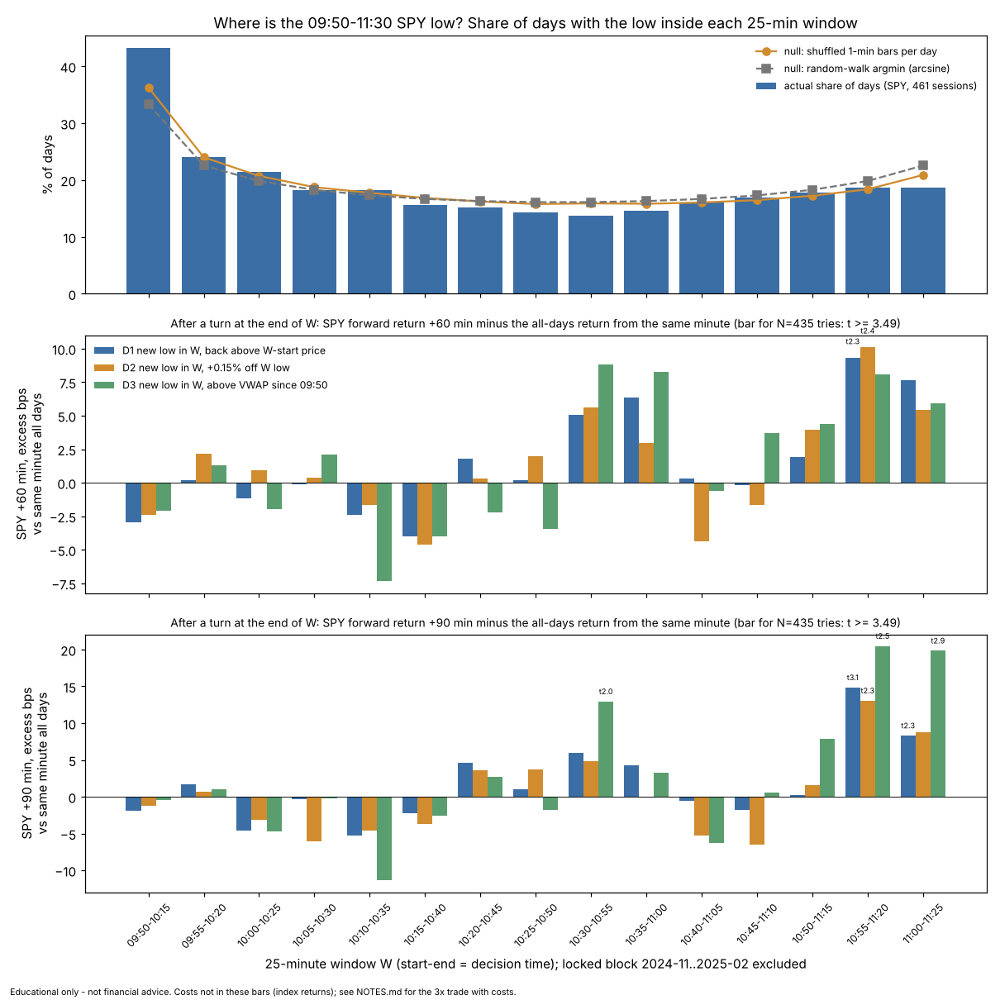

# Morning-low study ("10:25 study", widened by the owner 2026-11-16)

*Educational only — not financial advice. Research only: no config, setup or live change.*

Question (owner): SPY made its morning low around 10:26 ET on Fri 11-13 and Mon 11-16 and then rose ~0.5% in 30 min.
Is there a time window between 09:50 and ~11:00 where the morning low tends to sit, and does buying the turn pay?

Data: SPY / QQQ (+ SPXL / TQQQ for the trade) 1-minute RTH bars, 461 full sessions 2024-09-16 .. 2026-11-13
(cache to 11-04, later sessions fetched read-only). The locked block 2024-11-01..2025-02-28 is excluded entirely.
TRAIN = 242 sessions to 2025-12-31, VALID = 219 sessions from 2026-01-01. 11-16 is a partial session (used only
for the anecdote check). Per the 11-14 direction rule, everything is measured from 09:50: the low is the
09:50-11:30 low, day type uses the 09:50 state, returns are scored from the decision minute.

## Plain-English summary

**Where the low tends to be.** No time window between 10:00 and 11:00 holds the morning low more often than chance.
The 09:50-11:30 low is most often right at 09:50 (43% of days in the 09:50-10:15 window vs 36% for a shuffled-bar
null and 33% for a random walk; 10% of days the low is the 09:50 bar itself) — i.e. the trend set in the first 20
minutes often just continues. The windows that contain 10:25 sit slightly *below* the null (10:25-10:50: 14.3% of
days vs 15.8% null; 10:05-10:30: 18.2% vs 18.7%). No Q1 cell clears the try-count bar. Weak-start days
(SPY below its 09:30 open at 09:50) put a bit more of their lows at 09:50 and late (after 11:00); strong-start
days a bit more around 10:05-10:30, all within noise (|z| <= 2.7).

**Does buying the turn pay, in which window?** Mostly no. A turn signal (new 09:50+ low inside the window, then a
reclaim) at the end of windows ending 10:15-10:50 gives SPY/QQQ forward returns that are indistinguishable from
the same minute on all days (excess -7..+9 bps, nearly all |t| < 1.5). The one area that looked better is *late*:
turns confirmed at **11:20 (window 10:55-11:20)** and 11:25 — SPY +90 min +15 bps above the all-days return
(D1, n=37, t 3.1), and it held in both TRAIN (t 2.1) and VALID (t 2.2). It is still **below the bar** (3.49 for 435
configurations), it was picked after seeing VALID, and as a 3x ETF trade it is small: SPXL avg +0.27 R (n=37,
t 1.9, worst day -1.07 R, avg R without best day +0.21, best day 27% of total). Worth a pre-registered forward look,
not a setup.

**Caveats.** The two-day anecdote is real but thin: on 11-16 the 09:50-11:30 low is 10:26 ($743.31 bar low) and
SPY rose 0.54% within 30 min; on 11-13 the bar low is 10:21 ($747.88) with a near double bottom at 10:26
($747.95), +0.51% in 30 min. Two days out of 461 is exactly what you expect to remember: ~15% of days have their
low in any given 25-min window by chance. Index returns in the bars/tables are before costs; the 3x trade has
costs in. Windows overlap, so the cells are correlated (the bar treats them as independent, which is conservative).
TRAIN and VALID cell-by-cell excess agree in sign only 51% of the time (correlation of t: 0.05) — the turn
signal is mostly noise, except the late window above.

## Q1 — where is the morning low (SPY, all 461 sessions)

From 09:30 (context): 37% of days have their 09:30-11:30 low before 09:50 (17% in 09:30-09:35). From 09:50:

| 25-min window | share of days | null: shuffled bars | null: random walk | z vs shuffle |
|---|---|---|---|---|
| 09:50-10:15 | 43.2% | 36.3% | 33.3% | +3.08 |
| 09:55-10:20 | 24.1% | 24.0% | 22.5% | +0.04 |
| 10:00-10:25 | 21.5% | 20.7% | 19.8% | +0.40 |
| 10:05-10:30 | 18.2% | 18.7% | 18.3% | -0.29 |
| 10:10-10:35 | 18.2% | 17.8% | 17.3% | +0.27 |
| 10:15-10:40 | 15.6% | 16.8% | 16.7% | -0.70 |
| 10:20-10:45 | 15.2% | 16.2% | 16.3% | -0.60 |
| 10:25-10:50 | 14.3% | 15.8% | 16.1% | -0.86 |
| 10:30-10:55 | 13.7% | 15.9% | 16.1% | -1.30 |
| 10:35-11:00 | 14.5% | 15.8% | 16.3% | -0.76 |
| 10:40-11:05 | 16.1% | 16.0% | 16.7% | +0.01 |
| 10:45-11:10 | 16.9% | 16.5% | 17.3% | +0.27 |
| 10:50-11:15 | 17.8% | 17.2% | 18.3% | +0.32 |
| 10:55-11:20 | 18.7% | 18.4% | 19.8% | +0.17 |
| 11:00-11:25 | 18.7% | 20.9% | 22.5% | -1.18 |

The U shape is the random-walk argmin law (lows cluster at the ends of any interval); the data follow it closely.
10:25-10:50 by split: TRAIN 12.4%, VALID 16.4% (null 15.8%). Day-type splits (weak/strong vs the 09:30 open and vs
the 09:30-09:50 midpoint), 5-min histogram and TRAIN/VALID for every cell: `q1_windows.csv`, `q1_hist5.csv`,
`q1_hist5_from0930.csv`, per-day `q1_days.csv`. Largest Q1 cells: all/09:50 z +3.08, weak_open/09:50 +2.69,
weak_open/10:05 -2.42, strong_mid/11:00 -2.33 — none reaches 3.49.

## Q2 — what happens after a turn (pre-declared definitions, decided at the end of W with data to that minute)

Signal on SPY; "new low in W" = W's low is below every 09:50+ low before W.
- D1: new low in W and the decision-minute close > the close just before W started (reclaim of W's start price).
- D2: new low in W and close >= W low x 1.0015 (up 0.15% off the W low).
- D3: new low in W and close > VWAP since 09:50.

Forward SPY and QQQ returns to +30 / +60 / +90 min and to 15:55. Null 1 = same decision minute, all days
(excess and t are against this). Null 2 = all 15 decision minutes, all days (`null_rand_bps` column).
All 1,080 rows (360 cells x TRAIN/VALID/ALL): `q2_cells.csv`; panel: `q2_panel.csv.gz`.

Summary of the 360 cells (ALL): 1 cell with |t| >= 3.49 (QQQ +90, D3, decision 11:25, n=8 — too small to mean
anything), 17 with t >= 2 (11 at decision 11:20, 4 at 11:25, 2 at 10:55; none at 10:15-10:50), 4 with t <= -2
(decisions 11:00-11:10 to 15:55). Selected rows (SPY, ALL / TRAIN / VALID):

| decision (W) | def | horizon | n | excess bps ALL | t ALL | t TRAIN | t VALID |
|---|---|---|---|---|---|---|---|
| 10:30 (10:05-10:30) | D1 | +60 | 73 | -0.1 | -0.0 | -0.1 | +0.1 |
| 10:30 | D2 | +60 | 75 | +0.4 | +0.1 | -0.2 | +0.3 |
| 10:35 (10:10-10:35) | D2 | +60 | 79 | -1.7 | -0.4 | -0.6 | +0.2 |
| 10:50 (10:25-10:50) | D2 | +60 | 55 | +2.0 | +0.4 | +0.7 | -0.2 |
| 10:50 | D3 | 15:55 | 33 | +7.0 | +0.8 | +3.8 | -1.3 |
| 11:20 (10:55-11:20) | D1 | +90 | 37 | +14.8 | +3.1 | +2.1 | +2.2 |
| 11:20 | D2 | +60 | 43 | +10.1 | +2.4 | +1.6 | +2.0 |

The 10:50 D3-to-close cell is the classic trap: t 3.8 in TRAIN (n=15), -1.3 in VALID.

## 3x ETF trade (costs in)

Entry at the decision-minute close of SPXL (SPY signal) or TQQQ; stop = 3 x (distance from the underlying's
entry to its W low, floor 0.15%, +5 bp) below entry, filled at the stop or the bar open if gapped; exit at the
horizon close. Costs: 1c + 1 bps per side, +2c on stop fills (`mcf/research/gates.py` production cost; covers
the ~1c SPXL spread). R = entry - stop.

| cell | how chosen | split | n | avg R | hit | t | worst R | avg R w/o best day | best-day share |
|---|---|---|---|---|---|---|---|---|---|
| 10:20 (09:55-10:20) D1 SPY to 15:55 | pre-declared: best TRAIN t with n >= 30 | TRAIN | 57 | -0.04 | 46% | -0.25 | -1.11 | -0.08 | — |
| | | VALID | 55 | -0.01 | 33% | -0.04 | -1.12 | -0.14 | — |
| 11:20 (10:55-11:20) D1 SPY +90 | post-hoc (VALID seen) | TRAIN | 19 | +0.13 | 63% | 0.76 | -1.07 | +0.05 | 64% (1 day) |
| | | VALID | 18 | +0.42 | 72% | 1.85 | -1.06 | +0.28 | 36% |
| | | ALL | 37 | +0.27 | 68% | 1.92 | -1.07 | +0.21 | 27% |
| 10:50 (10:25-10:50) D2 SPY +60 | the owner's window | TRAIN | 29 | +0.17 | 52% | 0.87 | -1.07 | +0.05 | 73% (1 day) |
| | | VALID | 26 | -0.02 | 46% | -0.08 | -1.06 | -0.15 | — |

Median stop distance about 0.7-1.0% of the 3x ETF price. Worst single day in every variant ≈ -1.1 R (a clean stop).
The pre-declared selection (TRAIN best with n >= 30) loses after costs in both splits; the owner's 10:25 window is
flat after costs and its TRAIN gain is one day.

## Try count and bar

Q1: 15 windows x 5 day groups (all, weak/strong vs open, weak/strong vs 09:30-09:50 midpoint) = 75.
Q2: 15 windows x 3 definitions x 4 horizons x 2 symbols = 360. Plus 3 trade translations (not scored for the bar).
N = 435, bar = max(1.5, sqrt(2 ln 435)) = **3.49**. Nothing with a meaningful sample clears it.

## Rule-change context

This is an index (SPY/QQQ) timing study, not a setup result; no `research/ledger.jsonl` change alters these
numbers. MCF's own no-entry-before-09:50 rule (owner 2026-11-14) is why the study starts at 09:50.

## Next step (optimistic, honest)

The late-morning turn (low made 10:55-11:20, reclaimed by 11:20, hold ~90 min) is the one lead consistent across
TRAIN and VALID. It could be logged in `research/backlog.jsonl` as a pre-registered idea and scored on future
sessions only (fixed: D1, SPY, decision 11:20, +90 min, SPXL with the stop above). The "10:25 low" itself is not
supported as a time-of-day edge.

Reproduce: `MCF_ROOT=/home/user/MCF python research/morning_low_1116/study.py <recent_bars.parquet>` then
`python research/morning_low_1116/plot.py` (recent bars = read-only `mcf.replay.store._fetch_bars` for
SPY/QQQ/SPXL/TQQQ after the cache end).
