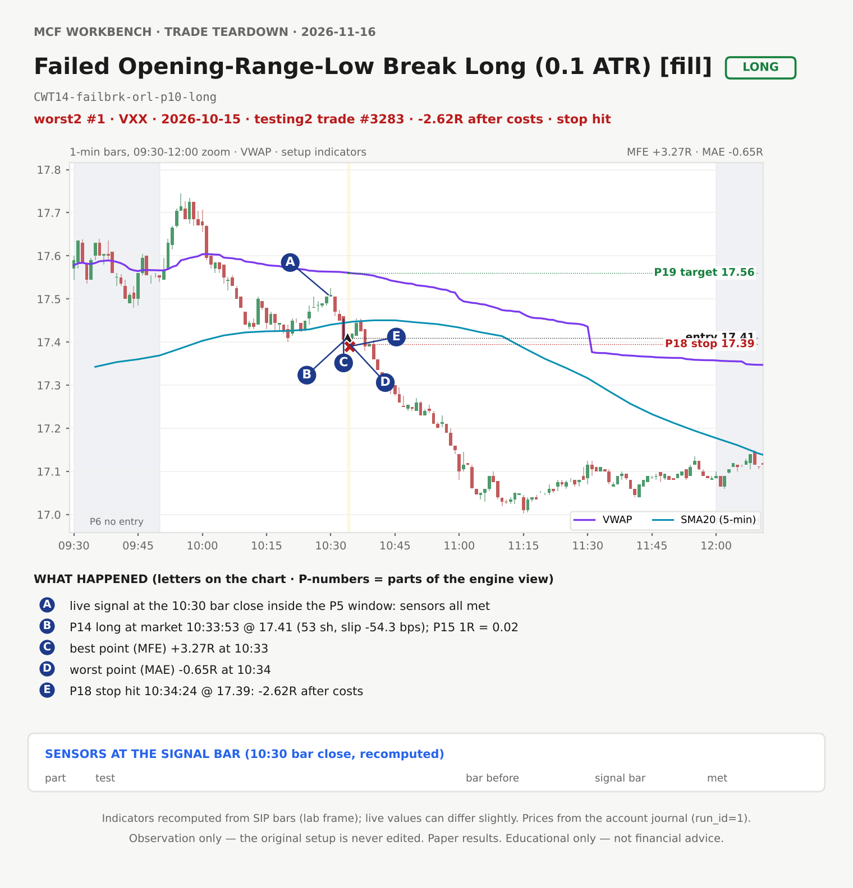
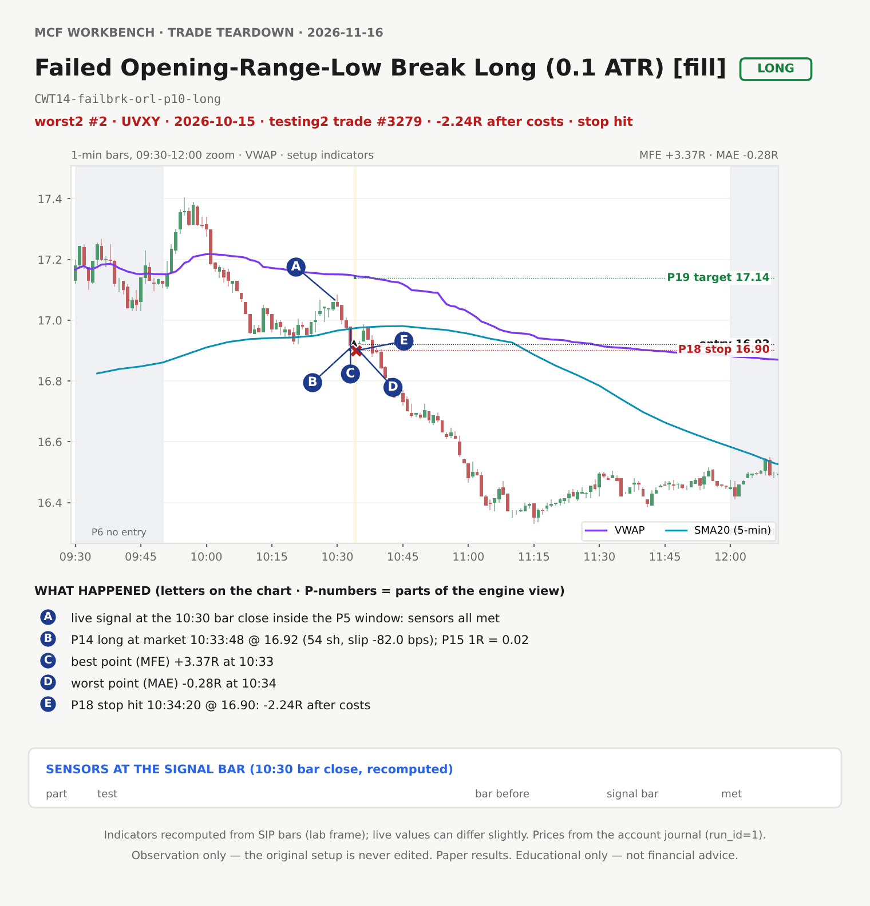

# Workbench blueprint: Failed Opening-Range-Low Break Long (0.1 ATR) [fill]

`CWT14-failbrk-orl-p10-long` - long - built 2026-11-16

> 09:50-12:00: price pokes 0.1+ ATR under the 09:30-10:00 low, then closes back above it within 3 bars; buy. Fill: over the 4-per-family cap.

## WHICH STOCKS

| Part | Exact value | Source / note |
|---|---|---|
| Liquidity floor (20-day avg $ volume) | `>= $95M` | setup min_adv |
| Account universe | `ADV >= $5M core, ATR >= 1.0%` | extended tier $1M with rvol >= 3.0x |
| Price floor | `>= $5.0` | costs.min_price |
| Earnings blackout | `4 trading days either side` | universe |
| Partnerships (PTP) | `excluded` | 10% withholding on sales |

## WHEN

| Part | Exact value | Source / note |
|---|---|---|
| Entry window (5-min bar close) | `09:50-12:00 ET` | window: [950, 1200] |
| No entries before | `09:50 ET` | live.no_entry_before |
| Flat by | `15:55 ET` | half days: close - 5 min |
| Refire | `first qualifying bar per symbol-day` | refire: false |

## ENTRY TRIGGER

| Part | Exact value | Source / note |
|---|---|---|
| Side | `LONG` | SIDE |
| Module rule (as described) | `B3-LOR-p0.1-Vany-sidelong-t05s1-guest` | LAYERS |
| Order | `enter at the close of the signal bar` | lab outcome model |

## RISK & EXIT

| Part | Exact value | Source / note |
|---|---|---|
| 1R (risk unit) | `0.25 x daily ATR` | r_atr_frac |
| Exit geometry | `t05s1: target +0.5R / stop 1R` | GEOM |
| Stop | `1.0R below entry` | bracket stop |
| Target | `+0.5R` | bracket target |
| Scale-out | `none` | scale_out_r: null |
| Time exit | `flat at 15:55 ET` | session.flatten_by |

## LIMITS

| Part | Exact value | Source / note |
|---|---|---|
| Open lots per setup | `75` | max_positions_per_strategy |
| Per-setup daily latch | `stops at -2R net` | max_setup_daily_loss_r |
| Account daily stop | `-120R` | max_daily_loss_r |
| Lots per symbol | `3 (same side)` | same_setup_reentry: True |
| Spread / size checks | `spread <= 30 bps and <= 0.25 of stop; <= 10% of 1-min volume` | live |

## ACCOUNT & SIZING

| Part | Exact value | Source / note |
|---|---|---|
| Runs in | `Graveyard` | configs now |
| Size per trade | `min(0.25% equity at risk, slot ~$533)` | 300 slots x 1.6 BP |
| Max position | `10% of equity` | max_position_notional_pct |

## RECORD

| Part | Exact value | Source / note |
|---|---|---|
| Trades / sessions | `723 / 25` | 2026-10-12 to 2026-11-13 |
| Avg R after costs | `-0.085R` | total -61.7R, win 65% |
| Avg R w/o best day | `-0.109R` |  |
| By account | `Testing A 193 tr -0.20R, Graveyard 530 tr -0.04R` |  |
| Rule changes in window | `7 (listed in the markdown)` | latest: 2026-11-12: LR1: flatten at min(15:55, calendar close - 5 mi; 2026-11-12: LR5: broker position vs journal lot check every  |

## MODULE

- file: `research/bdi/cwt/live/CWT14-failbrk-orl-p10-long.py` (parsed as: mask)
- module's own layer notes: B3-LOR-p0.1-Vany-sidelong-t05s1-guest

## RULE CHANGES INSIDE THE RECORD WINDOW

- 2026-10-17: Testing 2: 4 more setups bank half at +0.35R, rest to breakeven (live_scale_out)
- 2026-10-21: Move the four CWT14-failbrk-orl longs (p05, p05-lowvol, p10, p10-lowvol) from Testing 2 to the Graveyard
- 2026-10-23: Owner ST-A: per-setup daily loss stop off in Testing 1, Testing 2 and the Setup Generator (Graveyard keeps -2R; Primary unchanged, never had one)
- 2026-10-23: Owner replies: withdraw G1 (R1 yes: the 6 -g1 up-tape gated short variants are never added); no new daily stop for Primary (R2 yes: keep the -20R account stop and the -2R per-setup stop in the testing accounts; B1b not adopted)
- 2026-11-12: Graveyard: buying_power_multiple 3.8 -> 1.6, slots 200 -> 300 (REPV-11); per-setup cap 25 -> 75 (REPV-12); -2R latch kept (config)
- 2026-11-12: LR1: flatten at min(15:55, calendar close - 5 min) on every account (half days 11-27 / 12-24 flatten 12:55)
- 2026-11-12: LR5: broker position vs journal lot check every poll on all accounts; a persistent mismatch is flagged (health.position_mismatch), blocks new entries in that symbol and alerts; never auto-closed

## WORKBENCH PARAMETERS (for `python -m mcf.research.workbench spawn`)

- `min_adv` = `95000000`
- `window` = `[950, 1200]`
- `scale_out_r` = `0.35`
- `live_scale_out` = `False`
- `refire` = `False`
- `refire_cooldown` = `1`
- `geom` = `t05s1`
- `r_atr_frac` = `0.25`

## ENGINE VIEW (numbered parts)

| Part | Stage | Component | Exact value | Binding share |
|---|---|---|---|---|
| P1 | INTAKE | Account universe | `ADV >= $5M core, ATR >= 1.0%` | - |
| P2 | INTAKE | Setup liquidity floor (20d avg $ vol) | `>= $95M` | - |
| P3 | INTAKE | Price floor | `>= $5.0` | blocked 1/1684 signals (0%) |
| P4 | INTAKE | Earnings blackout | `4 trading days either side` | - |
| P5 | TIMER | Entry window (5-min bar close) | `09:50-12:00 ET` | - |
| P6 | TIMER | No entries before | `09:50 ET` | - |
| P7 | TIMER | Refire | `first qualifying bar per symbol-day` | - |
| P8 | SENSORS | Module rule (as described) | `B3-LOR-p0.1-Vany-sidelong-t05s1-guest` | - |
| P9 | GATES | Open lots per setup | `75` | blocked 93/1684 signals (6%) |
| P10 | GATES | Lots per symbol | `3 (same side)` | blocked 73/1684 signals (4%) |
| P11 | GATES | Per-setup daily latch | `stops at -2R net` | blocked 378/1684 signals (22%) |
| P12 | GATES | Account daily stop / halt | `-120R` | blocked 51/1684 signals (3%) |
| P13 | GATES | Quote & spread checks | `spread <= 30 bps and <= 0.25 of stop; <= 10% of 1-min volume` | blocked 286/1684 signals (17%) |
| P14 | ENTRY | Side + order | `LONG at market, signal-bar close` | - |
| P15 | ENTRY | 1R (risk unit) | `0.25 x daily ATR` | - |
| P16 | ENTRY | Size per trade | `min(0.25% equity at risk, slot ~$533)` | - |
| P17 | ENTRY | Max position | `10% of equity` | - |
| P18 | EXHAUST | Stop | `1.0R below entry` | ended 222/723 live trades (31%) |
| P19 | EXHAUST | Target | `+0.5R` | ended 466/723 live trades (64%) |
| P20 | EXHAUST | Scale-out | `none` | ended 0/723 live trades (0%) |
| P21 | EXHAUST | Time exit | `flat at 15:55 ET` | ended 35/723 live trades (5%) |

Exit mix: {'target': 466, 'stop': 222, 'time': 35} of 723 live trades; blocked signals: {'cap_symbol': 73, 'quote': 286, 'other': 9, 'cap_setup': 93, 'acct_stop': 51, 'latch': 378, 'price': 1} of 1684 live signals (refire setups re-signal every bar while held).

## TRADE TEARDOWNS

### VXX 2026-10-15 (testing2 #3283): -2.62R, stop

- **A** live signal at the 10:30 bar close inside the P5 window: sensors all met
- **B** P14 long at market 10:33:53 @ 17.41 (53 sh, slip -54.3 bps); P15 1R = 0.02
- **C** best point (MFE) +3.27R at 10:33
- **D** worst point (MAE) -0.65R at 10:34
- **E** P18 stop hit 10:34:24 @ 17.39: -2.62R after costs

| Part | Test | Bar before | Signal bar | Met |
|---|---|---|---|---|

### UVXY 2026-10-15 (testing2 #3279): -2.24R, stop

- **A** live signal at the 10:30 bar close inside the P5 window: sensors all met
- **B** P14 long at market 10:33:48 @ 16.92 (54 sh, slip -82.0 bps); P15 1R = 0.02
- **C** best point (MFE) +3.37R at 10:33
- **D** worst point (MAE) -0.28R at 10:34
- **E** P18 stop hit 10:34:20 @ 16.90: -2.24R after costs

| Part | Test | Bar before | Signal bar | Met |
|---|---|---|---|---|

Observation only: the original setup is never edited. Educational only — not financial advice.
