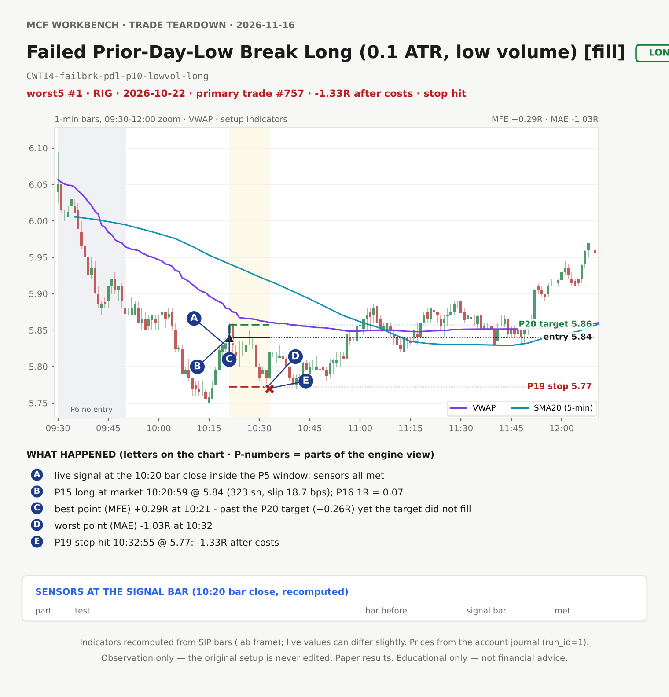
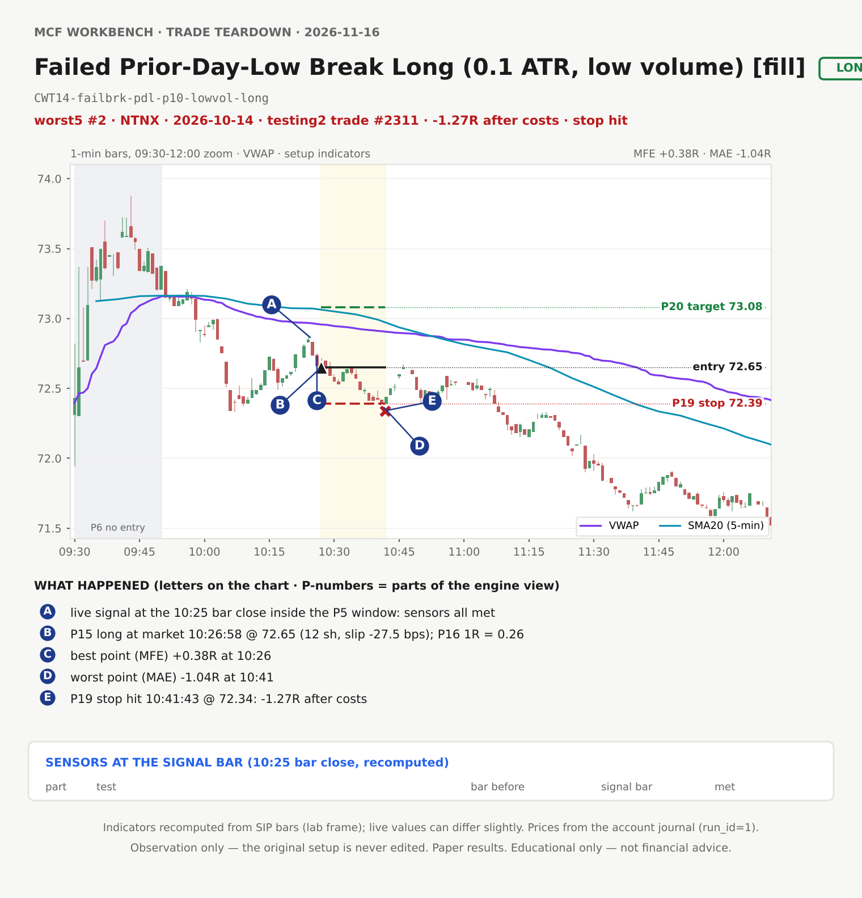
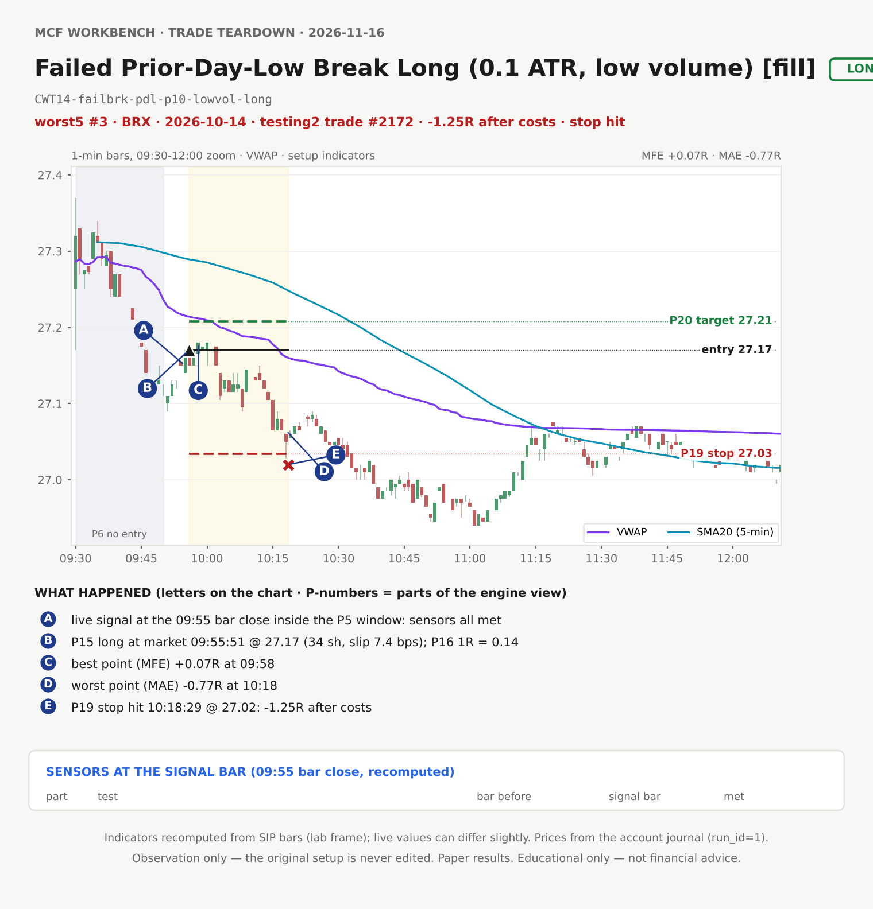
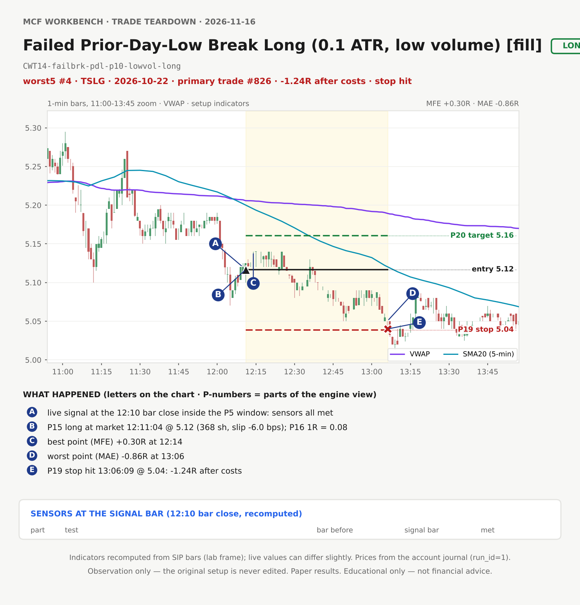
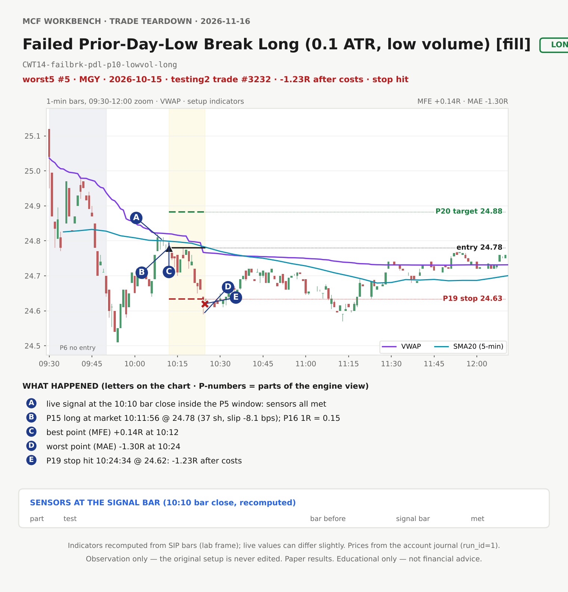
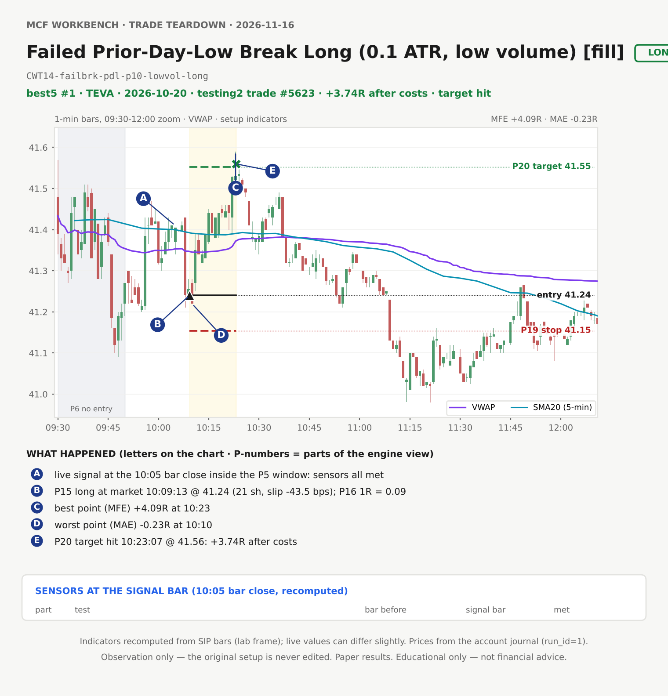
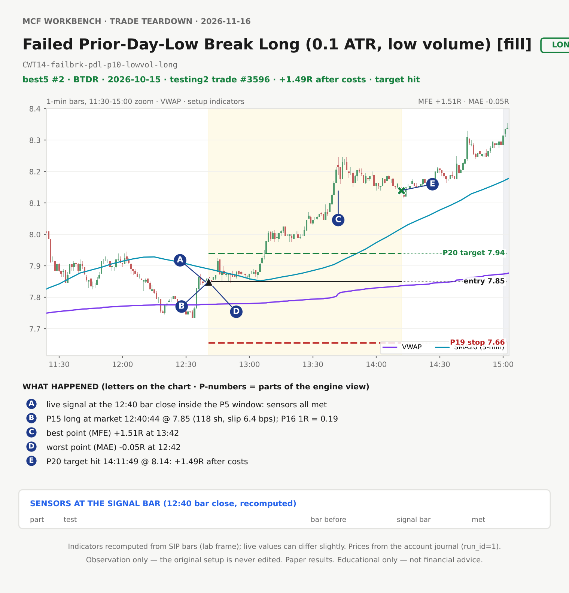
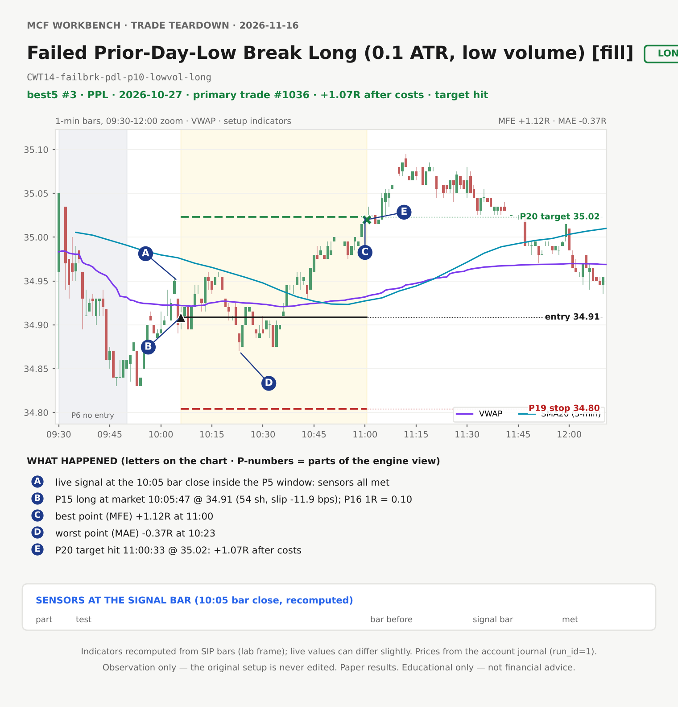
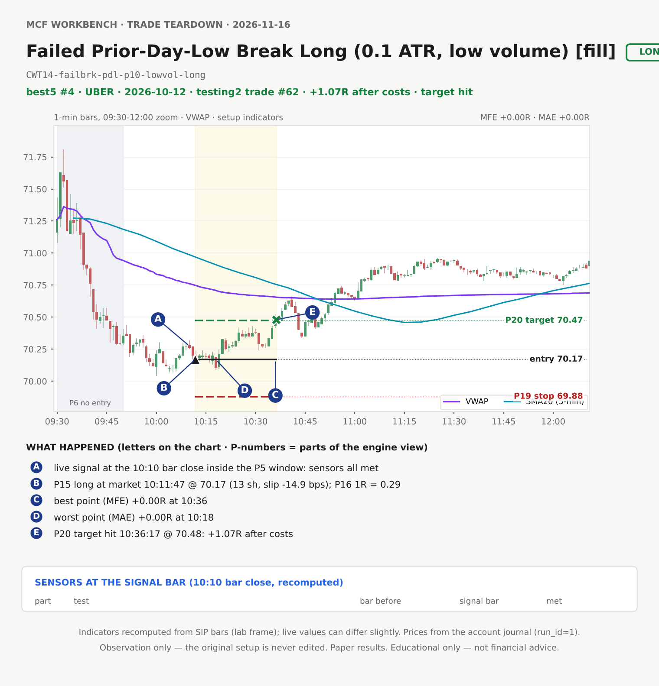
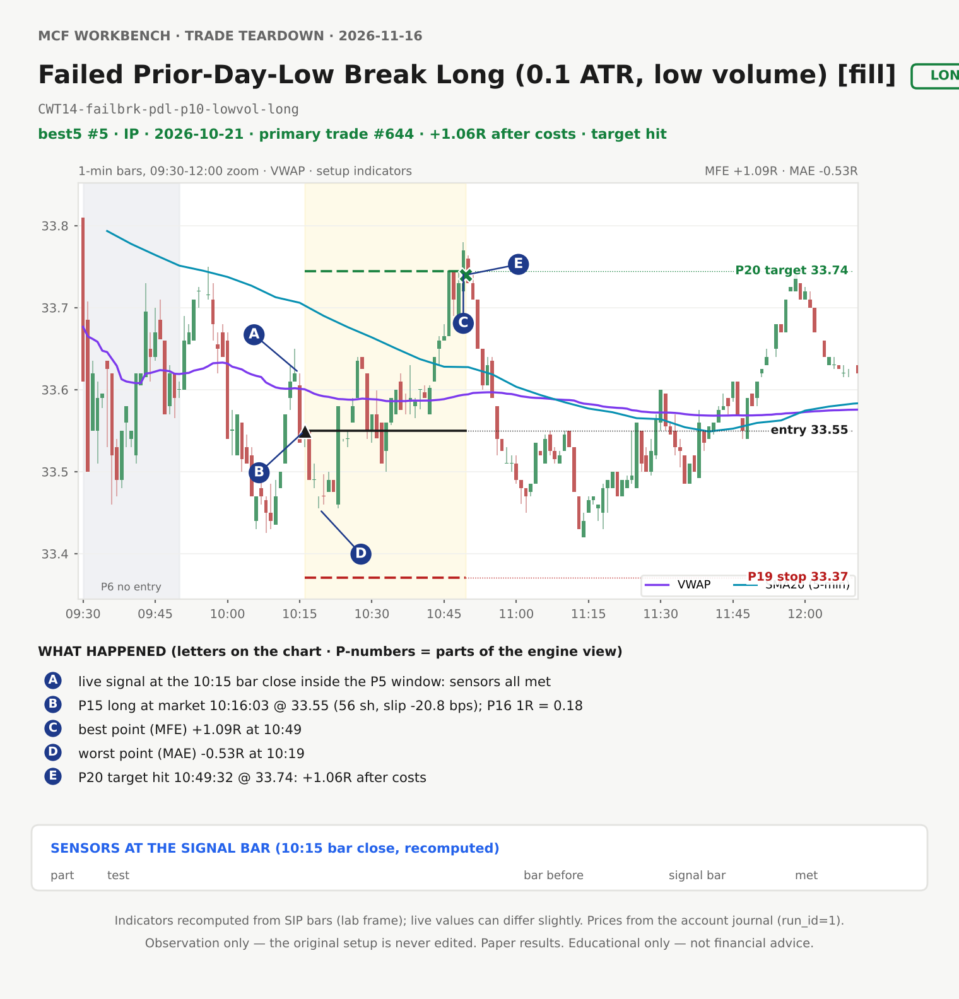

# Workbench blueprint: Failed Prior-Day-Low Break Long (0.1 ATR, low volume) [fill]

`CWT14-failbrk-pdl-p10-lowvol-long` - long - built 2026-11-16

> 09:50-15:00: price pokes 0.1+ ATR under yesterday's low on below-average volume, then closes back above it within 3 bars; buy. Fill: over the 4-per-family cap.

## WHICH STOCKS

| Part | Exact value | Source / note |
|---|---|---|
| Liquidity floor (20-day avg $ volume) | `>= $95M` | setup min_adv |
| Account universe | `ADV >= $5M core, ATR >= 1.0%` | extended tier $1M with rvol >= 3.0x |
| Price floor | `>= $5.0` | costs.min_price |
| Earnings blackout | `4 trading days either side` | universe |
| Partnerships (PTP) | `excluded` | 10% withholding on sales |

## WHEN

| Part | Exact value | Source / note |
|---|---|---|
| Entry window (5-min bar close) | `09:50-15:00 ET` | window: [950, 1500] |
| No entries before | `09:50 ET` | live.no_entry_before |
| Flat by | `15:55 ET` | half days: close - 5 min |
| Refire | `first qualifying bar per symbol-day` | refire: false |

## ENTRY TRIGGER

| Part | Exact value | Source / note |
|---|---|---|
| Side | `LONG` | SIDE |
| Module rule (as described) | `B3-LPD-p0.1-Vlowvol-sidelong-t05s1-full` | LAYERS |
| Order | `enter at the close of the signal bar` | lab outcome model |

## RISK & EXIT

| Part | Exact value | Source / note |
|---|---|---|
| 1R (risk unit) | `0.25 x daily ATR` | r_atr_frac |
| Exit geometry | `t05s1: target +0.5R / stop 1R` | GEOM |
| Stop | `1.0R below entry` | bracket stop |
| Target | `+0.5R` | bracket target |
| Scale-out | `none` | scale_out_r: null |
| Time exit | `flat at 15:55 ET` | session.flatten_by |

## LIMITS

| Part | Exact value | Source / note |
|---|---|---|
| Open lots per setup | `50` | max_positions_per_strategy |
| Per-setup daily latch | `off` | max_setup_daily_loss_r |
| Account daily stop | `-300R` | max_daily_loss_r |
| Lots per symbol | `3 (same side)` | same_setup_reentry: True |
| Cost filter | `skip if stop costs > 0.15R` | max_stop_cost_r |
| Spread / size checks | `spread <= 30 bps and <= 0.25 of stop; <= 10% of 1-min volume` | live |

## ACCOUNT & SIZING

| Part | Exact value | Source / note |
|---|---|---|
| Runs in | `Testing D` | configs now |
| Size per trade | `min(0.25% equity at risk, slot ~$1,000)` | 200 slots x 2.0 BP |
| Max position | `10% of equity` | max_position_notional_pct |

## RECORD

| Part | Exact value | Source / note |
|---|---|---|
| Trades / sessions | `408 / 26` | 2026-10-12 to 2026-11-16 |
| Avg R after costs | `-0.020R` | total -8.3R, win 67% |
| Avg R w/o best day | `-0.050R` |  |
| By account | `Primary 78 tr -0.01R, Testing A 240 tr -0.09R, Testing D 90 tr +0.16R` |  |
| Rule changes in window | `14 (listed in the markdown)` | latest: 2026-11-12: LR7: closing flatten retries every 20 s until cl; 2026-11-12: Testing D / E / F filled (10 setups each) and th |

## MODULE

- file: `research/bdi/cwt/live/CWT14-failbrk-pdl-p10-lowvol-long.py` (parsed as: mask)
- module's own layer notes: B3-LPD-p0.1-Vlowvol-sidelong-t05s1-full

## RULE CHANGES INSIDE THE RECORD WINDOW

- 2026-10-20: Owner promotions (move): L3-gap-slope-fromopen-FD Testing 1 -> Primary; CWT14-failbrk-pdl-p10-lowvol-long Testing 2 -> Primary
- 2026-10-23: Owner ST-A: per-setup daily loss stop off in Testing 1, Testing 2 and the Setup Generator (Graveyard keeps -2R; Primary unchanged, never had one)
- 2026-10-23: Owner replies: withdraw G1 (R1 yes: the 6 -g1 up-tape gated short variants are never added); no new daily stop for Primary (R2 yes: keep the -20R account stop and the -2R per-setup stop in the testing accounts; B1b not adopted)
- 2026-10-26: Owner: promote CWT13-vwapstretch-z05-long (Stretched Below VWAP Bounce) Testing 2 -> Primary (move)
- 2026-10-27: Owner Z05: demote CWT13-vwapstretch-z05-long (Stretched Below VWAP Bounce) Primary -> Testing 2 (move)
- 2026-10-28: Owner rotation 2026-10-27: CWT14-failbrk-pdl-p10-lowvol-long (Failed Prior-Day-Low Break Long (0.1 ATR, low volume)) Primary -> Testing 2 (move)
- 2026-10-28: Owner: Primary position size ~$4,000 instead of ~$5,000 (slots 61 -> 77, max concurrent 61 -> 77; per-setup stays 30)
- 2026-10-28: Owner: Primary position size ~$5,000 (slots 160 -> 61, max concurrent 160 -> 61, per-setup 100 -> 30)
- 2026-10-29: Owner ST-P: per-setup daily stop at -2R (latched) in Primary only
- 2026-11-12: LR1: flatten at min(15:55, calendar close - 5 min) on every account (half days 11-27 / 12-24 flatten 12:55)
- 2026-11-12: LR3: Primary's -20R account halt and -2R per-setup latch count R after costs; the account halt also counts open lots' marks (less a market-exit cost)
- 2026-11-12: LR5: broker position vs journal lot check every poll on all accounts; a persistent mismatch is flagged (health.position_mismatch), blocks new entries in that symbol and alerts; never auto-closed
- 2026-11-12: LR7: closing flatten retries every 20 s until close - 1 min, then an extended-hours close, alerts on failure; watchdog in act for Primary until calendar close + 5 min (also acts on flatten_failed / exposure after the flatten)
- 2026-11-12: Testing D / E / F filled (10 setups each) and the testing areas rebalanced: A 11 / B 11 / C 11 / D 10 / E 10 / F 10, by side and family, twins apart (move)

## WORKBENCH PARAMETERS (for `python -m mcf.research.workbench spawn`)

- `min_adv` = `95000000`
- `window` = `[950, 1500]`
- `scale_out_r` = `None`
- `refire` = `False`
- `refire_cooldown` = `1`
- `geom` = `t05s1`
- `r_atr_frac` = `0.25`

## ENGINE VIEW (numbered parts)

| Part | Stage | Component | Exact value | Binding share |
|---|---|---|---|---|
| P1 | INTAKE | Account universe | `ADV >= $5M core, ATR >= 1.0%` | - |
| P2 | INTAKE | Setup liquidity floor (20d avg $ vol) | `>= $95M` | - |
| P3 | INTAKE | Price floor | `>= $5.0` | blocked 1/691 signals (0%) |
| P4 | INTAKE | Earnings blackout | `4 trading days either side` | - |
| P5 | TIMER | Entry window (5-min bar close) | `09:50-15:00 ET` | - |
| P6 | TIMER | No entries before | `09:50 ET` | - |
| P7 | TIMER | Refire | `first qualifying bar per symbol-day` | - |
| P8 | SENSORS | Module rule (as described) | `B3-LPD-p0.1-Vlowvol-sidelong-t05s1-full` | - |
| P9 | GATES | Open lots per setup | `50` | blocked 0/691 signals (0%) |
| P10 | GATES | Lots per symbol | `3 (same side)` | blocked 10/691 signals (1%) |
| P11 | GATES | Per-setup daily latch | `off` | blocked 0/691 signals (0%) |
| P12 | GATES | Account daily stop / halt | `-300R` | blocked 12/691 signals (2%) |
| P13 | GATES | Cost filter | `skip if stop costs > 0.15R` | blocked 0/691 signals (0%) |
| P14 | GATES | Quote & spread checks | `spread <= 30 bps and <= 0.25 of stop; <= 10% of 1-min volume` | blocked 176/691 signals (25%) |
| P15 | ENTRY | Side + order | `LONG at market, signal-bar close` | - |
| P16 | ENTRY | 1R (risk unit) | `0.25 x daily ATR` | - |
| P17 | ENTRY | Size per trade | `min(0.25% equity at risk, slot ~$1,000)` | - |
| P18 | ENTRY | Max position | `10% of equity` | - |
| P19 | EXHAUST | Stop | `1.0R below entry` | ended 120/408 live trades (29%) |
| P20 | EXHAUST | Target | `+0.5R` | ended 267/408 live trades (65%) |
| P21 | EXHAUST | Scale-out | `none` | ended 0/408 live trades (0%) |
| P22 | EXHAUST | Time exit | `flat at 15:55 ET` | ended 21/408 live trades (5%) |

Exit mix: {'target': 267, 'stop': 120, 'time': 21} of 408 live trades; blocked signals: {'quote': 176, 'price': 1, 'other': 74, 'cap_symbol': 10, 'acct_stop': 12} of 691 live signals (refire setups re-signal every bar while held).

## TRADE TEARDOWNS

### RIG 2026-10-22 (primary #757): -1.33R, stop

- **A** live signal at the 10:20 bar close inside the P5 window: sensors all met
- **B** P15 long at market 10:20:59 @ 5.84 (323 sh, slip 18.7 bps); P16 1R = 0.07
- **C** best point (MFE) +0.29R at 10:21 - past the P20 target (+0.26R) yet the target did not fill
- **D** worst point (MAE) -1.03R at 10:32
- **E** P19 stop hit 10:32:55 @ 5.77: -1.33R after costs

| Part | Test | Bar before | Signal bar | Met |
|---|---|---|---|---|

### NTNX 2026-10-14 (testing2 #2311): -1.27R, stop

- **A** live signal at the 10:25 bar close inside the P5 window: sensors all met
- **B** P15 long at market 10:26:58 @ 72.65 (12 sh, slip -27.5 bps); P16 1R = 0.26
- **C** best point (MFE) +0.38R at 10:26
- **D** worst point (MAE) -1.04R at 10:41
- **E** P19 stop hit 10:41:43 @ 72.34: -1.27R after costs

| Part | Test | Bar before | Signal bar | Met |
|---|---|---|---|---|

### BRX 2026-10-14 (testing2 #2172): -1.25R, stop

- **A** live signal at the 09:55 bar close inside the P5 window: sensors all met
- **B** P15 long at market 09:55:51 @ 27.17 (34 sh, slip 7.4 bps); P16 1R = 0.14
- **C** best point (MFE) +0.07R at 09:58
- **D** worst point (MAE) -0.77R at 10:18
- **E** P19 stop hit 10:18:29 @ 27.02: -1.25R after costs

| Part | Test | Bar before | Signal bar | Met |
|---|---|---|---|---|

### TSLG 2026-10-22 (primary #826): -1.24R, stop

- **A** live signal at the 12:10 bar close inside the P5 window: sensors all met
- **B** P15 long at market 12:11:04 @ 5.12 (368 sh, slip -6.0 bps); P16 1R = 0.08
- **C** best point (MFE) +0.30R at 12:14
- **D** worst point (MAE) -0.86R at 13:06
- **E** P19 stop hit 13:06:09 @ 5.04: -1.24R after costs

| Part | Test | Bar before | Signal bar | Met |
|---|---|---|---|---|

### MGY 2026-10-15 (testing2 #3232): -1.23R, stop

- **A** live signal at the 10:10 bar close inside the P5 window: sensors all met
- **B** P15 long at market 10:11:56 @ 24.78 (37 sh, slip -8.1 bps); P16 1R = 0.15
- **C** best point (MFE) +0.14R at 10:12
- **D** worst point (MAE) -1.30R at 10:24
- **E** P19 stop hit 10:24:34 @ 24.62: -1.23R after costs

| Part | Test | Bar before | Signal bar | Met |
|---|---|---|---|---|

Observation only: the original setup is never edited. Educational only — not financial advice.
## TRADE TEARDOWNS (best 5)

### TEVA 2026-10-20 (testing2 #5623): +3.74R, target

- **A** live signal at the 10:05 bar close inside the P5 window: sensors all met
- **B** P15 long at market 10:09:13 @ 41.24 (21 sh, slip -43.5 bps); P16 1R = 0.09
- **C** best point (MFE) +4.09R at 10:23
- **D** worst point (MAE) -0.23R at 10:10
- **E** P20 target hit 10:23:07 @ 41.56: +3.74R after costs

| Part | Test | Bar before | Signal bar | Met |
|---|---|---|---|---|

### BTDR 2026-10-15 (testing2 #3596): +1.49R, target

- **A** live signal at the 12:40 bar close inside the P5 window: sensors all met
- **B** P15 long at market 12:40:44 @ 7.85 (118 sh, slip 6.4 bps); P16 1R = 0.19
- **C** best point (MFE) +1.51R at 13:42
- **D** worst point (MAE) -0.05R at 12:42
- **E** P20 target hit 14:11:49 @ 8.14: +1.49R after costs

| Part | Test | Bar before | Signal bar | Met |
|---|---|---|---|---|

### PPL 2026-10-27 (primary #1036): +1.07R, target

- **A** live signal at the 10:05 bar close inside the P5 window: sensors all met
- **B** P15 long at market 10:05:47 @ 34.91 (54 sh, slip -11.9 bps); P16 1R = 0.10
- **C** best point (MFE) +1.12R at 11:00
- **D** worst point (MAE) -0.37R at 10:23
- **E** P20 target hit 11:00:33 @ 35.02: +1.07R after costs

| Part | Test | Bar before | Signal bar | Met |
|---|---|---|---|---|

### UBER 2026-10-12 (testing2 #62): +1.07R, target

- **A** live signal at the 10:10 bar close inside the P5 window: sensors all met
- **B** P15 long at market 10:11:47 @ 70.17 (13 sh, slip -14.9 bps); P16 1R = 0.29
- **C** best point (MFE) +0.00R at 10:36
- **D** worst point (MAE) +0.00R at 10:18
- **E** P20 target hit 10:36:17 @ 70.48: +1.07R after costs

| Part | Test | Bar before | Signal bar | Met |
|---|---|---|---|---|

### IP 2026-10-21 (primary #644): +1.06R, target

- **A** live signal at the 10:15 bar close inside the P5 window: sensors all met
- **B** P15 long at market 10:16:03 @ 33.55 (56 sh, slip -20.8 bps); P16 1R = 0.18
- **C** best point (MFE) +1.09R at 10:49
- **D** worst point (MAE) -0.53R at 10:19
- **E** P20 target hit 10:49:32 @ 33.74: +1.06R after costs

| Part | Test | Bar before | Signal bar | Met |
|---|---|---|---|---|

Observation only: the original setup is never edited. Educational only — not financial advice.
