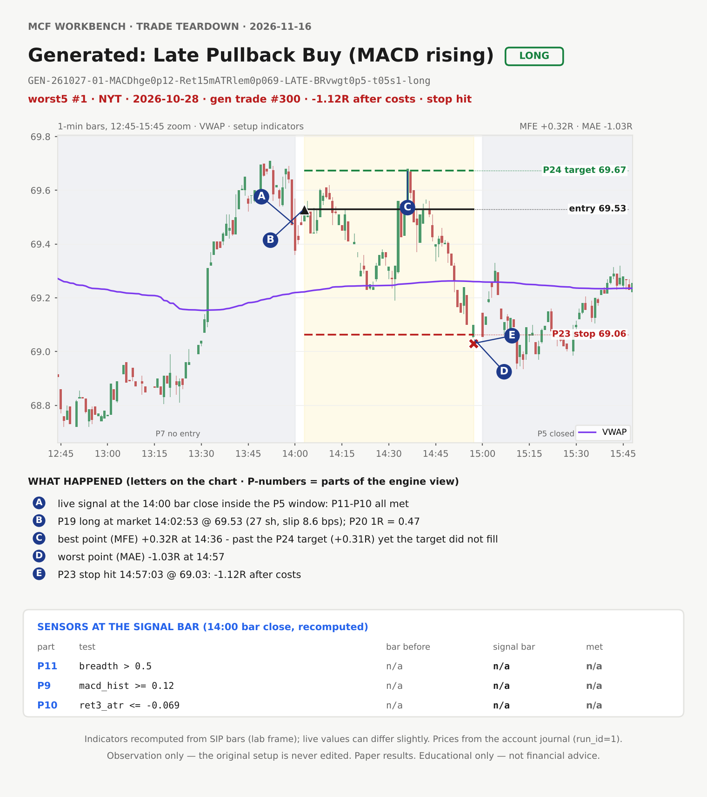
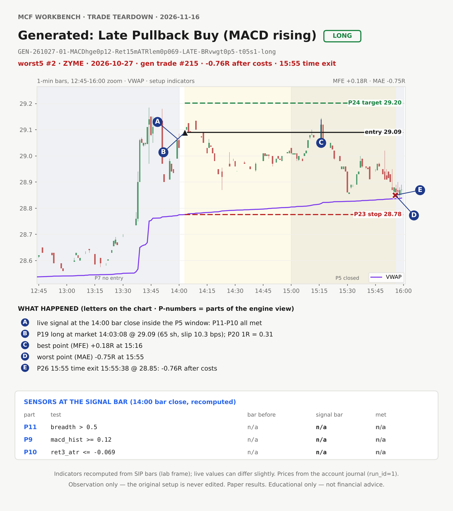
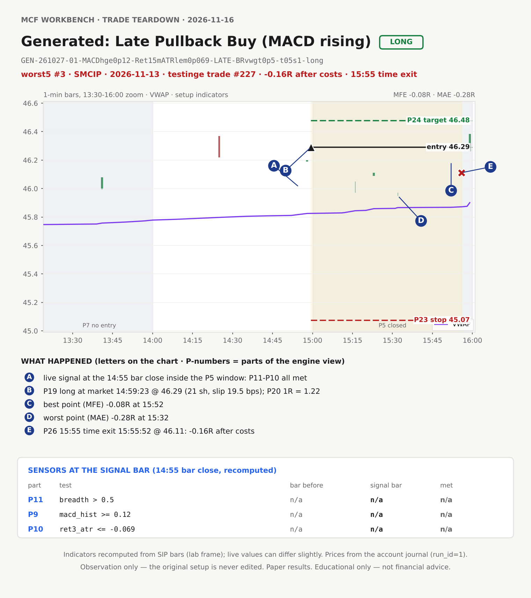
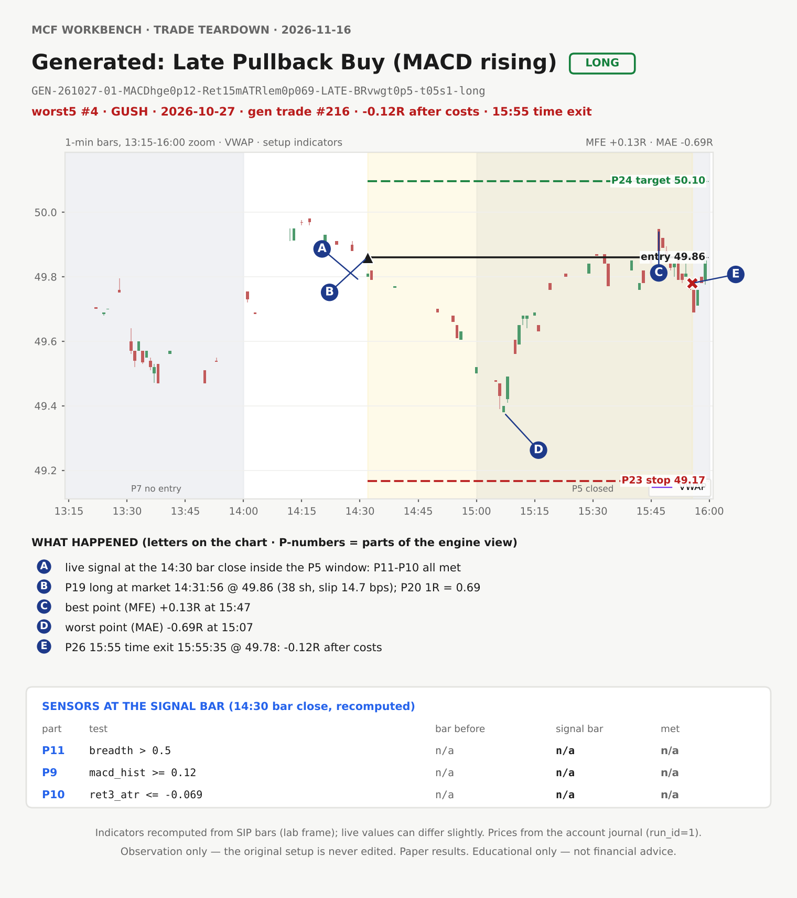
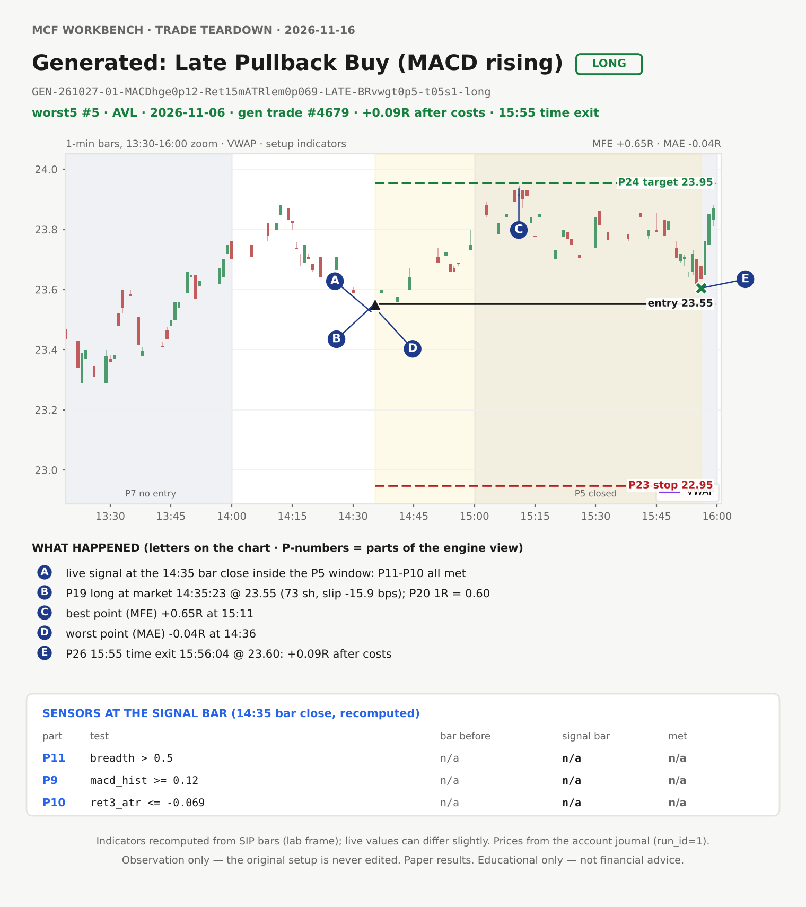

# Workbench blueprint: Generated: Late Pullback Buy (MACD rising)

`GEN-261027-01-MACDhge0p12-Ret15mATRlem0p069-LATE-BRvwgt0p5-t05s1-long` - long - built 2026-11-16

> Buy on the first 5-minute bar closing 14:00-15:00 ET where the share of stocks above their VWAP is above 0.5; macdPct minus its in-day EMA9 (histogram) >= 0.12; 15-min change in daily ATRs <= -0.069 (stocks with 20-day average dollar volume >= $20M). Exit target +0.5R / stop 1R, R = 0.25 x daily ATR. Machine-generated for exploration; not a tested edge.

## WHICH STOCKS

| Part | Exact value | Source / note |
|---|---|---|
| Liquidity floor (20-day avg $ volume) | `>= $20M` | setup min_adv |
| Account universe | `ADV >= $5M core, ATR >= 1.0%` | extended tier $1M with rvol >= 3.0x |
| Price floor | `>= $5.0` | costs.min_price |
| Earnings blackout | `4 trading days either side` | universe |
| Partnerships (PTP) | `excluded` | 10% withholding on sales |

## WHEN

| Part | Exact value | Source / note |
|---|---|---|
| Entry window (5-min bar close) | `14:00-15:00 ET` | window: [1400, 1500] |
| Module's own window | `14:00-15:00 ET` | WINDOW constant |
| No entries before | `09:50 ET` | live.no_entry_before |
| Flat by | `15:55 ET` | half days: close - 5 min |
| Refire | `first qualifying bar per symbol-day` | refire: false |

## ENTRY TRIGGER

| Part | Exact value | Source / note |
|---|---|---|
| Side | `LONG` | SIDE |
| share of stocks above their VWAP | `breadth > 0.5` | cond.breadth |
| macdPct minus its in-day EMA9 (histogram) | `macd_hist >= 0.12` | cond.macd_hist |
| 15-min change in daily ATRs | `ret3_atr <= -0.069` | cond.ret3_atr |
| Market context columns | `breadth` | context |
| Order | `enter at the close of the signal bar` | lab outcome model |

## RISK & EXIT

| Part | Exact value | Source / note |
|---|---|---|
| 1R (risk unit) | `0.25 x daily ATR` | r_atr_frac |
| Exit geometry | `t05s1: target +0.5R / stop 1R` | GEOM |
| Stop | `1.0R below entry` | bracket stop |
| Target | `+0.5R` | bracket target |
| Scale-out | `none` | scale_out_r: null |
| Time exit | `flat at 15:55 ET` | session.flatten_by |

## LIMITS

| Part | Exact value | Source / note |
|---|---|---|
| Open lots per setup | `50` | max_positions_per_strategy |
| Per-setup daily latch | `off` | max_setup_daily_loss_r |
| Account daily stop | `-300R` | max_daily_loss_r |
| Lots per symbol | `3 (same side)` | same_setup_reentry: True |
| Cost filter | `skip if stop costs > 0.15R` | max_stop_cost_r |
| Spread / size checks | `spread <= 30 bps and <= 0.25 of stop; <= 10% of 1-min volume` | live |

## ACCOUNT & SIZING

| Part | Exact value | Source / note |
|---|---|---|
| Runs in | `Testing E` | configs now |
| Size per trade | `min(0.25% equity at risk, slot ~$1,000)` | 200 slots x 2.0 BP |
| Max position | `10% of equity` | max_position_notional_pct |

## RECORD

| Part | Exact value | Source / note |
|---|---|---|
| Trades / sessions | `16 / 6` | 2026-10-27 to 2026-11-13 |
| Avg R after costs | `+0.187R` | total +3.0R, win 75% |
| Avg R w/o best day | `+0.139R` | best day 2026-11-10 = 39% of R |
| By account | `Setup Generator 14 tr +0.22R, Testing E 2 tr -0.02R` |  |
| Rule changes in window | `4 (listed in the markdown)` | latest: 2026-11-12: LR1: flatten at min(15:55, calendar close - 5 mi; 2026-11-12: LR5: broker position vs journal lot check every  |

## NAME CODE (Setup Generator id)

| Token | Meaning |
|---|---|
| `261027-01` | generated 2026-10-27, spec #01 of that run |
| `MACDhge0p12` | macdPct minus its in-day EMA9 (histogram) >= 0.12 |
| `Ret15mATRlem0p069` | 15-min change in daily ATRs <= -0.069 |
| `LATE` | time window 14:00-15:00 ET |
| `BRvwgt0p5` | the share of stocks above their VWAP is above 0.5 |
| `t05s1` | target +0.5R / stop 1R |
| `long` | side long |

## MODULE

- file: `research/generator/modules/GEN-261027-01-macdh-hi-late-long.py` (parsed as: conds)
- module's own layer notes: breadth > 0.5; macd_hist >= 0.12; ret3_atr <= -0.069; window 1400-1500

## RULE CHANGES INSIDE THE RECORD WINDOW

- 2026-11-12: GEN-GRAD: 5 Setup Generator setups graduate to Testing D / E / F (rule: >= 4 traded sessions, >= 10 trades, shrunk avg R > 0, avg R w/o best day >= -0.10; live run_id=1, R after costs) (move)
- 2026-11-12: Gen: buying_power_multiple 3.8 -> 1.8, slots 200 -> 300 (REPV-1); per-setup cap 48 -> 150 (REPV #5) (config)
- 2026-11-12: LR1: flatten at min(15:55, calendar close - 5 min) on every account (half days 11-27 / 12-24 flatten 12:55)
- 2026-11-12: LR5: broker position vs journal lot check every poll on all accounts; a persistent mismatch is flagged (health.position_mismatch), blocks new entries in that symbol and alerts; never auto-closed

## WORKBENCH PARAMETERS (for `python -m mcf.research.workbench spawn`)

- `context` = `['breadth']`
- `min_adv` = `20000000`
- `window` = `[1400, 1500]`
- `refire` = `False`
- `scale_out_r` = `None`
- `refire_cooldown` = `1`
- `geom` = `t05s1`
- `r_atr_frac` = `0.25`
- `cond.breadth` = `0.5`
- `cond.macd_hist` = `0.12`
- `cond.ret3_atr` = `-0.069`

## ENGINE VIEW (numbered parts)

| Part | Stage | Component | Exact value | Binding share |
|---|---|---|---|---|
| P1 | INTAKE | Account universe | `ADV >= $5M core, ATR >= 1.0%` | - |
| P2 | INTAKE | Setup liquidity floor (20d avg $ vol) | `>= $20M` | - |
| P3 | INTAKE | Price floor | `>= $5.0` | blocked 1/79 signals (1%) |
| P4 | INTAKE | Earnings blackout | `4 trading days either side` | - |
| P5 | TIMER | Entry window (5-min bar close) | `14:00-15:00 ET` | - |
| P6 | TIMER | Module's own window | `14:00-15:00 ET` | - |
| P7 | TIMER | No entries before | `09:50 ET` | - |
| P8 | TIMER | Refire | `first qualifying bar per symbol-day` | - |
| P9 | SENSORS | macdPct minus its in-day EMA9 (histogram) | `macd_hist >= 0.12` | - |
| P10 | SENSORS | 15-min change in daily ATRs | `ret3_atr <= -0.069` | - |
| P11 | GATES | share of stocks above their VWAP | `breadth > 0.5` | - |
| P12 | GATES | Market context columns | `breadth` | - |
| P13 | GATES | Open lots per setup | `50` | blocked 0/79 signals (0%) |
| P14 | GATES | Lots per symbol | `3 (same side)` | blocked 1/79 signals (1%) |
| P15 | GATES | Per-setup daily latch | `off` | blocked 0/79 signals (0%) |
| P16 | GATES | Account daily stop / halt | `-300R` | blocked 21/79 signals (27%) |
| P17 | GATES | Cost filter | `skip if stop costs > 0.15R` | blocked 0/79 signals (0%) |
| P18 | GATES | Quote & spread checks | `spread <= 30 bps and <= 0.25 of stop; <= 10% of 1-min volume` | blocked 18/79 signals (23%) |
| P19 | ENTRY | Side + order | `LONG at market, signal-bar close` | - |
| P20 | ENTRY | 1R (risk unit) | `0.25 x daily ATR` | - |
| P21 | ENTRY | Size per trade | `min(0.25% equity at risk, slot ~$1,000)` | - |
| P22 | ENTRY | Max position | `10% of equity` | - |
| P23 | EXHAUST | Stop | `1.0R below entry` | ended 1/16 live trades (6%) |
| P24 | EXHAUST | Target | `+0.5R` | ended 9/16 live trades (56%) |
| P25 | EXHAUST | Scale-out | `none` | ended 0/16 live trades (0%) |
| P26 | EXHAUST | Time exit | `flat at 15:55 ET` | ended 6/16 live trades (38%) |

Exit mix: {'target': 9, 'time': 6, 'stop': 1} of 16 live trades; blocked signals: {'quote': 18, 'acct_stop': 21, 'cap_symbol': 1, 'price': 1, 'other': 1} of 79 live signals (refire setups re-signal every bar while held).

## TRADE TEARDOWNS

### NYT 2026-10-28 (gen #300): -1.12R, stop

- **A** live signal at the 14:00 bar close inside the P5 window: P11-P10 all met
- **B** P19 long at market 14:02:53 @ 69.53 (27 sh, slip 8.6 bps); P20 1R = 0.47
- **C** best point (MFE) +0.32R at 14:36 - past the P24 target (+0.31R) yet the target did not fill
- **D** worst point (MAE) -1.03R at 14:57
- **E** P23 stop hit 14:57:03 @ 69.03: -1.12R after costs

| Part | Test | Bar before | Signal bar | Met |
|---|---|---|---|---|
| P11 | `breadth > 0.5` | n/a | n/a | n/a |
| P9 | `macd_hist >= 0.12` | n/a | n/a | n/a |
| P10 | `ret3_atr <= -0.069` | n/a | n/a | n/a |

### ZYME 2026-10-27 (gen #215): -0.76R, flatten

- **A** live signal at the 14:00 bar close inside the P5 window: P11-P10 all met
- **B** P19 long at market 14:03:08 @ 29.09 (65 sh, slip 10.3 bps); P20 1R = 0.31
- **C** best point (MFE) +0.18R at 15:16
- **D** worst point (MAE) -0.75R at 15:55
- **E** P26 15:55 time exit 15:55:38 @ 28.85: -0.76R after costs

| Part | Test | Bar before | Signal bar | Met |
|---|---|---|---|---|
| P11 | `breadth > 0.5` | n/a | n/a | n/a |
| P9 | `macd_hist >= 0.12` | n/a | n/a | n/a |
| P10 | `ret3_atr <= -0.069` | n/a | n/a | n/a |

### SMCIP 2026-11-13 (testinge #227): -0.16R, flatten

- **A** live signal at the 14:55 bar close inside the P5 window: P11-P10 all met
- **B** P19 long at market 14:59:23 @ 46.29 (21 sh, slip 19.5 bps); P20 1R = 1.22
- **C** best point (MFE) -0.08R at 15:52
- **D** worst point (MAE) -0.28R at 15:32
- **E** P26 15:55 time exit 15:55:52 @ 46.11: -0.16R after costs

| Part | Test | Bar before | Signal bar | Met |
|---|---|---|---|---|
| P11 | `breadth > 0.5` | n/a | n/a | n/a |
| P9 | `macd_hist >= 0.12` | n/a | n/a | n/a |
| P10 | `ret3_atr <= -0.069` | n/a | n/a | n/a |

### GUSH 2026-10-27 (gen #216): -0.12R, flatten

- **A** live signal at the 14:30 bar close inside the P5 window: P11-P10 all met
- **B** P19 long at market 14:31:56 @ 49.86 (38 sh, slip 14.7 bps); P20 1R = 0.69
- **C** best point (MFE) +0.13R at 15:47
- **D** worst point (MAE) -0.69R at 15:07
- **E** P26 15:55 time exit 15:55:35 @ 49.78: -0.12R after costs

| Part | Test | Bar before | Signal bar | Met |
|---|---|---|---|---|
| P11 | `breadth > 0.5` | n/a | n/a | n/a |
| P9 | `macd_hist >= 0.12` | n/a | n/a | n/a |
| P10 | `ret3_atr <= -0.069` | n/a | n/a | n/a |

### AVL 2026-11-06 (gen #4679): +0.09R, flatten

- **A** live signal at the 14:35 bar close inside the P5 window: P11-P10 all met
- **B** P19 long at market 14:35:23 @ 23.55 (73 sh, slip -15.9 bps); P20 1R = 0.60
- **C** best point (MFE) +0.65R at 15:11
- **D** worst point (MAE) -0.04R at 14:36
- **E** P26 15:55 time exit 15:56:04 @ 23.60: +0.09R after costs

| Part | Test | Bar before | Signal bar | Met |
|---|---|---|---|---|
| P11 | `breadth > 0.5` | n/a | n/a | n/a |
| P9 | `macd_hist >= 0.12` | n/a | n/a | n/a |
| P10 | `ret3_atr <= -0.069` | n/a | n/a | n/a |

Observation only: the original setup is never edited. Educational only — not financial advice.
