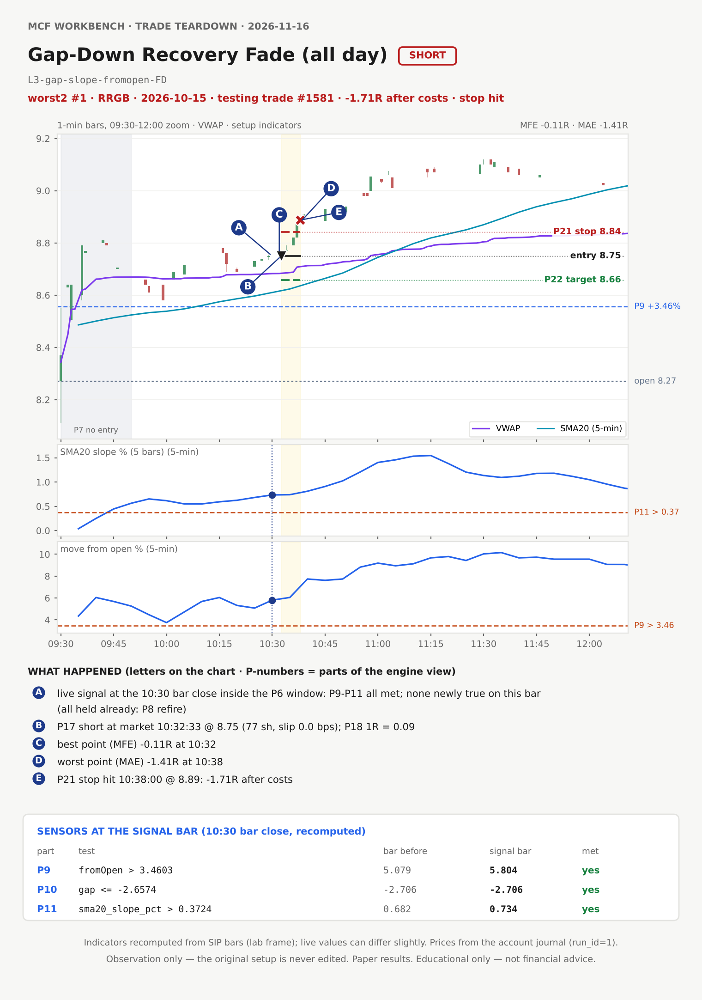
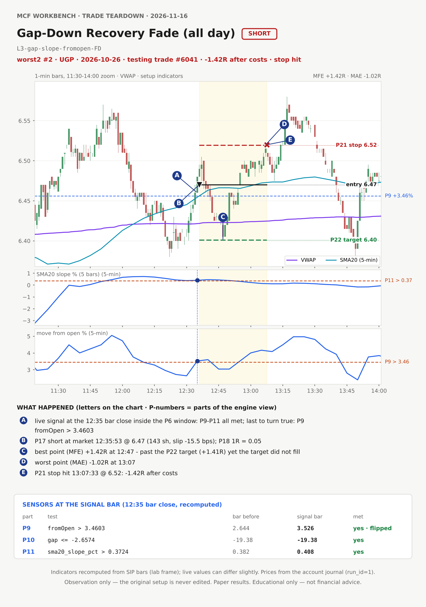

# Workbench blueprint: Gap-Down Recovery Fade (all day)

`L3-gap-slope-fromopen-FD` - short - built 2026-11-16

> 09:50-15:00: a stock that gapped down 2.7%+ has rallied more than 3.5% from its open with its 20-bar average turning up; short the rally.

## WHICH STOCKS

| Part | Exact value | Source / note |
|---|---|---|
| Liquidity floor (20-day avg $ volume) | `none (0)` | setup min_adv; 0 = account universe floor only |
| Account universe | `ADV >= $5M core, ATR >= 1.0%` | extended tier $1M with rvol >= 3.0x |
| Price floor | `>= $5.0` | costs.min_price |
| Earnings blackout | `4 trading days either side` | universe |
| Partnerships (PTP) | `excluded` | 10% withholding on sales |
| Pre-filter | `gap at the open <= -2.66%` | prefilter: gap_le:-2.6573517322540283 |
| Short borrow | `shortable + easy to borrow only` | broker flags |

## WHEN

| Part | Exact value | Source / note |
|---|---|---|
| Entry window (5-min bar close) | `09:50-15:00 ET` | window: [950, 1500] |
| No entries before | `09:50 ET` | live.no_entry_before |
| Flat by | `15:55 ET` | half days: close - 5 min |
| Refire | `every qualifying bar, cooldown 1 bar(s)` | refire: true |

## ENTRY TRIGGER

| Part | Exact value | Source / note |
|---|---|---|
| Side | `SHORT` | SIDE |
| close vs today's open % | `fromOpen > 3.4603` | cond.fromOpen |
| open vs prior close % | `gap <= -2.6574` | cond.gap |
| SMA20 slope over 5 bars % | `sma20_slope_pct > 0.3724` | cond.sma20_slope_pct |
| Order | `enter at the close of the signal bar` | lab outcome model |

## RISK & EXIT

| Part | Exact value | Source / note |
|---|---|---|
| 1R (risk unit) | `0.25 x daily ATR` | r_atr_frac |
| Exit geometry | `t1s1: target +1R / stop 1R` | GEOM |
| Stop | `1.0R above entry` | bracket stop |
| Target | `+1.0R` | bracket target |
| Scale-out | `none` | scale_out_r: null |
| Time exit | `flat at 15:55 ET` | session.flatten_by |

## LIMITS

| Part | Exact value | Source / note |
|---|---|---|
| Open lots per setup | `30` | max_positions_per_strategy |
| Per-setup daily latch | `stops at -2R net` | max_setup_daily_loss_r |
| Account daily stop | `-20R` | max_daily_loss_r |
| Lots per symbol | `3 (same side)` | same_setup_reentry: True |
| Spread / size checks | `spread <= 30 bps and <= 0.25 of stop; <= 10% of 1-min volume` | live |

## ACCOUNT & SIZING

| Part | Exact value | Source / note |
|---|---|---|
| Runs in | `Primary` | configs now |
| Size per trade | `min(0.25% equity at risk, slot ~$4,156)` | 77 slots x 3.2 BP |
| Max position | `10% of equity` | max_position_notional_pct |

## RECORD

| Part | Exact value | Source / note |
|---|---|---|
| Trades / sessions | `340 / 21` | 2026-10-13 to 2026-11-12 |
| Avg R after costs | `+0.223R` | total +75.9R, win 65% |
| Avg R w/o best day | `+0.163R` | best day 2026-10-20 = 44% of R |
| By account | `Primary 118 tr +0.22R, On Deck 222 tr +0.22R` |  |
| Rule changes in window | `17 (listed in the markdown)` | latest: 2026-11-12: LR5: broker position vs journal lot check every ; 2026-11-12: LR7: closing flatten retries every 20 s until cl |

## MODULE

- file: `research/bdi/fullday/L3-gap-slope-fromopen-FD.py` (parsed as: mask)
- module's own layer notes: gap <= -2.657 (V1); 0.3724 < sma20_slope_pct (D10); 3.46 < fromOpen (V20); full day: bar close 09:50-15:00 ET (YAML window [950, 1500])

## RULE CHANGES INSIDE THE RECORD WINDOW

- 2026-10-14: Lab refire: RW6G1 in Primary + 13 Testing 1 setups fire again later in the day (cooldown per setup); owner option B, mid-session
- 2026-10-20: Owner promotions (move): L3-gap-slope-fromopen-FD Testing 1 -> Primary; CWT14-failbrk-pdl-p10-lowvol-long Testing 2 -> Primary
- 2026-10-20: Risk: no lot on a symbol held by the setup's twin (X / X-FD, 'twin held'); per-setup daily loss limit -2R net ('setup daily loss limit') in Testing 1/2 and gen, account backstop 60 -> 120R there
- 2026-10-21: Move 12 setups to the Graveyard account: LIQ-orl-sweep-open15-s25-long, RW2-exhaustion-noon-adv150-short-FD, heat_fade_long (from Testing 2); RW6-ns2-up3-short-FD, NS2-sma50break-overbought-short-FD, heat_fade_long-FD, ST1-ordn-long-pm-t05s1-FD, MF1-945-flowsell-vwapup-FD, heat_fade_short-FD, ST2-slope20up-long-am-t05s1-FD, NS2-sma50break-overbought-short, heat_fade_short (from Testing 1)
- 2026-10-22: Owner L3-1: demote L3-gap-slope-fromopen-FD from Primary to Testing 1 (move)
- 2026-10-23: Owner ST-A: per-setup daily loss stop off in Testing 1, Testing 2 and the Setup Generator (Graveyard keeps -2R; Primary unchanged, never had one)
- 2026-10-23: Owner replies: withdraw G1 (R1 yes: the 6 -g1 up-tape gated short variants are never added); no new daily stop for Primary (R2 yes: keep the -20R account stop and the -2R per-setup stop in the testing accounts; B1b not adopted)
- 2026-10-26: Owner MF1-D: demote MF1-945-flowsell-vwapup (Early Sellers Above VWAP) Primary -> Testing 1 (move)
- 2026-10-28: Owner: Primary position size ~$4,000 instead of ~$5,000 (slots 61 -> 77, max concurrent 61 -> 77; per-setup stays 30)
- 2026-10-28: Owner: Primary position size ~$5,000 (slots 160 -> 61, max concurrent 160 -> 61, per-setup 100 -> 30)
- 2026-10-29: Owner ST-P: per-setup daily stop at -2R (latched) in Primary only
- 2026-10-30: Owner CF: Testing 1/2 skip entries whose stop-exit round-trip cost > 0.15R (forward test of p3_1029 A3)
- 2026-10-30: Owner: re-promote L3-gap-slope-fromopen-FD (Gap-Down Recovery Fade, all day) Testing 1 -> Primary (move)
- 2026-11-12: LR1: flatten at min(15:55, calendar close - 5 min) on every account (half days 11-27 / 12-24 flatten 12:55)
- 2026-11-12: LR3: Primary's -20R account halt and -2R per-setup latch count R after costs; the account halt also counts open lots' marks (less a market-exit cost)
- 2026-11-12: LR5: broker position vs journal lot check every poll on all accounts; a persistent mismatch is flagged (health.position_mismatch), blocks new entries in that symbol and alerts; never auto-closed
- 2026-11-12: LR7: closing flatten retries every 20 s until close - 1 min, then an extended-hours close, alerts on failure; watchdog in act for Primary until calendar close + 5 min (also acts on flatten_failed / exposure after the flatten)

## WORKBENCH PARAMETERS (for `python -m mcf.research.workbench spawn`)

- `refire` = `True`
- `refire_cooldown` = `1`
- `min_adv` = `0`
- `window` = `[950, 1500]`
- `prefilter` = `gap_le:-2.6573517322540283`
- `scale_out_r` = `None`
- `geom` = `t1s1`
- `r_atr_frac` = `0.25`
- `cond.fromOpen` = `3.460294628143309`
- `cond.gap` = `-2.6573517322540283`
- `cond.sma20_slope_pct` = `0.37244729995727527`

## ENGINE VIEW (numbered parts)

| Part | Stage | Component | Exact value | Binding share |
|---|---|---|---|---|
| P1 | INTAKE | Account universe | `ADV >= $5M core, ATR >= 1.0%` | - |
| P2 | INTAKE | Price floor | `>= $5.0` | blocked 1/4963 signals (0%) |
| P3 | INTAKE | Earnings blackout | `4 trading days either side` | - |
| P4 | INTAKE | Pre-filter (fixed at the open) | `gap at the open <= -2.66%` | - |
| P5 | INTAKE | Short borrow | `shortable + easy to borrow` | blocked 3011/4963 signals (61%) |
| P6 | TIMER | Entry window (5-min bar close) | `09:50-15:00 ET` | - |
| P7 | TIMER | No entries before | `09:50 ET` | - |
| P8 | TIMER | Refire | `every qualifying bar, cooldown 1 bar(s)` | - |
| P9 | SENSORS | close vs today's open % | `fromOpen > 3.4603` | - |
| P10 | SENSORS | open vs prior close % | `gap <= -2.6574` | - |
| P11 | SENSORS | SMA20 slope over 5 bars % | `sma20_slope_pct > 0.3724` | - |
| P12 | GATES | Open lots per setup | `30` | blocked 648/4963 signals (13%) |
| P13 | GATES | Lots per symbol | `3 (same side)` | blocked 198/4963 signals (4%) |
| P14 | GATES | Per-setup daily latch | `stops at -2R net` | blocked 55/4963 signals (1%) |
| P15 | GATES | Account daily stop / halt | `-20R` | blocked 540/4963 signals (11%) |
| P16 | GATES | Quote & spread checks | `spread <= 30 bps and <= 0.25 of stop; <= 10% of 1-min volume` | blocked 155/4963 signals (3%) |
| P17 | ENTRY | Side + order | `SHORT at market, signal-bar close` | - |
| P18 | ENTRY | 1R (risk unit) | `0.25 x daily ATR` | - |
| P19 | ENTRY | Size per trade | `min(0.25% equity at risk, slot ~$4,156)` | - |
| P20 | ENTRY | Max position | `10% of equity` | - |
| P21 | EXHAUST | Stop | `1.0R above entry` | ended 77/340 live trades (23%) |
| P22 | EXHAUST | Target | `+1.0R` | ended 150/340 live trades (44%) |
| P23 | EXHAUST | Scale-out | `none` | ended 0/340 live trades (0%) |
| P24 | EXHAUST | Time exit | `flat at 15:55 ET` | ended 113/340 live trades (33%) |

Exit mix: {'stop': 77, 'target': 150, 'time': 113} of 340 live trades; blocked signals: {'borrow': 3011, 'quote': 155, 'cap_symbol': 198, 'latch': 55, 'acct_stop': 540, 'cap_setup': 648, 'price': 1, 'other': 4, 'split_gate': 10} of 4963 live signals (refire setups re-signal every bar while held).

## TRADE TEARDOWNS

### RRGB 2026-10-15 (testing #1581): -1.71R, stop

- **A** live signal at the 10:30 bar close inside the P6 window: P9-P11 all met; none newly true on this bar (all held already: P8 refire)
- **B** P17 short at market 10:32:33 @ 8.75 (77 sh, slip 0.0 bps); P18 1R = 0.09
- **C** best point (MFE) -0.11R at 10:32
- **D** worst point (MAE) -1.41R at 10:38
- **E** P21 stop hit 10:38:00 @ 8.89: -1.71R after costs

| Part | Test | Bar before | Signal bar | Met |
|---|---|---|---|---|
| P9 | `fromOpen > 3.4603` | 5.079 | 5.804 | yes |
| P10 | `gap <= -2.6574` | -2.706 | -2.706 | yes |
| P11 | `sma20_slope_pct > 0.3724` | 0.682 | 0.734 | yes |

### UGP 2026-10-26 (testing #6041): -1.42R, stop

- **A** live signal at the 12:35 bar close inside the P6 window: P9-P11 all met; last to turn true: P9 fromOpen > 3.4603
- **B** P17 short at market 12:35:53 @ 6.47 (143 sh, slip -15.5 bps); P18 1R = 0.05
- **C** best point (MFE) +1.42R at 12:47 - past the P22 target (+1.41R) yet the target did not fill
- **D** worst point (MAE) -1.02R at 13:07
- **E** P21 stop hit 13:07:33 @ 6.52: -1.42R after costs

| Part | Test | Bar before | Signal bar | Met |
|---|---|---|---|---|
| P9 | `fromOpen > 3.4603` | 2.644 | 3.526 | yes (flipped) |
| P10 | `gap <= -2.6574` | -19.38 | -19.38 | yes |
| P11 | `sma20_slope_pct > 0.3724` | 0.382 | 0.408 | yes |

Observation only: the original setup is never edited. Educational only — not financial advice.
