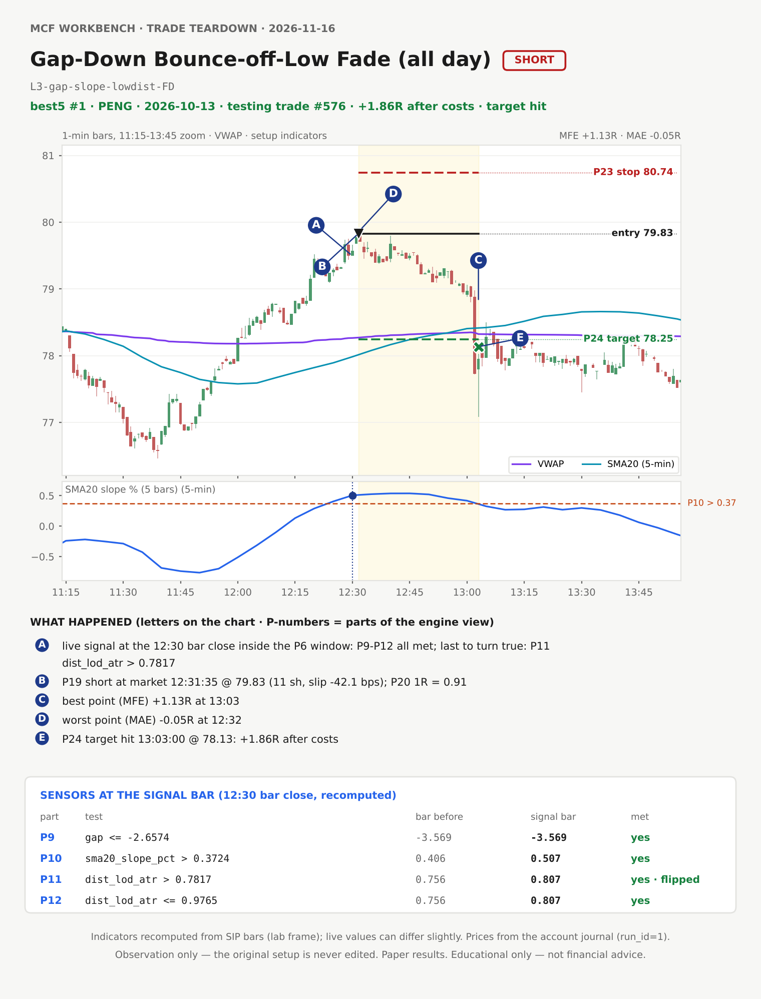
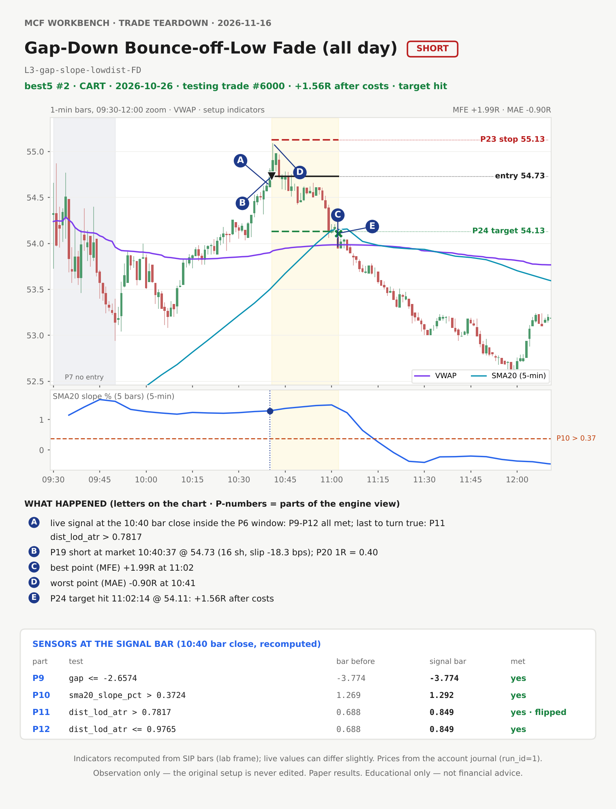
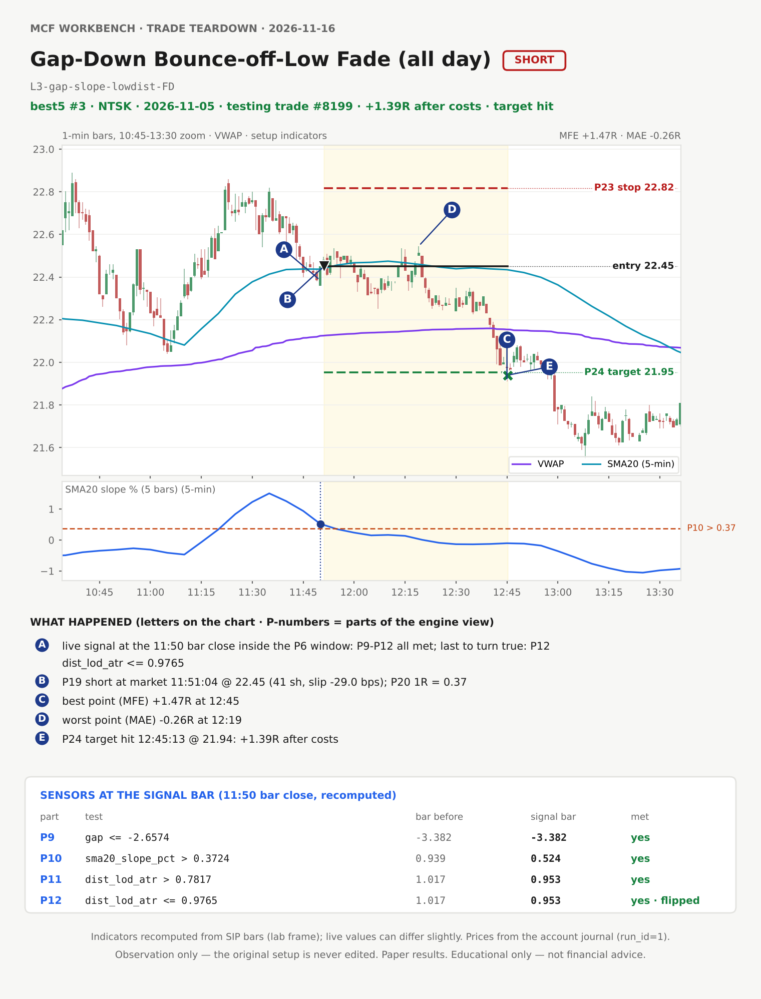
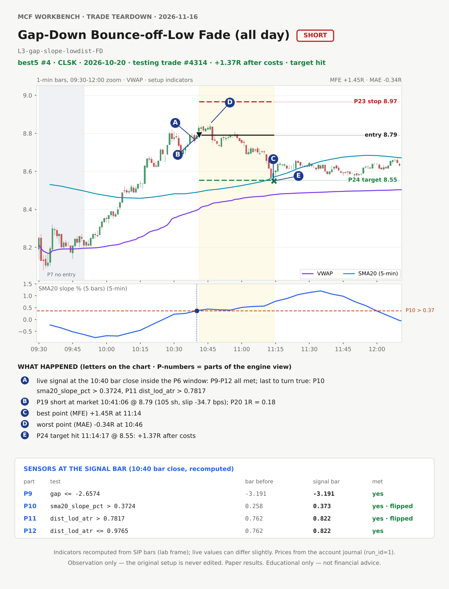
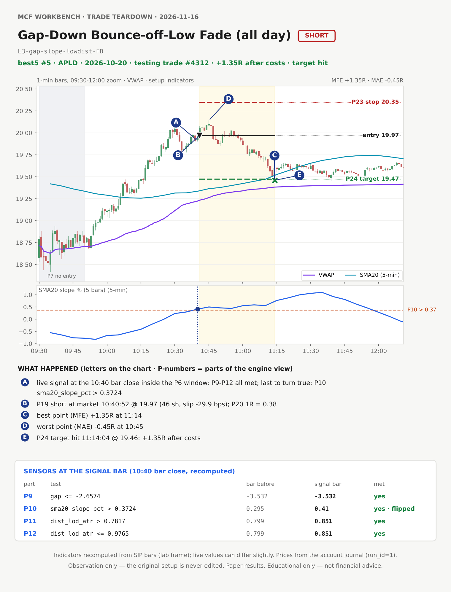

## TRADE TEARDOWNS

### PENG 2026-10-13 (testing #576): +1.86R, target

- **A** live signal at the 12:30 bar close inside the P6 window: P9-P12 all met; last to turn true: P11 dist_lod_atr > 0.7817
- **B** P19 short at market 12:31:35 @ 79.83 (11 sh, slip -42.1 bps); P20 1R = 0.91
- **C** best point (MFE) +1.13R at 13:03
- **D** worst point (MAE) -0.05R at 12:32
- **E** P24 target hit 13:03:00 @ 78.13: +1.86R after costs

| Part | Test | Bar before | Signal bar | Met |
|---|---|---|---|---|
| P9 | `gap <= -2.6574` | -3.569 | -3.569 | yes |
| P10 | `sma20_slope_pct > 0.3724` | 0.406 | 0.507 | yes |
| P11 | `dist_lod_atr > 0.7817` | 0.756 | 0.807 | yes (flipped) |
| P12 | `dist_lod_atr <= 0.9765` | 0.756 | 0.807 | yes |

### CART 2026-10-26 (testing #6000): +1.56R, target

- **A** live signal at the 10:40 bar close inside the P6 window: P9-P12 all met; last to turn true: P11 dist_lod_atr > 0.7817
- **B** P19 short at market 10:40:37 @ 54.73 (16 sh, slip -18.3 bps); P20 1R = 0.40
- **C** best point (MFE) +1.99R at 11:02
- **D** worst point (MAE) -0.90R at 10:41
- **E** P24 target hit 11:02:14 @ 54.11: +1.56R after costs

| Part | Test | Bar before | Signal bar | Met |
|---|---|---|---|---|
| P9 | `gap <= -2.6574` | -3.774 | -3.774 | yes |
| P10 | `sma20_slope_pct > 0.3724` | 1.269 | 1.292 | yes |
| P11 | `dist_lod_atr > 0.7817` | 0.688 | 0.849 | yes (flipped) |
| P12 | `dist_lod_atr <= 0.9765` | 0.688 | 0.849 | yes |

### NTSK 2026-11-05 (testing #8199): +1.39R, target

- **A** live signal at the 11:50 bar close inside the P6 window: P9-P12 all met; last to turn true: P12 dist_lod_atr <= 0.9765
- **B** P19 short at market 11:51:04 @ 22.45 (41 sh, slip -29.0 bps); P20 1R = 0.37
- **C** best point (MFE) +1.47R at 12:45
- **D** worst point (MAE) -0.26R at 12:19
- **E** P24 target hit 12:45:13 @ 21.94: +1.39R after costs

| Part | Test | Bar before | Signal bar | Met |
|---|---|---|---|---|
| P9 | `gap <= -2.6574` | -3.382 | -3.382 | yes |
| P10 | `sma20_slope_pct > 0.3724` | 0.939 | 0.524 | yes |
| P11 | `dist_lod_atr > 0.7817` | 1.017 | 0.953 | yes |
| P12 | `dist_lod_atr <= 0.9765` | 1.017 | 0.953 | yes (flipped) |

### CLSK 2026-10-20 (testing #4314): +1.37R, target

- **A** live signal at the 10:40 bar close inside the P6 window: P9-P12 all met; last to turn true: P10 sma20_slope_pct > 0.3724, P11 dist_lod_atr > 0.7817
- **B** P19 short at market 10:41:06 @ 8.79 (105 sh, slip -34.7 bps); P20 1R = 0.18
- **C** best point (MFE) +1.45R at 11:14
- **D** worst point (MAE) -0.34R at 10:46
- **E** P24 target hit 11:14:17 @ 8.55: +1.37R after costs

| Part | Test | Bar before | Signal bar | Met |
|---|---|---|---|---|
| P9 | `gap <= -2.6574` | -3.191 | -3.191 | yes |
| P10 | `sma20_slope_pct > 0.3724` | 0.258 | 0.373 | yes (flipped) |
| P11 | `dist_lod_atr > 0.7817` | 0.762 | 0.822 | yes (flipped) |
| P12 | `dist_lod_atr <= 0.9765` | 0.762 | 0.822 | yes |

### APLD 2026-10-20 (testing #4312): +1.35R, target

- **A** live signal at the 10:40 bar close inside the P6 window: P9-P12 all met; last to turn true: P10 sma20_slope_pct > 0.3724
- **B** P19 short at market 10:40:52 @ 19.97 (46 sh, slip -29.9 bps); P20 1R = 0.38
- **C** best point (MFE) +1.35R at 11:14
- **D** worst point (MAE) -0.45R at 10:45
- **E** P24 target hit 11:14:04 @ 19.46: +1.35R after costs

| Part | Test | Bar before | Signal bar | Met |
|---|---|---|---|---|
| P9 | `gap <= -2.6574` | -3.532 | -3.532 | yes |
| P10 | `sma20_slope_pct > 0.3724` | 0.295 | 0.41 | yes (flipped) |
| P11 | `dist_lod_atr > 0.7817` | 0.799 | 0.851 | yes |
| P12 | `dist_lod_atr <= 0.9765` | 0.799 | 0.851 | yes |

Observation only: the original setup is never edited. Educational only — not financial advice.
