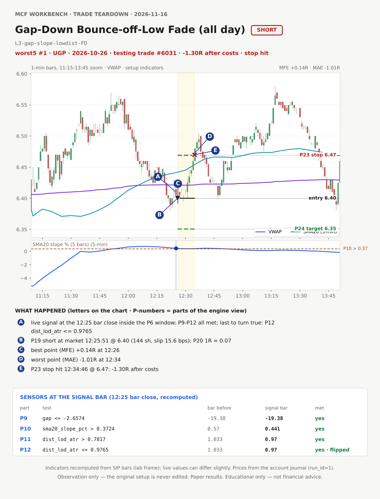
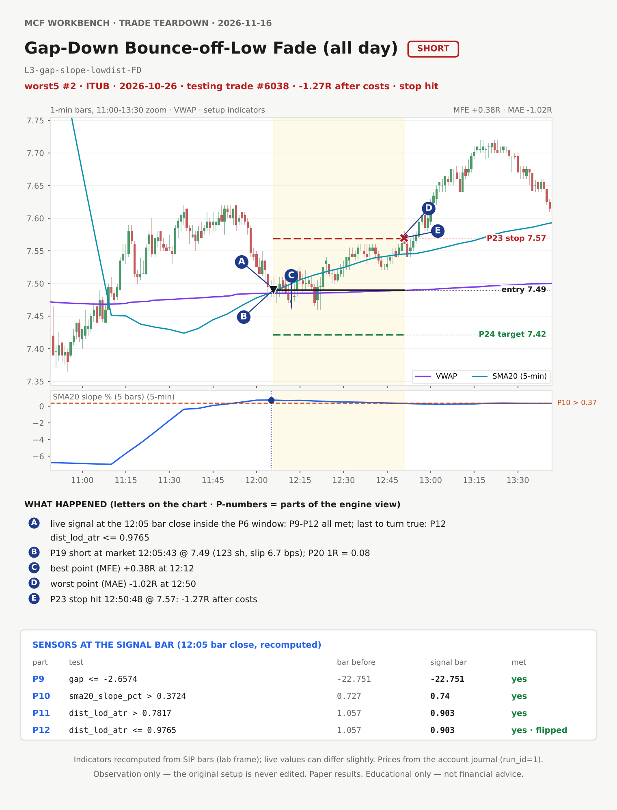
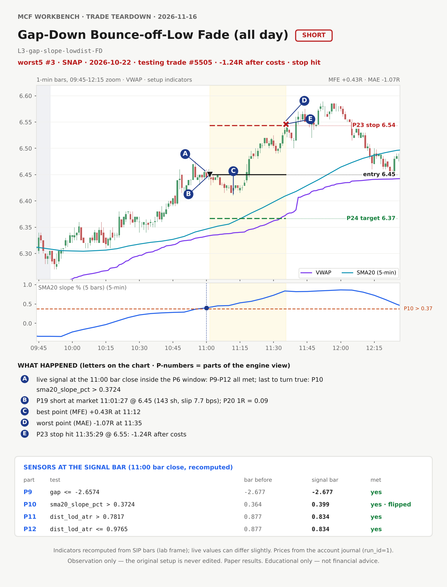
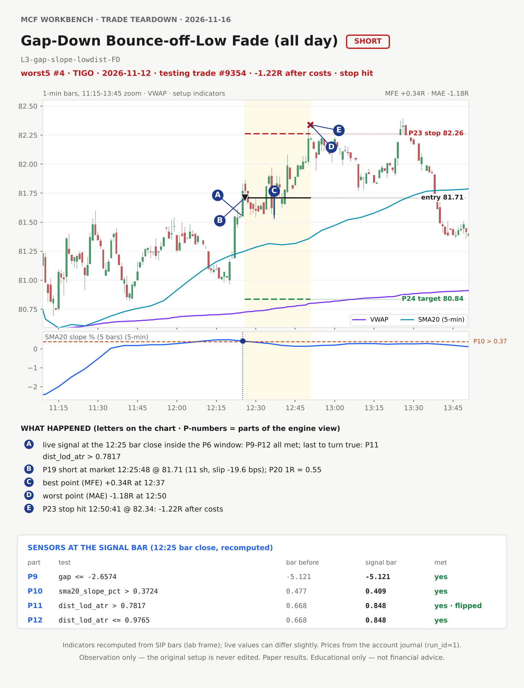
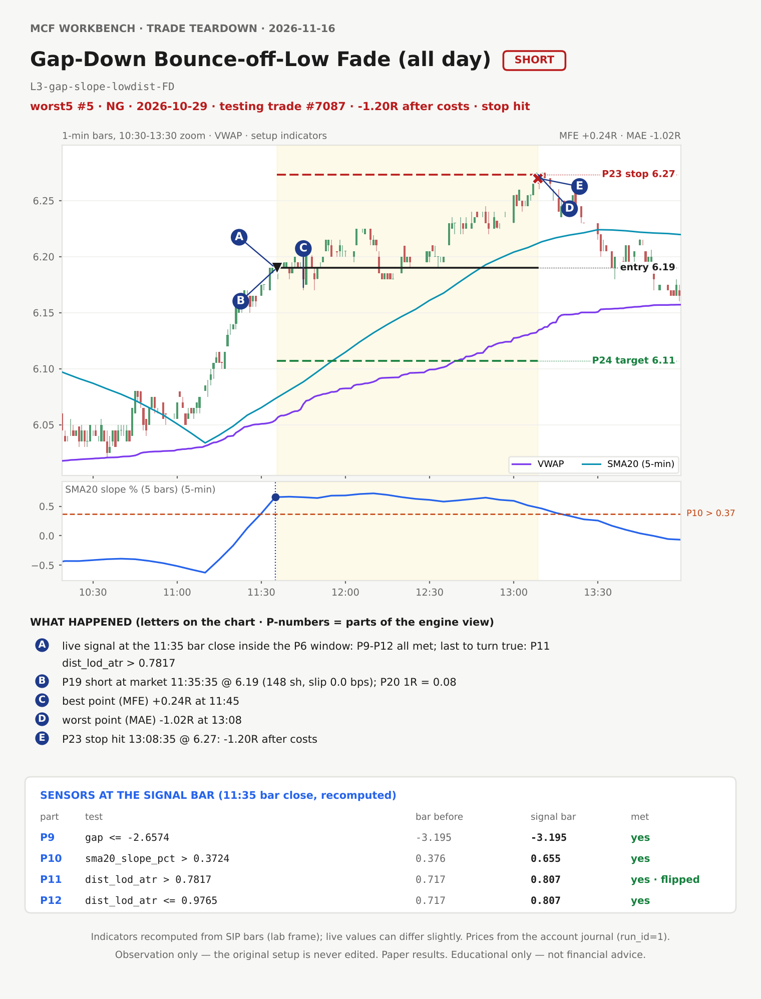

# Workbench blueprint: Gap-Down Bounce-off-Low Fade (all day)

`L3-gap-slope-lowdist-FD` - short - built 2026-11-16

> 09:50-15:00: a stock that gapped down 2.7%+ with its 20-bar average turning up has bounced 0.8-1.0 daily ATR off its low; short the bounce. Full-day version of L3-gap-slope-lowdist.

## WHICH STOCKS

| Part | Exact value | Source / note |
|---|---|---|
| Liquidity floor (20-day avg $ volume) | `none (0)` | setup min_adv; 0 = account universe floor only |
| Account universe | `ADV >= $5M core, ATR >= 1.0%` | extended tier $1M with rvol >= 3.0x |
| Price floor | `>= $5.0` | costs.min_price |
| Earnings blackout | `4 trading days either side` | universe |
| Partnerships (PTP) | `excluded` | 10% withholding on sales |
| Pre-filter | `gap at the open <= -2.66%` | prefilter: gap_le:-2.6573517322540283 |
| Short borrow | `shortable + easy to borrow only` | broker flags |

## WHEN

| Part | Exact value | Source / note |
|---|---|---|
| Entry window (5-min bar close) | `09:50-15:00 ET` | window: [950, 1500] |
| No entries before | `09:50 ET` | live.no_entry_before |
| Flat by | `15:55 ET` | half days: close - 5 min |
| Refire | `first qualifying bar per symbol-day` | refire: false |

## ENTRY TRIGGER

| Part | Exact value | Source / note |
|---|---|---|
| Side | `SHORT` | SIDE |
| open vs prior close % | `gap <= -2.6574` | cond.gap |
| SMA20 slope over 5 bars % | `sma20_slope_pct > 0.3724` | cond.sma20_slope_pct |
| close - low of day in ATRs | `dist_lod_atr > 0.7817` | cond.dist_lod_atr |
| close - low of day in ATRs | `dist_lod_atr <= 0.9765` | cond.dist_lod_atr#2 |
| Order | `enter at the close of the signal bar` | lab outcome model |

## RISK & EXIT

| Part | Exact value | Source / note |
|---|---|---|
| 1R (risk unit) | `0.25 x daily ATR` | r_atr_frac |
| Exit geometry | `t1s1: target +1R / stop 1R` | GEOM |
| Stop | `1.0R above entry` | bracket stop |
| Target | `+1.0R` | bracket target |
| Scale-out | `none` | scale_out_r: null |
| Time exit | `flat at 15:55 ET` | session.flatten_by |

## LIMITS

| Part | Exact value | Source / note |
|---|---|---|
| Open lots per setup | `150` | max_positions_per_strategy |
| Per-setup daily latch | `off` | max_setup_daily_loss_r |
| Account daily stop | `-300R` | max_daily_loss_r |
| Lots per symbol | `3 (same side)` | same_setup_reentry: True |
| Cost filter | `skip if stop costs > 0.15R` | max_stop_cost_r |
| Spread / size checks | `spread <= 30 bps and <= 0.25 of stop; <= 10% of 1-min volume` | live |

## ACCOUNT & SIZING

| Part | Exact value | Source / note |
|---|---|---|
| Runs in | `On Deck` | configs now |
| Size per trade | `min(0.25% equity at risk, slot ~$950)` | 400 slots x 3.8 BP |
| Max position | `10% of equity` | max_position_notional_pct |

## RECORD

| Part | Exact value | Source / note |
|---|---|---|
| Trades / sessions | `105 / 16` | 2026-10-13 to 2026-11-12 |
| Avg R after costs | `+0.227R` | total +23.8R, win 63% |
| Avg R w/o best day | `+0.077R` | best day 2026-11-12 = 76% of R (1 day) |
| Rule changes in window | `7 (listed in the markdown)` | latest: 2026-11-12: LR1: flatten at min(15:55, calendar close - 5 mi; 2026-11-12: LR5: broker position vs journal lot check every  |

## MODULE

- file: `research/bdi/fullday/L3-gap-slope-lowdist-FD.py` (parsed as: mask)
- module's own layer notes: gap <= -2.657 (V1); 0.3724 < sma20_slope_pct (D10); 0.7817 < dist_lod_atr <= 0.9765 (V19); full day: bar close 09:50-15:00 ET (YAML window [950, 1500])

## RULE CHANGES INSIDE THE RECORD WINDOW

- 2026-10-20: Risk: no lot on a symbol held by the setup's twin (X / X-FD, 'twin held'); per-setup daily loss limit -2R net ('setup daily loss limit') in Testing 1/2 and gen, account backstop 60 -> 120R there
- 2026-10-21: Move 12 setups to the Graveyard account: LIQ-orl-sweep-open15-s25-long, RW2-exhaustion-noon-adv150-short-FD, heat_fade_long (from Testing 2); RW6-ns2-up3-short-FD, NS2-sma50break-overbought-short-FD, heat_fade_long-FD, ST1-ordn-long-pm-t05s1-FD, MF1-945-flowsell-vwapup-FD, heat_fade_short-FD, ST2-slope20up-long-am-t05s1-FD, NS2-sma50break-overbought-short, heat_fade_short (from Testing 1)
- 2026-10-23: Owner ST-A: per-setup daily loss stop off in Testing 1, Testing 2 and the Setup Generator (Graveyard keeps -2R; Primary unchanged, never had one)
- 2026-10-30: Owner CF: Testing 1/2 skip entries whose stop-exit round-trip cost > 0.15R (forward test of p3_1029 A3)
- 2026-11-11: Owner TEAM yes: Primary runs TEAM-6 from 2026-11-11 to 2026-11-13, frozen (no rotation): NM-ETF-late-dip-di-long Live Lab -> Primary; MF2-FD, MF4-FD, L3-rsi5hi-FD Primary -> Testing 1; MF4 base, NS1 Primary -> Testing 2 (move)
- 2026-11-12: LR1: flatten at min(15:55, calendar close - 5 min) on every account (half days 11-27 / 12-24 flatten 12:55)
- 2026-11-12: LR5: broker position vs journal lot check every poll on all accounts; a persistent mismatch is flagged (health.position_mismatch), blocks new entries in that symbol and alerts; never auto-closed

## WORKBENCH PARAMETERS (for `python -m mcf.research.workbench spawn`)

- `min_adv` = `0`
- `window` = `[950, 1500]`
- `prefilter` = `gap_le:-2.6573517322540283`
- `scale_out_r` = `None`
- `refire` = `False`
- `refire_cooldown` = `1`
- `geom` = `t1s1`
- `r_atr_frac` = `0.25`
- `cond.gap` = `-2.6573517322540283`
- `cond.sma20_slope_pct` = `0.37244729995727527`
- `cond.dist_lod_atr` = `0.7816761255264282`
- `cond.dist_lod_atr#2` = `0.9764953255653381`

## ENGINE VIEW (numbered parts)

| Part | Stage | Component | Exact value | Binding share |
|---|---|---|---|---|
| P1 | INTAKE | Account universe | `ADV >= $5M core, ATR >= 1.0%` | - |
| P2 | INTAKE | Price floor | `>= $5.0` | blocked 0/462 signals (0%) |
| P3 | INTAKE | Earnings blackout | `4 trading days either side` | - |
| P4 | INTAKE | Pre-filter (fixed at the open) | `gap at the open <= -2.66%` | - |
| P5 | INTAKE | Short borrow | `shortable + easy to borrow` | blocked 170/462 signals (37%) |
| P6 | TIMER | Entry window (5-min bar close) | `09:50-15:00 ET` | - |
| P7 | TIMER | No entries before | `09:50 ET` | - |
| P8 | TIMER | Refire | `first qualifying bar per symbol-day` | - |
| P9 | SENSORS | open vs prior close % | `gap <= -2.6574` | - |
| P10 | SENSORS | SMA20 slope over 5 bars % | `sma20_slope_pct > 0.3724` | - |
| P11 | SENSORS | close - low of day in ATRs | `dist_lod_atr > 0.7817` | - |
| P12 | SENSORS | close - low of day in ATRs | `dist_lod_atr <= 0.9765` | - |
| P13 | GATES | Open lots per setup | `150` | blocked 0/462 signals (0%) |
| P14 | GATES | Lots per symbol | `3 (same side)` | blocked 9/462 signals (2%) |
| P15 | GATES | Per-setup daily latch | `off` | blocked 0/462 signals (0%) |
| P16 | GATES | Account daily stop / halt | `-300R` | blocked 72/462 signals (16%) |
| P17 | GATES | Cost filter | `skip if stop costs > 0.15R` | blocked 0/462 signals (0%) |
| P18 | GATES | Quote & spread checks | `spread <= 30 bps and <= 0.25 of stop; <= 10% of 1-min volume` | blocked 43/462 signals (9%) |
| P19 | ENTRY | Side + order | `SHORT at market, signal-bar close` | - |
| P20 | ENTRY | 1R (risk unit) | `0.25 x daily ATR` | - |
| P21 | ENTRY | Size per trade | `min(0.25% equity at risk, slot ~$950)` | - |
| P22 | ENTRY | Max position | `10% of equity` | - |
| P23 | EXHAUST | Stop | `1.0R above entry` | ended 25/105 live trades (24%) |
| P24 | EXHAUST | Target | `+1.0R` | ended 55/105 live trades (52%) |
| P25 | EXHAUST | Scale-out | `none` | ended 0/105 live trades (0%) |
| P26 | EXHAUST | Time exit | `flat at 15:55 ET` | ended 25/105 live trades (24%) |

Exit mix: {'target': 55, 'stop': 25, 'time': 25} of 105 live trades; blocked signals: {'borrow': 170, 'quote': 43, 'cap_symbol': 9, 'acct_stop': 72, 'split_gate': 50, 'other': 12} of 462 live signals (refire setups re-signal every bar while held).

## TRADE TEARDOWNS

### UGP 2026-10-26 (testing #6031): -1.30R, stop

- **A** live signal at the 12:25 bar close inside the P6 window: P9-P12 all met; last to turn true: P12 dist_lod_atr <= 0.9765
- **B** P19 short at market 12:25:51 @ 6.40 (144 sh, slip 15.6 bps); P20 1R = 0.07
- **C** best point (MFE) +0.14R at 12:26
- **D** worst point (MAE) -1.01R at 12:34
- **E** P23 stop hit 12:34:46 @ 6.47: -1.30R after costs

| Part | Test | Bar before | Signal bar | Met |
|---|---|---|---|---|
| P9 | `gap <= -2.6574` | -19.38 | -19.38 | yes |
| P10 | `sma20_slope_pct > 0.3724` | 0.57 | 0.441 | yes |
| P11 | `dist_lod_atr > 0.7817` | 1.033 | 0.97 | yes |
| P12 | `dist_lod_atr <= 0.9765` | 1.033 | 0.97 | yes (flipped) |

### ITUB 2026-10-26 (testing #6038): -1.27R, stop

- **A** live signal at the 12:05 bar close inside the P6 window: P9-P12 all met; last to turn true: P12 dist_lod_atr <= 0.9765
- **B** P19 short at market 12:05:43 @ 7.49 (123 sh, slip 6.7 bps); P20 1R = 0.08
- **C** best point (MFE) +0.38R at 12:12
- **D** worst point (MAE) -1.02R at 12:50
- **E** P23 stop hit 12:50:48 @ 7.57: -1.27R after costs

| Part | Test | Bar before | Signal bar | Met |
|---|---|---|---|---|
| P9 | `gap <= -2.6574` | -22.751 | -22.751 | yes |
| P10 | `sma20_slope_pct > 0.3724` | 0.727 | 0.74 | yes |
| P11 | `dist_lod_atr > 0.7817` | 1.057 | 0.903 | yes |
| P12 | `dist_lod_atr <= 0.9765` | 1.057 | 0.903 | yes (flipped) |

### SNAP 2026-10-22 (testing #5505): -1.24R, stop

- **A** live signal at the 11:00 bar close inside the P6 window: P9-P12 all met; last to turn true: P10 sma20_slope_pct > 0.3724
- **B** P19 short at market 11:01:27 @ 6.45 (143 sh, slip 7.7 bps); P20 1R = 0.09
- **C** best point (MFE) +0.43R at 11:12
- **D** worst point (MAE) -1.07R at 11:35
- **E** P23 stop hit 11:35:29 @ 6.55: -1.24R after costs

| Part | Test | Bar before | Signal bar | Met |
|---|---|---|---|---|
| P9 | `gap <= -2.6574` | -2.677 | -2.677 | yes |
| P10 | `sma20_slope_pct > 0.3724` | 0.364 | 0.399 | yes (flipped) |
| P11 | `dist_lod_atr > 0.7817` | 0.877 | 0.834 | yes |
| P12 | `dist_lod_atr <= 0.9765` | 0.877 | 0.834 | yes |

### TIGO 2026-11-12 (testing #9354): -1.22R, stop

- **A** live signal at the 12:25 bar close inside the P6 window: P9-P12 all met; last to turn true: P11 dist_lod_atr > 0.7817
- **B** P19 short at market 12:25:48 @ 81.71 (11 sh, slip -19.6 bps); P20 1R = 0.55
- **C** best point (MFE) +0.34R at 12:37
- **D** worst point (MAE) -1.18R at 12:50
- **E** P23 stop hit 12:50:41 @ 82.34: -1.22R after costs

| Part | Test | Bar before | Signal bar | Met |
|---|---|---|---|---|
| P9 | `gap <= -2.6574` | -5.121 | -5.121 | yes |
| P10 | `sma20_slope_pct > 0.3724` | 0.477 | 0.409 | yes |
| P11 | `dist_lod_atr > 0.7817` | 0.668 | 0.848 | yes (flipped) |
| P12 | `dist_lod_atr <= 0.9765` | 0.668 | 0.848 | yes |

### NG 2026-10-29 (testing #7087): -1.20R, stop

- **A** live signal at the 11:35 bar close inside the P6 window: P9-P12 all met; last to turn true: P11 dist_lod_atr > 0.7817
- **B** P19 short at market 11:35:35 @ 6.19 (148 sh, slip 0.0 bps); P20 1R = 0.08
- **C** best point (MFE) +0.24R at 11:45
- **D** worst point (MAE) -1.02R at 13:08
- **E** P23 stop hit 13:08:35 @ 6.27: -1.20R after costs

| Part | Test | Bar before | Signal bar | Met |
|---|---|---|---|---|
| P9 | `gap <= -2.6574` | -3.195 | -3.195 | yes |
| P10 | `sma20_slope_pct > 0.3724` | 0.376 | 0.655 | yes |
| P11 | `dist_lod_atr > 0.7817` | 0.717 | 0.807 | yes (flipped) |
| P12 | `dist_lod_atr <= 0.9765` | 0.717 | 0.807 | yes |

Observation only: the original setup is never edited. Educational only — not financial advice.
