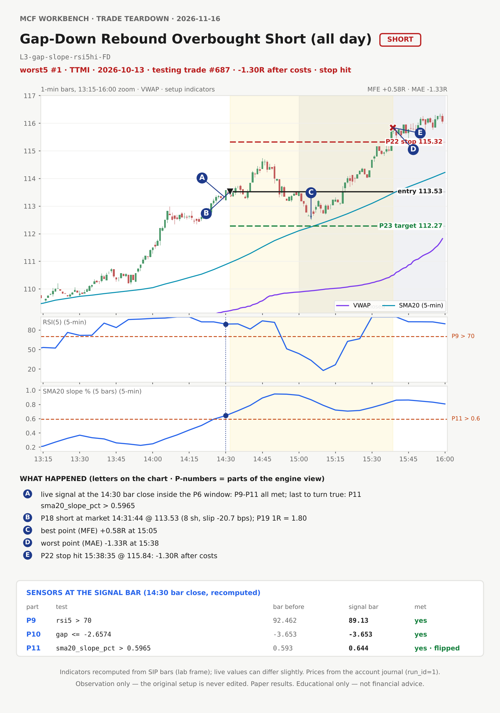
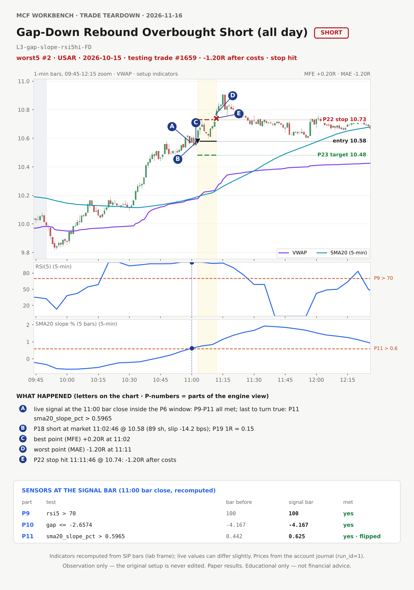
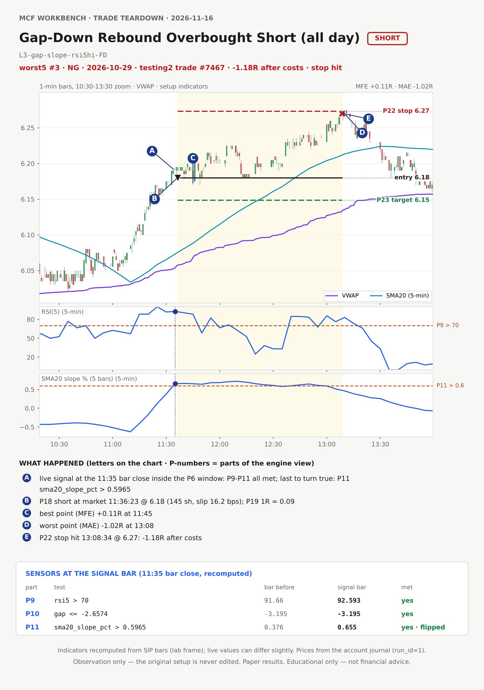
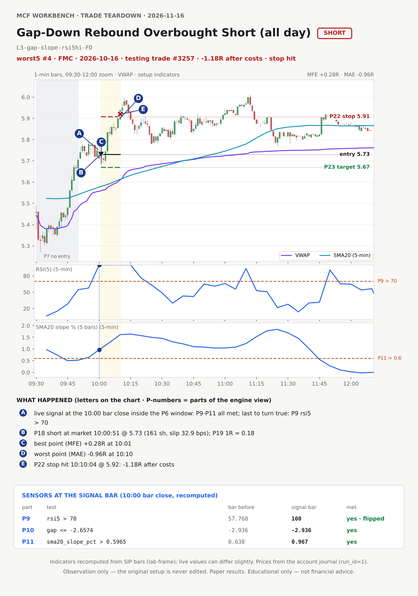
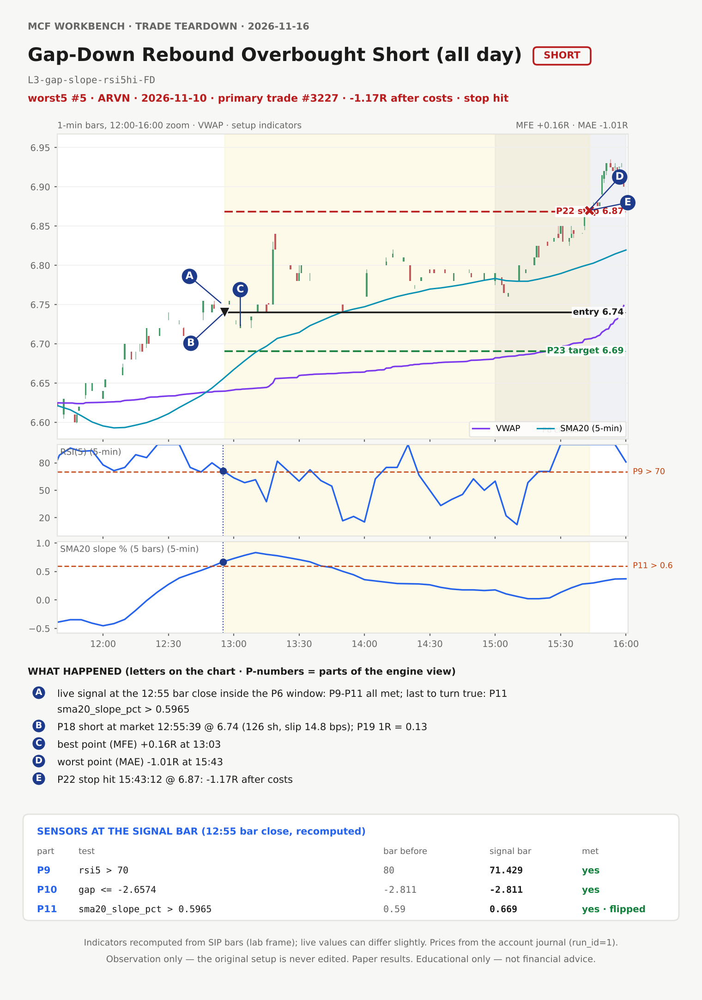

# Workbench blueprint: Gap-Down Rebound Overbought Short (all day)

`L3-gap-slope-rsi5hi-FD` - short - built 2026-11-16

> 09:50-15:00: a stock that gapped down 2.7%+ is back above a rising 20-bar average (slope > 0.6%) with RSI(5) above 70; short the pop. Target 0.5R, stop 1R, flat 15:55; re-fires after a 6-bar cooldown.

## WHICH STOCKS

| Part | Exact value | Source / note |
|---|---|---|
| Liquidity floor (20-day avg $ volume) | `none (0)` | setup min_adv; 0 = account universe floor only |
| Account universe | `ADV >= $5M core, ATR >= 1.0%` | extended tier $1M with rvol >= 3.0x |
| Price floor | `>= $5.0` | costs.min_price |
| Earnings blackout | `4 trading days either side` | universe |
| Partnerships (PTP) | `excluded` | 10% withholding on sales |
| Pre-filter | `gap at the open <= -2.66%` | prefilter: gap_le:-2.6573517322540283 |
| Short borrow | `shortable + easy to borrow only` | broker flags |

## WHEN

| Part | Exact value | Source / note |
|---|---|---|
| Entry window (5-min bar close) | `09:50-15:00 ET` | window: [950, 1500] |
| No entries before | `09:50 ET` | live.no_entry_before |
| Flat by | `15:55 ET` | half days: close - 5 min |
| Refire | `every qualifying bar, cooldown 6 bar(s)` | refire: true |

## ENTRY TRIGGER

| Part | Exact value | Source / note |
|---|---|---|
| Side | `SHORT` | SIDE |
| RSI(5) | `rsi5 > 70` | cond.rsi5 |
| open vs prior close % | `gap <= -2.6574` | cond.gap |
| SMA20 slope over 5 bars % | `sma20_slope_pct > 0.5965` | cond.sma20_slope_pct |
| Order | `enter at the close of the signal bar` | lab outcome model |

## RISK & EXIT

| Part | Exact value | Source / note |
|---|---|---|
| 1R (risk unit) | `0.25 x daily ATR` | r_atr_frac |
| Exit geometry | `t05s1: target +0.5R / stop 1R` | GEOM |
| Stop | `1.0R above entry` | bracket stop |
| Target | `+0.5R` | bracket target |
| Scale-out | `none` | scale_out_r: null |
| Time exit | `flat at 15:55 ET` | session.flatten_by |

## LIMITS

| Part | Exact value | Source / note |
|---|---|---|
| Open lots per setup | `150` | max_positions_per_strategy |
| Per-setup daily latch | `off` | max_setup_daily_loss_r |
| Account daily stop | `-300R` | max_daily_loss_r |
| Lots per symbol | `3 (same side)` | same_setup_reentry: True |
| Cost filter | `skip if stop costs > 0.15R` | max_stop_cost_r |
| Spread / size checks | `spread <= 30 bps and <= 0.25 of stop; <= 10% of 1-min volume` | live |

## ACCOUNT & SIZING

| Part | Exact value | Source / note |
|---|---|---|
| Runs in | `On Deck` | configs now |
| Size per trade | `min(0.25% equity at risk, slot ~$950)` | 400 slots x 3.8 BP |
| Max position | `10% of equity` | max_position_notional_pct |

## RECORD

| Part | Exact value | Source / note |
|---|---|---|
| Trades / sessions | `139 / 21` | 2026-10-13 to 2026-11-16 |
| Avg R after costs | `+0.113R` | total +15.7R, win 75% |
| Avg R w/o best day | `+0.025R` | best day 2026-11-12 = 84% of R (1 day) |
| By account | `Primary 22 tr -0.45R, On Deck 72 tr +0.19R, Testing A 45 tr +0.26R` |  |
| Rule changes in window | `15 (listed in the markdown)` | latest: 2026-11-12: LR7: closing flatten retries every 20 s until cl; 2026-11-12: On Deck build (ONDECK): OD-IN / OD-OUT rules; 14 |

## MODULE

- file: `research/bdi/fullday/L3-gap-slope-rsi5hi-FD.py` (parsed as: mask)
- module's own layer notes: gap <= -2.657 (V1); 0.5965 < sma20_slope_pct (V20); RSI(5) > 70; full day: bar close 09:50-15:00 ET (YAML window [950, 1500])

## RULE CHANGES INSIDE THE RECORD WINDOW

- 2026-10-20: Risk: no lot on a symbol held by the setup's twin (X / X-FD, 'twin held'); per-setup daily loss limit -2R net ('setup daily loss limit') in Testing 1/2 and gen, account backstop 60 -> 120R there
- 2026-10-23: Owner ST-A: per-setup daily loss stop off in Testing 1, Testing 2 and the Setup Generator (Graveyard keeps -2R; Primary unchanged, never had one)
- 2026-10-23: Owner replies: withdraw G1 (R1 yes: the 6 -g1 up-tape gated short variants are never added); no new daily stop for Primary (R2 yes: keep the -20R account stop and the -2R per-setup stop in the testing accounts; B1b not adopted)
- 2026-10-28: Owner: Primary position size ~$4,000 instead of ~$5,000 (slots 61 -> 77, max concurrent 61 -> 77; per-setup stays 30)
- 2026-10-28: Owner: Primary position size ~$5,000 (slots 160 -> 61, max concurrent 160 -> 61, per-setup 100 -> 30)
- 2026-10-29: Owner ST-P: per-setup daily stop at -2R (latched) in Primary only
- 2026-10-30: Owner CF: Testing 1/2 skip entries whose stop-exit round-trip cost > 0.15R (forward test of p3_1029 A3)
- 2026-10-30: Owner: promote L3-gap-slope-rsi5hi-FD (Gap-Down Rebound Overbought Short (all day)) Testing 2 -> Primary (move)
- 2026-10-30: Owner: re-promote L3-gap-slope-fromopen-FD (Gap-Down Recovery Fade, all day) Testing 1 -> Primary (move)
- 2026-11-11: Owner TEAM yes: Primary runs TEAM-6 from 2026-11-11 to 2026-11-13, frozen (no rotation): NM-ETF-late-dip-di-long Live Lab -> Primary; MF2-FD, MF4-FD, L3-rsi5hi-FD Primary -> Testing 1; MF4 base, NS1 Primary -> Testing 2 (move)
- 2026-11-12: LR1: flatten at min(15:55, calendar close - 5 min) on every account (half days 11-27 / 12-24 flatten 12:55)
- 2026-11-12: LR3: Primary's -20R account halt and -2R per-setup latch count R after costs; the account halt also counts open lots' marks (less a market-exit cost)
- 2026-11-12: LR5: broker position vs journal lot check every poll on all accounts; a persistent mismatch is flagged (health.position_mismatch), blocks new entries in that symbol and alerts; never auto-closed
- 2026-11-12: LR7: closing flatten retries every 20 s until close - 1 min, then an extended-hours close, alerts on failure; watchdog in act for Primary until calendar close + 5 min (also acts on flatten_failed / exposure after the flatten)
- 2026-11-12: On Deck build (ONDECK): OD-IN / OD-OUT rules; 14 setups in On Deck (11 qualifiers - MF4 base + OD-FILL CWT05-m05-v5 + OD-P20 MF2-FD / MF4-FD / L3-rsi5hi-FD); 7 out to Testing E / F; MF5 and exhaustion_short-FD single home Testing A (move)

## WORKBENCH PARAMETERS (for `python -m mcf.research.workbench spawn`)

- `refire` = `True`
- `refire_cooldown` = `6`
- `min_adv` = `0`
- `window` = `[950, 1500]`
- `prefilter` = `gap_le:-2.6573517322540283`
- `scale_out_r` = `None`
- `geom` = `t05s1`
- `r_atr_frac` = `0.25`
- `cond.rsi5` = `70.0`
- `cond.gap` = `-2.6573517322540283`
- `cond.sma20_slope_pct` = `0.5964763522148127`

## ENGINE VIEW (numbered parts)

| Part | Stage | Component | Exact value | Binding share |
|---|---|---|---|---|
| P1 | INTAKE | Account universe | `ADV >= $5M core, ATR >= 1.0%` | - |
| P2 | INTAKE | Price floor | `>= $5.0` | blocked 1/1214 signals (0%) |
| P3 | INTAKE | Earnings blackout | `4 trading days either side` | - |
| P4 | INTAKE | Pre-filter (fixed at the open) | `gap at the open <= -2.66%` | - |
| P5 | INTAKE | Short borrow | `shortable + easy to borrow` | blocked 753/1214 signals (62%) |
| P6 | TIMER | Entry window (5-min bar close) | `09:50-15:00 ET` | - |
| P7 | TIMER | No entries before | `09:50 ET` | - |
| P8 | TIMER | Refire | `every qualifying bar, cooldown 6 bar(s)` | - |
| P9 | SENSORS | RSI(5) | `rsi5 > 70` | - |
| P10 | SENSORS | open vs prior close % | `gap <= -2.6574` | - |
| P11 | SENSORS | SMA20 slope over 5 bars % | `sma20_slope_pct > 0.5965` | - |
| P12 | GATES | Open lots per setup | `150` | blocked 0/1214 signals (0%) |
| P13 | GATES | Lots per symbol | `3 (same side)` | blocked 14/1214 signals (1%) |
| P14 | GATES | Per-setup daily latch | `off` | blocked 34/1214 signals (3%) |
| P15 | GATES | Account daily stop / halt | `-300R` | blocked 126/1214 signals (10%) |
| P16 | GATES | Cost filter | `skip if stop costs > 0.15R` | blocked 0/1214 signals (0%) |
| P17 | GATES | Quote & spread checks | `spread <= 30 bps and <= 0.25 of stop; <= 10% of 1-min volume` | blocked 90/1214 signals (7%) |
| P18 | ENTRY | Side + order | `SHORT at market, signal-bar close` | - |
| P19 | ENTRY | 1R (risk unit) | `0.25 x daily ATR` | - |
| P20 | ENTRY | Size per trade | `min(0.25% equity at risk, slot ~$950)` | - |
| P21 | ENTRY | Max position | `10% of equity` | - |
| P22 | EXHAUST | Stop | `1.0R above entry` | ended 28/139 live trades (20%) |
| P23 | EXHAUST | Target | `+0.5R` | ended 102/139 live trades (73%) |
| P24 | EXHAUST | Scale-out | `none` | ended 0/139 live trades (0%) |
| P25 | EXHAUST | Time exit | `flat at 15:55 ET` | ended 9/139 live trades (6%) |

Exit mix: {'target': 102, 'stop': 28, 'time': 9} of 139 live trades; blocked signals: {'borrow': 753, 'quote': 90, 'cap_symbol': 14, 'latch': 34, 'acct_stop': 126, 'split_gate': 25, 'other': 24, 'price': 1} of 1214 live signals (refire setups re-signal every bar while held).

## TRADE TEARDOWNS

### TTMI 2026-10-13 (testing #687): -1.30R, stop

- **A** live signal at the 14:30 bar close inside the P6 window: P9-P11 all met; last to turn true: P11 sma20_slope_pct > 0.5965
- **B** P18 short at market 14:31:44 @ 113.53 (8 sh, slip -20.7 bps); P19 1R = 1.80
- **C** best point (MFE) +0.58R at 15:05
- **D** worst point (MAE) -1.33R at 15:38
- **E** P22 stop hit 15:38:35 @ 115.84: -1.30R after costs

| Part | Test | Bar before | Signal bar | Met |
|---|---|---|---|---|
| P9 | `rsi5 > 70` | 92.462 | 89.13 | yes |
| P10 | `gap <= -2.6574` | -3.653 | -3.653 | yes |
| P11 | `sma20_slope_pct > 0.5965` | 0.593 | 0.644 | yes (flipped) |

### USAR 2026-10-15 (testing #1659): -1.20R, stop

- **A** live signal at the 11:00 bar close inside the P6 window: P9-P11 all met; last to turn true: P11 sma20_slope_pct > 0.5965
- **B** P18 short at market 11:02:46 @ 10.58 (89 sh, slip -14.2 bps); P19 1R = 0.15
- **C** best point (MFE) +0.20R at 11:02
- **D** worst point (MAE) -1.20R at 11:11
- **E** P22 stop hit 11:11:46 @ 10.74: -1.20R after costs

| Part | Test | Bar before | Signal bar | Met |
|---|---|---|---|---|
| P9 | `rsi5 > 70` | 100 | 100 | yes |
| P10 | `gap <= -2.6574` | -4.167 | -4.167 | yes |
| P11 | `sma20_slope_pct > 0.5965` | 0.442 | 0.625 | yes (flipped) |

### NG 2026-10-29 (testing2 #7467): -1.18R, stop

- **A** live signal at the 11:35 bar close inside the P6 window: P9-P11 all met; last to turn true: P11 sma20_slope_pct > 0.5965
- **B** P18 short at market 11:36:23 @ 6.18 (145 sh, slip 16.2 bps); P19 1R = 0.09
- **C** best point (MFE) +0.11R at 11:45
- **D** worst point (MAE) -1.02R at 13:08
- **E** P22 stop hit 13:08:34 @ 6.27: -1.18R after costs

| Part | Test | Bar before | Signal bar | Met |
|---|---|---|---|---|
| P9 | `rsi5 > 70` | 91.66 | 92.593 | yes |
| P10 | `gap <= -2.6574` | -3.195 | -3.195 | yes |
| P11 | `sma20_slope_pct > 0.5965` | 0.376 | 0.655 | yes (flipped) |

### FMC 2026-10-16 (testing #3257): -1.18R, stop

- **A** live signal at the 10:00 bar close inside the P6 window: P9-P11 all met; last to turn true: P9 rsi5 > 70
- **B** P18 short at market 10:00:51 @ 5.73 (161 sh, slip 32.9 bps); P19 1R = 0.18
- **C** best point (MFE) +0.28R at 10:01
- **D** worst point (MAE) -0.96R at 10:10
- **E** P22 stop hit 10:10:04 @ 5.92: -1.18R after costs

| Part | Test | Bar before | Signal bar | Met |
|---|---|---|---|---|
| P9 | `rsi5 > 70` | 57.768 | 100 | yes (flipped) |
| P10 | `gap <= -2.6574` | -2.936 | -2.936 | yes |
| P11 | `sma20_slope_pct > 0.5965` | 0.638 | 0.967 | yes |

### ARVN 2026-11-10 (primary #3227): -1.17R, stop

- **A** live signal at the 12:55 bar close inside the P6 window: P9-P11 all met; last to turn true: P11 sma20_slope_pct > 0.5965
- **B** P18 short at market 12:55:39 @ 6.74 (126 sh, slip 14.8 bps); P19 1R = 0.13
- **C** best point (MFE) +0.16R at 13:03
- **D** worst point (MAE) -1.01R at 15:43
- **E** P22 stop hit 15:43:12 @ 6.87: -1.17R after costs

| Part | Test | Bar before | Signal bar | Met |
|---|---|---|---|---|
| P9 | `rsi5 > 70` | 80 | 71.429 | yes |
| P10 | `gap <= -2.6574` | -2.811 | -2.811 | yes |
| P11 | `sma20_slope_pct > 0.5965` | 0.59 | 0.669 | yes (flipped) |

Observation only: the original setup is never edited. Educational only — not financial advice.
