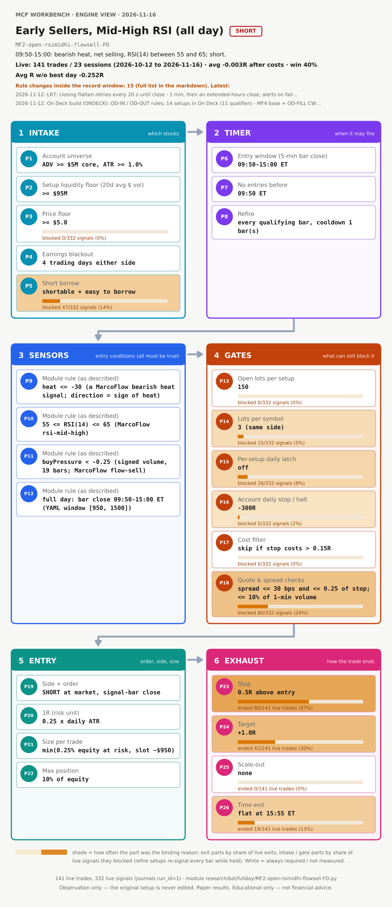

# Workbench diagnosis — Early Sellers, Mid-High RSI (all day) `MF2-open-rsimidhi-flowsell-FD` (On Deck)
Educational only — not financial advice. Mechanic 2026-11-16, built after the close (research files only; no config change, no deploy).

Live record used for DIAGNOSIS only (owner: not part of the pass decision): leaderboard rank 17, 139 trades / 22 sessions,
avg +0.013R (journal pull 2026-11-16 ~19:45 ET: 141 / 23 incl. today's 2, avg −0.003R; Primary 111 trades 10-20..11-10, On Deck /
Testing 1 30). Best day 10-22 (+29.2R on 23 trades) carries the whole record: avg R w/o best day −0.252R (`1 day` tag). Known
symptom: negative on up days (−2.48R/session on up days vs +3.21 on down days, 10-12..11-11).
Rule changes inside the window (ledger; full list in `MF2-open-rsimidhi-flowsell-FD.md`): 10-20 promotion to Primary + twin rule /
−2R latch in Testing, 10-21 promotion = move (Primary only), 10-23 ST-A (no per-setup stop in Testing), 10-28 Primary size / cap 30,
10-29 Primary −2R latch, 10-30 Testing cost filter 0.15R (CF), 11-11 TEAM-6 move back to Testing 1 (now On Deck), 11-12 LR1/LR3/LR5/LR7
+ LR8 costs + ONDECK build. Live numbers before and after these dates are not like for like (e.g. the 111 Primary trades had NO cost
filter; On Deck has one) — the replay applies today's On Deck rules to every session.

**R unit.** The parent is t1s05: 1R (P20) = 0.25 x daily ATR, stop (P23) 0.5R, target (P24) 1R. The journal (and every number
here) measures R as P&L / stop distance = 0.125 ATR, so a full stop is about −1.0R before costs and a target +2.0R.

## Engine (parts P1..P26) — every part inspected

| Part | Setting | What the evidence says | Tested as |
|---|---|---|---|
| P1 account universe | ADV $5M, ATR 1% | not binding (P2 is stricter) | — (covered by P2) |
| P2 ADV floor | >= $95M | $150M: 2y −0.007 -> +0.027R (VALID −0.054 -> −0.016); $200M +0.024 on −32% trades. Replay cannot test (replay = names that passed $95M live) | V01 PASS (2y only) -> in WB2/WB3; S5 |
| P3 price | >= $5 | 0/332 live signals blocked; $10 floor neutral | V02 pass, no gain |
| P4 earnings blackout | 4 days | universe-level | not a setup knob |
| P5 borrow | shortable + ETB | 47/332 signals blocked (14%); both tests use ETB names only | not a knob |
| P6 window | 09:50-15:00 | live 10:30-11:30 entries 38 trades −0.60R; replay 10:30-11:00 −0.55R; but start 11:00 fails 2y VALID; end 13:00/14:00 neutral in 2y | V04 / V05 / V06 pass narrowly, not shipped |
| P7 start | 09:50 | the sensors almost never line up before 10:15 (RSI(14) needs the morning) — start 10:15 changes 8 of 2,956 2y trades | V03 pass (no effect) |
| P8 refire | on, cooldown 1 | refire off / cooldown 3 lose 2y (−0.022): later lots on the same name pay | V07 / V08 FAIL |
| P9 heat <= −30 | | deeper heat is WORSE (live heat < −40: 21 trades −0.29R; replay −50..−40 −0.38R); heat <= −35 fails the replay. A FLOOR (heat >= −40) helps both tests on top of WB2 | V09 pass; V10 FAIL; floor in WB3 |
| P10 55 <= RSI(14) <= 65 | | top of the band loses (live RSI > 62: 38 trades −0.23R vs +0.11R; replay 62-65 −0.25R). RSI <= 62: 2y −0.007 -> +0.029; raising the floor to 57 FAILS | V11 PASS -> in WB2/WB3; V12 FAIL; S6 FAIL |
| P11 buyPressure < −0.25 | | strongest selling (bp < −0.5) loses (replay −0.63R on 41); bp < −0.30 FAILS; floor −0.5 neutral in 2y | V13 pass; V14 FAIL; D1 |
| P12 window note | | same as P6 | — |
| P13 open lots per setup 150 | | 0 / 332 blocked | not binding |
| P14 lots per symbol 3 | | 15 / 332 blocked; 1 lot per symbol loses 2y (−0.020) | V15 FAIL |
| P15 per-setup latch | off (On Deck) | 26 blocks were Primary's −2R latch | not a knob in On Deck |
| P16 account stop −300R | | 5 blocks (Primary −20R) | account-wide |
| P17 cost filter 0.15R | (account) | **the biggest part of the bench**: with the filter off the 2y is −0.046 (4,732 trades) vs −0.007; 0.10 helps 2y a little (+0.004) and replay (−0.120) | V16 pass (in C5/C6, not shipped); V17 FAIL |
| P18 quote / spread | | 80 / 332 blocked (24%) | runner-level, not a knob |
| P19 side + order | short at signal-bar close | as modelled | — |
| P20 1R 0.25 ATR | | 0.30 ATR: replay −0.204, worst day −49R | V18 FAIL |
| P21 / P22 size | slot / 10% | sizing, not a signal part | — |
| P23 stop 0.5R (0.125 ATR) | | 57% of live exits; 32 live trades held <= 10 min lost −31R (6% win). Looks too tight, BUT every wider stop is worse: 0.75R replay −0.200 / 2y −0.027, 1R (t1s1) 2y worst day −71R, holdtr −0.288 / −0.019. The tight stop is not the leak — WHAT gets shorted is | V19 / V20 / V22 FAIL |
| P24 target 1R | | 30% of live exits; target 0.5R (t05s05) 2y −0.052 | V21 FAIL |
| P25 scale-out | none | — | — |
| P26 time exit 15:55 | | 13% of live exits, +0.60R avg (winners still running) | trail V23 FAIL; not cut |
| NEW market gate | SPY since 09:50 (owner rule: after 09:50) | the RW5 gate does NOT transfer: skip SPY > +0.30% replay −0.193 (worse); skip above 09:30-09:50 high −0.198 / −0.021 | V24 / V25 FAIL |
| NEW trend layer | 20-SMA (5-min) slope | **the leak**: shorting a RISING 20-SMA. Live slope > +0.05%/bar: 31 trades −0.79R (−24.5R) vs 108 at +0.24R (+26.3R). Skip it: replay −0.162 -> +0.030, 2y −0.007 -> +0.004 | V26 PASS -> WB1 |
| NEW gap layer | gap at the open | shorting a GAP-UP stock: live gap > +2%: 30 trades −0.80R vs +0.24R; replay −0.72R on 60. Skip it: replay +0.061 | V27 PASS -> WB1 |
| NEW VWAP / ATR% | | skip > 1% below VWAP and ATR% cap both fail 2y | V28 / V29 FAIL |

## The 10 trades (5 worst + 5 best live)
Features recomputed on the replay frames (SIP 1-min, lab frame); ADV = 20-day $ volume from SIP daily bars. "Blocked by" = which
WB3 part (or the On Deck cost filter the parent already has) would have skipped the trade.

| Trade | What happened | Part that caused it | What WB3 does to THIS trade |
|---|---|---|---|
| worst1 CLSK 11-05 −1.73R (`_worst1_CLSK`) | Primary short 11:35 @ 5.86, 1R stop = $0.045; MFE +4.75R but MAE −1.28R first, P23 stop after 186 min | P17 cost (stop cost 0.92 of the stop distance — Primary had no filter) | already skipped by the parent's On Deck cost filter (0.15); WB3 also skips |
| worst2 SM 10-12 −1.43R (`_worst2_SM`) | Testing 1 short 10:42 @ 37.37, rising 20-SMA (slope +0.15), gap +1.9%; stopped in 10 min | NEW trend layer (rising average) + P2 (ADV $142M) | skipped (slope > 0.05, ADV < $150M); also cost 0.48 |
| worst3 IYW 11-06 −1.41R (`_worst3_IYW`) | Primary short 10:40 @ 227.67 on a gap-up ETF (+2.3%) with a rising 20-SMA (+0.25), RSI 63.0; P23 stop 10:46 | NEW trend + gap layers, P10 top | skipped (slope, gap, RSI > 62). 11-06 was the replay's worst day (−33.1R); WB3 takes no trade that day |
| worst4 SKYD 10-12 −1.29R (`_worst4_SKYD`) | Testing 1 short 11:42 @ 8.92 (1R stop $0.06), stop after 179 min | P17 cost (0.68) | skipped by the parent's cost filter already |
| worst5 VUG 11-05 −1.29R (`_worst5_VUG`) | Primary short 12:05 @ 82.19 on a crash day (SPY −2.1% since 09:50), 1R stop $0.19; stopped in 8 min | P17 cost (0.30) | skipped by the parent's cost filter already; no WB3 sensor fires (slope −0.20, gap −0.7%) |
| best1 PURR 10-16 +4.10R | target 14:32 | — | skipped by the cost filter (0.75) — parent and WB3 alike |
| best2 SCO 10-20 +3.01R | 15:55 flatten | — | skipped (cost 1.30; ADV $115M) |
| best3 VWO 10-22 +2.72R | target | — | skipped (cost 0.78; RSI 62.2) |
| best4 TER 11-06 +2.68R (`_best4_TER`) | short 10:20 @ 220.94 on a +9.7% gap-up, slope +0.050; target in 52 min | — | **WB3 would MISS it** (gap > 2%, slope just over 0.05): the price of the gap-up layer |
| best5 SCHG 10-22 +2.61R | target | — | skipped by the cost filter (0.88) |

Reading: 4 of the 5 worst and 4 of the 5 best live trades are thin-stop names (ETFs / cheap stocks) that the parent itself no
longer takes in On Deck (cost filter 0.15). The live trades the parent still takes look like IYW and SM: shorts into a rising
average or a gap-up — those are what WB3 removes; TER is what it gives back.

## Across all live trades (which part is most often behind the losses)
(139 of 141 live trades matched to the replay; `component_analysis.txt` has the full split.)
- **Shorting strength (trend + gap layers): the main leak.** Trades with a rising 20-SMA (> +0.05%/bar) or a gap-up > +2%: 34
  trades **−0.82R** (−28.0R); the other 105: **+0.28R** (+29.8R). The same split in the replay (parent without cost filter):
  slope > 0.05 −0.62R on 71, gap > +2% −0.72R on 60.
- **RSI top + extreme heat:** RSI(14) > 62 −0.23R (38) vs +0.11R; heat < −40 −0.29R (21) vs +0.07R. All four WB3 sensors together:
  70 trades −0.36R vs 69 at **+0.39R**. Inside the cost filter (what On Deck now trades): 72 trades −0.10R; WB3 removes 39 at −0.24R
  and keeps 33 at +0.07R.
- **Stop (P23):** 80 of 141 exits; 35 stopped trades had seen +0.5R first and 14 +1R — looks like a too-tight stop, but the
  wider-stop copies lose in both tests (the losses are the wrong shorts, not the stop).
- **Quick losers:** 32 trades held <= 10 min −31.2R (6% win); 17 of them (−16.2R) are rising-average / gap-up shorts and 23 trip at least one WB3 sensor (14 had stop cost > 0.15R).
- **Time of day:** 10:30-11:30 entries 38 trades −0.60R live — overlaps the trend layer (morning gap-ups still rising); a window
  change alone does not hold in the 2-year test.
- **Up days:** 2y up-day avg −0.282R on 664 trades (−1.34R per up day). WB3 cuts it to −0.173R on 255 (−0.42R per up day) without
  a market gate — the trend/gap layers remove the stocks that go up with the market.

## Candidate tweaks (one part each -> combos)
1. NEW trend layer: skip a rising 20-SMA (slope <= +0.05%/bar) — V26.
2. NEW gap layer: skip gap-ups > +2% — V27. (1 + 2 = WB1.)
3. P10 RSI top 65 -> 62 and P2 ADV $95M -> $150M — V11 / V01 (WB2 = WB1 + both).
4. P9 heat floor >= −40 (WB3 = WB2 + floor).
Everything else (48 configurations in all) is in RESULTS.md, including every failure.
