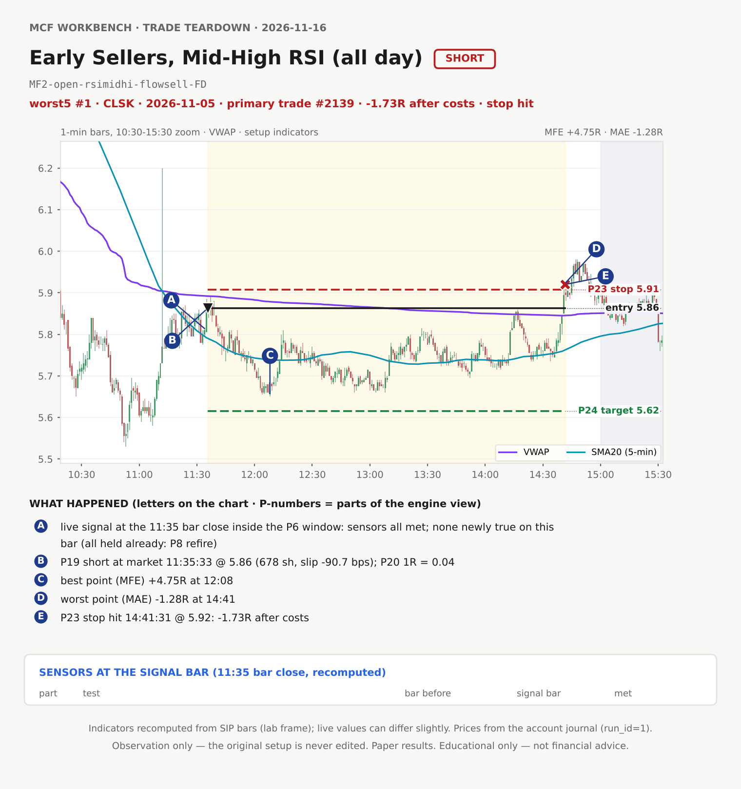
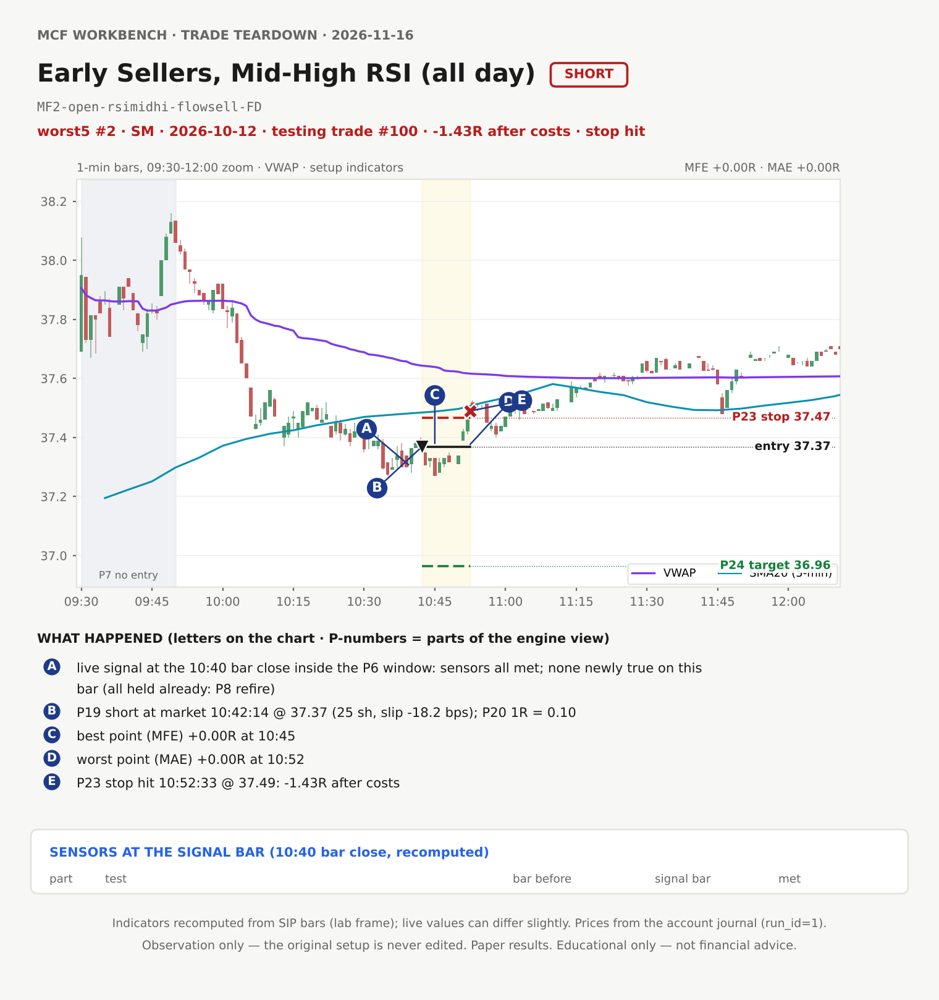
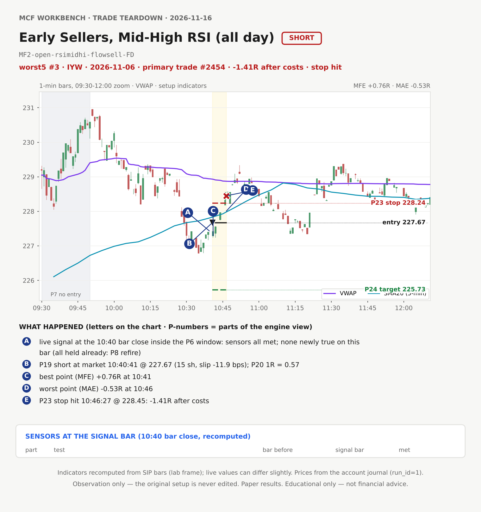
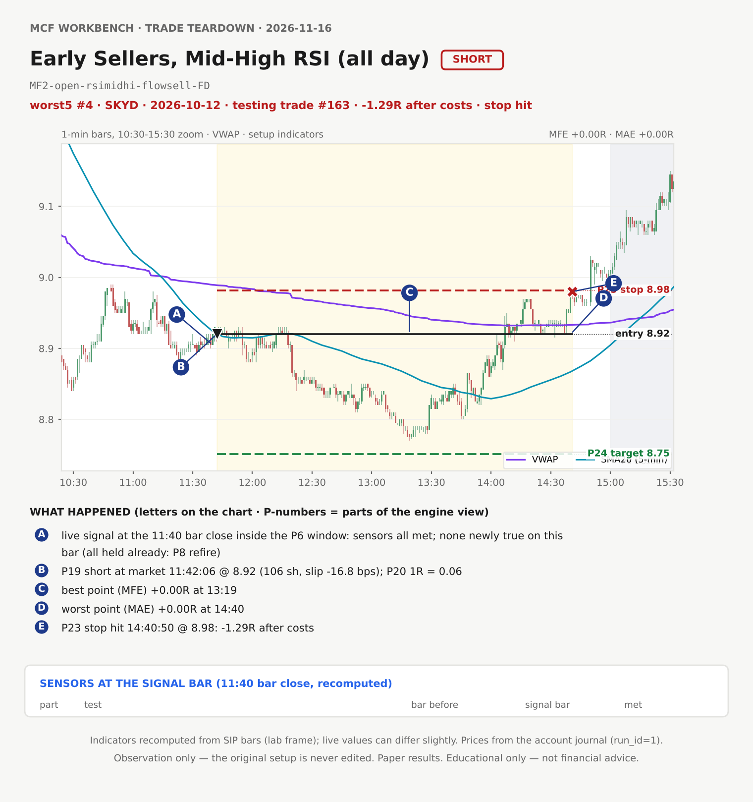
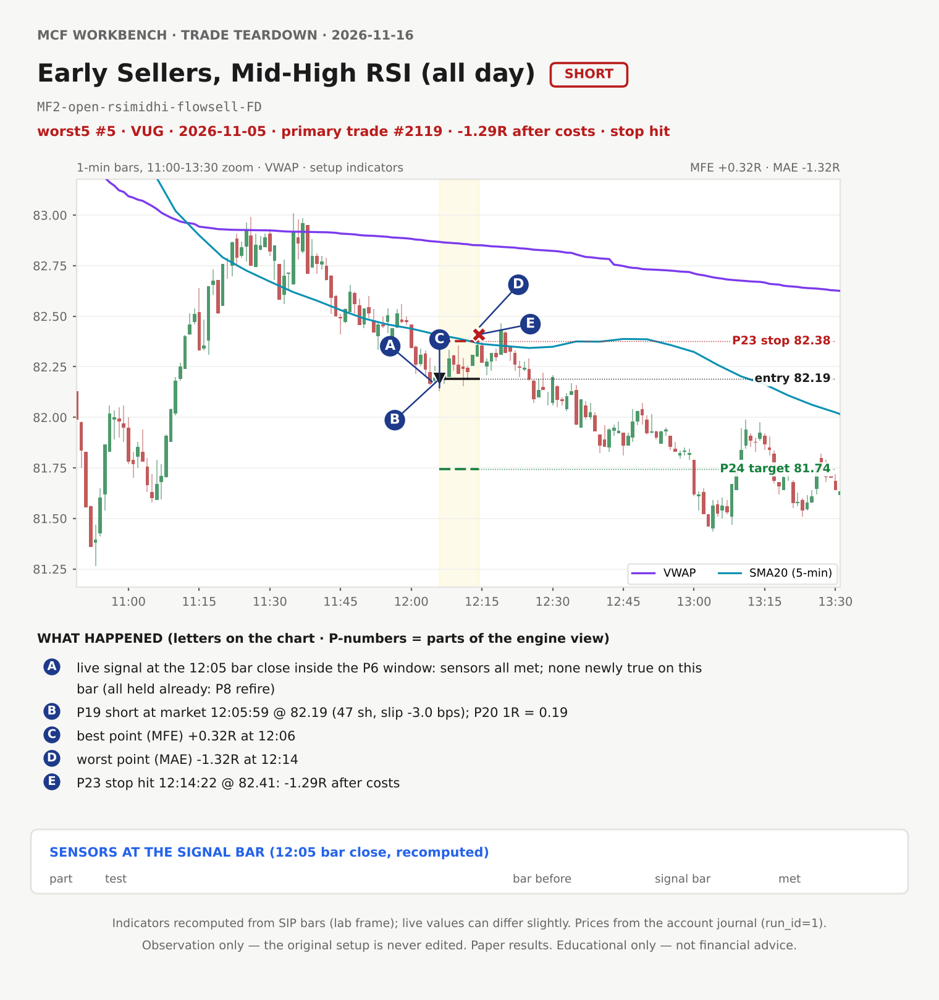

# Workbench blueprint: Early Sellers, Mid-High RSI (all day)

`MF2-open-rsimidhi-flowsell-FD` - short - built 2026-11-16

> 09:50-15:00: bearish heat, net selling, RSI(14) between 55 and 65; short.

## WHICH STOCKS

| Part | Exact value | Source / note |
|---|---|---|
| Liquidity floor (20-day avg $ volume) | `>= $95M` | setup min_adv |
| Account universe | `ADV >= $5M core, ATR >= 1.0%` | extended tier $1M with rvol >= 3.0x |
| Price floor | `>= $5.0` | costs.min_price |
| Earnings blackout | `4 trading days either side` | universe |
| Partnerships (PTP) | `excluded` | 10% withholding on sales |
| Short borrow | `shortable + easy to borrow only` | broker flags |

## WHEN

| Part | Exact value | Source / note |
|---|---|---|
| Entry window (5-min bar close) | `09:50-15:00 ET` | window: [950, 1500] |
| No entries before | `09:50 ET` | live.no_entry_before |
| Flat by | `15:55 ET` | half days: close - 5 min |
| Refire | `every qualifying bar, cooldown 1 bar(s)` | refire: true |

## ENTRY TRIGGER

| Part | Exact value | Source / note |
|---|---|---|
| Side | `SHORT` | SIDE |
| Module rule (as described) | `heat <= -30 (a MarcoFlow bearish heat signal; direction = sign of heat)` | LAYERS |
| Module rule (as described) | `55 <= RSI(14) <= 65 (MarcoFlow rsi-mid-high)` | LAYERS |
| Module rule (as described) | `buyPressure < -0.25 (signed volume, 19 bars; MarcoFlow flow-sell)` | LAYERS |
| Module rule (as described) | `full day: bar close 09:50-15:00 ET (YAML window [950, 1500])` | LAYERS |
| Order | `enter at the close of the signal bar` | lab outcome model |

## RISK & EXIT

| Part | Exact value | Source / note |
|---|---|---|
| 1R (risk unit) | `0.25 x daily ATR` | r_atr_frac |
| Exit geometry | `t1s05: target +1R / stop 0.5R` | GEOM |
| Stop | `0.5R above entry` | bracket stop |
| Target | `+1.0R` | bracket target |
| Scale-out | `none` | scale_out_r: null |
| Time exit | `flat at 15:55 ET` | session.flatten_by |

## LIMITS

| Part | Exact value | Source / note |
|---|---|---|
| Open lots per setup | `150` | max_positions_per_strategy |
| Per-setup daily latch | `off` | max_setup_daily_loss_r |
| Account daily stop | `-300R` | max_daily_loss_r |
| Lots per symbol | `3 (same side)` | same_setup_reentry: True |
| Cost filter | `skip if stop costs > 0.15R` | max_stop_cost_r |
| Spread / size checks | `spread <= 30 bps and <= 0.25 of stop; <= 10% of 1-min volume` | live |

## ACCOUNT & SIZING

| Part | Exact value | Source / note |
|---|---|---|
| Runs in | `On Deck` | configs now |
| Size per trade | `min(0.25% equity at risk, slot ~$950)` | 400 slots x 3.8 BP |
| Max position | `10% of equity` | max_position_notional_pct |

## RECORD

| Part | Exact value | Source / note |
|---|---|---|
| Trades / sessions | `141 / 23` | 2026-10-12 to 2026-11-16 |
| Avg R after costs | `-0.003R` | total -0.4R, win 40% |
| Avg R w/o best day | `-0.252R` |  |
| By account | `Primary 111 tr -0.01R, On Deck 30 tr +0.02R` |  |
| Rule changes in window | `15 (listed in the markdown)` | latest: 2026-11-12: LR7: closing flatten retries every 20 s until cl; 2026-11-12: On Deck build (ONDECK): OD-IN / OD-OUT rules; 14 |

## MODULE

- file: `research/bdi/fullday/MF2-open-rsimidhi-flowsell-FD.py` (parsed as: mask)
- module's own layer notes: heat <= -30 (a MarcoFlow bearish heat signal; direction = sign of heat); 55 <= RSI(14) <= 65 (MarcoFlow rsi-mid-high); buyPressure < -0.25 (signed volume, 19 bars; MarcoFlow flow-sell); full day: bar close 09:50-15:00 ET (YAML window [950, 1500])

## RULE CHANGES INSIDE THE RECORD WINDOW

- 2026-10-20: Promote MF2-FD, MF4-FD, NS3-FD from Testing 1 to Primary (they keep running in Testing 1)
- 2026-10-20: Risk: no lot on a symbol held by the setup's twin (X / X-FD, 'twin held'); per-setup daily loss limit -2R net ('setup daily loss limit') in Testing 1/2 and gen, account backstop 60 -> 120R there
- 2026-10-21: Owner rule: a promotion is a move - promoted setups no longer keep a Testing 1 copy (RW5-FD, RW3-FD, MF2-FD, MF4-FD, NS3-FD, MF3-FD now Primary only)
- 2026-10-23: Owner ST-A: per-setup daily loss stop off in Testing 1, Testing 2 and the Setup Generator (Graveyard keeps -2R; Primary unchanged, never had one)
- 2026-10-23: Owner replies: withdraw G1 (R1 yes: the 6 -g1 up-tape gated short variants are never added); no new daily stop for Primary (R2 yes: keep the -20R account stop and the -2R per-setup stop in the testing accounts; B1b not adopted)
- 2026-10-28: Owner: Primary position size ~$4,000 instead of ~$5,000 (slots 61 -> 77, max concurrent 61 -> 77; per-setup stays 30)
- 2026-10-28: Owner: Primary position size ~$5,000 (slots 160 -> 61, max concurrent 160 -> 61, per-setup 100 -> 30)
- 2026-10-29: Owner ST-P: per-setup daily stop at -2R (latched) in Primary only
- 2026-10-30: Owner CF: Testing 1/2 skip entries whose stop-exit round-trip cost > 0.15R (forward test of p3_1029 A3)
- 2026-11-11: Owner TEAM yes: Primary runs TEAM-6 from 2026-11-11 to 2026-11-13, frozen (no rotation): NM-ETF-late-dip-di-long Live Lab -> Primary; MF2-FD, MF4-FD, L3-rsi5hi-FD Primary -> Testing 1; MF4 base, NS1 Primary -> Testing 2 (move)
- 2026-11-12: LR1: flatten at min(15:55, calendar close - 5 min) on every account (half days 11-27 / 12-24 flatten 12:55)
- 2026-11-12: LR3: Primary's -20R account halt and -2R per-setup latch count R after costs; the account halt also counts open lots' marks (less a market-exit cost)
- 2026-11-12: LR5: broker position vs journal lot check every poll on all accounts; a persistent mismatch is flagged (health.position_mismatch), blocks new entries in that symbol and alerts; never auto-closed
- 2026-11-12: LR7: closing flatten retries every 20 s until close - 1 min, then an extended-hours close, alerts on failure; watchdog in act for Primary until calendar close + 5 min (also acts on flatten_failed / exposure after the flatten)
- 2026-11-12: On Deck build (ONDECK): OD-IN / OD-OUT rules; 14 setups in On Deck (11 qualifiers - MF4 base + OD-FILL CWT05-m05-v5 + OD-P20 MF2-FD / MF4-FD / L3-rsi5hi-FD); 7 out to Testing E / F; MF5 and exhaustion_short-FD single home Testing A (move)

## WORKBENCH PARAMETERS (for `python -m mcf.research.workbench spawn`)

- `refire` = `True`
- `refire_cooldown` = `1`
- `min_adv` = `95000000`
- `window` = `[950, 1500]`
- `scale_out_r` = `None`
- `geom` = `t1s05`
- `r_atr_frac` = `0.25`

## ENGINE VIEW (numbered parts)

| Part | Stage | Component | Exact value | Binding share |
|---|---|---|---|---|
| P1 | INTAKE | Account universe | `ADV >= $5M core, ATR >= 1.0%` | - |
| P2 | INTAKE | Setup liquidity floor (20d avg $ vol) | `>= $95M` | - |
| P3 | INTAKE | Price floor | `>= $5.0` | blocked 0/332 signals (0%) |
| P4 | INTAKE | Earnings blackout | `4 trading days either side` | - |
| P5 | INTAKE | Short borrow | `shortable + easy to borrow` | blocked 47/332 signals (14%) |
| P6 | TIMER | Entry window (5-min bar close) | `09:50-15:00 ET` | - |
| P7 | TIMER | No entries before | `09:50 ET` | - |
| P8 | TIMER | Refire | `every qualifying bar, cooldown 1 bar(s)` | - |
| P9 | SENSORS | Module rule (as described) | `heat <= -30 (a MarcoFlow bearish heat signal; direction = sign of heat)` | - |
| P10 | SENSORS | Module rule (as described) | `55 <= RSI(14) <= 65 (MarcoFlow rsi-mid-high)` | - |
| P11 | SENSORS | Module rule (as described) | `buyPressure < -0.25 (signed volume, 19 bars; MarcoFlow flow-sell)` | - |
| P12 | SENSORS | Module rule (as described) | `full day: bar close 09:50-15:00 ET (YAML window [950, 1500])` | - |
| P13 | GATES | Open lots per setup | `150` | blocked 0/332 signals (0%) |
| P14 | GATES | Lots per symbol | `3 (same side)` | blocked 15/332 signals (5%) |
| P15 | GATES | Per-setup daily latch | `off` | blocked 26/332 signals (8%) |
| P16 | GATES | Account daily stop / halt | `-300R` | blocked 5/332 signals (2%) |
| P17 | GATES | Cost filter | `skip if stop costs > 0.15R` | blocked 0/332 signals (0%) |
| P18 | GATES | Quote & spread checks | `spread <= 30 bps and <= 0.25 of stop; <= 10% of 1-min volume` | blocked 80/332 signals (24%) |
| P19 | ENTRY | Side + order | `SHORT at market, signal-bar close` | - |
| P20 | ENTRY | 1R (risk unit) | `0.25 x daily ATR` | - |
| P21 | ENTRY | Size per trade | `min(0.25% equity at risk, slot ~$950)` | - |
| P22 | ENTRY | Max position | `10% of equity` | - |
| P23 | EXHAUST | Stop | `0.5R above entry` | ended 80/141 live trades (57%) |
| P24 | EXHAUST | Target | `+1.0R` | ended 42/141 live trades (30%) |
| P25 | EXHAUST | Scale-out | `none` | ended 0/141 live trades (0%) |
| P26 | EXHAUST | Time exit | `flat at 15:55 ET` | ended 19/141 live trades (13%) |

Exit mix: {'time': 19, 'stop': 80, 'target': 42} of 141 live trades; blocked signals: {'quote': 80, 'cap_symbol': 15, 'borrow': 47, 'latch': 26, 'acct_stop': 5, 'split_gate': 3, 'other': 9} of 332 live signals (refire setups re-signal every bar while held).

## TRADE TEARDOWNS

### CLSK 2026-11-05 (primary #2139): -1.73R, stop

- **A** live signal at the 11:35 bar close inside the P6 window: sensors all met; none newly true on this bar (all held already: P8 refire)
- **B** P19 short at market 11:35:33 @ 5.86 (678 sh, slip -90.7 bps); P20 1R = 0.04
- **C** best point (MFE) +4.75R at 12:08
- **D** worst point (MAE) -1.28R at 14:41
- **E** P23 stop hit 14:41:31 @ 5.92: -1.73R after costs

| Part | Test | Bar before | Signal bar | Met |
|---|---|---|---|---|

### SM 2026-10-12 (testing #100): -1.43R, stop

- **A** live signal at the 10:40 bar close inside the P6 window: sensors all met; none newly true on this bar (all held already: P8 refire)
- **B** P19 short at market 10:42:14 @ 37.37 (25 sh, slip -18.2 bps); P20 1R = 0.10
- **C** best point (MFE) +0.00R at 10:45
- **D** worst point (MAE) +0.00R at 10:52
- **E** P23 stop hit 10:52:33 @ 37.49: -1.43R after costs

| Part | Test | Bar before | Signal bar | Met |
|---|---|---|---|---|

### IYW 2026-11-06 (primary #2454): -1.41R, stop

- **A** live signal at the 10:40 bar close inside the P6 window: sensors all met; none newly true on this bar (all held already: P8 refire)
- **B** P19 short at market 10:40:41 @ 227.67 (15 sh, slip -11.9 bps); P20 1R = 0.57
- **C** best point (MFE) +0.76R at 10:41
- **D** worst point (MAE) -0.53R at 10:46
- **E** P23 stop hit 10:46:27 @ 228.45: -1.41R after costs

| Part | Test | Bar before | Signal bar | Met |
|---|---|---|---|---|

### SKYD 2026-10-12 (testing #163): -1.29R, stop

- **A** live signal at the 11:40 bar close inside the P6 window: sensors all met; none newly true on this bar (all held already: P8 refire)
- **B** P19 short at market 11:42:06 @ 8.92 (106 sh, slip -16.8 bps); P20 1R = 0.06
- **C** best point (MFE) +0.00R at 13:19
- **D** worst point (MAE) +0.00R at 14:40
- **E** P23 stop hit 14:40:50 @ 8.98: -1.29R after costs

| Part | Test | Bar before | Signal bar | Met |
|---|---|---|---|---|

### VUG 2026-11-05 (primary #2119): -1.29R, stop

- **A** live signal at the 12:05 bar close inside the P6 window: sensors all met; none newly true on this bar (all held already: P8 refire)
- **B** P19 short at market 12:05:59 @ 82.19 (47 sh, slip -3.0 bps); P20 1R = 0.19
- **C** best point (MFE) +0.32R at 12:06
- **D** worst point (MAE) -1.32R at 12:14
- **E** P23 stop hit 12:14:22 @ 82.41: -1.29R after costs

| Part | Test | Bar before | Signal bar | Met |
|---|---|---|---|---|

Observation only: the original setup is never edited. Educational only — not financial advice.
