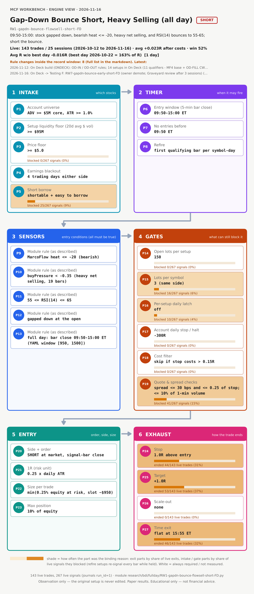

# Workbench diagnosis — Gap-Down Bounce Short, Heavy Selling (all day) `RW1-gapdn-bounce-flowsell-short-FD` (On Deck)
Educational only — not financial advice. Mechanic 2026-11-16, built ~14:45-16:30 ET (research files only; no config change, no deploy).

Live record used for DIAGNOSIS only (owner: not part of the pass decision): 143 trades / 25 sessions to 11-16 (140 / 24 to
11-13), avg +0.023R after costs (+0.004R to 11-13), win 52%; Testing A 80 trades +0.14R (to 11-11), On Deck 63 trades −0.13R
(from 11-12 for this setup's On Deck lots; 10-12..11-11 On Deck lots came from the old Testing 1 home). Best day 10-22 = 163% of
total R (`1 day` tag; avg R w/o best day −0.016R). Rule changes inside the window (ledger): 10-20 twin rule + −2R per-setup latch
in Testing 1/2; 10-23 ST-A latch off in Testing 1/2; 10-30 CF cost filter (skip stop-exit cost > 0.15R) in Testing 1/2; 11-12
LR1/LR5 + LR8 costs and the On Deck build (this setup moved Testing A → On Deck); 11-16 RW7 (near-twin) On Deck → Testing F.
Live trades before and after 10-23 / 10-30 / 11-12 are not like for like (e.g. 3 of the 5 best live trades, MAGS / LEVI / PURR,
had stop-exit cost 0.22-0.34R and would be blocked by today's own CF filter). The replay below applies today's On Deck rules
(no latch, 150 lots, CF 0.15, <= 3 lots per symbol) to every session.

## Engine (parts P1..P27) — every part inspected
  (full table: BLUEPRINT_worst5.md)

| Part | Setting | What the evidence says (live = journal; replay / 2y = bench, LR8 costs) | Tested as |
|---|---|---|---|
| P1 account universe | ADV $5M, ATR >= 1% | not binding (P2 stricter); but thin 1R hurts: 2y 1R < 0.40% of price 224 trades −0.23R | V03 1R >= 0.40% PASS -> in WB3 |
| P2 ADV floor | >= $95M | $150M: replay −0.057 (drops good names), 2y −0.010 | V01 FAIL |
| P3 price | >= $5 | 0 / 267 live signals blocked; $10 = parent | V02 pass (no effect) |
| P4 earnings blackout | 4 days | universe-level | not a setup knob |
| P5 borrow | shortable + ETB | 25 / 267 signals blocked; both tests use ETB names only | not a knob |
| P6 window end | 15:00 | replay entries 13:00-15:00: 37 trades −0.27R/trade (−10.2R); live 13:00-15:00 ~0R; 2y 13:00-14:00 −0.079 but 14:00+ +0.022 | V05 end 13:00 PASS -> WB1, in WB3; V06 end 14:00 meets; D3 end 13:30 weaker |
| P7 start | 09:50 | live entries before 11:00: 39 trades −0.23R (−9.0R); but replay 10:30-11:00 ~0 and 2y 10:30-11:00 is the best slot (+0.011); start 10:30 / 11:00 ~neutral in the backtests | V07 / V08 pass (meet only); C8 / C9 worse than C1 -> not kept |
| P8 refire | off | refire (cd 6): replay worst day −9.9R | V09 FAIL |
| P9 heat <= -20 | | heat <= −25 helps replay (+0.062) but 2y = parent; heat <= −15 2y worst day −45R | V10 pass / V11 FAIL; C4 / C10 too thin (59 / 48 replay trades) |
| P10 buyPressure < -0.35 | | live / replay: bp in (−0.40, −0.35] is the weak bin (−0.05 / −0.11R) but 2y it is the BEST bin (+0.009); < −0.40 hurts 2y (−0.029) | V12 FAIL |
| P11 RSI(14) 55-65 | | **the main sensor flaw**: the upper half of the band is a reclaim, not a bounce into resistance — live RSI 60-65 54 trades −6.9R vs 55-60 86 trades +7.5R; replay 57-66 −0.06R/trade; 2y 62-66 −0.036 (1,817 trades) | V13 55-60 PASS -> WB2, in WB3; V14 58-65 FAIL; S1 55-58 / D4 55-61 neighbours hold |
| P12 gap < 0 | | gap <= −1% helps both (replay +0.074, 2y −0.002) but in combos the TRAIN split gets worse (C6 −0.070, D1 −0.072 vs parent −0.044) | V16 pass, V15 FAIL; not in WB3 (TRAIN) |
| P13 window note | | same as P6 | — |
| P14 open-lot cap 150 | | 0 / 267 signals blocked | not binding |
| P15 lots per symbol 3 | | refire off -> 1 lot per symbol-day; the 16 blocks were the two-account overlap | V17 = parent |
| P16 per-setup latch | off | −2R latch: replay −0.008 | V18 FAIL |
| P17 account halt | −300R | 0 blocked | not a setup knob |
| P18 cost filter | 0.15R | 0.10R drops winners too: replay +0.002 | V04 FAIL (the RW5 intake form does not transfer) |
| P19 quote / spread | | 41 / 267 blocked | runner-wide |
| P20 entry | market, signal-bar close | live slip mixed (−20.7 to +4.7 bps on the 5 worst) | not tested |
| P21 1R | 0.25 x ATR | see P1 (1R floor in % of price, the RW3 intake form, transfers) | V03 -> WB3 |
| P22 size / P23 max position | | R-neutral | not tested |
| P24 stop 1R | | 44 / 143 live exits; only 9 of 44 stops had MFE >= 0.5R first; 1.25R: 2y worst day −29.5R; BE at +0.5R: 2y −0.030 | V19 / V21 FAIL |
| P25 target 1R | | 53 / 143 live exits (+0.95R avg), the edge; 0.8R = parent at best | V20 pass (no gain) |
| P26 scale-out | none | — | not tested |
| P27 time exit 15:55 | | 46 / 143 live exits at −0.01R (flat); max hold 120 hurts (replay −0.033); flat 15:00 meets but has no live per-setup knob | V22 FAIL / V23 pass (not shippable) |
| NEW gate: SPY since 09:50 (sibling RW3/RW5) | (none) | **does not transfer on its own**: live SPY > 0 since 09:50 61 trades −0.04R vs <= 0 79 trades +0.03R (small); replay's worst bin is the opposite tape (SPY <= −0.5%: −0.23R/trade); alone 0.20 fails (replay −0.008, w/o best day −0.103). Inside the RSI 55-60 + 1R floor + end 13:00 combo it adds on both tests (C5 -> D8: replay +0.160 -> +0.185, 2y +0.008 -> +0.026) | V24 / V25 FAIL alone; in WB3 |
| NEW sensor: price at/below VWAP | (none) | live/replay: above-VWAP (0..+0.5%) is the weak bin; filter passes on meet only (2y −0.024) | V26 pass (meet), not kept |

## The 5 worst live trades (each a full stop, −1.14 to −1.19R)
| Trade | What happened | Part that caused it | Small tweak and what it does to THIS trade |
|---|---|---|---|
| EMR 11-12 10:30 (On Deck) −1.19R (`_worst1_`) | gap −0.5%, RSI(14) 61.6 at the signal bar, price already above VWAP and the 5-min SMA20 turning up; MFE +0.23R, stop in 41 min | P11 upper RSI band (a reclaim, not a bounce) | RSI 55-60 (WB2 / WB3): **not taken** (+1.19R) |
| XLI 10-13 12:30 −1.18R (`_worst2_`) | 1R = $0.46 = **0.28% of price** (stop cost 0.16R); MFE +0.48R, then up to the stop 14:06 | P1/P21 thin 1R | 1R >= 0.40% (WB3): **not taken**; today's CF 0.15 would also skip it |
| FDS 10-26 13:20 (Testing A) −1.18R (`_worst3_`) | SPY +0.44% since 09:50, 13:20 entry, never in profit (MFE −0.01R), stop 14:44 | P6 late window + missing market-state gate | end 13:00 (WB1 / WB3) or SPY gate: **not taken** |
| FLEX 10-13 12:45 −1.16R (`_worst4_`) | gap −2.7%, RSI 56.7, SPY −0.07%: a clean signal; MFE +0.55R 13:07, then reversed to the stop 14:06 | none of the parts (normal loser) | **WB3 still takes it**; stop 1.25R / BE stop tested on all trades and fail |
| BNO 10-29 11:00 (Testing A) −1.14R (`_worst5_`) | 1R 0.43% of price, stop cost 0.18R (pre-CF); MFE +0.85R at 11:06 (target missed by 0.15R), stop 12:29 | P18 cost (today's CF already skips it) / P25 target | today's parent already skips it (CF); target 0.8R would have won this one but fails overall (V20 = parent) |

## The 5 best live trades
| Trade | RSI(14) | 1R % of price | SPY since 09:50 | entry | WB3 keeps it? |
|---|---|---|---|---|---|
| APH 11-05 11:35 +2.68R (`_best1_`) | 57.0 | 0.73% | −1.59% | 11:35 | yes |
| PURR 10-16 14:30 +1.51R (`_best2_`) | 58.8 | 1.65% | −1.31% | 14:30 | no — after 13:00 (and stop cost 0.27R: today's CF skips it too) |
| MAGS 10-22 11:55 +1.42R (`_best3_`) | 57.6 | 0.35% | −0.29% | 11:55 | no — 1R < 0.40% (stop cost 0.22R: today's CF skips it too) |
| LEVI 10-28 13:30 +1.39R (`_best4_`) | 59.1 | 0.60% | +0.15% | 13:30 | no — after 13:00 (stop cost 0.34R: today's CF skips it too) |
| BAI 11-05 12:10 +1.21R (`_best5_`) | 55.3 | 1.23% | −2.02% | 12:10 | yes |

WB3 drops 4 of the 5 worst live trades (EMR, XLI, FDS, BNO) and keeps 2 of the 5 best; the 3 best it drops would be blocked by the
parent's own cost filter as it runs today. Over all 143 live trades the WB3 rule keeps 42 (+0.071R avg) and drops 101 (+0.003R).

## Across all trades — which part loses most often (component_analysis.txt)
1. **Sensors / P11 RSI band** — the 60-65 half of the band loses in all three views (live −0.13R/trade on 54; replay −0.06 to −0.11;
   2y −0.036 on 1,817 at 62-66). A gap-down name whose RSI(14) is already back above 60 has reclaimed, it is not bouncing into supply.
2. **Timer / P6 end** — entries after 13:00: replay −0.27R/trade, 2y 13:00-14:00 −0.079 (798 trades); the afternoon bounce drifts
   to the 15:55 flatten or the stop.
3. **Intake / 1R in % of price** — 2y 1R < 0.40% of price: 224 trades −0.23R (cost and noise vs a thin unit).
4. **Gates** — up-tape days are where it loses (2y up days −0.249R/trade on 1,860 vs down days +0.157); the SPY-since-09:50 gate only
   helps once the sensor and timer leaks are closed.
Stops are mostly "never worked" trades (35 of 44 live stops had MFE < 0.5R), so stop / breakeven / target changes do not help.

Educational only — not financial advice.
