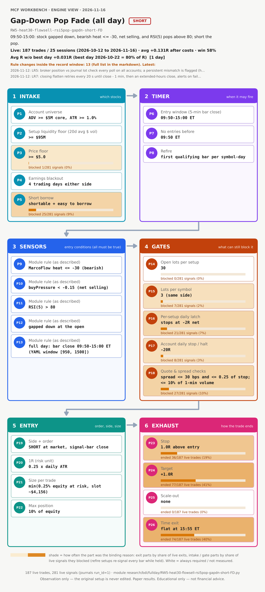

# Workbench diagnosis — Gap-Down Pop Fade (all day) `RW5-heat30-flowsell-rsi5pop-gapdn-short-FD` (Primary, TEAM-6)
Educational only — not financial advice. Mechanic 2026-11-16 (market hours: research files only; no config change).

Live record used for DIAGNOSIS only (owner: not part of the pass decision): 185 trades / 24 sessions, avg +0.125R after
costs, leaderboard rank 7 (journal pull 2026-11-16 ~13:10 ET: 187 / 25 incl. today's 2; Primary 154, On Deck 33 before the
10-21 move). Best day 10-22 = 80% of total R (`1 day` tag: avg R w/o best day +0.031R). Rule changes inside the window
(ledger): 10-15 promotion to Primary, 10-20 twin rule / -2R latch in Testing, 10-21 promotion = move (Primary only),
10-28 Primary size ~$4-5k / per-setup cap 30, 10-29 Primary -2R per-setup latch, 11-12 LR1/LR3/LR5/LR7 + LR8 cost model.
Live numbers before and after these dates are not like for like; the replay applies today's rules to every session.

## Engine (parts P1..P26) — every part inspected

| Part | Setting | What the evidence says | Tested as |
|---|---|---|---|
| P1 account universe | ADV $5M, ATR 1% | not binding (P2 is stricter) | — (covered by P2) |
| P2 ADV floor | >= $95M | $150M drops good mid-liquidity names: 2y -0.031 -> -0.054 (replay cannot test: replay = names that passed $95M live) | V01 FAIL |
| P3 price | >= $5 | 1 of 281 live signals blocked; $10 floor almost neutral (2y -0.032) | V02 pass, too small to ship |
| P4 earnings blackout | 4 days | universe-level, not a setup knob | not tested |
| P5 borrow | shortable + ETB | 25 / 281 signals blocked; both tests use ETB names only | not a knob |
| P6 window | 09:50-15:00 | live entries 13:00-15:00: 57 trades -2.1R; replay after 13:00 -0.032R; end 13:00 helps replay, hurts 2y VALID | V03 / V04 pass narrowly |
| P7 start | 09:50 | live entries before 10:15: 4 trades -1.2R (TT x2 among them); start 10:15 helps 2y (-0.031 -> -0.024) | V05 pass -> in WB3 |
| P8 refire | off | refire (cd 6) ~ neutral | V06 pass, not useful |
| P9 heat <= -30 | | deeper heat (<= -35) is WORSE (replay -0.072, 2y -0.055): the most extreme heat is a trend day, not a pop | V07 FAIL |
| P10 buyPressure < -0.15 | | -0.20 helps 2y a little (-0.022), costs 30% of trades | V09 pass, combo C4 not better overall |
| P11 RSI(5) > 80 | | > 85 helps TRAIN, hurts FWD; cap <= 97 hurts 2y | V10 pass / V11 FAIL |
| P12 gap < 0 | | gap < -1% thins trades, 2y w/o best day worse | V12 pass / V13 FAIL |
| P13 window note | | same as P6 | — |
| P14 open-lot cap 30 | | 0 / 281 signals blocked | not binding |
| P15 lots per symbol 3 | | refire off -> one lot per symbol-day; 7 blocks were the two-account overlap | not binding |
| P16 -2R latch | | 21 signals blocked; -4R latch: more trades, lower avg (2y -0.036) | V14 pass, no gain |
| P17 account halt | -20R | 8 signals blocked (11-10/11-11) | account-wide, not a setup knob |
| P18 quote / spread | | 27 blocked | runner-wide |
| P19 entry | market, signal-bar close | live slip mostly favourable | not tested |
| P20 1R | 0.25 x ATR | 1R 0.30 ATR hurts both (replay +0.067); thin-R names: cost/R <= 0.15 cuts the 2y worst day -25.3 -> -15.9R | V15 FAIL / V16 pass -> in WB3 |
| P21 size / P22 max position | | sizing only (R-neutral) | not tested |
| P23 stop 1R | | 36 / 187 live exits; 1.25R and breakeven-at-0.5R both worse | V17 / V19 FAIL |
| P24 target 1R | | 77 / 187 live exits, the edge; 0.8R worse | V18 FAIL |
| P25 scale-out | none | — | not tested (no live knob change wanted) |
| P26 time exit 15:55 | | 74 / 187 live exits at -0.10R avg; replay holds > 180 min -0.156R, BUT max hold 90/120 hurts the 2y test (-0.045 / -0.041); flat 15:00 neutral in 2y and has no per-setup live knob | V20 FAIL / V21, V22 pass (not shipped) |
| NEW gate: SPY since 09:50 | (none) | **the main failure mode**: live trades taken while SPY was up > +0.20% since 09:50: 67 trades -0.138R (-9.2R) vs 118 trades +0.274R (+32.4R) | V23 / S1 / S2 pass -> in WB3 |

## The 5 worst live trades (each a full stop, -1.16 to -1.25R)
| Trade | What happened | Part that caused it | Small tweak and what it does to THIS trade |
|---|---|---|---|
| TT 10-20 10:15 (On Deck) -1.25R | shorted a pop 25 min after the 09:50 mark while SPY was +0.39% since 09:50; ran through the stop in 6 min | P9-P12 sensors fire into a rising market; P7 early entry | SPY gate 0.20 -> not taken (start 10:15 alone would still take this 10:15-bar signal) |
| TCOM 10-21 11:50 -1.25R | entry at the pop high below VWAP, MFE +0.02R, slow 2-hour grind up to the stop; cost/R 0.27 (1R only 0.5% of price) | P20 thin R (cost eats it), gate (SPY +0.22%) | cost/R <= 0.15 and SPY gate -> not taken |
| TT 10-20 10:15 (Primary) -1.20R | same signal as #1 in the other account | as #1 | not taken |
| WDAY 10-29 11:55 -1.17R | SPY +0.22% since 09:50, stock reclaimed and ran 30 min to the stop | missing market-state gate | SPY gate 0.20 -> not taken (0.30 gate would keep it) |
| TCOM 11-09 11:45 -1.16R | SPY +0.47% since 09:50; MFE +0.11R, drifted up all afternoon, stopped 14:55 | missing gate; P26 stays in too long | SPY gate -> not taken |

## The 5 best live trades (each a full target, +1.22 to +1.38R)
| Trade | SPY since 09:50 | cost/R | WB3 keeps it? |
|---|---|---|---|
| FLEX 10-14 12:50 +1.38R | -0.78% | 0.04 | yes |
| VFLO 11-03 11:00 +1.29R | +0.29% | 0.35 | no (gate 0.20 and cost/R) — the give-back |
| KMI 11-03 10:40 +1.27R | +0.03% | 0.20 | no (cost/R) — the give-back |
| OKTA 10-14 12:40 +1.24R | -0.81% | 0.04 | yes |
| TLN 10-14 13:00 +1.22R | -0.75% | 0.02 | yes |

## Across ALL live trades (185 to 11-13; component_analysis.txt)
- Exits: target 77 (+71.4R), time 74 (-7.5R), stop 36 (-39.3R). 24 of the 36 stops were taken while SPY was > +0.20% since
  09:50, cost/R > 0.15 or before 10:15 — the WB3 filters remove 24 / 36 stops.
- **The part most often responsible for the losses is the missing market-state gate**: the setup shorts pops in gapped-down
  names, and when the index is rallying after 09:50 the pop keeps going (11-11: 21 trades -14.5R, all removed by WB3; 11-10: 22 trades -12.5R, WB3 removes only 5 of them, -3.1R —
  11-10 stays the copy's weak spot). Live, WB3's filters keep 77 trades at +0.317R (+24.4R) and drop 108 at -0.012R (-1.3R).
- By day type (2y, SPY open->close): up days -0.286R (1,579 trades) vs flat +0.052 / down +0.154 — the gate measured AFTER
  09:50 removes most of the up-day exposure (WB3 up-day trades 516, -0.225R) without looking at the open or prior close.
- Replay hold > 180 min -0.156R (64 trades) points at P26, but every max-hold tested lost in the 2-year test: the long
  holds are mostly targets reached late in the 2-year sample, so no time-exit part is shipped.

Candidate tweaks (one part each, then combined): NEW SPY-since-09:50 gate (WB1), P20/intake cost/R <= 0.15 (WB2),
combo with P7 start 10:15 (WB3). All 38 configurations: RESULTS.md.
