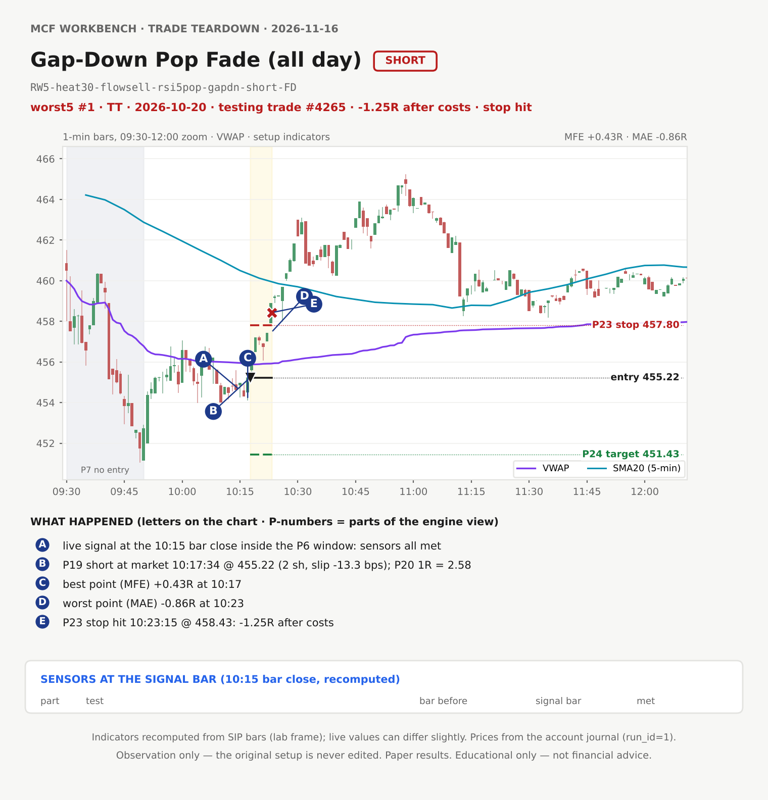
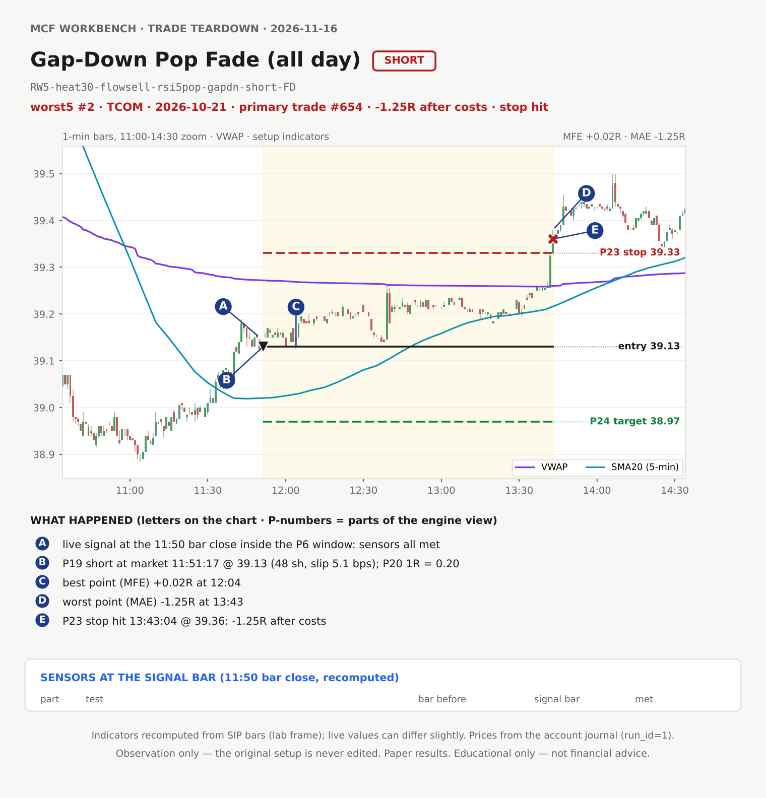
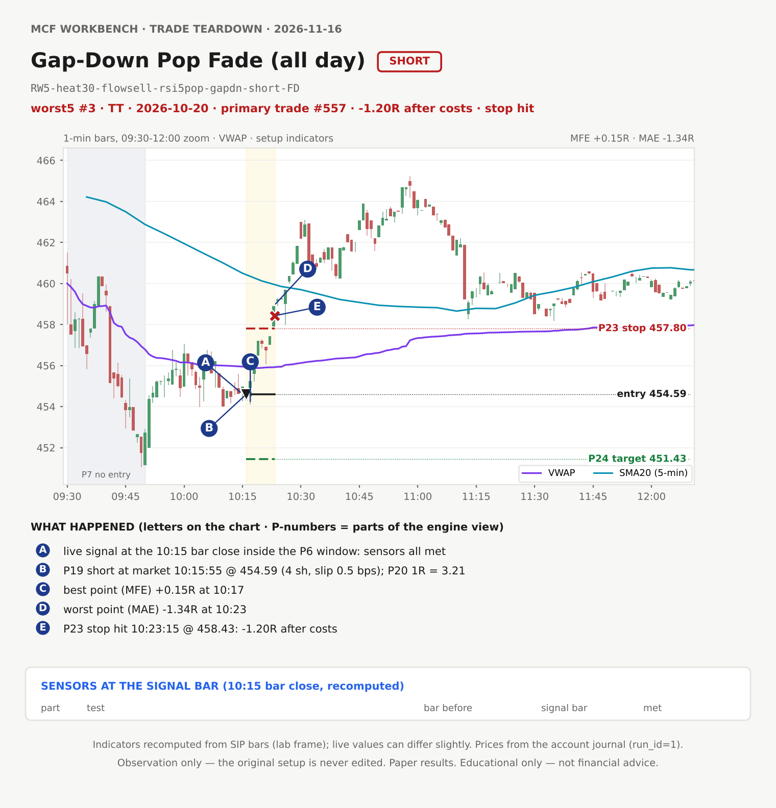
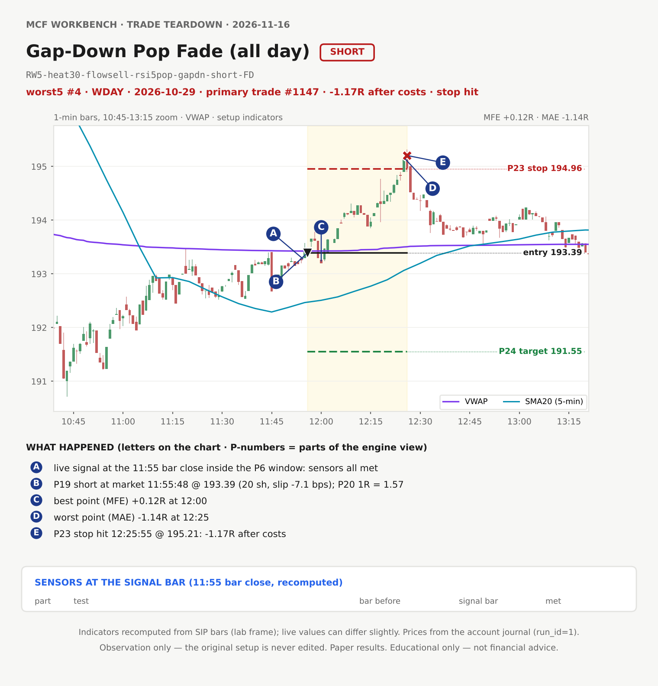
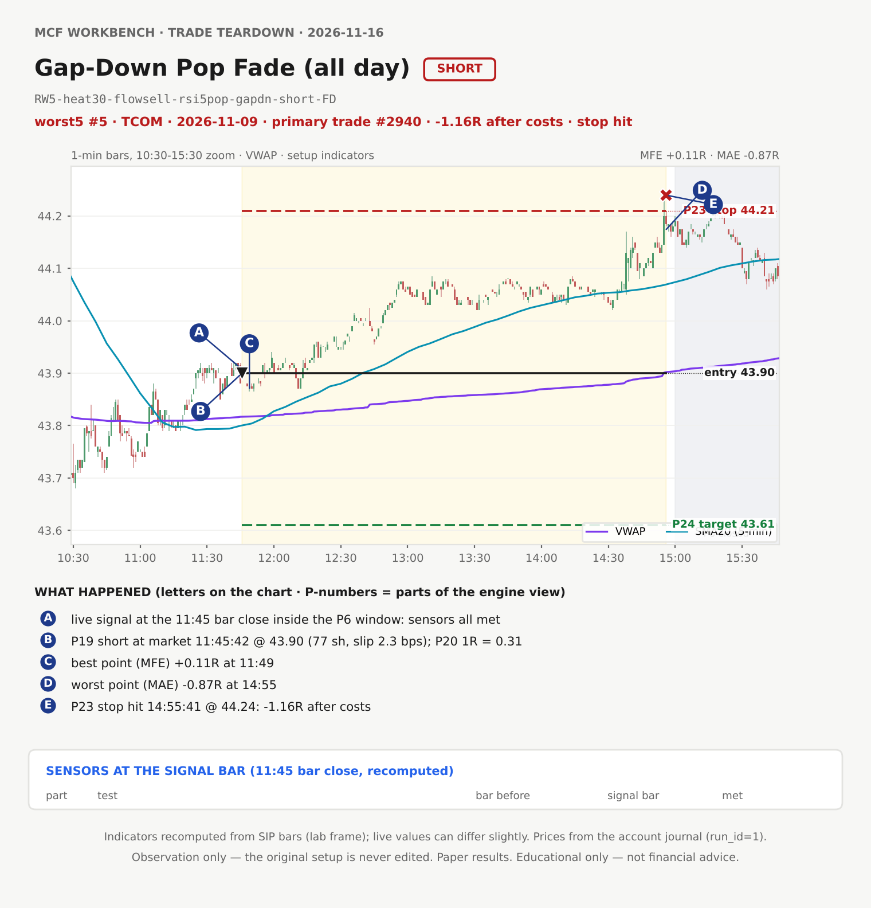

# Workbench blueprint: Gap-Down Pop Fade (all day)

`RW5-heat30-flowsell-rsi5pop-gapdn-short-FD` - short - built 2026-11-16

> 09:50-15:00: stock gapped down, bearish heat <= -30, net selling, and RSI(5) pops above 80; short the pop.

## WHICH STOCKS

| Part | Exact value | Source / note |
|---|---|---|
| Liquidity floor (20-day avg $ volume) | `>= $95M` | setup min_adv |
| Account universe | `ADV >= $5M core, ATR >= 1.0%` | extended tier $1M with rvol >= 3.0x |
| Price floor | `>= $5.0` | costs.min_price |
| Earnings blackout | `4 trading days either side` | universe |
| Partnerships (PTP) | `excluded` | 10% withholding on sales |
| Short borrow | `shortable + easy to borrow only` | broker flags |

## WHEN

| Part | Exact value | Source / note |
|---|---|---|
| Entry window (5-min bar close) | `09:50-15:00 ET` | window: [950, 1500] |
| No entries before | `09:50 ET` | live.no_entry_before |
| Flat by | `15:55 ET` | half days: close - 5 min |
| Refire | `first qualifying bar per symbol-day` | refire: false |

## ENTRY TRIGGER

| Part | Exact value | Source / note |
|---|---|---|
| Side | `SHORT` | SIDE |
| Module rule (as described) | `MarcoFlow heat <= -30 (bearish)` | LAYERS |
| Module rule (as described) | `buyPressure < -0.15 (net selling)` | LAYERS |
| Module rule (as described) | `RSI(5) > 80` | LAYERS |
| Module rule (as described) | `gapped down at the open` | LAYERS |
| Module rule (as described) | `full day: bar close 09:50-15:00 ET (YAML window [950, 1500])` | LAYERS |
| Order | `enter at the close of the signal bar` | lab outcome model |

## RISK & EXIT

| Part | Exact value | Source / note |
|---|---|---|
| 1R (risk unit) | `0.25 x daily ATR` | r_atr_frac |
| Exit geometry | `t1s1: target +1R / stop 1R` | GEOM |
| Stop | `1.0R above entry` | bracket stop |
| Target | `+1.0R` | bracket target |
| Scale-out | `none` | scale_out_r: null |
| Time exit | `flat at 15:55 ET` | session.flatten_by |

## LIMITS

| Part | Exact value | Source / note |
|---|---|---|
| Open lots per setup | `30` | max_positions_per_strategy |
| Per-setup daily latch | `stops at -2R net` | max_setup_daily_loss_r |
| Account daily stop | `-20R` | max_daily_loss_r |
| Lots per symbol | `3 (same side)` | same_setup_reentry: True |
| Spread / size checks | `spread <= 30 bps and <= 0.25 of stop; <= 10% of 1-min volume` | live |

## ACCOUNT & SIZING

| Part | Exact value | Source / note |
|---|---|---|
| Runs in | `Primary` | configs now |
| Size per trade | `min(0.25% equity at risk, slot ~$4,156)` | 77 slots x 3.2 BP |
| Max position | `10% of equity` | max_position_notional_pct |

## RECORD

| Part | Exact value | Source / note |
|---|---|---|
| Trades / sessions | `187 / 25` | 2026-10-12 to 2026-11-16 |
| Avg R after costs | `+0.131R` | total +24.6R, win 58% |
| Avg R w/o best day | `+0.031R` | best day 2026-10-22 = 80% of R (1 day) |
| By account | `Primary 154 tr +0.09R, On Deck 33 tr +0.33R` |  |
| Rule changes in window | `13 (listed in the markdown)` | latest: 2026-11-12: LR5: broker position vs journal lot check every ; 2026-11-12: LR7: closing flatten retries every 20 s until cl |

## MODULE

- file: `research/bdi/fullday/RW5-heat30-flowsell-rsi5pop-gapdn-short-FD.py` (parsed as: mask)
- module's own layer notes: MarcoFlow heat <= -30 (bearish); buyPressure < -0.15 (net selling); RSI(5) > 80; gapped down at the open; full day: bar close 09:50-15:00 ET (YAML window [950, 1500])

## RULE CHANGES INSIDE THE RECORD WINDOW

- 2026-10-15: Promote RW5-FD, RW3-FD and MF3-FD from Testing 1 to Primary (owner; they keep running in Testing 1)
- 2026-10-20: Risk: no lot on a symbol held by the setup's twin (X / X-FD, 'twin held'); per-setup daily loss limit -2R net ('setup daily loss limit') in Testing 1/2 and gen, account backstop 60 -> 120R there
- 2026-10-21: Owner rule: a promotion is a move - promoted setups no longer keep a Testing 1 copy (RW5-FD, RW3-FD, MF2-FD, MF4-FD, NS3-FD, MF3-FD now Primary only)
- 2026-10-23: Owner ST-A: per-setup daily loss stop off in Testing 1, Testing 2 and the Setup Generator (Graveyard keeps -2R; Primary unchanged, never had one)
- 2026-10-23: Owner replies: withdraw G1 (R1 yes: the 6 -g1 up-tape gated short variants are never added); no new daily stop for Primary (R2 yes: keep the -20R account stop and the -2R per-setup stop in the testing accounts; B1b not adopted)
- 2026-10-28: Owner: Primary position size ~$4,000 instead of ~$5,000 (slots 61 -> 77, max concurrent 61 -> 77; per-setup stays 30)
- 2026-10-28: Owner: Primary position size ~$5,000 (slots 160 -> 61, max concurrent 160 -> 61, per-setup 100 -> 30)
- 2026-10-29: Owner ST-P: per-setup daily stop at -2R (latched) in Primary only
- 2026-10-30: Owner CF: Testing 1/2 skip entries whose stop-exit round-trip cost > 0.15R (forward test of p3_1029 A3)
- 2026-11-12: LR1: flatten at min(15:55, calendar close - 5 min) on every account (half days 11-27 / 12-24 flatten 12:55)
- 2026-11-12: LR3: Primary's -20R account halt and -2R per-setup latch count R after costs; the account halt also counts open lots' marks (less a market-exit cost)
- 2026-11-12: LR5: broker position vs journal lot check every poll on all accounts; a persistent mismatch is flagged (health.position_mismatch), blocks new entries in that symbol and alerts; never auto-closed
- 2026-11-12: LR7: closing flatten retries every 20 s until close - 1 min, then an extended-hours close, alerts on failure; watchdog in act for Primary until calendar close + 5 min (also acts on flatten_failed / exposure after the flatten)

## WORKBENCH PARAMETERS (for `python -m mcf.research.workbench spawn`)

- `min_adv` = `95000000`
- `window` = `[950, 1500]`
- `scale_out_r` = `None`
- `refire` = `False`
- `refire_cooldown` = `1`
- `geom` = `t1s1`
- `r_atr_frac` = `0.25`

## ENGINE VIEW (numbered parts)

| Part | Stage | Component | Exact value | Binding share |
|---|---|---|---|---|
| P1 | INTAKE | Account universe | `ADV >= $5M core, ATR >= 1.0%` | - |
| P2 | INTAKE | Setup liquidity floor (20d avg $ vol) | `>= $95M` | - |
| P3 | INTAKE | Price floor | `>= $5.0` | blocked 1/281 signals (0%) |
| P4 | INTAKE | Earnings blackout | `4 trading days either side` | - |
| P5 | INTAKE | Short borrow | `shortable + easy to borrow` | blocked 25/281 signals (9%) |
| P6 | TIMER | Entry window (5-min bar close) | `09:50-15:00 ET` | - |
| P7 | TIMER | No entries before | `09:50 ET` | - |
| P8 | TIMER | Refire | `first qualifying bar per symbol-day` | - |
| P9 | SENSORS | Module rule (as described) | `MarcoFlow heat <= -30 (bearish)` | - |
| P10 | SENSORS | Module rule (as described) | `buyPressure < -0.15 (net selling)` | - |
| P11 | SENSORS | Module rule (as described) | `RSI(5) > 80` | - |
| P12 | SENSORS | Module rule (as described) | `gapped down at the open` | - |
| P13 | SENSORS | Module rule (as described) | `full day: bar close 09:50-15:00 ET (YAML window [950, 1500])` | - |
| P14 | GATES | Open lots per setup | `30` | blocked 0/281 signals (0%) |
| P15 | GATES | Lots per symbol | `3 (same side)` | blocked 7/281 signals (2%) |
| P16 | GATES | Per-setup daily latch | `stops at -2R net` | blocked 21/281 signals (7%) |
| P17 | GATES | Account daily stop / halt | `-20R` | blocked 8/281 signals (3%) |
| P18 | GATES | Quote & spread checks | `spread <= 30 bps and <= 0.25 of stop; <= 10% of 1-min volume` | blocked 27/281 signals (10%) |
| P19 | ENTRY | Side + order | `SHORT at market, signal-bar close` | - |
| P20 | ENTRY | 1R (risk unit) | `0.25 x daily ATR` | - |
| P21 | ENTRY | Size per trade | `min(0.25% equity at risk, slot ~$4,156)` | - |
| P22 | ENTRY | Max position | `10% of equity` | - |
| P23 | EXHAUST | Stop | `1.0R above entry` | ended 36/187 live trades (19%) |
| P24 | EXHAUST | Target | `+1.0R` | ended 77/187 live trades (41%) |
| P25 | EXHAUST | Scale-out | `none` | ended 0/187 live trades (0%) |
| P26 | EXHAUST | Time exit | `flat at 15:55 ET` | ended 74/187 live trades (40%) |

Exit mix: {'target': 77, 'time': 74, 'stop': 36} of 187 live trades; blocked signals: {'quote': 27, 'borrow': 25, 'latch': 21, 'acct_stop': 8, 'price': 1, 'cap_symbol': 7, 'other': 1} of 281 live signals (refire setups re-signal every bar while held).

## TRADE TEARDOWNS

### TT 2026-10-20 (testing #4265): -1.25R, stop

- **A** live signal at the 10:15 bar close inside the P6 window: sensors all met
- **B** P19 short at market 10:17:34 @ 455.22 (2 sh, slip -13.3 bps); P20 1R = 2.58
- **C** best point (MFE) +0.43R at 10:17
- **D** worst point (MAE) -0.86R at 10:23
- **E** P23 stop hit 10:23:15 @ 458.43: -1.25R after costs

| Part | Test | Bar before | Signal bar | Met |
|---|---|---|---|---|

### TCOM 2026-10-21 (primary #654): -1.25R, stop

- **A** live signal at the 11:50 bar close inside the P6 window: sensors all met
- **B** P19 short at market 11:51:17 @ 39.13 (48 sh, slip 5.1 bps); P20 1R = 0.20
- **C** best point (MFE) +0.02R at 12:04
- **D** worst point (MAE) -1.25R at 13:43
- **E** P23 stop hit 13:43:04 @ 39.36: -1.25R after costs

| Part | Test | Bar before | Signal bar | Met |
|---|---|---|---|---|

### TT 2026-10-20 (primary #557): -1.20R, stop

- **A** live signal at the 10:15 bar close inside the P6 window: sensors all met
- **B** P19 short at market 10:15:55 @ 454.59 (4 sh, slip 0.5 bps); P20 1R = 3.21
- **C** best point (MFE) +0.15R at 10:17
- **D** worst point (MAE) -1.34R at 10:23
- **E** P23 stop hit 10:23:15 @ 458.43: -1.20R after costs

| Part | Test | Bar before | Signal bar | Met |
|---|---|---|---|---|

### WDAY 2026-10-29 (primary #1147): -1.17R, stop

- **A** live signal at the 11:55 bar close inside the P6 window: sensors all met
- **B** P19 short at market 11:55:48 @ 193.39 (20 sh, slip -7.1 bps); P20 1R = 1.57
- **C** best point (MFE) +0.12R at 12:00
- **D** worst point (MAE) -1.14R at 12:25
- **E** P23 stop hit 12:25:55 @ 195.21: -1.17R after costs

| Part | Test | Bar before | Signal bar | Met |
|---|---|---|---|---|

### TCOM 2026-11-09 (primary #2940): -1.16R, stop

- **A** live signal at the 11:45 bar close inside the P6 window: sensors all met
- **B** P19 short at market 11:45:42 @ 43.90 (77 sh, slip 2.3 bps); P20 1R = 0.31
- **C** best point (MFE) +0.11R at 11:49
- **D** worst point (MAE) -0.87R at 14:55
- **E** P23 stop hit 14:55:41 @ 44.24: -1.16R after costs

| Part | Test | Bar before | Signal bar | Met |
|---|---|---|---|---|

Observation only: the original setup is never edited. Educational only — not financial advice.
